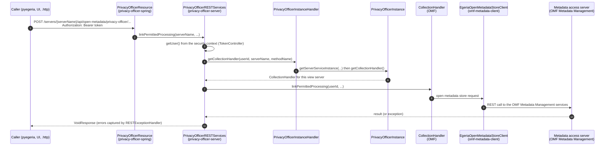

<!-- SPDX-License-Identifier: CC-BY-4.0 -->
<!-- Copyright Contributors to the Egeria project. -->

# Writing an Open Metadata View Service

An [Open Metadata View Service (OMVS)](/services/omvs) is a registered service that provides a task-oriented REST API for user interfaces, [pyegeria](/guides/developer/python-clients/overview), Dr.Egeria and other non-Java callers.  View services run in a [View Server](/concepts/view-server).  They hold no metadata of their own: each call is passed to a [Metadata Access Server](/concepts/metadata-access-server) through the Java clients and handlers of the [Open Metadata Framework (OMF)](/frameworks/omf/overview).

This guide walks through everything needed to add a new view service to Egeria, from registering its name to calling it from an IntelliJ HTTP client collection.

!!! info "The worked example: Privacy Officer"
    The examples on this page come from the [Privacy Officer OMVS :material-github:](https://github.com/odpi/egeria/tree/main/open-metadata-implementation/view-services/privacy-officer){ target=gh }.  It is one of the smallest view services that does real work: its eight REST calls link and detach the relationships that describe permitted data processing.  Its sibling, the [Data Officer OMVS :material-github:](https://github.com/odpi/egeria/tree/main/open-metadata-implementation/view-services/data-officer){ target=gh }, has the same classes with no REST calls yet, which makes it a convenient empty template to copy.

    To build a new service, copy one of these modules and replace `PrivacyOfficer`/`privacy-officer`/`privacyofficer` with your own service's name throughout.


## How a call flows through a view service

Every view service is built from the same small set of classes.  The diagram shows the path of a request from a caller to the metadata access server, and which module each class lives in.



The view server can host many view services, and the platform can host many view servers.  The instance handler is what connects a REST call for a particular `serverName` to the objects that were created for that server when it started.


## Step 1 - Register the service in ViewServiceDescription

Each view service has an entry in the `ViewServiceDescription` enum in the `org.odpi.openmetadata.adminservices.configuration.registration` package of the [admin-services-api :material-github:](https://github.com/odpi/egeria/tree/main/open-metadata-implementation/admin-services/admin-services-api){ target=gh } module.  This is the entry for Privacy Officer:

```java
    /**
     * Manage the governance of privacy.
     */
    PRIVACY_OFFICER (221,
                     ComponentDevelopmentStatus.STABLE,
                     "Privacy Officer",
                     "privacy-officer",
                     "Manage the governance of privacy."),
```

The constructor takes five values:

| Field | Getter | Meaning |
|---|---|---|
| `viewServiceCode` | `getViewServiceCode()` | A unique number for the service.  View services use the 200s; the highest in use at the time of writing is 243 (`GOVERNANCE_ENGINE`), so choose the next free number.  It is copied into the configuration as `viewServiceId` and is used as the audit log component identifier for the service. |
| `viewServiceDevelopmentStatus` | `getViewServiceDevelopmentStatus()` | A `ComponentDevelopmentStatus` value such as `IN_DEVELOPMENT` or `STABLE`.  A service marked `DEPRECATED` is left out when all view services are configured with a single call (see [step 7](#step-7-configure-the-service-in-a-view-server)). |
| `viewServiceName` | `getViewServiceName()` | The short display name, for example `Privacy Officer`.  `getViewServiceFullName()` adds `" API"` to it (`Privacy Officer API`), and the full name is what the instance and instance handler use as the service name. |
| `viewServiceURLMarker` | `getViewServiceURLMarker()` | The string that identifies the service in its REST URLs (`/servers/{serverName}/api/open-metadata/privacy-officer/...`) and in the admin calls that configure it.  Use lower case words separated by hyphens. |
| `viewServiceDescription` | `getViewServiceDescription()` | One sentence describing the service.  It is returned when the registered services are listed. |

Two further values are derived rather than stored, so they need no work in the enum, but they do need you to act:

* `getViewServiceWiki()` returns `https://egeria-project.org/services/omvs/<url-marker>/overview/`.  Create that page in the egeria-docs repository (under `site/docs/services/omvs/<url-marker>/overview.md`) and add it to the navigation, or the link carried in the registration, audit log and OpenAPI documentation will be broken.
* `getViewServicePartnerService()` returns the service name of `AccessServiceDescription.OMF_METADATA_MANAGEMENT` for every view service.  All view services call the OMF Metadata Management access service in the metadata access server.

!!! tip "Generic view server services"
    The services in [view-server-generic-services :material-github:](https://github.com/odpi/egeria/tree/main/open-metadata-implementation/view-server-generic-services){ target=gh }, such as Collection Manager, Asset Maker and Classification Explorer, also have `ViewServiceDescription` entries, but their URLs are mapped as `/servers/{serverName}/api/open-metadata/{urlMarker}`.  They accept the URL marker of any active view service, so as soon as your new service is configured, these generic APIs are also callable under your service's URL marker.  This means a new view service only needs to implement the calls that are specific to its domain.


## Step 2 - Create the modules

A view service has two modules under `open-metadata-implementation/view-services/<url-marker>`.  It has no `-api` or `-client` module because callers use its REST API directly.

```
privacy-officer/
    README.md
    Egeria-api-privacy-officer.http
    privacy-officer-server/
        build.gradle
        src/main/java/org/odpi/openmetadata/viewservices/privacyofficer/
            admin/PrivacyOfficerAdmin.java
            ffdc/PrivacyOfficerAuditCode.java
            server/PrivacyOfficerRegistration.java
            server/PrivacyOfficerInstance.java
            server/PrivacyOfficerInstanceHandler.java
            server/PrivacyOfficerRESTServices.java
        src/test/java/org/odpi/openmetadata/viewservices/privacyofficer/ffdc/AuditCodeTest.java
    privacy-officer-spring/
        build.gradle
        src/main/java/org/odpi/openmetadata/viewservices/privacyofficer/server/spring/PrivacyOfficerResource.java
```

Each package also has a `package-info.java` file describing it.

??? example "privacy-officer-server/build.gradle"
    ```groovy
    dependencies {
        implementation project(':open-metadata-implementation:user-security:token-controller')
        implementation project(':open-metadata-implementation:admin-services:admin-services-api')
        implementation project(':open-metadata-implementation:common-services:ffdc-services')
        implementation project(':open-metadata-implementation:common-services:multi-tenant')
        implementation project(':open-metadata-implementation:admin-services:admin-services-registration')
        implementation project(':open-metadata-implementation:frameworks:audit-log-framework')
        implementation project(':open-metadata-implementation:frameworks:open-metadata-framework')
        implementation project(':open-metadata-implementation:frameworks:open-connector-framework')
        implementation project(':open-metadata-implementation:access-services:omf-metadata-management:omf-metadata-api')
        implementation project(':open-metadata-implementation:access-services:omf-metadata-management:omf-metadata-client')
        compileOnly 'com.fasterxml.jackson.core:jackson-annotations'
        implementation 'org.slf4j:slf4j-api'
        testImplementation project(':open-metadata-test:open-metadata-ut')
        testImplementation 'org.testng:testng'
    }

    java {
        withJavadocJar()
    }

    test {
        useTestNG()
        scanForTestClasses = false
    }
    ```

    | Dependency | Why it is needed |
    |---|---|
    | `token-controller` | `TokenController`, the base class of the REST services class. |
    | `admin-services-api`, `admin-services-registration` | `ViewServiceDescription`, `ViewServiceConfig`, `ViewServiceRegistrationEntry`, `ViewServiceAdmin` and `OMAGViewServiceRegistration`. |
    | `ffdc-services` | `RESTCallLogger`, `RESTCallToken`, `RESTExceptionHandler` and the shared request and response beans such as `NewRelationshipRequestBody` and `VoidResponse`. |
    | `multi-tenant` | `OMVSServiceInstance` and `OMVSServiceInstanceHandler`. |
    | `audit-log-framework` | `AuditLog` and the message set interfaces. |
    | `open-metadata-framework` | The OMF handlers (`CollectionHandler`, `GovernanceDefinitionHandler`, ...), `OpenMetadataClient`, the properties beans and the OMF exceptions. |
    | `omf-metadata-client` | `EgeriaOpenMetadataStoreClient`, which calls the metadata access server. |
    | `open-metadata-ut` | `AuditLogMessageSetTest`, used by the audit code unit test. |

??? example "privacy-officer-spring/build.gradle"
    ```groovy
    dependencies {
        implementation project(':open-metadata-implementation:user-security:token-controller')
        implementation project(':open-metadata-implementation:view-services:privacy-officer:privacy-officer-server')
        implementation project(':open-metadata-implementation:common-services:ffdc-services')
        implementation project(':open-metadata-implementation:frameworks:open-metadata-framework')
        implementation 'org.springframework:spring-web'
        implementation 'io.swagger.core.v3:swagger-annotations-jakarta'
        compileOnly 'com.fasterxml.jackson.core:jackson-annotations'
    }

    java {
        withJavadocJar()
    }
    ```

### Places the new service must be listed

Creating the modules is not enough.  A new view service must be added to each of these places in the egeria repository:

| File | What to add |
|---|---|
| `settings.gradle` | An `include(...)` line for each module, for example `include(':open-metadata-implementation:view-services:privacy-officer:privacy-officer-server')` and the same for `privacy-officer-spring`. |
| `open-metadata-implementation/platform-chassis/platform-chassis-spring/build.gradle` | A `runtimeOnly project(':open-metadata-implementation:view-services:privacy-officer:privacy-officer-spring')` line inside the `if (!project.hasProperty("adminChassisOnly"))` block.  This puts the spring module on the platform's classpath; without it the platform never loads the service. |
| `open-metadata-distribution/omag-server-platform/build.gradle` | A `from(".../view-services/privacy-officer") { include 'Egeria*.http' }` entry in the `assembly/opt/http-client-collections` copy, so that the service's `.http` file is shipped with the platform assembly. |
| `open-metadata-implementation/view-services/README.md` | A bullet describing the service. |
| `open-metadata-resources/open-metadata-deployment/sample-configs/view-server/config/view-server.config` | The default `view-server` configuration document is pre-built and stored in the repository, and lists each view service explicitly.  Regenerate it by running `BuildDefaultConfigs.http` (in the same `sample-configs` directory) against a platform that includes your service, otherwise the new service is not active in the default view server. |
| `messages-and-codes/` | These pages are generated from the message sets.  Regenerate them with `./gradlew :open-metadata-resources:open-metadata-dev-utilities:messages-and-codes:generateMessageDocumentation` so that the new audit codes are documented. |

There is no list of view services to update in the admin services themselves: the configuration calls work from whatever services have registered with the platform (see [step 3](#the-registration-class)).

!!! tip "Functional verification tests"
    The [view-services-fvt :material-github:](https://github.com/odpi/egeria/tree/main/open-metadata-test/open-metadata-fvt/view-services-fvt){ target=gh } module starts a view server running every registered view service and calls their REST APIs through `ViewServiceClient`.  Add a test class for the new service there (for example `PrivacyOfficerFVT` creates its client with `new ViewServiceClient(ViewServiceDescription.PRIVACY_OFFICER)`).  The suite's `EndpointCoverage` class reports any request mapping that no test calls.


## Step 3 - Write the server module

### The admin class

The admin class extends `ViewServiceAdmin` (in `admin-services-registration`) and implements its two abstract methods.  When the view server starts, the server operations services create the admin class, then call `initialize()` with:

* `serverName` - the name of the view server.
* `viewServiceConfig` - the service's `ViewServiceConfig` from the server's configuration document.  As well as the values copied from the registration, it carries the name (`getOMAGServerName()`) and platform URL root (`getOMAGServerPlatformRootURL()`) of the metadata access server to call, the secrets store details (`getSecretsStoreProvider()`, `getSecretsStoreLocation()`, `getSecretsStoreCollection()`) used to authenticate that call, and an optional `getViewServiceOptions()` map.
* `auditLog` - an audit log for this service, created with the service's code, name, description and wiki URL.
* `serverUserName` - the view server's own user id.
* `maxPageSize` - the maximum number of elements returned on a single request (0 means unlimited).

`initialize()` creates the instance object, logging audit messages before and after.  `shutdown()` is called when the server stops, and shuts down the instance.

??? example "PrivacyOfficerAdmin.initialize() and shutdown()"
    ```java
    public class PrivacyOfficerAdmin extends ViewServiceAdmin
    {
        private AuditLog               auditLog   = null;
        private PrivacyOfficerInstance instance   = null;
        private String                 serverName = null;

        @Override
        public void initialize(String            serverName,
                               ViewServiceConfig viewServiceConfig,
                               AuditLog          auditLog,
                               String            serverUserName,
                               int               maxPageSize) throws OMAGConfigurationErrorException
        {
            final String actionDescription = "initialize";

            auditLog.logMessage(actionDescription, PrivacyOfficerAuditCode.SERVICE_INITIALIZING.getMessageDefinition());

            this.auditLog = auditLog;
            this.serverName = serverName;

            try
            {
                this.instance = new PrivacyOfficerInstance(serverName,
                                                           auditLog,
                                                           serverUserName,
                                                           viewServiceConfig.getSecretsStoreProvider(),
                                                           viewServiceConfig.getSecretsStoreLocation(),
                                                           viewServiceConfig.getSecretsStoreCollection(),
                                                           maxPageSize,
                                                           viewServiceConfig.getOMAGServerName(),
                                                           viewServiceConfig.getOMAGServerPlatformRootURL());

                auditLog.logMessage(actionDescription,
                                    PrivacyOfficerAuditCode.SERVICE_INITIALIZED.getMessageDefinition(),
                                    viewServiceConfig.toString());
            }
            catch (Exception error)
            {
                auditLog.logException(actionDescription,
                                      PrivacyOfficerAuditCode.SERVICE_INSTANCE_FAILURE.getMessageDefinition(error.getMessage()),
                                      viewServiceConfig.toString(),
                                      error);

                super.throwUnexpectedInitializationException(actionDescription,
                                                             ViewServiceDescription.PRIVACY_OFFICER.getViewServiceFullName(),
                                                             error);
            }
        }

        @Override
        public void shutdown()
        {
            final String actionDescription = "shutdown";

            auditLog.logMessage(actionDescription, PrivacyOfficerAuditCode.SERVICE_TERMINATING.getMessageDefinition(serverName));

            if (instance != null)
            {
                this.instance.shutdown();
            }

            auditLog.logMessage(actionDescription, PrivacyOfficerAuditCode.SERVICE_SHUTDOWN.getMessageDefinition(serverName));
        }
    }
    ```

`ViewServiceAdmin` also provides helpers for services that take options, such as `getSupportedTypesForSearchOption()`, `logBadConfiguration()` and `logBadConfigProperties()`.

### The registration class

The registration class tells the platform that the service's code is present.  It builds a `ViewServiceRegistrationEntry` from the enum value, a `ServiceOperationalStatus` and the name of the admin class, and passes it to `OMAGViewServiceRegistration.registerViewService()`:

```java
public class PrivacyOfficerRegistration
{
    public static void registerViewService()
    {
        ViewServiceDescription myDescription = ViewServiceDescription.PRIVACY_OFFICER;
        ViewServiceRegistrationEntry myRegistration = new ViewServiceRegistrationEntry(myDescription,
                                                                                       ServiceOperationalStatus.ENABLED,
                                                                                       PrivacyOfficerAdmin.class.getName());
        OMAGViewServiceRegistration.registerViewService(myRegistration);
    }
}
```

The `ViewServiceRegistrationEntry` constructor copies the code, development status, name, full name, URL marker, description, wiki URL and partner service out of the enum value.  Only services registered as `ENABLED` are started: when a view server starts, `OMAGServerOperationalServices.initializeViewServices()` starts a configured service only if it is enabled both in the configuration document and in the platform's registrations.  Registering a service as `DISABLED` is a way to ship its code without allowing it to run.

Nothing calls the registration class directly.  It is called from the instance handler's constructor, and the instance handler is created when Spring loads the resource class (see [step 4](#step-4-write-the-spring-module)).  This is why the spring module must be on the platform's classpath.

### The instance class

The instance class holds the objects that the service needs for one view server.  It extends `OMVSServiceInstance` (in `common-services/multi-tenant`), whose constructor registers the instance under the server and service name, and saves the remote server name and URL (returned by `getRemoteServerName()` and `getRemoteServerURL()`).  The constructor then creates the clients and handlers that the REST calls use.

??? example "PrivacyOfficerInstance"
    ```java
    public class PrivacyOfficerInstance extends OMVSServiceInstance
    {
        private static final ViewServiceDescription myDescription = ViewServiceDescription.PRIVACY_OFFICER;

        private final CollectionHandler           collectionHandler;
        private final GovernanceDefinitionHandler governanceDefinitionHandler;

        public PrivacyOfficerInstance(String   serverName,
                                      AuditLog auditLog,
                                      String   localServerUserId,
                                      String   localServerSecretsStoreProvider,
                                      String   localServerSecretsStoreLocation,
                                      String   localServerSecretsStoreCollection,
                                      int      maxPageSize,
                                      String   remoteServerName,
                                      String   remoteServerURL) throws InvalidParameterException
        {
            super(serverName,
                  myDescription.getViewServiceFullName(),
                  auditLog,
                  localServerUserId,
                  maxPageSize,
                  remoteServerName,
                  remoteServerURL);

            OpenMetadataClient openMetadataClient = new EgeriaOpenMetadataStoreClient(remoteServerName,
                                                                                      remoteServerURL,
                                                                                      localServerSecretsStoreProvider,
                                                                                      localServerSecretsStoreLocation,
                                                                                      localServerSecretsStoreCollection,
                                                                                      maxPageSize,
                                                                                      auditLog);

            collectionHandler = new CollectionHandler(serverName,
                                                      auditLog,
                                                      myDescription.getViewServiceFullName(),
                                                      openMetadataClient);

            governanceDefinitionHandler = new GovernanceDefinitionHandler(serverName,
                                                                          auditLog,
                                                                          myDescription.getViewServiceFullName(),
                                                                          openMetadataClient);
        }

        public CollectionHandler getCollectionHandler()
        {
            return collectionHandler;
        }

        public GovernanceDefinitionHandler getGovernanceDefinitionHandler()
        {
            return governanceDefinitionHandler;
        }
    }
    ```

See [step 5](#step-5-calling-the-metadata-access-server) for more on choosing the handlers.

### The instance handler

The instance handler extends `OMVSServiceInstanceHandler`.  Its constructor passes the service's full name to the superclass and calls the registration class.  It then has one method for each object that the REST services need.  Each method uses `getServerServiceInstance()` to look up the instance for the requested server; this call also checks that the server is running this service and asks the server's security verifier whether the user may call the service and operation, throwing `InvalidParameterException`, `UserNotAuthorizedException` or `PropertyServerException` if not.

```java
public class PrivacyOfficerInstanceHandler extends OMVSServiceInstanceHandler
{
    public PrivacyOfficerInstanceHandler()
    {
        super(ViewServiceDescription.PRIVACY_OFFICER.getViewServiceFullName());

        PrivacyOfficerRegistration.registerViewService();
    }

    public CollectionHandler getCollectionHandler(String userId,
                                                  String serverName,
                                                  String serviceOperationName) throws InvalidParameterException,
                                                                                      PropertyServerException,
                                                                                      UserNotAuthorizedException
    {
        PrivacyOfficerInstance instance = (PrivacyOfficerInstance) getServerServiceInstance(userId, serverName, serviceOperationName);

        if (instance != null)
        {
            return instance.getCollectionHandler();
        }

        return null;
    }
}
```

The superclass also provides `getAuditLog(userId, serverName, methodName)`, which the REST services use to log exceptions, and `getServiceName()`.

### The REST services class

The REST services class implements the REST API.  It extends `TokenController` (in `user-security/token-controller`) and creates one shared instance handler, exception handler and call logger:

```java
public class PrivacyOfficerRESTServices extends TokenController
{
    private static final PrivacyOfficerInstanceHandler instanceHandler = new PrivacyOfficerInstanceHandler();

    private static final RESTExceptionHandler restExceptionHandler = new RESTExceptionHandler();

    private static final RESTCallLogger restCallLogger = new RESTCallLogger(LoggerFactory.getLogger(PrivacyOfficerRESTServices.class),
                                                                            instanceHandler.getServiceName());
```

Every method follows the same pattern:

1. `restCallLogger.logRESTCall()` logs the start of the call and returns a `RESTCallToken`.
2. `getUser(serviceName, methodName)` returns the caller's user id.  The platform's security filters have already validated the bearer token on the request, so `TokenController` simply reads the name from Spring's `SecurityContextHolder`.  It throws `UserNotAuthorizedException` if there is no user.  The user id is passed to `restCallLogger.setUserId()`.
3. The audit log and handler are retrieved from the instance handler.
4. The request body is checked.  Request bodies carry a polymorphic `properties` object, so the method tests it is the expected class and calls `restExceptionHandler.handleInvalidPropertiesObject()` if it is not.
5. The handler is called.
6. Any exception is caught as a `Throwable` and passed to `restExceptionHandler.captureRuntimeExceptions()`, which stores the exception details (HTTP code, message id, message and so on) in the response.  REST calls to Egeria return the error inside the response body, so callers check the `relatedHTTPCode` in the response.
7. `restCallLogger.logRESTCallReturn()` logs the end of the call and the response is returned.

??? example "PrivacyOfficerRESTServices.linkPermittedProcessing()"
    ```java
    public VoidResponse linkPermittedProcessing(String                     serverName,
                                                String                     dataProcessingPurposeGUID,
                                                String                     dataProcessingDescriptionGUID,
                                                NewRelationshipRequestBody requestBody)
    {
        final String methodName = "linkPermittedProcessing";

        RESTCallToken token = restCallLogger.logRESTCall(serverName, methodName, requestBody);

        VoidResponse response = new VoidResponse();
        AuditLog     auditLog = null;

        try
        {
            String userId = super.getUser(instanceHandler.getServiceName(), methodName);

            restCallLogger.setUserId(token, userId);

            auditLog = instanceHandler.getAuditLog(userId, serverName, methodName);
            CollectionHandler handler = instanceHandler.getCollectionHandler(userId, serverName, methodName);

            if (requestBody != null)
            {
                if (requestBody.getProperties() instanceof PermittedProcessingProperties properties)
                {
                    handler.linkPermittedProcessing(userId,
                                                    dataProcessingPurposeGUID,
                                                    dataProcessingDescriptionGUID,
                                                    requestBody,
                                                    properties);
                }
                else if (requestBody.getProperties() == null)
                {
                    handler.linkPermittedProcessing(userId,
                                                    dataProcessingPurposeGUID,
                                                    dataProcessingDescriptionGUID,
                                                    requestBody,
                                                    null);
                }
                else
                {
                    restExceptionHandler.handleInvalidPropertiesObject(PermittedProcessingProperties.class.getName(), methodName);
                }
            }
            else
            {
                handler.linkPermittedProcessing(userId,
                                                dataProcessingPurposeGUID,
                                                dataProcessingDescriptionGUID,
                                                null,
                                                null);
            }
        }
        catch (Throwable error)
        {
            restExceptionHandler.captureRuntimeExceptions(response, error, methodName, auditLog);
        }

        restCallLogger.logRESTCallReturn(token, response);
        return response;
    }
    ```

    `NewRelationshipRequestBody` extends `MakeAnchorOptions`, so the request body itself is passed to the handler as the options for the call.

### Audit codes and error codes

Each view service has an audit code enum in its `ffdc` package that implements `AuditLogMessageSet`.  The message identifiers start with `OMVS-` followed by the URL marker in upper case.  Privacy Officer has five messages, which is the standard set used by the admin class:

| Constant | Message id | Severity |
|---|---|---|
| `SERVICE_INITIALIZING` | `OMVS-PRIVACY-OFFICER-0001` | `STARTUP` |
| `SERVICE_INITIALIZED` | `OMVS-PRIVACY-OFFICER-0002` | `STARTUP` |
| `SERVICE_SHUTDOWN` | `OMVS-PRIVACY-OFFICER-0003` | `SHUTDOWN` |
| `SERVICE_INSTANCE_FAILURE` | `OMVS-PRIVACY-OFFICER-0004` | `EXCEPTION` |
| `SERVICE_TERMINATING` | `OMVS-PRIVACY-OFFICER-0005` | `SHUTDOWN` |

```java
public enum PrivacyOfficerAuditCode implements AuditLogMessageSet
{
    SERVICE_INITIALIZING("OMVS-PRIVACY-OFFICER-0001",
                         AuditLogRecordSeverityLevel.STARTUP,
                         "The Privacy Officer Open Metadata View Service (OMVS) is initializing",
                         "The local server is initializing the Privacy Officer Open Metadata View Service. ...",
                         "No action is required. This is part of the normal operation of the Privacy Officer Open Metadata View Service.",
                         "https://egeria-project.org/services/omvs/privacy-officer/overview/"),
    ...
```

Each entry supplies the message id, severity, message text (with `{0}` style inserts), system action, user action and a further-reading link.  The audit log component id for these messages is the `viewServiceCode` from the `ViewServiceDescription` entry, because the server operations services create the service's audit log with `viewServiceConfig.getViewServiceId()`.

The `AuditCodeTest` unit test extends `AuditLogMessageSetTest` and calls `testSingleAuditCodeValue(errorCode, "OMVS-PRIVACY-OFFICER")` for each value, checking that the ids are unique, have the right prefix and can be serialized.

Most view services do not need their own error codes: the exceptions they report come from the OMF handlers and the metadata access server.  If a service does need one, add an enum that implements `ExceptionMessageSet` to the `ffdc` package, with an HTTP error code on each message.  `MyProfileErrorCode` in the [My Profile OMVS :material-github:](https://github.com/odpi/egeria/tree/main/open-metadata-implementation/view-services/my-profile){ target=gh } is an example (`OMVS-MY-PROFILE-400-001` and so on), with a matching `ErrorCodeTest`.


## Step 4 - Write the spring module

The spring module contains one resource class that maps each REST endpoint to a method of the REST services class.  It contains no logic of its own.

```java
@RestController
@RequestMapping("/servers/{serverName}/api/open-metadata/privacy-officer")

@Tag(name="API: Privacy Officer", description="Supports a Privacy Officer as they lead the data privacy governance program.  This builds on the capabilities of the Governance Officer API.",
        externalDocs=@ExternalDocumentation(description="Further Information",
                url="https://egeria-project.org/services/omvs/privacy-officer/overview/"))

public class PrivacyOfficerResource
{
    private final PrivacyOfficerRESTServices restAPI = new PrivacyOfficerRESTServices();

    @PostMapping(path = "/data-processing-purposes/{dataProcessingPurposeGUID}/permitted-processing/{dataProcessingDescriptionGUID}/attach")
    @SecurityRequirement(name = "BearerAuthorization")

    @Operation(summary="linkPermittedProcessing",
            description="Link a data processing purpose to a data processing description.",
            externalDocs=@ExternalDocumentation(description="Further Information",
                    url="https://egeria-project.org/concepts/"))

    public VoidResponse linkPermittedProcessing(@PathVariable String                     serverName,
                                                @PathVariable String                     dataProcessingPurposeGUID,
                                                @PathVariable String                     dataProcessingDescriptionGUID,
                                                @RequestBody (required = false)
                                                              NewRelationshipRequestBody requestBody)
    {
        return restAPI.linkPermittedProcessing(serverName, dataProcessingPurposeGUID, dataProcessingDescriptionGUID, requestBody);
    }
```

* `@RestController` and `@RequestMapping` come from Spring Web.  The mapping is always `/servers/{serverName}/api/open-metadata/` followed by the URL marker from the `ViewServiceDescription` entry.  The platform finds the class because it scans the `org.odpi.openmetadata.*` packages at start up.
* `@Tag`, `@Operation` and `@ExternalDocumentation` come from the Swagger annotations and describe the API in the platform's OpenAPI documentation.  By convention the tag name is `API: ` followed by the service name.
* `@SecurityRequirement(name = "BearerAuthorization")` on each operation records in the OpenAPI documentation that the call needs a bearer token.
* Egeria's view services use `POST` for most calls, including queries, so that search criteria and options can be passed in a request body.  The URL ends in a verb such as `/attach`, `/detach`, `/update`, `/delete` or `/by-search-string`.  Request bodies are usually marked `required = false`.
* The request and response beans are shared rather than defined per service.  They come from `org.odpi.openmetadata.commonservices.ffdc.rest` (for example `NewRelationshipRequestBody`, `DeleteRelationshipRequestBody`, `VoidResponse`) and the properties beans from `org.odpi.openmetadata.frameworks.openmetadata.properties` (for example `PermittedProcessingProperties`).  Reuse them so that pyegeria and Dr.Egeria can handle the new service in the same way as the others.


## Step 5 - Calling the metadata access server

A view service always calls the metadata access server named in its configuration.  The admin class passes `viewServiceConfig.getOMAGServerName()` and `viewServiceConfig.getOMAGServerPlatformRootURL()` to the instance, along with the secrets store details that hold the credentials the view server uses to authenticate that call.

The instance creates one `EgeriaOpenMetadataStoreClient` (from `omf-metadata-client`), which implements the OMF `OpenMetadataClient` interface by calling the OMF Metadata Management access service in the metadata access server.  It then wraps the client in the OMF handlers that match the service's domain.  The handlers are in the `org.odpi.openmetadata.frameworks.openmetadata.handlers` package; Privacy Officer uses `CollectionHandler` and `GovernanceDefinitionHandler`, and other view services use handlers such as `AssetHandler`, `ActorRoleHandler` or `SolutionComponentHandler`.  Each handler takes the server name, audit log, service name and `OpenMetadataClient`.

The handlers convert between the typed properties beans and the generic open metadata elements, so a view service rarely needs to call `OpenMetadataClient` directly.  If the domain needs a capability that no handler provides, add it to an OMF handler rather than to the view service, so that other services and the Java clients can reuse it.

The user id passed on each handler method is the caller's id from `getUser()`.  The metadata access server's security connector can therefore make access decisions based on the end user, even though the call is made by the view server.


## Step 6 - Write the README and HTTP client collection

Each view service has a `README.md` describing its purpose, and an `Egeria-api-<url-marker>.http` file with an example of every call.  The `.http` file is shipped with the platform (see [the table of places to list the service](#places-the-new-service-must-be-listed)) and is often the most useful documentation of the API.  It starts with the token request and then has one request per operation, in the IntelliJ HTTP client format:

??? example "Egeria-api-privacy-officer.http (first request)"
    ```http
    # Egeria-privacy-officer-api

    @baseURL=https://localhost:7443
    @viewServer=view-server

    ###
    # =====================================================================================================================
    # Manage the authentication token.  Run this request to create/refresh the token.

    # @name Token (RequestBody)
    POST {{baseURL}}/api/token
    Content-Type: application/json

    {
      "userId" : "peterprofile",
      "password" : "secret"
    }

    > 


    ###
    # =====================================================================================================================
    # Work with Permitted Processing
    # https://egeria-project.org/concepts/data-processing-purpose

    @dataProcessingPurposeGUID=add guid here
    @dataProcessingDescriptionGUID=add guid here

    ###
    # @name linkPermittedProcessing
    # Link a data processing purpose to a data processing description.
    POST {{baseURL}}/servers/{{viewServer}}/api/open-metadata/privacy-officer/data-processing-purposes/{{dataProcessingPurposeGUID}}/permitted-processing/{{dataProcessingDescriptionGUID}}/attach
    Authorization: Bearer {{token}}
    Content-Type: application/json

    {
      "class" : "NewRelationshipRequestBody",
      "properties": {
        "class": "PermittedProcessingProperties",
        "label" : "",
        "description" : "",
        "effectiveFrom": "{{$isoTimestamp}}",
        "effectiveTo": "{{$isoTimestamp}}"
      },
      "externalSourceGUID": "add guid here",
      "externalSourceName": "add qualified name here",
      "effectiveTime" : "{{$isoTimestamp}}",
      "forLineage" : false,
      "forDuplicateProcessing" : false
    }
    ```

The `class` properties tell Jackson which subclass of the request and properties beans to create.  See [Using Egeria's REST APIs](/guides/developer/rest-apis) for more about the token and the request formats.


## Step 7 - Configure the service in a view server

Once the platform has been rebuilt with the new modules, check that the service is registered:

```http
###
# @name Get registered view services
GET {{baseURL}}/open-metadata/platform-services/server-platform/registered-services/view-services
Authorization: Bearer {{token}}
```

A view service is configured in the `viewServicesConfig` section of the view server's [configuration document](/concepts/configuration-document) as a `ViewServiceConfig` entry.  The admin services in `ConfigViewServicesResource` provide two ways to add it.  Both take a `ViewServiceRequestBody` naming the metadata access server that the service is to call:

```http
###
# @name configureViewService
# Configure a single view service by its URL marker.
POST {{baseURL}}/open-metadata/admin-services/servers/{{viewServer}}/view-services/privacy-officer
Authorization: Bearer {{token}}
Content-Type: application/json

{
  "class": "ViewServiceRequestBody",
  "omagserverName": "active-metadata-store",
  "omagserverPlatformRootURL": "https://localhost:9443",
  "secretsStoreProvider" : "add secrets store provider class name here",
  "secretsStoreLocation"  : "add secrets store location here",
  "secretsStoreCollection" : "add secrets store collection here"
}

###
# @name configureAllViewServices
# Configure every registered view service that is not deprecated.
POST {{baseURL}}/open-metadata/admin-services/servers/{{viewServer}}/view-services
Authorization: Bearer {{token}}
Content-Type: application/json

{
  "class": "ViewServiceRequestBody",
  "omagserverName": "active-metadata-store",
  "omagserverPlatformRootURL": "https://localhost:9443",
  "secretsStoreProvider" : "add secrets store provider class name here",
  "secretsStoreLocation"  : "add secrets store location here",
  "secretsStoreCollection" : "add secrets store collection here"
}
```

`configureAllViewServices` builds its list from the platform's registrations, skipping any service whose development status is `DEPRECATED`, so a new service is picked up automatically the next time a view server's configuration is rebuilt.  `ViewServiceRequestBody` can also carry a `viewServiceOptions` map for services that read options in their admin class.  The [BuildDefaultConfigs.http :material-github:](https://github.com/odpi/egeria/tree/main/open-metadata-resources/open-metadata-deployment/sample-configs){ target=gh } script shows the full configuration of the default view server.

Then restart the view server so that the new configuration is used:

```http
###
# @name Start server
POST {{baseURL}}/open-metadata/platform-services/server-platform/servers/{{viewServer}}/instance
Authorization: Bearer {{token}}
```

The view server's audit log shows the service's `OMVS-...-0001` and `OMVS-...-0002` messages as it starts, and the server operations message listing the URL markers of all active view services.  The service is then callable at `{{baseURL}}/servers/{{viewServer}}/api/open-metadata/<url-marker>/...`.

See [Configuring a View Server](/guides/admin/servers/by-server-type/configuring-a-view-server) for the rest of the view server's configuration.

!!! info "Python and Dr.Egeria support is a separate step"
    The view service is now usable through its REST API.  Support in [pyegeria](/guides/developer/python-clients/overview), and therefore in Dr.Egeria and the pyegeria command line tools, is added separately in the [egeria-python :material-github:](https://github.com/odpi/egeria-python){ target=gh } repository, by writing a client class that calls the new URLs.


--8<-- "snippets/abbr.md"
