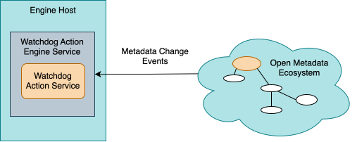

<!-- SPDX-License-Identifier: CC-BY-4.0 -->
<!-- Copyright Contributors to the Egeria project. -->

# Writing a Watchdog Action Service

A [watchdog action service](/concepts/watchdog-action-service) monitors the open metadata ecosystem for a specific situation or event and, when it occurs, notifies the people, teams or processes that need to know.



It is implemented as a specialized [Open Connector Framework (OCF)](/frameworks/ocf/overview) connector, so it has two parts: a *connector provider* that describes and creates it, and the *connector implementation* that does the work.

!!! attention "Watchdogs are long-running"
    This is the difference that shapes everything else on this page.  A [governance action service](/guides/developer/governance-action-services/overview) is atomic - it starts, does its work and completes.  A watchdog action service is expected to keep running for as long as the situation needs watching, which may be indefinitely.

    That is why watchdog action services were moved out of the [Open Governance Framework (OGF)](/frameworks/ogf/overview) - where they were one of five kinds of governance action service - into their own [Open Watchdog Framework (OWF)](/frameworks/owf/overview), with their own base classes and their own [engine service](/services/omes/watchdog-action/overview).  If you are converting a `WatchdogGovernanceActionService`, that class no longer exists; see [migrating a watchdog governance action service](#migrating-a-watchdog-governance-action-service).

??? education "What the framework gives you"
    The [Open Watchdog Framework (OWF)](/frameworks/owf/overview) describes the two ways of watching, the notification type model, and the standard request parameters, action targets and guards.  This page covers how to build one.

## Dependencies

* [Open Connector Framework (OCF)](/frameworks/ocf/overview) - basic connector interfaces.
* [Open Watchdog Framework (OWF)](/frameworks/owf/overview) - the watchdog action service base classes and the watchdog context.
* [Open Governance Framework (OGF)](/frameworks/ogf/overview) - the connector provider base class, the listener interface, guards and action targets.
* [Open Metadata Framework (OMF)](/frameworks/omf/overview) - the open metadata clients, event types, properties and completion status.
* [Audit Log Framework (ALF)](/frameworks/alf/overview) - for audit logging and exceptions.

=== "Gradle dependencies"
    ```groovy
    dependencies {
        compileOnly 'org.odpi.egeria:audit-log-framework'
        compileOnly 'org.odpi.egeria:open-connector-framework'
        compileOnly 'org.odpi.egeria:open-metadata-framework'
        compileOnly 'org.odpi.egeria:open-governance-framework'
        compileOnly 'org.odpi.egeria:open-watchdog-framework'
    }
    ```
=== "Maven dependencies"
    ```xml
        <dependencies>

            <dependency>
                <groupId>org.odpi.egeria</groupId>
                <artifactId>audit-log-framework</artifactId>
                <scope>provided</scope>
            </dependency>

            <dependency>
                <groupId>org.odpi.egeria</groupId>
                <artifactId>open-connector-framework</artifactId>
                <scope>provided</scope>
            </dependency>

            <dependency>
                <groupId>org.odpi.egeria</groupId>
                <artifactId>open-metadata-framework</artifactId>
                <scope>provided</scope>
            </dependency>

            <dependency>
                <groupId>org.odpi.egeria</groupId>
                <artifactId>open-governance-framework</artifactId>
                <scope>provided</scope>
            </dependency>

            <dependency>
                <groupId>org.odpi.egeria</groupId>
                <artifactId>open-watchdog-framework</artifactId>
                <scope>provided</scope>
            </dependency>

        </dependencies>
    ```

!!! tip "Use provided scope"
    The `<scope>provided</scope>` setting (`compileOnly` in Gradle) keeps the Egeria libraries out of your connector's jar file so it can run with any level of Egeria that supports this type of connector.

## Choosing what to watch

The [OWF](/frameworks/owf/overview) supports two patterns, and the choice determines most of your implementation.

=== "Watching an instance or a type"

    Point the service at a single metadata instance, or at every instance of an open metadata type, and react to the events it receives.  This is the simpler pattern, and is what the old *watchdog governance action service* did.

    The service registers a listener in `start()` and does its work in `processEvent()`.

=== "Watching through a notification type"

    Service a [*NotificationType*](/types/4/0451-Notifications) - a governance definition that formally describes the resources to monitor, the subscribers to tell, and how often to tell them.

    The service is passed its notification types as action targets, and uses the [watchdog context](#the-watchdog-context) to find the monitored resources and to notify the subscribers when the situation occurs.

    This pattern is more stateful: the notification type persists in open metadata, and subscribers can be added or removed by people or by other governance processes while the service is running.

## Writing the connector provider

Each connector provider extends [`WatchdogActionServiceProvider` :material-github:](https://github.com/odpi/egeria/blob/main/open-metadata-implementation/frameworks/open-watchdog-framework/src/main/java/org/odpi/openmetadata/frameworks/openwatchdog/WatchdogActionServiceProvider.java){ target=gh }, which in turn extends `GovernanceServiceProviderBase`.

The descriptive information - connector type GUID, qualified name, display name, description, wiki page, audit log component identifier and development status - comes from an implementation of the [`OpenConnectorDefinition` :material-github:](https://github.com/odpi/egeria/blob/main/open-metadata-implementation/frameworks/open-connector-framework/src/main/java/org/odpi/openmetadata/frameworks/connectors/OpenConnectorDefinition.java){ target=gh } interface.  Egeria's own connectors use the `EgeriaOpenConnectorDefinition` enum for this.

The constructor then declares the service's specification: `supportedRequestTypes`, `supportedRequestParameters`, `supportedActionTargetTypes`, `producedActionTargetTypes` and `producedGuards`.  The `WatchdogActionServiceProvider` constructor already sets `supportedRequestParameters` (from `WatchdogRequestParameter`), `producedGuards` (from `WatchdogActionGuard.getSimpleWatchdogGuardTypes()`) and `producedActionTargetTypes` (from `WatchdogActionTarget`) to the OWF standard values, so you only override the ones your service changes.

The examples in this guide are for an illustrative service, `ChangeWatchdogService`, that watches for every change to open metadata:

```java
public class ChangeWatchdogServiceProvider extends WatchdogActionServiceProvider
{
    public ChangeWatchdogServiceProvider()
    {
        super(MyOpenConnectorDefinition.CHANGE_WATCHDOG_SERVICE,
              ChangeWatchdogService.class.getName(),
              null);

        super.supportedRequestTypes = null;
        super.supportedRequestParameters = null;
        super.supportedActionTargetTypes = null;
        super.producedGuards = WatchdogActionGuard.getSimpleWatchdogGuardTypes();
    }
}
```

The OWF defines two standard action targets in [`WatchdogActionTarget` :material-github:](https://github.com/odpi/egeria/blob/main/open-metadata-implementation/frameworks/open-watchdog-framework/src/main/java/org/odpi/openmetadata/frameworks/openwatchdog/controls/WatchdogActionTarget.java){ target=gh } - `notificationType` and `instanceToMonitor` - matching the two patterns above.  `WatchdogActionTarget.getInstanceActionTargetTypes()` returns just the `instanceToMonitor` definition, for a provider's `supportedActionTargetTypes`.  The request parameters for instance/type watching are in `WatchdogRequestParameter` - `interestingTypeName`, `instanceToMonitor`, the action target name overrides, and one `...ProcessName` parameter per kind of event naming the governance action process to run when it occurs.

!!! warning "Match the provider to the connector"
    A `WatchdogActionServiceProvider` must name a connector class that extends `WatchdogActionServiceConnector`.  The [Watchdog Action OMES](/services/omes/watchdog-action/overview) casts the connector it creates to that class, so pairing a watchdog provider with, say, a `GeneralGovernanceActionService` fails at run time rather than at compile time.

## Writing the watchdog action service connector

The service extends [`WatchdogActionServiceConnector` :material-github:](https://github.com/odpi/egeria/blob/main/open-metadata-implementation/frameworks/open-watchdog-framework/src/main/java/org/odpi/openmetadata/frameworks/openwatchdog/WatchdogActionServiceConnector.java){ target=gh }.  The base class sets up:

* `watchdogContext` - the [watchdog context](#the-watchdog-context).
* `watchdogActionServiceName` - the qualified name of the service, for audit log messages and exceptions.
* `auditLog` - the audit logging destination.
* `connector` - a slot for a [digital resource connector](/concepts/digital-resource-connector); the base class disconnects it for you.
* `embeddedConnectors` - connectors created from connections nested in the service's connection.
* `propertyHelper` - utility for reading values out of open metadata elements.

There are three methods:

* `start()` - register interest in the events the service cares about, and set up any state it needs.  Call `super.start()` first; it checks that the watchdog context has been supplied.  Unlike a governance action service, `start()` returns quickly and the real work happens in `processEvent()`.
* `processEvent(event)` - **abstract, so you must implement it**.  Called once for each matching event, for as long as the service is registered.
* `disconnect()` - free up any resources.  The base class disconnects the resource connector, unregisters the listener and disconnects the watchdog context for you, so call `super.disconnect()`.

### Registering a listener

`registerListener()` takes the listener plus up to three filters, each of which may be null to mean "any":

```java
        watchdogContext.registerListener(listener,
                                         interestingEventTypes,     // List<OpenMetadataEventType>
                                         interestingMetadataTypes,  // List<String> - open metadata type names
                                         specificInstance);         // GUID of one element or relationship
```

The event types are values of `OpenMetadataEventType` - `NEW_ELEMENT_CREATED`, `ELEMENT_UPDATED`, `ELEMENT_DELETED`, `ELEMENT_CLASSIFIED`, `ELEMENT_RECLASSIFIED`, `ELEMENT_DECLASSIFIED`, `ELEMENT_RESTORED` and others.  The metadata types refer to the subject of the event: the type of the element for element events, the type of the relationship for related-element events, and the name of the classification for classification events.

Only one set of filters is active at a time, but a service can call `registerListener()` again while it is running to change what it is watching for - for example, after it finishes with one notification type and moves on to the next.  `disconnectListener()` stops events being delivered.  The registration is keyed by the running instance of the service (its engine action), so two engine actions running the same watchdog service - watching two different folders, say - each keep their own listener.

The OWF supplies [`GenericWatchdogActionListener` :material-github:](https://github.com/odpi/egeria/blob/main/open-metadata-implementation/frameworks/open-watchdog-framework/src/main/java/org/odpi/openmetadata/frameworks/openwatchdog/GenericWatchdogActionListener.java){ target=gh }, which simply forwards every event to your connector's `processEvent()` method, so most services do not need a listener class of their own:

```java
public class ChangeWatchdogService extends WatchdogActionServiceConnector
{
    private final GenericWatchdogActionListener listener = new GenericWatchdogActionListener(this);

    @Override
    public void start() throws ConnectorCheckedException, UserNotAuthorizedException
    {
        super.start();

        final String methodName = "start";

        try
        {
            watchdogContext.registerListener(listener, null, null, null);
        }
        catch (Exception error)
        {
            /*
             * The service cannot do its job, so report the failure and complete.
             */
            AuditLogMessageDefinition completionMessage =
                    MyAuditCode.UNEXPECTED_EXCEPTION.getMessageDefinition(watchdogActionServiceName,
                                                                          error.getClass().getName(),
                                                                          methodName,
                                                                          error.getMessage());

            auditLog.logException(methodName, completionMessage, error);

            watchdogContext.recordCompletionStatus(WatchdogActionGuard.MONITORING_FAILED.getCompletionStatus(),
                                                   List.of(WatchdogActionGuard.MONITORING_FAILED.getName()),
                                                   null,
                                                   null,
                                                   completionMessage);
            :
        }
    }


    @Override
    public void processEvent(OpenMetadataOutTopicEvent event)
    {
        if ((event != null) && (event.getElementHeader() != null))
        {
            if (event.getEventType() != OpenMetadataEventType.REFRESH_ELEMENT_EVENT)
            {
                :
            }
        }
    }
}
```

!!! tip "Filter out refresh events"
    `REFRESH_ELEMENT_EVENT` means an element has been distributed around the cohort, not that anything about it has changed.  Most watchdogs should ignore it, as this example does.

### Keeping processEvent cheap

`processEvent()` is called on the event delivery thread, once per matching event, potentially at high volume.  Keep it fast: filter early, cache lookups that do not change, and hand anything expensive over to a [governance action process](/concepts/governance-action-process) with `watchdogContext.initiateGovernanceActionProcess()` rather than doing it inline.  This is how Egeria's generic watchdogs work: each kind of event is mapped to the qualified name of a process to run.

An event that cannot be processed should be reported by throwing `GovernanceServiceException`.  It is logged, and the listener keeps being called - a single bad event does not take the watchdog down.

## The watchdog context

`WatchdogContext` extends `ConnectorContextBase` - the same base class used by the [integration context](/guides/developer/integration-connectors/integration-context), the [survey context](/guides/developer/survey-action-services/overview#survey-context) and the [governance action context](/guides/developer/governance-action-services/overview#the-governance-action-context).  So a watchdog action service has the full set of open metadata clients available to it, plus the ability to raise [To Dos](/concepts/to-do), [incident reports](/concepts/incident-report) and context events.

On top of that it adds:

### Understanding the request

`getRequestType()`, `getRequestParameters()`, `getIntRequestParameter(name, default)`, `getActionTargetElements()`, `getRequesterUserId()`, `getEngineActionGUID()` and `getWatchdogActionServiceName()`.

### Handing work on

`initiateGovernanceActionProcess()` starts a [governance action process](/concepts/governance-action-process), passing request parameters and action targets - typically the element the event was about.

### Watching an instance or type

`registerListener()` and `disconnectListener()`, described [above](#registering-a-listener).

### Servicing notification types

| Method | Purpose |
|---|---|
| `getNotificationTypesFromActionTargets()` | Extract the notification types passed in as action targets, ignoring any that are not in an active state. |
| `getNotificationType()` / `updateNotificationType()` | Retrieve or update the details of a specific notification type. |
| `getMonitoredResources()` | Retrieve the resources linked to a notification type via *MonitoredResource*. |
| `getNotificationSubscribers()` | Retrieve the actors currently linked to a notification type via *NotificationSubscriber*. |
| `getNotificationProperties(messageDefinition, notificationTypeGUID, notificationCount)` | Build the properties of a *Notification* from a message definition - the display name, situation and expected behaviour come from the message. |
| `notifySubscribers(notificationTypeGUID, initialClassifications, firstNotificationProperties, subsequentNotificationProperties, lastNotificationProperties, requestParameters, actionTargets)` | Create a *Notification* for each subscriber that is eligible to receive one. |

`notifySubscribers()` does the bookkeeping for you.  It considers each subscriber in turn, decides from the notification type's `multipleNotificationsPermitted`, `minimumNotificationInterval` and `nextScheduledNotification` properties whether that subscriber is due a notification, and picks the first, subsequent or last set of notification properties depending on where that subscriber is in its subscription.  The notification type itself is updated whenever it is eligible to deliver notifications, even if it has no subscribers.

A service using this pattern typically also watches the *ActionTarget* relationship, so that a new notification type can be added to a running instance without restarting it.

!!! info "Subscription management for digital products"
    Welcoming, periodic, one-time and dismissal notifications for [digital product](/concepts/digital-product) subscriptions are not sent by a watchdog action service.  They are handled by the Baudot Subscription Manager, a dynamic [integration connector](/concepts/integration-connector) that sends them on each refresh - see [watching through a notification type](/frameworks/owf/overview#watching-through-a-notification-type) in the OWF description.

## Completing - or not

This is where a watchdog action service differs most from the other governance services.  It runs as an [engine action](/concepts/engine-action), and that engine action stays active for as long as the service is watching.  **Do not record a completion status just because `start()` has returned.**

Record a completion status only when:

* the service has failed and cannot continue,
* it was asked to watch for a single occurrence and that has now happened, or
* it is deliberately being stopped.

```java
        watchdogContext.recordCompletionStatus(WatchdogActionGuard.MONITORING_COMPLETED.getCompletionStatus(),
                                               List.of(WatchdogActionGuard.MONITORING_COMPLETED.getName()),
                                               null,
                                               null,
                                               completionMessage);
```

The completion message may be an `AuditLogMessageDefinition` (which is formatted for you) or a plain `String`.  Any request parameters you pass are merged over the ones the service was started with before they are handed to whatever runs next.

If the engine host is restarted while a watchdog action service is still watching, its engine action is still incomplete, so the service is restarted too rather than being left behind.

The standard guards are defined in [`WatchdogActionGuard` :material-github:](https://github.com/odpi/egeria/blob/main/open-metadata-implementation/frameworks/open-watchdog-framework/src/main/java/org/odpi/openmetadata/frameworks/openwatchdog/controls/WatchdogActionGuard.java){ target=gh }, each carrying the completion status that goes with it:

| Guard | Completion status | Meaning |
|---|---|---|
| `monitoring-completed` | ACTIONED | The monitoring completed successfully. |
| `monitoring-invalid` | INVALID | The watchdog did not run because the supplied information (such as the notification type) is invalid for this type of watchdog. |
| `monitoring-failed` | FAILED | An unexpected error occurred during monitoring; the notification process is incomplete. |

## Migrating a watchdog governance action service

The `WatchdogGovernanceActionService` base class has been removed.  To convert an existing service:

1. Change the superclass from `WatchdogGovernanceActionService` to `WatchdogActionServiceConnector`, and the provider's superclass from `GovernanceActionServiceProviderBase` to `WatchdogActionServiceProvider`.
2. Replace `governanceContext` with `watchdogContext`, and `governanceServiceName` with `watchdogActionServiceName`.
3. Move the event handling into the connector's own `processEvent()` method - it is now abstract on the base class - and use `GenericWatchdogActionListener` rather than writing a listener class.
4. Replace the `Guard` values with `WatchdogActionGuard` values.
5. Check that the service does not record a completion status while it is still watching.
6. Deploy the service into a [watchdog action engine](/concepts/watchdog-action-engine) rather than a [governance action engine](/concepts/governance-action-engine), so that it is run by the [Watchdog Action OMES](/services/omes/watchdog-action/overview).

## Deploying and running your watchdog action service

Package your connector provider and implementation in a jar file, and add it (with any third party client libraries it needs) to the [OMAG Server Platform](/concepts/omag-server-platform) class path - the easiest way is to copy the jar files into the `extra` directory of the platform's [assembly](/education/tutorials/building-egeria-tutorial/overview).

Watchdog action services are then grouped into [watchdog action engines](/concepts/watchdog-action-engine), which map a [governance request type](/concepts/governance-request-type) to the service that should run.  These definitions are created as part of a [governance engine pack](/guides/developer/open-metadata-archives/creating-governance-engine-packs) or through the [Asset Maker](/services/omvs/asset-maker/overview) API, and are stored in the open metadata repositories.

Watchdog action engines are hosted by the [Watchdog Action OMES](/services/omes/watchdog-action/overview) running in an [engine host](/concepts/engine-host).  See [configuring the engine services in the engine host](/guides/admin/servers/by-section/engine-host-services-section) in the administration guide.

A watchdog action service can be started via an [engine action](/concepts/engine-action), a [governance action type](/concepts/governance-action-type), or as a step in a [governance action process](/concepts/governance-action-process).

## Example implementations

The framework itself is in the [open-watchdog-framework :material-github:](https://github.com/odpi/egeria/tree/main/open-metadata-implementation/frameworks/open-watchdog-framework){ target=gh } module.

Egeria's own watchdog action services follow the instance/type pattern.  They are in the [`watchdog` package of governance-action-connectors :material-github:](https://github.com/odpi/egeria/tree/main/open-metadata-implementation/adapters/open-connectors/governance-action-connectors/src/main/java/org/odpi/openmetadata/adapters/connectors/governanceactions/watchdog){ target=gh } - the class names still say *GovernanceAction*, but they extend `WatchdogActionServiceConnector` and `WatchdogActionServiceProvider`:

* [Generic Element Watchdog :material-github:](https://github.com/odpi/egeria/blob/main/open-metadata-implementation/adapters/open-connectors/governance-action-connectors/docs/generic-element-watchdog-governance-action-service.md){ target=gh } and [Generic Folder Watchdog :material-github:](https://github.com/odpi/egeria/blob/main/open-metadata-implementation/adapters/open-connectors/governance-action-connectors/docs/generic-folder-watchdog-governance-action-service.md){ target=gh } - ready-to-configure services that run a named governance action process when a chosen kind of event occurs.  Both share the `GenericWatchdogGovernanceActionConnector` base class, which shows how to build the listener filters from the request parameters, register a `GenericWatchdogActionListener`, and complete only on an unrecoverable error or, when asked to listen for a single event, once that event occurs.  The core content pack registers them as the *Generic Element Watchdog Action Service* and the *New Files Watchdog Action Service*.

The Lovelace Karma Point Awards Service was another example of the instance/type pattern until release 6.3, when karma points moved to the [Simon Contribution Recorder](/features/metadata-observability/overview#the-simon-contribution-recorder) integration connector.  Its source is in the [6.2 release :material-github:](https://github.com/odpi/egeria/blob/V6.2/open-metadata-implementation/adapters/open-connectors/lovelace-insights/src/main/java/org/odpi/openmetadata/adapters/connectors/organizationinsight/karmapoints/LovelaceKarmaPointAwardsService.java){ target=gh }.

??? education "Further information"
    - [Open Watchdog Framework (OWF)](/frameworks/owf/overview) - the two ways of watching, the notification type model and the full reference data.
    - [Watchdog action service](/concepts/watchdog-action-service) - the concept page.
    - [Writing a governance action service](/guides/developer/governance-action-services/overview) - for short, atomic governance work.
    - [0451 Notifications](/types/4/0451-Notifications) - the open metadata types behind notification-based monitoring.

--8<-- "snippets/abbr.md"
