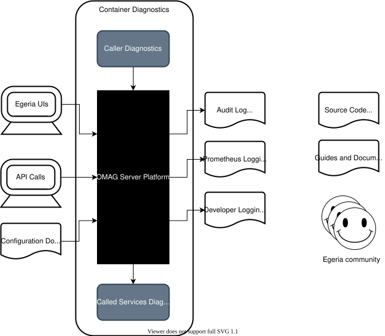

<!-- SPDX-License-Identifier: CC-BY-4.0 -->
<!-- Copyright Contributors to the Egeria project. -->

# Diagnostic Sources

## OMAG Server Platform

Figure 1 shows the choices you have when [gathering diagnostics](/guides/diagnostic/overview) for a problem related to the
OMAG Server Platform and the servers and services that run on it.
These are in addition to the diagnostics from the container services, and the services that either call or are
called by the services running on the OMAG Server Platform.

> **Figure 1:** Diagnostic sources for the OMAG Server Platform

Specifically they are:

* **Audit Log** - the audit log provides diagnostic information for a running OMAG Server.
  This includes the start up and shutdown of services, unexpected exceptions, events sent and processed,
  connector failures and security violations.  It is the primary source of diagnostics for an OMAG Server,
  its connectors and the Open Metadata Repository Cohort.  Each message has an identifier, such as
  `OMRS-AUDIT-0064`, whose prefix names the component that wrote it, and describes the likely cause and the action to take.
  Where the records go depends on the server's [audit log destinations](/guides/monitoring/overview#where-audit-log-records-go).
  [More information ...](/guides/diagnostic/ffdc).

* **Status reports** - every server reports its own status, and the integration daemons and engine hosts report the
  status of each connector and governance engine.  These are what the portal's
  [Egeria Operations](/guides/operations/overview#egeria-operations-in-the-portal) and the
  [hey_egeria monitors](/guides/operations/overview#hey_egeria-commands) display, and they can be retrieved through the
  [Diagnostic APIs](/guides/diagnostic/diagnostic-apis).

* **Engine actions** - each [engine action](/concepts/engine-action) records its status, completion guards and
  completion message, so a failed governance service usually says why it failed.  View them on the *Engine Actions*
  tab of Egeria Operations.

* **Platform metrics** - the OMAG Server Platform includes the Spring Boot Actuator and a
  [Prometheus :material-dock-window:](https://prometheus.io/docs/introduction/overview/){ target=prometheus } registry.
  The endpoints are not exposed by default; set `management.endpoints.web.exposure.include` in the platform's
  `application.properties` to publish them, then visualize the REST call timings and JVM metrics with a tool such as
  [Grafana :material-dock-window:](https://prometheus.io/docs/visualization/grafana/){ target=grafana }.

* **Developer Logging** - developer logging can be used in development and test environments
  to understand how the code is running.  It is enabled through the OMAG Server Platform's
  `application.properties` and is activated when the platform starts up - for example,
  `logging.level.org.odpi.openmetadata.adapters.connectors.resource.jdbc=DEBUG` logs every SQL statement,
  and `logging.level.org.odpi.openmetadata.commonservices.ffdc.RESTCallLogger=DEBUG` logs every REST call.
  [More information ...](/guides/admin/omag-server-platform-logging).

* **Configuration Document** - the configuration document describes the services and connectors
  defined for a particular OMAG Server.  It helps you to confirm that a server is configured correctly.
  Remember that integration daemons and engine hosts take most of their configuration from open metadata
  (integration groups, governance engines and catalog targets), so check that too.
  [More information ...](/concepts/configuration-document).

* **Infrastructure diagnostics** - Apache Kafka and PostgreSQL have their own tools: Kafka's consumer group and topic
  listings, and PostgreSQL's `pg_stat_activity` and `pg_stat_statements` views.
  [More information ...](/guides/diagnostic/postgresql-and-kafka-diagnostic-guide)

* **Guides and Documentation** - documentation for Egeria includes design information to help you understand
  how the technology should work, administration guides and guides on using the services.
  [More Information ...](https://egeria-project.org/)

* **API Calls** - the Egeria API calls can be used to understand the state of a particular repository, OMAG Server and/or
  OMAG Server Platform.
  [More Information ...](/guides/diagnostic/diagnostic-apis)

* **Egeria UIs** - the Egeria UIs help to visualize the state of the repositories and the Egeria Ecosystem.
  Egeria Operations shows the runtime, The Catalog and Egeria Explorer show the metadata itself, and
  Egeria Audit shows exceptions and security information.
  [More Information ...](/user-interfaces)

* **Source Code** - the Egeria source code can help you determine exactly how a capability is implemented (or not).
  It is available on GitHub.  The primary repository is
  [https://github.com/odpi/egeria](https://github.com/odpi/egeria), and the Python client and commands are in
  [https://github.com/odpi/egeria-python](https://github.com/odpi/egeria-python).

* **Egeria Community** - if you are completely stuck, or believe there is a bug in the Egeria content,
  you can [raise an issue](https://github.com/odpi/egeria/issues) that describes the problem you are seeing,
  a description of your runtime topology, the diagnostics you have collected, the conclusions you have come to
  and the help that you need.
  More information on the Egeria community can be found [here](/guides/community).

---8<-- "snippets/abbr.md"
