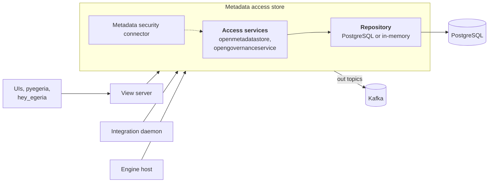

<!-- SPDX-License-Identifier: CC-BY-4.0 -->
<!-- Copyright Contributors to the Egeria project. -->

# Metadata Access Store Diagnostic Guide

The [metadata access store](/concepts/metadata-access-store) is at the centre of an Egeria deployment.  It holds the open metadata repository, and every other server depends on it: [view servers](/concepts/view-server) call it on behalf of user interfaces and pyegeria, [integration daemons](/concepts/integration-daemon) and [engine hosts](/concepts/engine-host) read their configuration from it and store the metadata they create in it, and its out topics tell them when anything changes.  So a problem in the metadata access store usually shows up first as a problem somewhere else.

## Is it running?

Check the server's status (`hey_egeria_ops show servers status`, the *Servers* tab of Egeria Operations, or `GET .../server-platform/servers/{serverName}/status`) and the services it is running.  A healthy start-up shows, in order, the audit log initializing (`OMRS-AUDIT-0064`), the repository connecting and validating its schema (`POSTGRES-REPOSITORY-CONNECTOR-0002`, `-0003`), any open metadata archives loading, the access services starting, and finally the server reporting that it is active.  If start-up stops part way, the last messages before the stop - and any `Error` or `Exception` record - say where.

| Symptom | Likely cause | See |
|---|---|---|
| Fails while connecting to the repository | Database unreachable, wrong credentials, or schema owned by another server or metadata collection | [PostgreSQL](/guides/diagnostic/postgresql-and-kafka-diagnostic-guide#the-metadata-access-store-does-not-start) |
| Fails while loading an archive | The archive file is missing from the platform, or holds types that conflict with types already in the repository | [Server start-up errors](/guides/diagnostic/examples-of-server-start-up-errors) |
| Starts, but takes many minutes | Large archives being loaded at every start, or a slow database | [Monitoring and Tuning Guide](/guides/monitoring/overview#postgresql) |
| Starts, but Kafka messages appear | The event bus is unreachable; the server works but other servers will not hear about changes | [Kafka](/guides/diagnostic/postgresql-and-kafka-diagnostic-guide#a-server-cannot-connect-to-kafka) |

## Requests fail

Requests usually arrive through a view server, so first find out whether the view server or the metadata access store is reporting the error: the exception returned to the caller names the server and the message identifier.

* **`Security` records, or "not authorized" exceptions** - the metadata access store's metadata security connector refused the request.  The record names the user, the element or service, and the rule.  Check the user's roles and the element's [governance zones](/features/governance-zoning/overview); see the [Security Guide](/guides/security/overview).
* **Repository exceptions (`POSTGRES-REPOSITORY-CONNECTOR`, `JDBC-RESOURCE-CONNECTOR`)** - see [Requests fail or time out](/guides/diagnostic/postgresql-and-kafka-diagnostic-guide#requests-fail-or-time-out-while-the-server-is-running).
* **Paging errors** - a request asked for a page larger than the server's maximum page size, which is logged at start-up (`SERVER-OPS-0001 ... is configured with a max page size of 1000`).  Ask for smaller pages, or raise the limit in the configuration.
* **Unknown type errors** - the type is newer than the server's type definitions, often because a client (such as pyegeria) is ahead of the platform release.  Align the versions.

## Metadata is missing or out of date

Work backwards along the path the metadata should have taken:

1. **Was it ever stored?**  Search for it directly in the metadata access store, using the [repository services](/guides/diagnostic/diagnostic-apis#the-repository) if the view services might be filtering it out.
2. **Was it deleted?**  Soft-deleted elements disappear from normal queries; a find with `limitResultsByStatus: ["DELETED"]` shows them.  An element archived with a *Memento* classification is still returned to lineage queries only.
3. **Is it visible to this user?**  [Governance zones](/features/governance-zoning/overview) and the metadata security connector can hide elements from some users, and effectivity dates hide elements that are not yet (or no longer) effective.
4. **Did the connector that maintains it run?**  Check its status, last refresh time and catalog targets - see the [integration daemon diagnostic guide](/guides/diagnostic/integration-daemon-diagnostic-guide).
5. **Did the archive that supplies it load?**  `hey_egeria_ops show repository archives` lists the archives loaded into the repository.  Reload a content pack if it is missing - loading again is harmless.
6. **Is the repository in memory?**  A metadata access store with the in-memory repository (such as the `simple-metadata-store` sample) loses everything except its archives when it restarts.

## Other servers are not reacting to changes

Integration daemons, engine hosts and the nanny daemon learn about changes from the metadata access store's out topics - `<topicURLRoot>.server.<serverName>.omas.openmetadatastore.outTopic` and `...omas.opengovernanceservice.outTopic`.  If they only react after a refresh, the events are not reaching them: see [Events are not being received](/guides/diagnostic/postgresql-and-kafka-diagnostic-guide#events-are-not-being-received).

## Requests are slow

Slow responses in a user interface are nearly always either the database or the volume of metadata a request touches.

* Check the repository's connection pool and slow queries - see [Requests are slow](/guides/diagnostic/postgresql-and-kafka-diagnostic-guide#requests-are-slow).
* Broad searches (such as a single-character search string across all types) touch a great deal of metadata.  Narrow the search by type, or page through the results.
* A large build-up of soft-deleted elements and old versions slows queries; see [Managing deleted metadata](/guides/monitoring/overview#managing-deleted-metadata).
* The metadata access store serves every other server.  Many integration connectors refreshing at once can saturate it; spread their refresh intervals out - see [Tuning the refresh interval](/guides/operations/overview#tuning-the-refresh-interval).

--8<-- "snippets/abbr.md"
