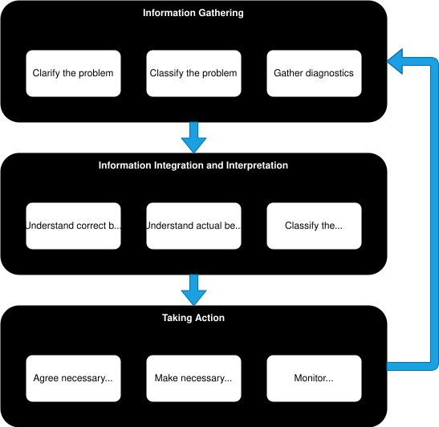

<!-- SPDX-License-Identifier: CC-BY-4.0 -->
<!-- Copyright Contributors to the ODPi Egeria project 2020. -->

# Egeria diagnostic guide

This guide focuses on diagnosing and fixing issues running Egeria's [OMAG Server Platform](/concepts/omag-server-platform), the [OMAG Servers](/concepts/omag-server) that run on it, the connectors they host, and the infrastructure they depend on - Apache Kafka and PostgreSQL.

If you are having problems building Egeria, please see the [Building Egeria](/education/tutorials/building-egeria-tutorial/overview) tutorial.  For routine checks and controls (starting servers, restarting connectors) see the [Operations Guide](/guides/operations/overview), and for watching a deployment over time see the [Monitoring and Tuning Guide](/guides/monitoring/overview).

## Where to start

Most problems show themselves in one part of the deployment first.  This table points to the most useful diagnostics for each.

| Where the problem shows | Look first at | More help |
|---|---|---|
| The platform does not start, or is unreachable | The platform's console output; `GET /open-metadata/platform-services/server-platform/origin` | [Platform start-up errors](/guides/diagnostic/examples-of-platform-start-up-errors) |
| A server does not start | The server's audit log (`Startup` and `Error` records); the server status in Egeria Operations or `hey_egeria_ops show servers startup` | [Server start-up errors](/guides/diagnostic/examples-of-server-start-up-errors) |
| A user cannot log on, or a request is refused | The `Security` records in the audit log | [Logon problems](/guides/diagnostic/logon-problems), [Security Guide](/guides/security/overview) |
| A REST call (from a UI, pyegeria or your own code) fails | The exception in the response - it names the message, cause and fix | [REST API errors](/guides/diagnostic/examples-of-common-rest-api-errors), [Tracing REST calls](/guides/diagnostic/tracing-rest-calls) |
| A user interface or pyegeria call is slow, empty or wrong | The [view server](/concepts/view-server) audit log, then the metadata access store it calls | [Metadata access store diagnostics](/guides/diagnostic/metadata-access-server-diagnostic-guide) |
| Metadata is missing, stale or wrong | The connector that maintains it; the metadata access store's repository | [Integration daemon diagnostics](/guides/diagnostic/integration-daemon-diagnostic-guide), [Metadata access store diagnostics](/guides/diagnostic/metadata-access-server-diagnostic-guide) |
| An integration connector is `FAILED` or not refreshing | The integration daemon's audit log; the connector's status and catalog targets | [Integration daemon diagnostics](/guides/diagnostic/integration-daemon-diagnostic-guide) |
| Engine actions fail or never start | The engine action's completion message and guards in Egeria Operations; the [engine host](/concepts/engine-host) audit log | [Operating governance engines](/guides/operations/overview#operating-governance-engines) |
| Servers stop hearing about each other's changes | Kafka consumer groups and topics; `OCF-KAFKA-TOPIC-CONNECTOR` messages | [PostgreSQL and Kafka diagnostics](/guides/diagnostic/postgresql-and-kafka-diagnostic-guide), [Cohort errors](/guides/diagnostic/examples-of-cohort-errors) |
| Repository errors, timeouts or slow queries | `POSTGRES-REPOSITORY-CONNECTOR` and `JDBC-RESOURCE-CONNECTOR` messages; PostgreSQL's own statistics | [PostgreSQL and Kafka diagnostics](/guides/diagnostic/postgresql-and-kafka-diagnostic-guide) |

## The diagnosis process

The OMAG Server Platform has many functions itself, and is typically be embedded in complex deployment environments.  This means that diagnosing problems (and most importantly fixing them) needs to be done in a systematic way.  

Figure 1 shows a view of the diagnostic process.  

> **Figure 1:** The diagnostic process

The diagram shows three phases linked together in sequence with a return arrow from the third phase, looping back to the first.  It is an example of process that appears rational in hindsight. When you are in the middle of the process you may find that you are iterating backwards and forwards between the different stages, particularly if it is a puzzling problem. However, it is often helpful to step back and look at each step in the process and assemble your thoughts along these lines.  The diagnostic guide is organized according to this process and at the very least, it will help you find the information that you need.

So now consider each phase of the process.

* **Information Gathering** - The first phase is to gather the information needed to understand the nature of the problem.

    * **Clarify the problem** - Create a clear picture in your mind of the symptoms of your problem.  Be as precise as possible since that will simplify your work at a later stage. Ask yourself:
  
        * What is not working?  Did something fail? Or is it unresponsive, or creating the wrong results?
        * Has it ever worked or has it just stopped working?
        * If it has just stopped working, what has changed recently?
        * Who does it affect?  Everyone?  Specific users?  Running in specific environments?
        * What is the context of the problem?  For example, what is the deployment topology in terms of the machines,
       containers, OMAG Server Platforms, OMAG Services and connected services (such as Apache Kafka).
  
    * **Classifying the problem** - Identifying the type of problem guides you to which diagnostics will be helpful. For example, consider the following options, and also identify whether this is a consistent or intermittent error.
       
        * The platform failed to start
        * The platform failed while it was running
        * A server failed to start
        * A server failed while it was running
        * A connector within a server failed to start up properly
        * A connector within a server detected an error
        * An integration connector has stopped refreshing, or is not picking up a catalog target
        * An engine action failed, or is not being run
        * A request to a server failed with an exception
        * A request to a server hangs
        * A request to a server produces the wrong results
        * A server is failing to join a cohort
        * Metadata is not being shared across the cohort, or other servers are not reacting to changes
        * Requests are running slowly
        * A dependent service (Kafka, PostgreSQL, a secrets store, a third party technology) is failing
            
    * **Gather diagnostics** - This is where you are looking to capture the evidence that may identify both the source of the error and the nature of the failure. The different types of diagnostics that are available are described in [Diagnostic Sources](/guides/diagnostic/diagnostic-sources). If the problem is in the Egeria code, rather than its runtime environment, then the [Egeria diagnostics may also define how to fix the problem](/guides/diagnostic/ffdc).
    
* **Information Integration and Interpretation** - The second phase uses the evidence gathered in the to make a diagnosis to determine which component is in error and what it is doing that is incorrect. To do this, you need to:
  
  * **Understand the correct behavior** - how should it be working?  If the desired capability is in the Egeria code, what is the status of the module and is the function that you are using complete and expected to work.
  
  * **Understand the actual behavior** - compare and contrast how it is actually working with how it should be working.
  
  * **Classify the behavior** - identify the nature of the behavior you are seeing. For example:
  
    * **Not Implemented** - The desired behavior is not yet implemented - or in development.
    * **Bad Environment** - The OMAG Server Platform's runtime (container) environment is incorrect or failing or lacking resources.
    * **Bad Platform Configuration** - The OMAG Server Platform is incorrectly configured.
    * **Bad Server Configuration** - The OMAG Server is incorrectly configured.  This may be its subsystems, or its connectors.
    * **Failing dependent service** - A service being called by the platform or a server (for example, Kafka, LDAP) is not running correctly.
    * **Insufficient security access** - A platform, server or user does not have security authorization to complete a request.
    * **Caller error** - An error in the caller to Egeria's request
    * **Bad connector implementation** - An error in the implementation of a connector.
    * **Egeria platform bug** - one of the subsystems of Egeria is not operating correctly.
    
  With this information, it may be possible to match what is occurring in your environment with descriptions of common errors, or errors found by other users of Egeria.  These will hopefully also include a description of how to fix the problem.
  
* **Taking Action** - Once the cause of the problem is understood, you next need to fix it. There are three parts to this: 

  * **Agree necessary changes** - Sometimes the diagnostics describe how to fix the problem, sometimes that are choices to be agreed with the people responsible for the components/configuration that needs fixing.
  
  * **Make necessary changes** - Once the approach has been agreed, the changes need to be made.
  
  * **Monitor results** - Finally the changes need to be tested to ensure the problem is fixed and there are no unwanted side effects.  If the solution did not work, then begin again with the information gathering process.  It may also be a time to request help from the [Egeria community](/guides/community).  If the situation is worse, you may wish to back out the changes you have made before trying the diagnosis process again.

The description above is an overview of what to do to diagnose and fix a problem. This may be enough to help you resolve the issues you are seeing. However, whilst some types of issues are frequently encountered, others are unique to your situation. What follows are some descriptions of the diagnostics for issues that are frequently seen. These can help you to eliminate the obvious causes.  

* [Examples of OMAG Server Platform startup errors](/guides/diagnostic/examples-of-platform-start-up-errors)
* [Examples of OMAG Server startup errors](/guides/diagnostic/examples-of-server-start-up-errors)
* [Examples of Open Metadata Repository Cohort errors](/guides/diagnostic/examples-of-cohort-errors)
* [Examples of REST API call failures](/guides/diagnostic/examples-of-common-rest-api-errors)
* [Diagnosing the metadata access store](/guides/diagnostic/metadata-access-server-diagnostic-guide)
* [Diagnosing the integration daemon](/guides/diagnostic/integration-daemon-diagnostic-guide)
* [Diagnosing PostgreSQL and Kafka](/guides/diagnostic/postgresql-and-kafka-diagnostic-guide)

## Further information

* [Diagnostic Sources](/guides/diagnostic/diagnostic-sources) and [Diagnostic APIs](/guides/diagnostic/diagnostic-apis)
* [First Failure Data Capture (FFDC)](/guides/diagnostic/ffdc)
* [Operations Guide](/guides/operations/overview) and [Monitoring and Tuning Guide](/guides/monitoring/overview)
* [Administration Guide](/guides/admin)

--8<-- "snippets/abbr.md"
