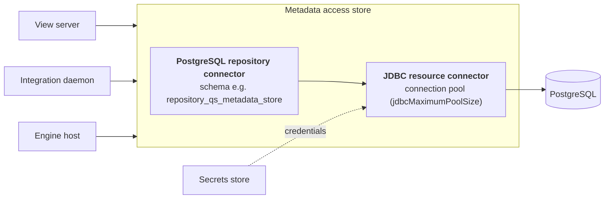
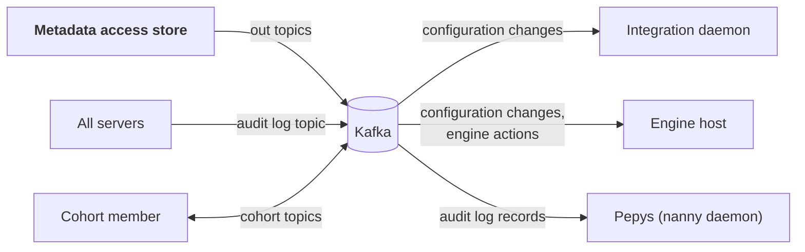

<!-- SPDX-License-Identifier: CC-BY-4.0 -->
<!-- Copyright Contributors to the Egeria project. -->

# Diagnosing PostgreSQL and Kafka problems

Egeria depends on two pieces of infrastructure that it does not control: PostgreSQL, which holds the metadata repositories, and Apache Kafka, which carries events between servers.  When one of them misbehaves, the symptoms usually appear somewhere else - a slow user interface, a connector that stops reacting, a server that will not start - so this page works from the symptom back to the cause.

Both write their problems to the audit log of the server that is affected.  The message prefixes to look for are:

| Prefix | Component |
|---|---|
| `POSTGRES-REPOSITORY-CONNECTOR` | The PostgreSQL repository connector in a metadata access store. |
| `JDBC-RESOURCE-CONNECTOR` | The JDBC connector the repository uses to talk to PostgreSQL. |
| `OCF-KAFKA-TOPIC-CONNECTOR` | The Kafka connector behind every event topic: cohort topics, out topics and audit log topics. |

## PostgreSQL



Every metadata request from every other server ends up in the metadata access store's connection pool, so a database problem affects everything at once.

### The metadata access store does not start

Look for the repository connector's start-up messages in the audit log:

```
POSTGRES-REPOSITORY-CONNECTOR-0002 The PostgreSQL repository connector qs-metadata-store is connecting to database ...
POSTGRES-REPOSITORY-CONNECTOR-0003 The PostgreSQL repository connector qs-metadata-store is validating the schema definitions for schema repository_qs_metadata_store
```

| Message | Cause | Fix |
|---|---|---|
| `JDBC-RESOURCE-CONNECTOR-400-001` - configured without the URL to the database | The connection has no `databaseURL`. | Add it to the repository connector's configuration properties. |
| `JDBC-RESOURCE-CONNECTOR-400-002` - invalid DriverManager class name | The JDBC driver class is wrong or not on the platform's class path. | Correct the class name, or add the driver jar to the directory the platform loads extra libraries from (its `loader.path`). |
| `JDBC-RESOURCE-CONNECTOR-500-003` - unexpected SQL exception, with a message such as `password authentication failed` or `Connection refused` | Wrong credentials, a database that is not running, or a network or TLS problem. | Check the database is up and reachable from the platform's container (`host.docker.internal` in the egeria-workspaces deployments), and that the secrets store holds the right user and password. |
| PostgreSQL message `permission denied for database egeria` or `permission denied for schema` | The database user lacks the grants it needs - common after a database is dropped and recreated by hand. | Re-apply the grants.  In egeria-workspaces use `compose-configs/shared-infra/reset-egeria-db.sh`, which does this, rather than a bare `DROP/CREATE DATABASE`. |
| `POSTGRES-REPOSITORY-CONNECTOR-500-005` - schema belongs to another server | The schema was created by a different server. | Point the server at its own `databaseSchema`.  Two servers must never share a schema. |
| `POSTGRES-REPOSITORY-CONNECTOR-500-006` - schema belongs to another metadata collection id | The schema was created with a different metadata collection identifier from the one in this server's configuration document - typically after the configuration was recreated, or a backup was restored without its matching configuration. | Restore the configuration document that goes with the database, or set the configuration's `metadataCollectionId` to the one the schema holds.  Do not simply wipe the schema: the metadata in it would be lost. |
| `POSTGRES-REPOSITORY-CONNECTOR-500-007` - unsupported schema version | The schema was created by a newer (or much older) release of the connector. | Run the release that matches the schema, or restore a backup taken with this release. |

### Requests fail or time out while the server is running

* **`POSTGRES-REPOSITORY-CONNECTOR-400-001`** - the repository is in read-only mode (`repositoryMode` is `readOnly`), so updates are refused.  This is configuration, not a failure.
* **`JDBC-RESOURCE-CONNECTOR-500-001` or `-500-003` with timeouts** - the connection pool is exhausted or the database is overloaded.  Check how many connections Egeria holds (`SELECT usename, state, count(*) FROM pg_stat_activity GROUP BY 1, 2;`) against `jdbcMaximumPoolSize` and PostgreSQL's `max_connections`.  See [Repository connector settings](/guides/monitoring/overview#repository-connector-settings).
* **`JDBC-RESOURCE-CONNECTOR-0004`** - the connector rolled back a transaction after an error; the message gives the database's reason.
* **`JDBC-RESOURCE-CONNECTOR-400-004`** - a property value contains a null character (`U+0000`), which PostgreSQL cannot store.  The message names the column and the method; the fix is in whatever supplied the value - often an integration connector copying data from a third party technology.
* **Connections dropped by a firewall or load balancer** - long-idle connections can be cut by network equipment.  `JDBC-RESOURCE-CONNECTOR-0010` confirms that TCP keepalive is switched on.

### Requests are slow

1. Find the slow statements with `pg_stat_statements` (see [What to watch](/guides/monitoring/overview#postgresql) in the Monitoring and Tuning Guide).
2. Look at what is running now: `SELECT pid, now() - query_start AS running, state, left(query, 120) FROM pg_stat_activity WHERE state <> 'idle' ORDER BY running DESC;`
3. Check that the repository tables have been vacuumed and analyzed recently (`last_autovacuum`, `last_autoanalyze` in `pg_stat_user_tables`).  A large purge or bulk load without an `ANALYZE` afterwards can leave the planner choosing poor plans.
4. Check the size of the repository.  A very large number of soft-deleted elements and old versions slows queries down; see [Managing deleted metadata](/guides/monitoring/overview#managing-deleted-metadata).
5. To see the SQL Egeria builds for a particular request, set `logging.level.org.odpi.openmetadata.adapters.connectors.resource.jdbc=DEBUG` and `logging.level.org.odpi.openmetadata.adapters.repositoryservices.postgres.repositoryconnector.database=DEBUG` in `application.properties` and restart the platform.  Switch it off again afterwards: it is very verbose.

### Metadata looks wrong

The repository can be inspected through the [repository services API](/guides/diagnostic/diagnostic-apis#the-repository), which bypasses the view services' filtering, or directly in PostgreSQL.  The `entity`, `relationship` and `classification` tables hold every version of every instance; the current version is the one whose `version_end_time` is null.  Treat the database as read-only: changing rows by hand bypasses Egeria's validation and the events that keep other servers in step.

## Apache Kafka



When Kafka is unavailable, servers keep serving REST requests, but they stop hearing about each other's changes: integration daemons and engine hosts pick up configuration changes late (or only on a refresh), cohort members drift out of step, and usage statistics stop.

### A server cannot connect to Kafka

At start-up each topic connector logs where it is connecting:

```
OCF-KAFKA-TOPIC-CONNECTOR-0001 Connecting to Apache Kafka Topic ... with a server identifier of ... and bootstrap server location of ...
OCF-KAFKA-TOPIC-CONNECTOR-0015 The local server is attempting to connect to Kafka brokers at ... [ attempt 1 of 10 ]
```

| Message | Cause | Fix |
|---|---|---|
| `OCF-KAFKA-TOPIC-CONNECTOR-0015` repeated, then `-0014` (connecting to bootstrap broker) | The brokers are not reachable at the `bootstrap.servers` address. | Check the address *from the platform's container*.  A broker advertises its own address to clients (`advertised.listeners`); if that address cannot be resolved from the platform, the first connection succeeds and every later one fails. |
| `OCF-KAFKA-TOPIC-CONNECTOR-0013` - property missing from the event bus configuration | The server's event bus configuration is incomplete. | Correct the event bus section of the configuration document. |
| `OCF-KAFKA-TOPIC-CONNECTOR-0006` - configuration properties produced an exception | A producer or consumer property has a value Kafka rejects. | The message includes Kafka's reason. |
| `OCF-KAFKA-TOPIC-CONNECTOR-0019` - cannot connect the producer | Security settings (`security.protocol`, `sasl.*`, `ssl.*`) are missing or wrong, or the topic cannot be created. | Check the security properties, and whether your Kafka service allows topics to be created automatically. |

If containers start before the brokers are ready, increase `bring.up.retries` and `bring.up.minSleepTime`.

### Events are not being sent

* **`OCF-KAFKA-TOPIC-CONNECTOR-0012`** - unable to send an event; the counts show how many were sent and how many are buffered waiting for Kafka.
* **`OCF-KAFKA-TOPIC-CONNECTOR-0020`** - the send buffer is full and events are being **discarded**.  Kafka has been unavailable for long enough to fill the buffer.  Once Kafka is back, refresh the integration daemons and engine hosts so they catch up on configuration changes they missed.
* **`OCF-KAFKA-TOPIC-CONNECTOR-0021`** - Kafka accepted the event but failed to deliver it, often because it is larger than the broker allows.  Compare the event size with `max.request.size` and the broker's `message.max.bytes`.
* **`OCF-KAFKA-TOPIC-CONNECTOR-0011`** at shutdown reports any unsent messages.

### Events are not being received

The usual sign is an integration connector or governance engine that does not react to a change until it is refreshed.

1. **Is the consumer connected?**  List the consumer group for the topic and check it has members:

    ```bash
    kafka-consumer-groups.sh --bootstrap-server <broker> --describe \
      --group 'EgeriaGovernance@egeria.omag.server.qs-metadata-store.omas.opengovernanceservice.outTopic'
    ```

    ```
    TOPIC                                                                    PARTITION  CURRENT-OFFSET  LOG-END-OFFSET  LAG  CONSUMER-ID
    egeria.omag.server.qs-metadata-store.omas.opengovernanceservice.outTopic 0          845234          845234          0    consumer-EgeriaGovernance@...
    ```

    A `LAG` of 0 means the consumer is up to date.  A lag that keeps growing means the server is reading too slowly or has stopped; no `CONSUMER-ID` means no server is reading with that group.
2. **Is the right topic being used?**  The out topics of a metadata access store are `<topicURLRoot>.server.<serverName>.omas.openmetadatastore.outTopic` and `...omas.opengovernanceservice.outTopic`.  Compare them with `kafka-topics.sh --list`.  A misspelt server name or `topicURLRoot` gives servers that publish and listen on different topics without any error.
3. **Look for `OCF-KAFKA-TOPIC-CONNECTOR-0008`** (an exception from Kafka while listening) and **`-0009`** (an exception passing an event to a component in the server).  The second points at the component, not Kafka.
4. **`OCF-KAFKA-TOPIC-CONNECTOR-0017` and `-0018`** mean consumed events could not be committed, usually because Kafka rebalanced the group.  The events will be delivered again after the rebalance.  An occasional message is harmless; frequent ones suggest the consumer is taking longer than `session.timeout.ms` to process events.
5. **Events older than the topic's retention are gone.**  A server that was down for longer than the retention period misses them.  Refresh its connectors and engines to bring it back into step.

### Many empty consumer groups

Each listener reads with its own consumer group, named from the server's identifier and what it is listening for - for example `<localServerId>Egeria:IntegrationGroup:Darwin` for an integration daemon listening for changes to one integration group, or `EgeriaGovernance@<topic>` for a governance engine.  When a server's configuration document is recreated, it gets a new `localServerId`, and so new consumer groups; the old ones are left behind with no members.  On a development system that is rebuilt often these accumulate into hundreds.  They do no harm beyond clutter, and can be removed with `kafka-consumer-groups.sh --delete --group <name>` once you are sure no server uses them.

!!! tip "Running Kafka's tools in egeria-workspaces"
    The shared Kafka runs in the `egeria-shared-kafka` container and advertises itself as `egeria-shared-kafka:9192`, so use that address with the tools inside the container:

    ```bash
    docker exec egeria-shared-kafka /opt/bitnami/kafka/bin/kafka-consumer-groups.sh \
      --bootstrap-server egeria-shared-kafka:9192 --list
    ```

## Further information

* [Monitoring and Tuning Guide](/guides/monitoring/overview) - tuning Kafka and PostgreSQL, backups and housekeeping.
* [Metadata access store diagnostics](/guides/diagnostic/metadata-access-server-diagnostic-guide)
* [Event bus](/concepts/event-bus) and the [Kafka Open Metadata Topic Connector :material-github:](https://github.com/odpi/egeria/blob/main/open-metadata-implementation/adapters/open-connectors/event-bus-connectors/open-metadata-topic-connectors/kafka-open-metadata-topic-connector/README.md){ target=gh }
* [PostgreSQL Repository Connector :material-github:](https://github.com/odpi/egeria/tree/main/open-metadata-implementation/adapters/open-connectors/repository-services-connectors/open-metadata-collection-store-connectors/postgres-repository-connector){ target=gh }

--8<-- "snippets/abbr.md"
