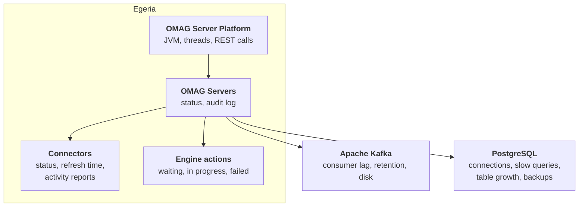

<!-- SPDX-License-Identifier: CC-BY-4.0 -->
<!-- Copyright Contributors to the Egeria project. -->

# Monitoring and Tuning Guide

This guide is for the people who keep an Egeria deployment healthy over time.  It covers what to watch, how to read Egeria's [audit log](/concepts/audit-log), how to tune the infrastructure Egeria depends on - [Apache Kafka](#apache-kafka) and [PostgreSQL](#postgresql) - and the [maintenance tasks](#maintenance-tasks) that every production deployment needs, such as backups and clearing out deleted metadata.

The day-to-day controls - starting servers, refreshing connectors, adding catalog targets - are in the [Operations Guide](/guides/operations/overview).  When monitoring shows that something has gone wrong, the [Diagnostic Guide](/guides/diagnostic/overview) helps you find out why.

## What to watch



| What | Healthy looks like | Where to look |
|---|---|---|
| Platforms and servers | Every server that should be active is active. | Egeria Operations *Servers* tab; `hey_egeria_ops show platforms status`; Runtime Manager platform and server reports. |
| Integration connectors | Status `WAITING`, `REFRESHING` or `RUNNING`; last refresh time keeps moving. | Egeria Operations *Integration Connectors* tab; `hey_egeria_ops show integrations status`.  See [connector status](/guides/operations/overview#connector-status). |
| Engine actions | Actions move through to `COMPLETED`; few `FAILED`; nothing left `WAITING` or `IN_PROGRESS` indefinitely. | Egeria Operations *Engine Actions* tab; `monitor_engine_activity`. |
| Audit log | No unexpected `Error`, `Exception` or `Security` records. | The [audit log destinations](#where-audit-log-records-go) you have configured. |
| Kafka | Egeria's consumer groups keep up; topics are not near their retention limit. | Kafka's own tools - see [Apache Kafka](#apache-kafka). |
| PostgreSQL | Connection pools are not exhausted; no runaway queries; backups succeed. | PostgreSQL statistics views - see [PostgreSQL](#postgresql). |
| The JVM and container | Memory and CPU within limits; no restarts. | Your container platform's monitoring.  The platform includes the Spring Boot Actuator and a Prometheus registry; expose the endpoints with `management.endpoints.web.exposure.include` in `application.properties`. |

The `hey_egeria_ops` monitors redraw themselves every few seconds, so a terminal running `show platforms status` and `show integrations status` side by side makes a simple control-room display.  For a deployment that is watched by a central operations team, feed the audit log and the infrastructure metrics into the tools that team already uses.

## The audit log

Every OMAG Server writes an [audit log](/concepts/audit-log): a structured record of what it is doing, written by each subsystem and connector.  Each record carries a message identifier (such as `OMRS-AUDIT-0064`), a [severity](/concepts/audit-log/#audit-log-records), a description, and - for problems - the likely cause and the action to take.  Because every message is documented in the code with its system and user actions, the audit log is the first place to look when something changes.

### Where audit log records go

Records are passed to one or more [audit log destination connectors](/concepts/audit-log-destination-connector), each configured with the severities it should receive.  This is set in each server's [configuration document](/guides/admin/servers/by-section/repository-services-section).

???+ info "Audit log destinations supplied with Egeria"

    | Destination | Writes to | Use it for |
    |---|---|---|
    | Console | Standard out, one line per record. | Container logs.  The simplest way to feed the records to a log aggregator. |
    | SLF4J | The platform's logging framework. | Routing records through your own logging configuration (Logback appenders, JSON layouts and so on). |
    | File | One JSON file per record, named `log-record-<guid>.omalrecord`, in a directory. | Keeping a complete, machine-readable record locally.  See [Cleaning up audit log files](#cleaning-up-audit-log-files). |
    | Event topic | An open metadata topic (usually Kafka). | Distributing records to other tools - and to the Pepys Activity Observer, which turns activity records into [usage statistics](/features/metadata-observability/overview). |
    | Console event display | Standard out. | Development only: shows the content of events as they are sent and received. |

    The sample configurations supplied with the platform send most severities to the console, `Error` and `Exception` records to files in `data/servers/<serverName>/logs/ffdc`, and errors, activity and security records to an event topic.

### Choosing severities

| Severity | Usually send to | Notes |
|---|---|---|
| `Startup`, `Shutdown` | Console | Confirms servers and services start and stop cleanly. |
| `Error`, `Exception`, `Action` | Console and alerting | These need a person to look at them. |
| `Security` | Console and your security monitoring | Unauthorized requests - see the [Security Guide](/guides/security/overview). |
| `Information`, `Event`, `Decision`, `Cohort`, `Types`, `Asset` | File or event topic | Useful history, but noisy on a console. |
| `Activity` | Event topic | Records of what users and services did; the input for metadata observability. |
| `PerfMon`, `Trace` | Nothing, normally | Switch on for a specific investigation. |

### Reading the audit log through the API

A running server can be asked for the definitions of its severities and for a report on its audit log - which components are logging and the counts of each message:

```
###
# @name auditLogReport
GET {{baseURL}}/servers/{{serverName}}/open-metadata/repository-services/audit-log/report
Authorization: Bearer {{token}}

###
# @name auditLogSeverities
GET {{baseURL}}/servers/{{serverName}}/open-metadata/repository-services/audit-log/severity-definitions
Authorization: Bearer {{token}}
```

!!! summary "Usage"
    Send `Error`, `Exception`, `Action` and `Security` records to wherever your alerts come from, keep the full record somewhere searchable, and send `Activity` records to an event topic so that Egeria can maintain usage statistics.  The [Diagnostic Guide](/guides/diagnostic/overview) explains how to use the records to track down a problem.

## Integration connectors and governance engines

Connectors and engines do Egeria's work in the background, so they need watching even when no-one is using Egeria directly.

* **Status** - a connector in `FAILED` or `CONFIG_FAILED` stays that way until it is restarted.  Check for them daily (the portal and `show integrations status` both show status), or alert on the audit log messages the integration daemon writes when a connector fails.
* **Last refresh time** - a connector stuck in `REFRESHING` for much longer than usual may be waiting on an unresponsive third party technology.
* **Connector activity reports** - set `generateConnectorActivityReports` on a connector's registration and it records what each refresh did (elements created, updated and deleted) as [open metadata](/types/4/0457-Connector-Activity-Reports).  These make it easy to spot a connector that has silently stopped finding anything.
* **Engine actions** - a growing number of engine actions waiting to start usually means the engine host that runs them is not active or is overloaded.

The main tuning controls are each connector's refresh interval and its catalog targets.  These are described in [Running and tuning integration connectors](/guides/operations/overview#running-and-tuning-integration-connectors).

## Apache Kafka

Egeria uses Kafka as its [event bus](/concepts/event-bus): servers in a [cohort](/concepts/cohort-member) exchange metadata over the cohort topics, the metadata access stores publish changes on their [out topics](/concepts/out-topic) (which is how integration daemons and engine hosts hear about configuration changes promptly), and the audit log can be published on a topic.  Kafka is optional - a single metadata access store with no cohort can run without it, and integration daemons fall back to re-reading their configuration about every half hour - but most deployments use it.

### What to watch

* **Consumer lag** - how far each consumer group is behind the end of its topic.  A steadily growing lag means a server is not keeping up, or has stopped reading.  Check it with `kafka-consumer-groups.sh --bootstrap-server <broker> --describe --all-groups`, or your Kafka monitoring.
* **Retention** - a server that is down for longer than a topic's retention period misses events when it comes back.  Set retention on the cohort and out topics comfortably longer than the longest outage you plan for.
* **Disk** on the brokers, especially with the audit log on a topic, which can be high volume.

### Settings that matter

Egeria passes producer and consumer properties to Kafka through the event bus configuration of each server.  The defaults suit a development system; these are the ones most often changed:

| Property | Default | Why change it |
|---|---|---|
| `bootstrap.servers` | `localhost:9092` | Point at your brokers - list several for resilience. |
| `max.request.size` (producer) / `max.partition.fetch.bytes` (consumer) | 10485760 (10 MB) | Large metadata instances produce large events.  Keep the two in step, and keep the broker's `message.max.bytes` at least as large. |
| `acks` | `all` | Leave as `all` so events are not lost when a broker fails. |
| `bring.up.retries` / `bring.up.minSleepTime` | 10 / 5000 ms | How long a server waits for Kafka at start-up.  Increase them if containers start before the brokers are ready. |
| Security properties (`security.protocol`, `sasl.*`, `ssl.*`) | None | Required by most managed Kafka services. |

Details are in the [Kafka Open Metadata Topic Connector :material-github:](https://github.com/odpi/egeria/blob/main/open-metadata-implementation/adapters/open-connectors/event-bus-connectors/open-metadata-topic-connectors/kafka-open-metadata-topic-connector/README.md){ target=gh } documentation.

??? info "Topics and consumer groups"
    Many enterprise Kafka services do not allow topics to be created automatically.  The topic names are built from the event bus's `topicURLRoot` (default `egeria.omag`): the cohort topics `egeria.omag.openmetadata.repositoryservices.cohort.<cohortName>.OMRSTopic.registration`, `.types` and `.instances`, and each metadata access store's out topics `egeria.omag.server.<serverName>.omas.openmetadatastore.outTopic` and `egeria.omag.server.<serverName>.omas.opengovernanceservice.outTopic`, plus any audit log topic.  One way to find the full list is to start the deployment against a Kafka that allows automatic creation and list the topics it made.

    Each server reads each topic with its own consumer group, named from the server's identifier and what it listens for, so a server resumes where it left off after a restart.  When a server's configuration document is recreated it gets a new identifier, and so new groups, leaving the old ones empty; a topic connection with no `local.server.id` gets a new random group every time it starts.  Review the group list from time to time and delete groups that no longer have members - see [Many empty consumer groups](/guides/diagnostic/postgresql-and-kafka-diagnostic-guide#many-empty-consumer-groups).

!!! summary "Usage"
    Watch consumer lag and broker disk, set retention longer than your longest expected outage, and make sure message size limits allow for your largest metadata elements.

## PostgreSQL

The [PostgreSQL repository connector](/concepts/repository-connector) stores each metadata access store's repository in its own database schema (for example `repository_qs_metadata_store`), in a small set of tables: `entity`, `relationship` and `classification`, each with a matching table of property values.  The repository is **bi-temporal**: every update adds a new version rather than overwriting the old one, so the history of each element can be queried with an `asOfTime`.  This makes the database grow steadily, even when the amount of current metadata is stable.

### Repository connector settings

These are configuration properties on the repository connector's connection in the server's configuration document:

| Property | Default | Notes |
|---|---|---|
| `databaseURL` | - | The JDBC URL; it should select the repository's schema. |
| `databaseSchema` | `repository_<serverName>` | The schema the repository uses. |
| `secretsStore`, `secretsCollectionName` | - | Where the database credentials are kept - see the [Security Guide](/guides/security/overview). |
| `jdbcMaximumPoolSize` | 10 | The maximum number of database connections the repository holds open.  Every metadata request the server handles goes through this pool, so size it for the server's concurrency: a busy view server with many users, and integration daemons running many connectors, drive a lot of parallel requests into the metadata access store. |
| `defaultAsOfTime` | none (current time) | Makes queries return metadata as it was at a fixed time by default - for example, for a server that serves a frozen snapshot. |
| `repositoryMode` | read-write | Set to `readOnly` to stop all updates, for example on a replica used for reporting. |

!!! tip "Connection budget"
    PostgreSQL's `max_connections` must cover the pools of *every* server that uses the database (and any other applications), plus headroom for administration.  If the pool is too small, requests queue inside Egeria and response times rise; if the database runs out of connections, servers fail with connection errors.

### What to watch

* **Slow and frequent queries** - enable `pg_stat_statements` (the egeria-workspaces PostgreSQL does this, with `track_activity_query_size=16384` so Egeria's long generated SQL is shown in full):

    ```sql
    CREATE EXTENSION IF NOT EXISTS pg_stat_statements;
    -- busiest statements by total time
    SELECT calls, round(total_exec_time) AS ms, rows, left(query, 120)
    FROM pg_stat_statements ORDER BY total_exec_time DESC LIMIT 20;
    ```

* **Active connections** - `SELECT usename, state, count(*) FROM pg_stat_activity GROUP BY 1, 2;` shows how close each server's pool is to its limit.
* **Table growth** - track the size of each repository schema over time:

    ```sql
    SELECT schemaname, relname, pg_size_pretty(pg_total_relation_size(relid)) AS size, n_live_tup, n_dead_tup
    FROM pg_stat_user_tables WHERE schemaname LIKE 'repository_%'
    ORDER BY pg_total_relation_size(relid) DESC;
    ```

* **Vacuum** - autovacuum keeps the tables in shape under normal use.  After a large purge (see [Managing deleted metadata](#managing-deleted-metadata)) run `VACUUM (ANALYZE)` on the repository tables so the space is reused and the query planner has current statistics.

To see the SQL the repository connector issues, set `logging.level.org.odpi.openmetadata.adapters.connectors.resource.jdbc=DEBUG` in the platform's `application.properties`.  This is very verbose: use it for an investigation, not in normal running.

!!! summary "Usage"
    Size each repository's connection pool for its workload and the database's `max_connections` for all of them together, watch for slow queries and table growth, and vacuum after large purges.

## Maintenance tasks

| Task | How often | Section |
|---|---|---|
| Back up the repositories and configuration | Daily, and before every upgrade | [Backups](#backups) |
| Purge soft-deleted metadata | Weekly or monthly, by policy | [Managing deleted metadata](#managing-deleted-metadata) |
| Clean up audit log files | Weekly | [Cleaning up audit log files](#cleaning-up-audit-log-files) |
| Review Kafka consumer groups | Monthly | [Topics and consumer groups](#apache-kafka) |
| Renew certificates | Before they expire | [Security Guide](/guides/security/overview) |
| Reload content packs | After an upgrade | [Load new content](/guides/operations/overview#operating-servers) |

### Backups

What to back up:

* **The PostgreSQL repositories** - this is the metadata itself.  `pg_dump` produces a consistent copy while Egeria is running, so a nightly dump of each repository schema (or the whole database) is a sound baseline:

    ```bash
    pg_dump --host <db-host> --port 5432 --username <admin-user> \
            --format custom --schema 'repository_*' \
            --file egeria-$(date +%Y%m%d).dump egeria
    ```

    For larger deployments, or a tighter recovery point, use PostgreSQL's continuous archiving (base backups plus write-ahead log archiving) instead.
* **The servers' configuration documents** - by default in the platform's `data/servers/<serverName>/config` directories, or wherever the platform's configuration store keeps them.
* **The platform's `application.properties`, keystores, trust stores and secrets stores.**  Treat these backups with the same care as the originals.
* **Kafka** does not normally need backing up: the topics carry events in transit, and the repositories hold the result.

Test restores regularly.  A restore of a repository must be matched with the configuration documents that refer to it (the repository's metadata collection identifier is in the configuration document), and other cohort members will re-send any changes they made while the restored server was out of date.

!!! tip "In egeria-workspaces"
    `compose-configs/shared-infra/reset-egeria-db.sh --backup` takes a `pg_dump` into `egeria-db-backups/` before resetting a development database.  It is a convenient pattern to copy for scheduled backups.

### Managing deleted metadata

When metadata is deleted, Egeria chooses between four outcomes, set by the `deleteMethod` on the request (or on a [catalog target](/guides/operations/overview#tuning-catalog-targets) for metadata maintained by a connector):

| Delete method | Effect |
|---|---|
| `LOOK_FOR_LINEAGE` | The usual choice: archive the element if it takes part in lineage, otherwise soft-delete it. |
| `ARCHIVE` | Keep the element, classified as a *Memento*, so lineage queries can still find it. |
| `SOFT_DELETE` | Mark the element as deleted.  It disappears from normal queries but can be restored. |
| `PURGE` | Remove the element and its history from the repository at once.  It can only be recovered from a backup. |

Soft-deleted elements stay in the repository, with their history, until they are purged.  On a busy system - particularly one where connectors catalog changing technology, recreating and deleting elements as it changes - they can come to outnumber the current metadata.  Egeria does not purge them by itself, because how long to keep them is a policy decision for the deploying organization: deleted glossary terms might be kept for a year in case they need restoring, while the search keywords a connector regenerates on every refresh might be kept for a week.

The practical approach is a scheduled housekeeping script that applies your retention policy.  Egeria provides an example to start from:

[:material-download: purge-deleted-elements.py](purge-deleted-elements.py){ .md-button download="purge-deleted-elements.py" }

The script:

1. Asks the metadata access store's repository services for its soft-deleted entities and relationships (using `limitResultsByStatus: ["DELETED"]`).
2. Skips anything whose home is another cohort member - only the home repository can purge an element.
3. Compares the time each was deleted with the retention period for its type, from a policy you supply.
4. Purges those that are past it - relationships first, then entities - or, by default, just lists what it would purge.

The retention policy maps type names to the number of days to keep a deleted element.  A type includes its subtypes, an element's own type wins over a supertype, and `"*"` covers everything else (leave it out to purge only the types you name):

```json
{
  "SearchKeyword": 7,
  "SearchKeywordLink": 7,
  "GlossaryTerm": 365,
  "Referenceable": 90
}
```

Run it by hand first, as a dry run, to see what your policy would remove:

```bash
export EGERIA_USER=garygeeke EGERIA_USER_PASSWORD=secret
python3 purge-deleted-elements.py --platform-url https://localhost:9443 \
        --server qs-metadata-store --policy retention.json --insecure
```

Then schedule it with `--purge` using cron, a Kubernetes CronJob, or your organization's job scheduler:

```
30 2 * * 0  /usr/bin/python3 /opt/egeria/purge-deleted-elements.py --server qs-metadata-store --policy /opt/egeria/retention.json --purge >> /var/log/egeria/purge.log 2>&1
```

The script exits with a non-zero code if any purge fails, so the scheduler can raise an alert.  `--max-purges` limits the work done in one run, which spreads a large first clean-up over several nights.

!!! warning "Purging cannot be undone"
    Take a backup before the first scheduled purge, run it as a user that is authorized to purge, and agree the retention policy with the people responsible for the metadata.  Elements archived for lineage are not soft-deleted, so the script never removes them.  After a large purge, vacuum the repository tables.

The script calls the repository services REST API directly, using only the Python standard library, so it runs anywhere Python 3.9 or later is installed.  The two calls it relies on are:

```
###
# @name findDeletedEntities
POST {{baseURL}}/servers/{{metadataStore}}/open-metadata/repository-services/users/{{userId}}/instances/entities
Authorization: Bearer {{token}}
Content-Type: application/json

{
  "class" : "EntityFindRequest",
  "typeGUID" : "{{typeGUID}}",
  "limitResultsByStatus" : ["DELETED"],
  "offset" : 0,
  "pageSize" : 500
}

###
# @name purgeEntity
POST {{baseURL}}/servers/{{metadataStore}}/open-metadata/repository-services/users/{{userId}}/instances/entity/{{deletedEntityGUID}}/purge
Authorization: Bearer {{token}}
Content-Type: application/json

{
  "class" : "TypeDefValidationForRequest",
  "typeDefGUID" : "{{typeGUID}}",
  "typeDefName" : "{{typeName}}"
}
```

Relationships use `.../instances/relationships` with a `RelationshipFindRequest`, and `.../instances/relationship/{{deletedRelationshipGUID}}/purge`.

### Cleaning up audit log files

The file audit log destination writes a separate file for every record.  On a busy server that is many thousands of files a day, so delete old ones on a schedule, after copying them to longer-term storage if your policies require it:

```bash
find data/servers/*/logs -name 'log-record-*.omalrecord' -mtime +14 -delete
```

Adjust the path to the directory set in the destination's endpoint.  If you do not use the files, remove the file destination from the server's configuration and rely on the console or event topic destinations instead.

## Further information

* [Operations Guide](/guides/operations/overview) - controlling servers and connectors.
* [Diagnostic Guide](/guides/diagnostic/overview) - investigating problems.
* [Security Guide](/guides/security/overview) - certificates, credentials, secrets stores and security audit records.
* [Metadata observability](/features/metadata-observability/overview) - turning audit log activity into usage statistics.

--8<-- "snippets/abbr.md"
