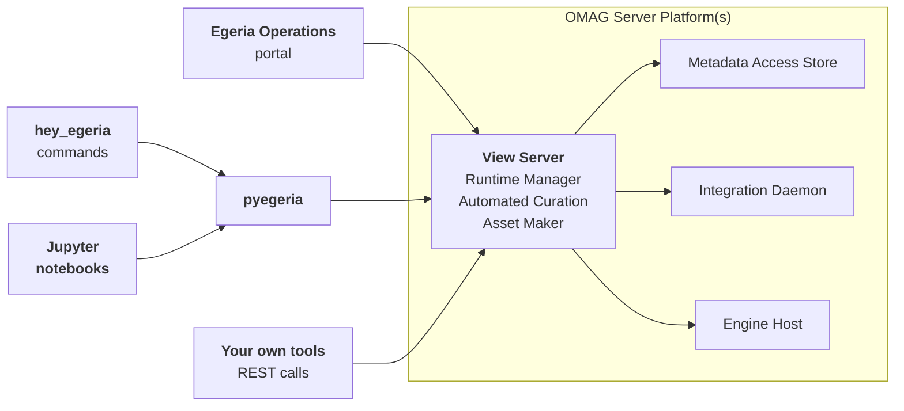
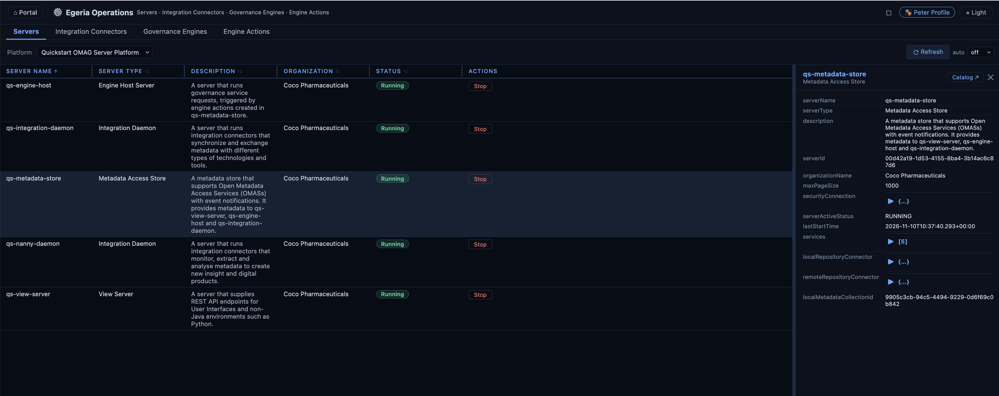
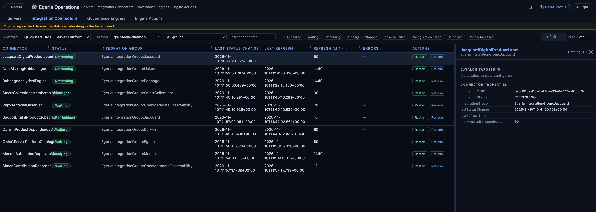
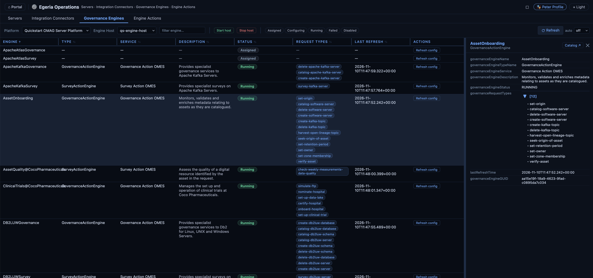
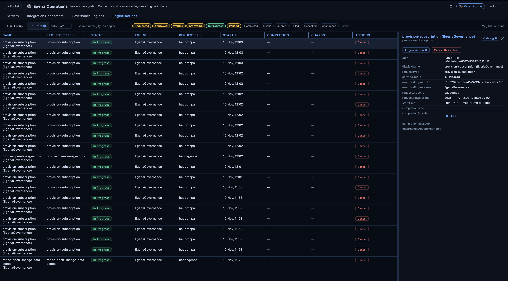
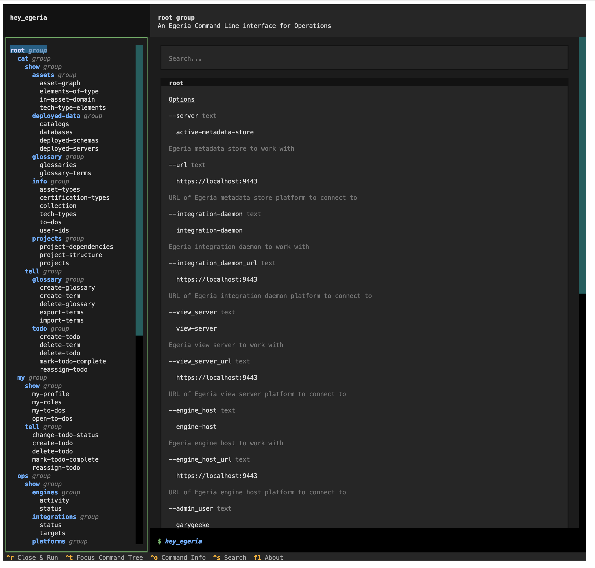
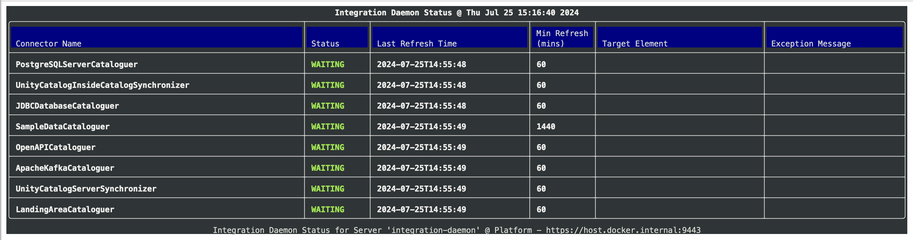
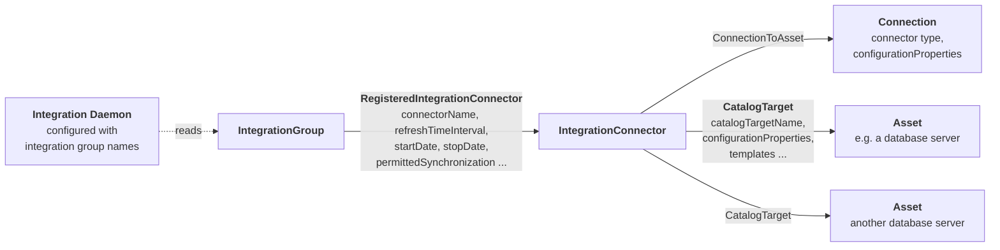
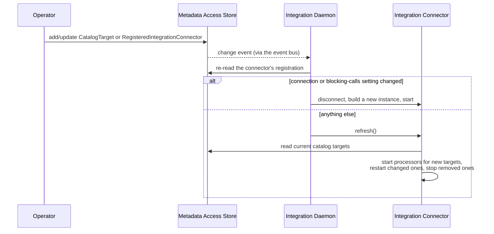

<!-- SPDX-License-Identifier: CC-BY-4.0 -->
<!-- Copyright Contributors to the ODPi Egeria project 2020. -->

# Operations Guide

The operations guide describes how to look after a running Egeria deployment: checking that the [OMAG Server Platforms](/concepts/omag-server-platform) and their [OMAG Servers](/concepts/omag-server) are healthy, starting and stopping servers, loading new content, and running and tuning the [connectors](/concepts/connector) that do Egeria's work in the background.

It assumes the servers are already [configured](/guides/admin/servers).  Watching the deployment over time, tuning the infrastructure Egeria depends on (Apache Kafka and PostgreSQL) and routine maintenance such as backups are covered in the [Monitoring and Tuning Guide](/guides/monitoring/overview).  When something has gone wrong, turn to the [Diagnostic Guide](/guides/diagnostic/overview).

## Ways to operate Egeria

When Egeria was first released, its REST APIs were the only way to control it.  There are now four, and they all end up calling the same services, so you can mix them freely - for example, watching connector status in the portal while scripting a bulk change in Python.

| Option | Best for | What it offers |
|---|---|---|
| [Egeria Operations](#egeria-operations-in-the-portal) (portal) | Day-to-day checks by an operator | A web view of servers, integration connectors, governance engines and engine actions, with simple actions such as start/stop, refresh, restart and cancel. |
| [hey_egeria](#hey_egeria-commands) (command line) | Operators working in a terminal | Live monitors that update in place, plus `tell` commands to start/stop servers, refresh and restart connectors, manage catalog targets and load archives. |
| [pyegeria](#pyegeria-scripts-and-jupyter-notebooks) (Python and Jupyter) | Automation and repeatable procedures | The full operational API as Python classes, so procedures can be scripted, scheduled, or written up as Jupyter notebooks that mix explanation with live results. |
| [REST APIs](#rest-apis) | Integration with other tools, and anything the other options do not yet cover | The underlying services.  The [Runtime Manager](/services/omvs/runtime-manager/overview) view service is the recommended entry point. |



All four routes go through a [view server](/concepts/view-server), which looks up the catalog entries for the platforms and servers and makes the calls on your behalf.  This means operators only need access to the view server, not to every platform in the deployment, and every request is subject to the same [security checks](/guides/planning/security/overview).  The older platform services calls described in [REST APIs](#rest-apis) go directly to a platform and are mainly useful in scripts that check whether a platform has started.

!!! tip "Which servers am I running?"
    The quickstart and freshstart deployments in [egeria-workspaces :material-github:](https://github.com/odpi/egeria-workspaces){ target=gh } run one platform hosting `qs-metadata-store` (a metadata access store), `qs-view-server`, `qs-integration-daemon`, `qs-engine-host` and `qs-nanny-daemon` (an integration daemon running the nanny connectors that maintain Egeria's own operational metadata).  The examples in this guide use these names.

## Egeria Operations in the portal

**Egeria Operations** is the runtime control panel on Egeria's portal.  Open it from its tile on the portal home page, or go directly to `/egeria-operations` on the portal's address.  It shows the state of the runtime itself rather than the metadata it holds; for the catalog entries describing the same servers, use the **Open in The Catalog** button on a server's detail panel.

=== "Servers"
    
=== "Integration Connectors"
    
=== "Governance Engines"
    
=== "Engine Actions"
    

> **Figure 1:** Tabs of Egeria Operations

| Tab | What it shows | Actions |
|---|---|---|
| **Servers** | Every server on the selected platform, with its type, description, organization and status.  Selecting a server opens a detail panel with its server identifier, services, maximum page size, repository connectors and local metadata collection identifier. | Start or stop a server (where your security permits). |
| **Integration Connectors** | The connectors in the selected integration daemon, filtered by integration group, name or status, with each connector's status, last status change, last refresh, refresh interval (minutes) and errors.  The detail panel lists the connector's catalog targets and properties. | Restart or refresh a connector. |
| **Governance Engines** | The governance engines in the selected engine host, filtered by name or status, with each engine's type, service, description, status, request types and last refresh. | Start or stop the engine host; refresh an engine's configuration. |
| **Engine Actions** | The ecosystem-wide log of [engine actions](/concepts/engine-action), filtered by status or searched by name, type or engine, with each action's request type, status, engine, requester, start and completion times and completion guards.  Rows can be grouped by action name. | Cancel an engine action that has not finished. |

Each tab has a **Refresh** button and an **auto** setting that refreshes the view at a chosen interval.  The **Catalog** link on a detail panel opens the catalog entry for the same server, connector, engine or action in [The Catalog](/user-interfaces/the-catalog/overview).

!!! note "Why the Integration Connectors tab can show a stale banner"
    Connector status comes from the integration daemon's report, which asks every connector for its current state and can take minutes on a busy daemon.  Rather than block, the tab shows the last report it has, under an amber banner ("Showing cached data - live status is refreshing in the background"), and updates itself when the fresh report arrives - usually within a minute.  This is expected behaviour, not a hang.

!!! summary "Usage"
    Use Egeria Operations for the routine question "is everything running?", and for one-off actions such as restarting a failed connector.  Changes that should survive a server restart - a new catalog target, a different refresh interval - are made to the connector's open metadata, as described in [Running and tuning integration connectors](#running-and-tuning-integration-connectors).

## hey_egeria commands

[hey_egeria](/user-interfaces/hey-egeria/overview) is the command line interface installed with [pyegeria](/concepts/pyegeria).  Operational commands live under `hey_egeria_ops` (also reachable as `hey_egeria ops`) and come in two groups: **show** commands display information, and **tell** commands make changes.  Many of the show commands are *monitors*: they redraw in place every few seconds until you press `Ctrl-C`, so they can be left running in a terminal window as a simple dashboard.

```bash
pip install pyegeria
```

The commands find the platform, servers and user from environment variables (such as `EGERIA_VIEW_SERVER`, `EGERIA_VIEW_SERVER_URL`, `EGERIA_INTEGRATION_DAEMON` and `EGERIA_USER`) or from options on the command line - run any command with `--help` to see them.  `hey_egeria tui` opens a menu-driven builder that is the easiest way to discover the commands.


> **Figure 2:** Building an operations command with `hey_egeria tui`

???+ info "Show commands"

    | Command | What it displays |
    |---|---|
    | `hey_egeria_ops show platforms status` | The platforms known to the view server and the servers on each.  Also available as the stand-alone `monitor_platform_status`. |
    | `hey_egeria_ops show servers status` | The status of the servers on a platform; add `--full` for more detail.  Also `monitor_server_status`. |
    | `hey_egeria_ops show servers startup` | Server start-up progress - useful straight after a platform restart.  Also `monitor_server_startup`. |
    | `hey_egeria_ops show integrations status` | Each integration connector in the integration daemon, with its status, last refresh time and refresh interval.  `--list` produces a paged list instead of a live monitor.  Also `monitor_daemon_status` / `list_daemon_status`. |
    | `hey_egeria_ops show engines status` | The governance engines in the engine host and their status.  Also `monitor_engine_status` / `list_engine_status`. |
    | `hey_egeria_ops show engines current-activity` | The engine actions currently in progress.  Also `monitor_active_engine_activity`. |
    | `monitor_engine_activity` / `list_engine_activity` | All engine actions, including completed ones. |
    | `list_catalog_targets` | The catalog targets of an integration connector. |
    | `hey_egeria_ops show repository archives` | The open metadata archives loaded into the metadata access store.  Also `list_archives`. |

    
    > **Figure 3:** The integration daemon status monitor

???+ info "Tell commands"

    | Command | What it does |
    |---|---|
    | `hey_egeria_ops tell servers start --server <name>` | Activates a server from its stored configuration. |
    | `hey_egeria_ops tell servers stop --server <name>` | Shuts a server down. |
    | `hey_egeria_ops tell integration-daemon refresh [--connector <name>]` | Calls `refresh()` on one connector, or all of them.  Also `refresh_integration_daemon`. |
    | `hey_egeria_ops tell integration-daemon restart [--connector <name>]` | Disconnects and restarts one connector, or all of them.  Also `restart_integration_daemon`. |
    | `hey_egeria_ops tell integration-daemon add-target <connector-name> <element-guid> <catalog-target-name>` | Adds a catalog target to an integration connector. |
    | `hey_egeria_ops tell integration-daemon update-target <relationship-guid> <catalog-target-name>` | Changes the name of an existing catalog target. |
    | `hey_egeria_ops tell integration-daemon remove-target <relationship-guid>` | Removes a catalog target. |
    | `hey_egeria_ops tell engine-host refresh` | Asks the engine host to reload its governance engine configuration.  Also `refresh_gov_eng_config`. |
    | `hey_egeria_ops tell repository load-archive` | Loads an open metadata archive (such as a content pack) into the metadata access store.  Also `load_archive`. |

The full command reference, with a screenshot of each display, is in the [hey_egeria documentation :material-github:](https://github.com/odpi/egeria-python/blob/main/commands/doc/README.md){ target=gh }.

## pyegeria scripts and Jupyter notebooks

[pyegeria](/concepts/pyegeria) wraps Egeria's REST APIs in Python classes.  The ones used for operations are:

| Class | Use it for |
|---|---|
| `RuntimeManager` | Platform and server status reports, starting and stopping servers, loading archives, cohort membership, and controlling integration connectors and governance engines. |
| `AssetMaker` | Maintaining the open metadata that describes integration connectors: catalog targets and their registration in integration groups. |
| `AutomatedCuration` | Engine actions, governance action processes and technology types. |
| `EgeriaTech` | All of the technical clients in one object, created as each one is first used. |

A short script can check a server and refresh a connector:

```python
from pyegeria import RuntimeManager

rm = RuntimeManager("qs-view-server", "https://localhost:9443", user_id="garygeeke", user_pwd="secret")
rm.create_egeria_bearer_token()

# How is the integration daemon doing?
print(rm.get_server_report(server_name="qs-integration-daemon"))

# Refresh one connector (omit connector_name to refresh them all)
rm.refresh_integration_connector(connector_name="MSSQLServerCataloguer",
                                 display_name="qs-integration-daemon")

rm.close_session()
```

Servers can be identified by `server_guid`, `display_name` or `qualified_name`, so scripts do not need to look up GUIDs first.  Most report methods take an `output_format` (`"JSON"`, `"DICT"`, `"MD"`, `"TABLE"` and others) so the same call can feed another program or produce a readable report.

The same code runs in a Jupyter notebook, which is a good way to capture an operational procedure: each step is explained in a markdown cell, and its live result appears underneath.  The egeria-workspaces deployments include a Jupyter server with sample notebooks.

!!! summary "Usage"
    Script anything you do more than twice - rolling out a catalog target to a set of databases, checking every connector after an upgrade, restarting servers in a particular order.  The `hey_egeria` commands are themselves pyegeria scripts, so their source is a good place to find working examples.

## REST APIs

Every operation above is available as a REST call.

* The **[Runtime Manager](/services/omvs/runtime-manager/overview)** view service covers platforms, servers, cohorts, archives, integration connectors and governance engines.  Calls go to the view server, which forwards them to the right platform.  Sample requests are in [Egeria-api-runtime-manager.http :material-github:](https://github.com/odpi/egeria/blob/main/open-metadata-implementation/view-services/runtime-manager/Egeria-api-runtime-manager.http){ target=gh }.
* **[Asset Maker](/services/omvs/asset-maker/overview)** maintains the catalog targets and integration group registrations that drive the integration daemons.
* **[Automated Curation](/services/omvs/automated-curation/overview)** lists, starts and cancels engine actions.
* The **[platform services](/services/platform-services/overview)** go directly to one platform.  They need no view server, which makes them the right choice for start-up scripts that wait for a platform to come up.  See [Server Platform Origin Service](/guides/operations/server-platform-origin-service), [Starting and Stopping an OMAG Server](/guides/operations/starting-and-stopping-omag-server) and [Adding an Archive to a Running Server](/guides/operations/adding-archive-to-running-server).

All calls carry a bearer token obtained from the platform's token service:

```
###
# @name Token
POST {{baseURL}}/api/token
Content-Type: application/json

{
  "userId" : "garygeeke",
  "password" : "secret"
}
```

For example, this call activates a server from its stored configuration:

```
###
# @name activateWithStoredConfig
POST {{baseURL}}/servers/{{viewServer}}/api/open-metadata/runtime-manager/omag-servers/{{serverGUID}}/instance
Authorization: Bearer {{token}}
```

## Operating servers

??? info "Start, stop and check a server"
    A server runs from its [configuration document](/concepts/configuration-document) and can be started and stopped any number of times without changing it.

    | Task | Portal | hey_egeria | pyegeria (`RuntimeManager`) | Runtime Manager REST |
    |---|---|---|---|---|
    | Is it running? | Servers tab | `show servers status` | `get_server_report()` | `GET .../omag-servers/{serverGUID}/instance/report` |
    | Start | Servers tab | `tell servers start` | `activate_server_with_stored_config()` | `POST .../omag-servers/{serverGUID}/instance` |
    | Stop | Servers tab | `tell servers stop` | `shutdown_server()` | `DELETE .../omag-servers/{serverGUID}/instance` |
    | Stop and remove from its cohorts | - | - | `shutdown_and_unregister_server()` | `DELETE .../omag-servers/{serverGUID}` |

    Only stop *and unregister* a server that is being permanently removed: it tells the other members of each [cohort](/concepts/cohort-member) to forget it.

??? info "Load new content into a metadata access store"
    [Open metadata archives](/concepts/open-metadata-archive), including the [content packs](/content-packs), can be loaded into a running [metadata access store](/concepts/metadata-access-store) without a restart.  Loading an archive a second time does no harm: an element is only added if the repository does not already hold it (or a later version of it).

    | Option | How |
    |---|---|
    | hey_egeria | `hey_egeria_ops tell repository load-archive` |
    | pyegeria | `RuntimeManager.add_archive_file()` for a file on the platform's file system, or `add_archive_content()` to send the archive in the request. |
    | REST | `POST .../omag-servers/{serverGUID}/instance/load/open-metadata-archives/file` - see also [Egeria-load-content-packs.http :material-github:](https://github.com/odpi/egeria/blob/main/open-metadata-implementation/view-services/runtime-manager/Egeria-load-content-packs.http){ target=gh }. |

??? info "Cohort membership"
    A server that is a [cohort member](/concepts/cohort-member) can be connected to, disconnected from and unregistered from each cohort while it runs.  Disconnecting stops the exchange but keeps the registration, so the server rejoins cleanly later; unregistering removes it from the cohort registry.  Use `RuntimeManager.connect_to_cohort()`, `disconnect_from_cohort()` and `unregister_from_cohort()`, or the matching `.../cohort-members/{serverGUID}/cohorts/{cohortName}/...` REST calls.

## Running and tuning integration connectors

An [integration daemon](/concepts/integration-daemon) runs [integration connectors](/concepts/integration-connector) that keep open metadata in step with third party technologies.  What a daemon runs is not in its configuration document: the document names one or more [integration groups](/concepts/integration-group), and the integration groups, connectors and their settings are held as open metadata in the metadata access store.  So most tuning is done by changing metadata, and the daemon picks the change up while it runs.



> **Figure 4:** The open metadata that controls an integration connector

### Connector status

The integration daemon reports a status for each connector.  This is what the portal, `show integrations status` and the server report display:

| Status | Meaning | What to do |
|---|---|---|
| `INITIALIZED` | Set up and waiting to start. | Nothing - it moves on once started. |
| `WAITING` | Running normally, waiting for its next refresh. | Nothing. |
| `REFRESHING` | Its `refresh()` method is running. | Nothing, unless it stays here for much longer than usual. |
| `RUNNING` | Running in its own thread (connectors that make blocking calls). | Nothing. |
| `STOPPED` | Stopped because of its configured stop date, or because the daemon is shutting down. | Check the stop date if this is unexpected. |
| `INITIALIZE_FAILED` | Could not be initialized because the metadata access store was unavailable. | Check the metadata access store, then restart the connector. |
| `CONFIG_FAILED` | Could not be initialized because its class name or configuration is invalid. | Correct its connection, then restart it. |
| `FAILED` | Threw an exception; it is not called again until restarted. | Look in the audit log for the exception, fix the cause, then restart. |
| `SHUTDOWN` | No longer called, because it was removed or replaced. | Nothing. |

Here is the report for one connector from `qs-integration-daemon`:

```json
{
  "connectorId": "0e29b0a8-0535-4be0-8941-f8ef2af3dc3b",
  "connectorName": "MSSQLServerCataloguer",
  "connectorInstanceId": "18425ffc-804d-4846-89df-d9f65da2a949",
  "connectorStatus": "WAITING",
  "lastStatusChange": "2026-11-10T11:11:28.623+00:00",
  "lastRefreshTime": "2026-11-10T11:11:28.623+00:00",
  "minMinutesBetweenRefresh": 60
}
```

### Refresh and restart

*Refresh* calls the connector's `refresh()` method now, without waiting for the next scheduled refresh.  Use it when you know something has changed in the third party technology.  *Restart* disconnects the connector, builds a new instance and starts it - use it to recover a `FAILED` connector or to pick up a corrected connection.  Both can be issued for one connector or for every connector in the daemon, from the portal, `hey_egeria_ops tell integration-daemon refresh|restart`, `RuntimeManager.refresh_integration_connector()` / `restart_connector()`, or `POST .../integration-daemons/{serverGUID}/integration-connectors/refresh|restart`.

### Tuning the refresh interval

The `refreshTimeInterval` property on the *RegisteredIntegrationConnector* relationship sets the number of **minutes** between refreshes.  The daemon checks each connector every second and calls `refresh()` once the interval has passed since the last refresh finished.

* **0** (the default) means the connector is refreshed once when it starts, and after that only when asked to - by a refresh request, or by a change to its configuration.  This suits connectors that are driven by events (such as the OpenLineage and Kafka-based connectors) or that should only run on demand.
* **A positive value** suits connectors that poll the third party technology.  Choose it from how quickly changes need to appear in open metadata and how much load each refresh puts on the technology: a full survey of a large database server every 5 minutes may cost more than it is worth, while a daily refresh may leave the catalog a day out of date.

Because the interval belongs to the registration, not the connector, the same connector definition can be registered in two integration groups with different intervals - for example, a frequent refresh in a development daemon and a nightly one in production.

??? info "Other registration properties"

    | Property | Effect |
    |---|---|
    | `connectorName` | The name used in status reports, audit log messages and refresh/restart requests. |
    | `connectorUserId` | The user the connector runs as.  Defaults to the integration daemon's own user.  Give a connector its own user to control what it may change, and to make its changes easy to identify. |
    | `startDate` / `connectorShutdownDate` | The window in which the connector runs.  Outside it the connector is not refreshed.  Use these to schedule a connector for a migration window, or to retire one without deleting its definition. |
    | `permittedSynchronization` | The direction metadata may flow: `FROM_THIRD_PARTY`, `TO_THIRD_PARTY` or `BOTH_DIRECTIONS`.  This is the default for each of the connector's catalog targets. |
    | `metadataSourceQualifiedName` | The [software capability](/concepts/software-capability) recorded as the source of the metadata the connector creates, which gives that metadata [external source provenance](/features/metadata-provenance/overview). |
    | `generateConnectorActivityReports` | Whether the connector writes [connector activity reports](/types/4/0457-Connector-Activity-Reports) to open metadata after each refresh. |

    Changing `connectorUserId`, the start or stop dates, the interval or the synchronization direction takes effect on the running connector.  Changing whether it uses blocking calls, or replacing its connection, makes the daemon build a new instance of the connector.

### Tuning catalog targets

A [catalog target](/concepts/catalog-target) attaches one piece of technology - typically the [asset](/concepts/asset) for a server, database or folder - to a connector.  One connector can have many catalog targets, and each one carries its own settings on the *CatalogTarget* relationship:

| Property | Effect |
|---|---|
| `catalogTargetName` | Which of the connector's supported [catalog target types](/concepts/catalog-target/#catalog-target-types) this target is.  It must match a name the connector declares. |
| `configurationProperties` | Settings for this target only.  They are laid over the connector's own configuration properties, so one connector can, for example, include different schemas from each database it catalogs. |
| `templates` | [Templates](/guides/planning/templates/overview) to use when creating elements for this target, keyed by the names the connector expects. |
| `metadataSourceQualifiedName` | The metadata collection that the elements created from this target belong to - so metadata from the sales database and the finance database can be kept apart. |
| `connectionName` | Which connection to use when the target asset has more than one. |
| `permittedSynchronization` | The direction metadata may flow for this target.  When it is not set, the connector's value is used. |
| `deleteMethod` | What to do with open metadata for things removed from the technology - archive, soft-delete or purge.  See [Deleting metadata](/guides/monitoring/overview#managing-deleted-metadata). |

The configuration properties a connector understands are listed on its page in the [connector catalog](/connectors).  Here is a catalog target being added through Asset Maker:

```
###
# @name addCatalogTarget
POST {{baseURL}}/servers/{{viewServer}}/api/open-metadata/asset-maker/integration-connectors/{{integrationConnectorGUID}}/catalog-targets/{{metadataElementGUID}}
Authorization: Bearer {{token}}
Content-Type: application/json

{
  "class" : "NewRelationshipRequestBody",
  "properties": {
    "class": "CatalogTargetProperties",
    "catalogTargetName" : "postgreSQLDatabaseServer",
    "configurationProperties" : {
      "includeDatabaseList" : ["sales", "finance"]
    },
    "permittedSynchronization" : "FROM_THIRD_PARTY"
  }
}
```

The same change can be made with `hey_egeria_ops tell integration-daemon add-target`, with `AssetMaker.add_catalog_target()` in pyegeria, or with Dr.Egeria.  `update-target` / `update_catalog_target()` change an existing target, and `remove-target` / `remove_catalog_target()` remove one.

### When changes take effect



> **Figure 5:** How a change to a connector's open metadata reaches the running connector

When Egeria has an event bus, the daemon hears about a change to a catalog target or registration within moments and refreshes the connector straight away.  If a refresh is already in progress, the change is held until it finishes, so two instances of the connector never work on the same metadata at once.  Without an event bus, the daemon re-reads each integration group's configuration roughly every half hour; issue a refresh to pick a change up sooner.

??? warning "Temporary changes through Runtime Manager"
    Runtime Manager can also change a running connector directly: `update_connector_configuration()` (configuration properties), `update_endpoint_address()` and `update_connector_connection()`, or the matching `.../integration-connectors/{connectorName}/...` REST calls.  These restart the connector with the new values **in memory only** - they are lost when the integration daemon restarts.  They are useful for trying out a setting; make the lasting change to the connector's connection or catalog target once you are happy with it.

!!! summary "Usage"
    Treat the connector's open metadata as the configuration: add catalog targets to bring new technology under management, set the refresh interval on the registration, and keep per-target settings on the catalog target.  Use refresh and restart to act on the running connector now, and the temporary Runtime Manager changes only to experiment.

## Operating governance engines

An [engine host](/concepts/engine-host) runs [governance engines](/concepts/governance-engine), whose definitions - like integration groups - are held in open metadata.  Engines do their work as [engine actions](/concepts/engine-action), which are created by people, by [governance action processes](/concepts/governance-action-process) and by other services.

| Task | Portal | hey_egeria | pyegeria | REST |
|---|---|---|---|---|
| Engine status | Governance Engines tab | `show engines status` | `RuntimeManager.get_server_report()` | Runtime Manager `.../omag-servers/{serverGUID}/instance/report` |
| Reload engine configuration | Governance Engines tab | `tell engine-host refresh` | `RuntimeManager.refresh_gov_eng_config()` | Runtime Manager `GET .../engine-hosts/{serverGUID}/governance-engines/refresh-config` |
| Active engine actions | Engine Actions tab | `show engines current-activity` | `AutomatedCuration` | Automated Curation `GET .../engine-actions/active` |
| Cancel an engine action | Engine Actions tab | - | `AutomatedCuration` | Automated Curation `POST .../engine-actions/{engineActionGUID}/cancel` |

An engine host normally picks up changes to its engine definitions by itself.  Reloading the configuration is useful after the metadata access store has been unavailable, particularly while the engine host was starting.

## Further information

* [Monitoring and Tuning Guide](/guides/monitoring/overview) - the audit log, Kafka and PostgreSQL, backups and housekeeping.
* [Diagnostic Guide](/guides/diagnostic/overview) - finding out why something is not working.
* [OMAG Server Runtime](/guides/operations/operate-omag-server-starter) - running a single server in its own process.
* [Administration Guide](/guides/admin) - creating and changing server configuration.

--8<-- "snippets/abbr.md"
