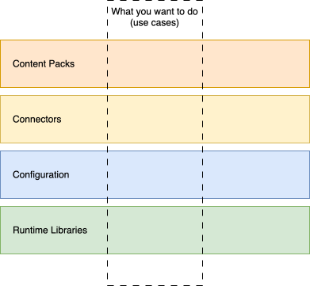
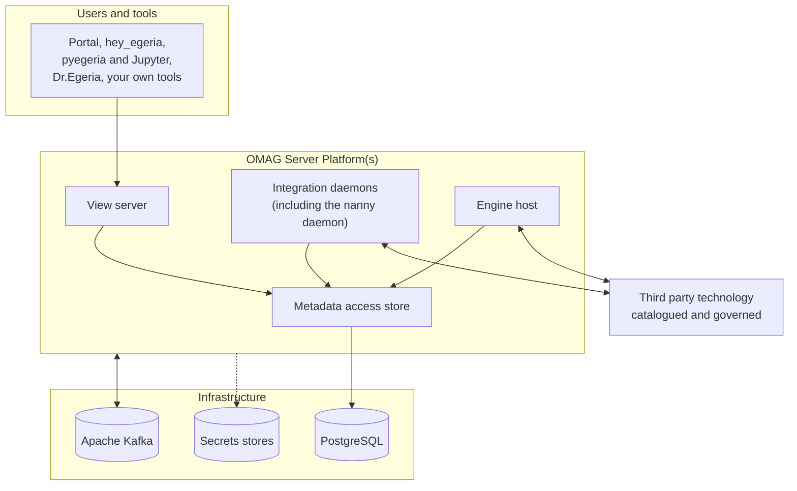

<!-- SPDX-License-Identifier: CC-BY-4.0 -->
<!-- Copyright Contributors to the Egeria project 2019-present. -->

# Planning Guide

[Egeria Workspaces](/egeria-workspaces) provides a simple, up and running environment using docker-compose.  It supports an individual, or small team.  If, however, you have out-grown egeria-workspaces, or would like to build your own deployment environment from scratch then this planning guide is the place to start.

Egeria is highly modular, allowing you to choose which components to use "as supplied", and which to remove, extend, or replace with something customized for your organization.
Typically, Egeria's function is broader than you need, at least initially, so often the challenge is to know which pieces you need to do the things you want to do, and what you can safely ignore.

There are four types of "component" from Egeria that you need to consider: Content Packs, Connectors, Configuration and the Runtime Libraries.

* The *content packs* contain open metadata types and instances.  Open metadata is used to define the people, processes, data and technology that make up your organization.  These are all linked together and stored in a knowledge graph to show how they work together.  Egeria's content packs provide sets of open metadata that provide basic definitions that help to bootstrap your knowledge graph.
* The *connectors* provide plugins into Egeria's runtime libraries that either connect to a specific technology to exchange metadata, or implement a specific governance action.  Connectors are configured using open metadata and only run when they are explicitly activated.  One of Egeria's content packs called *CoreContentPack.omarchive* includes the configuration for the [standard connectors included in Egeria](/connectors).
* The *configuration* controls the activation of Egeria's services in the runtime.  Related services are grouped together into what are called [OMAG Servers](/concepts/omag-server) so they can be activated and deactivated together.  Egeria's services are used to build out your knowledge graph.  They can be called from the connectors, or other tools and technologies using Egeria's clients, or directly via the REST APIs.  Managing configuration is described in the [Administration Guide](/guides/admin).
* The *runtime libraries* provide the services to manage the connectors and the knowledge graph.  They are packaged into a choice of two runtimes.  The [OMAG Server Platform](/concepts/omag-server-platform) is the typical runtime to use, particularly initially, since it can run all functions using multiple OMAG Servers and its configuration can be dynamically changed making it easy to experiment with different settings.  The [OMAG Server Runtime](/guides/operations/operate-omag-server-starter) is a specialist runtime for a cloud-native deployment that only runs a single OMAG Server using a fixed configuration.  The specific software services included in either runtime can be both removed or added at build time to allow you to fully customize Egeria's runtimes. 

The *Planning Guide* provides information to help you plan the deployment of Egeria in your organization. 

## Egeria's distribution

As a general rule of thumb, we suggest using Egeria's components as supplied and only customize them as you get more confident.  To this end, when you [build the main egeria repository](/education/tutorials/building-egeria-tutorial/overview) (called [egeria.git](https://github.com/odpi/egeria)), it creates a distribution folder containing content packs, connectors, sample configuration and the runtime libraries along with `README.md` files describing how to use this content.  

--8<-- "snippets/inside-egerias-distribution.md"

The Egeria project also includes additional content, such as connectors, in other repositories that can be built and added to this distribution.  The distribution also includes a Docker script file so that, once you have all of the content you need assembled, it can be turned into a docker container for deployment.  Alternatively it can be run directly on a local machine running Linux or MacOS (bare metal).

## Planning the whole deployment

A running Egeria deployment is more than the platform.  It is a set of OMAG Servers, the infrastructure they depend on, the connectors and content that give them something to do, the people and tools that use them, and the processes that keep them secure and healthy.  The decisions below cover the whole of that picture.  Each one is described briefly here and in detail in the guide it points to.

| Decision | Questions to answer | Where to find out more |
|---|---|---|
| **Starting point** | Is [Egeria Workspaces](/egeria-workspaces) enough, or do you need your own deployment?  Will you start from its configuration and adapt it? | [Egeria Workspaces](/egeria-workspaces) |
| **Runtime and servers** | How many platforms, and where?  Which servers - at least a [metadata access store](/concepts/metadata-access-store), a [view server](/concepts/view-server), [integration daemons](/concepts/integration-daemon) and an [engine host](/concepts/engine-host)?  The OMAG Server Platform or the single-server runtime?  Containers, Kubernetes or bare metal? | [Planning Runtime Deployment](/guides/planning/runtime/overview) |
| **Infrastructure** | Where will the PostgreSQL repository and the Apache Kafka [event bus](/concepts/event-bus) run, who looks after them, and how large must they be?  What topic name root will the servers share? | [Planning Runtime Deployment](/guides/planning/runtime/overview), [Monitoring and Tuning Guide](/guides/monitoring/overview) |
| **Connectors and content** | Which technologies will be catalogued and governed, and which [connectors](/connectors) and [content packs](/content-packs) does that need?  Are any connectors missing, so they must be built? | [Connector Catalog](/connectors), [Developer Guide](/guides/developer) |
| **Configuration** | How will the platform and server configuration be created, stored and kept under change control?  Which servers start automatically with the platform? | [Administration Guide](/guides/admin) |
| **Security** | Certificates and TLS, user accounts and passwords, secrets stores, the metadata security connectors, [governance zones](/concepts/governance-zone), and the audit trail of security decisions.  What must change from the shipped samples? | [Planning for Security](/guides/planning/security/overview) (threat model), [Security Guide](/guides/security/overview) (controls and hardening) |
| **User interfaces** | Who works with Egeria directly, and through which interface?  Which existing tools will be integrated instead? | [Planning User Interfaces](/guides/planning/user-interfaces/overview), [Integration Guide](/guides/integration) |
| **Day-to-day operation** | Who starts and stops servers, restarts connectors and tunes their refresh intervals and catalog targets?  Will they use the portal, `hey_egeria`, pyegeria scripts or the REST APIs? | [Operations Guide](/guides/operations/overview) |
| **Monitoring and maintenance** | Where does the audit log go, and who watches it?  How are Kafka and PostgreSQL monitored?  How often is the repository backed up, and what is the policy for purging soft-deleted metadata? | [Monitoring and Tuning Guide](/guides/monitoring/overview) |
| **Problem determination** | Who is called when something goes wrong, and what access will they need to logs, the audit log and the infrastructure? | [Diagnostic Guide](/guides/diagnostic/overview) |
| **Metadata ecosystem** | Which valid values, templates, translations, organization details and governance definitions must be loaded before users arrive? | [Preparing the metadata ecosystem](#preparing-the-metadata-ecosystem), below |

!!! tip "Start small"
    Each of these decisions can be revisited.  A common path is to begin with Egeria Workspaces, or a single platform running the same five servers as its quickstart (`qs-metadata-store`, `qs-view-server`, `qs-integration-daemon`, `qs-engine-host` and `qs-nanny-daemon`), connect it to the technologies you care about most, and then split servers across platforms, add capacity and tighten security as the deployment grows.

## Designing your own deployment

The rest of this *Planning Guide* assumes you are familiar with the basic concepts of Egeria and have some knowledge of the contents of the Egeria's distribution.  It is divided into two parts as follows:

### Planning deployment

These pages focus on setting up the Egeria software and its supporting technology.

* [Planning Runtime Deployment](/guides/planning/runtime/overview) describes how to design your Egeria runtime deployment.
* [Planning for Security](/guides/planning/security/overview) describes how to build a threat model for Egeria.  The [Security Guide](/guides/security/overview) then describes the controls that answer those threats.
* [Planning User Interfaces](/guides/planning/user-interfaces/overview) describes the user interfaces that Egeria supplies.

Once the deployment is running, these guides take over:

* The [Administration Guide](/guides/admin) describes how to configure the platform and its servers.
* The [Operations Guide](/guides/operations/overview) describes how to start and stop servers, and run and tune connectors and governance engines.
* The [Monitoring and Tuning Guide](/guides/monitoring/overview) describes the audit log, monitoring Kafka and PostgreSQL, and the regular maintenance tasks such as backups and purging deleted metadata.
* The [Diagnostic Guide](/guides/diagnostic/overview) describes how to find the cause of a problem.
* The [Security Guide](/guides/security/overview) describes how to assure the security of the deployment.

### Preparing the metadata ecosystem

These pages describe the types of metadata that should be populated in your open metadata ecosystem to allow it to operate effectively.  This metadata can be added directly into your metadata repository, or added to your own content packs to load across multiple Egeria deployments.

* [Metadata Valid Values](/guides/planning/valid-values/overview) to control the values used in open metadata elements.
* [Templates](/guides/planning/templates/overview) to simplify the creation of open metadata elements.
* [Multiple Language Translations](/guides/planning/translations/overview) to support multiple languages in the metadata elements.
* [Onboarding Organization](/guides/planning/organization/overview) to define the people, their roles and userIds and how they are organized into teams.  This is used to control access to metadata and associated resources, route stewardship actions to the appropriate individuals/teams and synchronize organizational information between systems.
* [Governance Program](/guides/planning/governance-program/overview) to coordinate the various governance activities in the organization.

The connectors supplied by Egeria are found in the [Connector Catalog](/connectors).

--8<-- "snippets/abbr.md"
