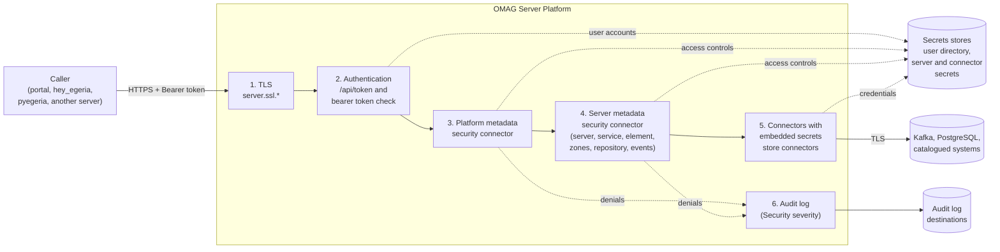
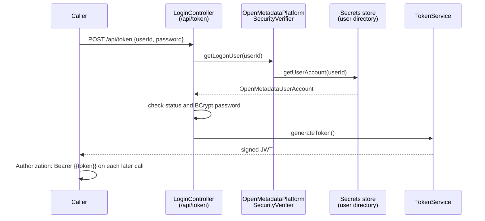

<!-- SPDX-License-Identifier: CC-BY-4.0 -->
<!-- Copyright Contributors to the Egeria project. -->

# Security Guide

This guide is for the security expert who needs to assure an Egeria deployment.  It walks through each layer of protection that Egeria provides, names the properties, classes and URLs that control it, and points to the pages that describe each mechanism in detail.  It also lists the settings in the shipped samples that must be changed before a deployment holds real metadata, and the places where the code behaves differently from what a reader might expect.

Egeria's runtime is the [OMAG Server Platform](/concepts/omag-server-platform): a Spring Boot application that hosts a number of [OMAG Servers](/concepts/omag-server).  Everything a caller does - configuring a server, starting it, searching for metadata, updating a glossary term - is a REST call to the platform, and every server-to-server call is also a REST call or an event on Apache Kafka.  Securing Egeria therefore means securing that platform and the connections it makes.

## Layers of protection

A request to Egeria passes through the layers below.  Each layer is independent, and each is optional in the code, so an assurance review needs to confirm that every one of them is switched on and configured.



| Layer | What it protects | Where it is configured | Detail |
|---|---|---|---|
| Transport level security | Confidentiality and integrity of every call to and from the platform. | `application.properties` (`server.ssl.*`, `strict.ssl`) and JVM system properties (`javax.net.ssl.*`). | [TLS and certificates](#transport-level-security) |
| Authentication | Proves who the caller is and issues a signed bearer token. | `application.properties` (`authentication.source`, `bearerTokenTimeout`) and the user directory in a secrets store. | [Users, passwords and tokens](#users-passwords-and-bearer-tokens) |
| Platform authorization | Who may configure servers, start and stop them, and query the platform. | `platform.security.*` properties. | [Platform metadata security connector](#the-platform-metadata-security-connector) |
| Server authorization | Who may use each server, each service and operation, and each metadata element. | The `serverSecurityConnection` in each server's [configuration document](/concepts/configuration-document). | [Server metadata security connector](#the-server-metadata-security-connector) |
| Governance zones | Which collections of metadata each user may read or change. | Security access controls in the user directory, plus `zoneMembership` on the elements. | [Governance zones](#governance-zones) |
| Secrets management | Keeps passwords, tokens and certificates out of configuration documents and the metadata repository. | Secrets store connectors embedded in connections. | [Secrets stores](#secrets-stores) |
| Security audit logging | A record of denied requests and of changes to accounts and controls. | Audit log destinations in each server's configuration document, plus the platform's security log file. | [Security audit logging](#security-audit-logging) |

!!! summary "Usage"
    Use this table as the outline of an assurance review: for each row, confirm that the mechanism is enabled, that it is configured with your organization's values rather than the samples, and that its output is monitored.

## Transport level security

The platform plays two network roles.  It is a *network server* for the REST calls it receives, and a *network client* when it calls other platforms, Apache Kafka, databases and the systems that its connectors catalogue.  Each role is configured separately.  The background to TLS, one-way and mutual authentication, and the creation of certificates is in [Transport Level Security (TLS) and Certificates](/guides/admin/omag-server-platform-transport-level-security).

???+ info "Inbound - the platform as a network server"
    These are standard Spring Boot properties, set in `application.properties`.  The values below are the ones shipped in the platform's `application.properties` and in the quickstart's `quickstart.application.properties`.

    ```properties
    server.port=9443
    server.ssl.key-store=keystore.p12
    server.ssl.key-store-password=egeria
    server.ssl.keyStoreType=PKCS12
    server.ssl.keyAlias=egeriaserverchassis
    server.ssl.trust-store=truststore.p12
    server.ssl.trust-store-password=egeria
    ```

    The key store holds the platform's own certificate and private key.  The trust store lists the certificates the platform trusts; it is only consulted for inbound calls if you also turn on mutual TLS with the Spring property `server.ssl.client-auth`.

???+ info "Outbound - the platform as a network client"
    Outbound calls use the standard Java system properties `javax.net.ssl.trustStore` and `javax.net.ssl.trustStorePassword`, plus `javax.net.ssl.keyStore` and `javax.net.ssl.keyStorePassword` when the remote end requires mutual TLS.  These are JVM system properties (`-D...`), not Spring properties.

    If `javax.net.ssl.trustStore` is not set, the platform logs the warning `Java trust store 'javax.net.ssl.trustStore' is null` at start up and copies `server.ssl.trust-store` and its password into the Java properties (see `OMAGServerPlatform.getInitialize()`).  Set the Java properties explicitly so that the inbound and outbound trust decisions are deliberate.

???+ warning "strict.ssl"
    `strict.ssl` is an Egeria property.  Its default in the code is `true`, which means outbound calls check the certificate of the server being called.  When it is set to `false`, the platform logs `Option strict.ssl is set to false! Invalid certificates will be accepted for connection!` and calls `HttpHelper.noStrictSSL()`, which turns off certificate and host name validation for **every** outbound HTTPS call made by the JVM.

    Both the shipped `application.properties` and the quickstart set `strict.ssl=false` so that they work with self-signed certificates.  A production platform must run with `strict.ssl=true` and a trust store that contains the certificates (or the issuing certificate authority) of every platform and service it calls.

???+ info "Kafka, PostgreSQL and other connections"
    Connections that Egeria makes through connectors carry their own TLS settings.  For Apache Kafka, add the Kafka client properties (for example `security.protocol`, `ssl.truststore.location` and `ssl.truststore.password`) to the `producer` and `consumer` sections of the server's `eventBusConfig` configuration properties.  For PostgreSQL, add the JDBC SSL parameters (for example `sslmode=verify-full`) to the `databaseURL`.  Use [placeholder variables](#keeping-secrets-out-of-configuration-documents) and secrets stores so that the passwords for these trust stores are not written into the configuration document.

???+ info "Certificates in the egeria-workspaces deployments"
    The egeria-workspaces quickstart puts an Apache web server (`apache-web`) in front of the platform and the portal.  Its certificates are created by `generate-certs.sh` (self-signed, for local use) or `letsencrypt-cert.sh` (Let's Encrypt, for a public demonstration), renewed by `renew-certs.sh`, and watched for expiry by `cert-watch.sh`.  The platform's own port is published only on the loopback interface by default (`EGERIA_BIND_IP` defaults to `127.0.0.1`), as is the JVM debug port 5005.  The sample `keystore.p12` and `truststore.p12` use the password `egeria`; replace them, and the passwords, with your own.

!!! summary "Usage"
    For each platform, record where its key store and trust store come from, who issues and renews the certificates, and confirm that `strict.ssl` is `true`.  Repeat the check for every Kafka broker and database connection in the servers' configuration documents.

## Users, passwords and bearer tokens

Every REST call to the platform, apart from a short list of public endpoints, must carry a bearer token.  The token is obtained by logging on with a userId and password.

### How log on works

Authentication is provided by the `user-authn` module (package `org.odpi.openmetadata.userauthn`), which is built on Spring Security.  It is switched on by these properties:

```properties
authentication.source=platform
authentication.mode=token
rsa.key-id=
bearerTokenTimeout=1
```

When `authentication.source=platform`, the `PlatformSecurityConfig` and `PlatformUserDetailsService` components look up user accounts through the [platform metadata security connector](#the-platform-metadata-security-connector) - specifically its `OpenMetadataUserSecurity` interface, which the Open Metadata Access Security Connector passes on to its embedded secrets store.  **The user directory is therefore the platform security connector's secrets store collection.**  If no platform security connector is configured, there are no user accounts and every log on fails with `User account not found`.



```http
###
# @name Token
POST {{baseURL}}/api/token
Content-Type: application/json

{
  "userId" : "garygeeke",
  "password" : "{{password}}"
}

###
# @name getServerStatus
GET {{baseURL}}/open-metadata/platform-services/server-platform/servers/qs-metadata-store/status
Authorization: Bearer {{token}}
```

The response to `POST /api/token` is the token itself, as plain text.  The same service is also available at `POST /servers/{serverName}/api/token`; today it calls the platform's user directory too, so the server name makes no difference to the result.

??? info "What is in the token"
    The token is a JSON Web Token created by `TokenService` and signed with a 2048-bit RSA key.  Its claims are:

    | Claim | Value |
    |---|---|
    | `iss` | `self` |
    | `sub` | The userId. |
    | `displayName` | The `userName` from the user account. |
    | `dn` | The `distinguishedName` from the user account, if it has one. |
    | `iat` / `exp` | Issue time, and issue time plus `bearerTokenTimeout` hours (default 1). |

    Spring Security's OAuth2 resource server validates the signature and the expiry time on every call.  The sessions are stateless (`SessionCreationPolicy.STATELESS`) and CSRF protection is disabled, which is the usual arrangement for a token-based REST API.

### User accounts and passwords

Each user account in the user directory has a `userAccountStatus` and a `userAccountType`:

| `userAccountStatus` | Effect at log on |
|---|---|
| `AVAILABLE` | The user may log on. |
| `CREDENTIALS_EXPIRED` | Log on fails with `Credentials expired` unless the request also supplies a `newPassword`.  The new password is stored and the account becomes `AVAILABLE`. |
| `LOCKED` | Log on fails. |
| `DISABLED` | Log on fails. |

The `userAccountType` is one of `EMPLOYEE`, `CONTRACTOR`, `EXTERNAL` or `DIGITAL` (a non-personal account used by automation).  The security connector builds dynamic groups from it, so it can be used in access decisions.

A password is held in the account's `secrets` as either `clearPassword` or `encryptedPassword`.  The `encryptedPassword` is a BCrypt hash, and is what the platform compares against.  When a user changes their password through `/api/token` with a `newPassword`, the platform writes a new BCrypt `encryptedPassword` to the secrets store and removes the `clearPassword`.  The sample user directories use `clearPassword` throughout: in production, store only `encryptedPassword` values.

Problems with logging on are diagnosed in [Logon problems](/guides/diagnostic/logon-problems).

### Endpoints that need no token

`SecurityConfig.securityFilterChain()` lets these paths through without a token:

| Path | Purpose |
|---|---|
| `/api/token` and `/servers/*/api/token` | Log on. |
| `/api/about` and `/api/public/**` | Descriptive information about the platform for user interfaces. |
| `/open-metadata/platform-services/server-platform/origin` | The platform's version string, used by health checks. |
| `/swagger-ui/**` and `/v3/api-docs/**` | The OpenAPI documentation, controlled by the `springdoc.*` properties. |

All of these are read-only.  If you do not want the API documentation published, set `springdoc.api-docs.enabled=false`.

### Token lifetime, revocation and signing keys

???+ warning "A token cannot be revoked before it expires"
    `DELETE /api/token/logout` returns `OK`, but it only removes the token from a `TokenClient` token cache, and the platform does not include an implementation of `TokenClient`.  In a standard build the call has no effect, and a token remains valid until it reaches its `exp` time.  Keep `bearerTokenTimeout` short (the quickstart uses 2 hours) and disable or lock the user account if a token may have been stolen - this stops new tokens being issued, but a token that has already been issued keeps working until it expires.

???+ warning "rsa.key-id does not fix the signing key"
    The token signing key pair is generated afresh each time the platform starts (`RSAGenerator.generateRSAKeyPair()` calls `KeyPairGenerator` every time).  The `rsa.key-id` property only sets the *key identifier* attached to that key; it does not load a fixed key.  So every restart invalidates all issued tokens, and a token issued by one platform is never accepted by another, whatever `rsa.key-id` is set to.  Clients must be ready to log on again after a platform restart.

### Other properties that affect the HTTP layer

* `cors.allowed-origins` - the browser origins allowed to call the platform.  Both the shipped and the quickstart properties set `*`.  Set it to the origins of your user interfaces.
* `authn.header.name.list` - names of HTTP headers to copy from incoming requests into thread-local storage for connectors to use (`*` copies them all).  Leave it empty unless a connector needs a header.
* `springdoc.*` - the OpenAPI documentation described above.
* `management.endpoints.web.exposure.include` - the Spring Boot actuator endpoints to expose.  It is commented out in the shipped properties, so only the defaults are exposed.

!!! summary "Usage"
    Confirm that `authentication.source=platform` and that a platform security connector is configured, so that every call needs a token issued from your user directory.  Choose a `bearerTokenTimeout` that balances the risk of a stolen token against how often people must log on, restrict `cors.allowed-origins`, and replace sample `clearPassword` values with BCrypt `encryptedPassword` values.

## Authorization with the metadata security connectors

Authorization is delegated to two kinds of connector, described in [Open Metadata Security](/features/metadata-security/overview):

* the [platform metadata security connector](/concepts/platform-metadata-security-connector), one per platform, which secures the [administration services](/services/admin-services/overview), [platform services](/services/platform-services/overview) and server operations; and
* the [server metadata security connector](/concepts/server-metadata-security-connector), one per OMAG Server, which secures everything that server does.

Egeria supplies one implementation of both: the *Open Metadata Access Security Connector* (provider class `org.odpi.openmetadata.metadatasecurity.accessconnector.OpenMetadataAccessSecurityProvider`).  It takes all its decisions from the user accounts, named lists and security access controls in an embedded secrets store, so a security team can control access by editing that store.

!!! danger "Both connectors fail open when they are missing"
    If no platform security connector is configured, the platform performs no authorization checks.  If a server's configuration document has no `serverSecurityConnection`, the server performs none either - every authenticated user can call every service and see every element.  Configure the platform connector before the platform is used, and configure each server's connector before the server is first started.

### The platform metadata security connector

The platform connector is configured in `application.properties`.  These are the values used by the quickstart:

```properties
platform.security.provider=org.odpi.openmetadata.metadatasecurity.accessconnector.OpenMetadataAccessSecurityProvider
platform.security.name=Coco Pharmaceuticals Platform @ 9443
platform.security.secrets.provider=org.odpi.openmetadata.adapters.connectors.secretsstore.yaml.YAMLSecretsStoreProvider
platform.security.secrets.location=/deployments/secrets/coco-user-directory.omsecrets
platform.security.secrets.collection=cocoUserDirectory
```

It can also be replaced while the platform is running with `POST /open-metadata/platform-services/server-platform/security/connection` (and read or removed with `GET` and `DELETE` on the same URL).  Replacing it needs operator authority under the current connector.

The connector maps the platform roles to security access controls in the user directory.  The names of these controls can be changed with the connector's configuration properties:

| Check | Configuration property | Default control name |
|---|---|---|
| Configure servers (administration services) | `serverAdministratorControlName` | `admin-services` |
| Start and stop servers (platform services) | `serverOperatorsControlName` | `platform-services` |
| Query servers (server operations) | `serverInvestigatorsControlName` | `server-operations` |

In the quickstart user directory, the `DEFAULT` list of `admin-services` names `serverAdministrator`, `platform-services` names `serverOperator`, and `server-operations` names `serverInvestigator` - with an extra `addOpenMetadataArchiveFile` entry that lets any `openMetadataMember` load an archive.  Configuring the platform connector is described in [Configuring the OMAG Server Platform](/guides/admin/configuring-the-omag-server-platform).

### The server metadata security connector

Each server's connector is held in the `serverSecurityConnection` property of its configuration document, and is set with the administration services.  This is the call that the quickstart uses to configure `qs-metadata-store`.  The `~{...}~` values are [placeholder variables](#keeping-secrets-out-of-configuration-documents).

```http
###
# @name setServerSecurityConnection
POST {{baseURL}}/open-metadata/admin-services/servers/qs-metadata-store/security/connection
Authorization: Bearer {{token}}
Content-Type: application/json

{
  "class": "VirtualConnection",
  "connectorType": {
    "class": "ConnectorType",
    "connectorProviderClassName": "org.odpi.openmetadata.metadatasecurity.accessconnector.OpenMetadataAccessSecurityProvider"
  },
  "embeddedConnections" : [{
    "class": "EmbeddedConnection",
    "embeddedConnection" : {
      "class" : "Connection",
      "connectorType" : {
        "class" : "ConnectorType",
        "connectorProviderClassName" : "~{secretsStoreProvider}~"
      },
      "endpoint" : {
        "class" : "Endpoint",
        "networkAddress" : "~{userDirectorySecretsStore}~"
      },
      "configurationProperties" : {
        "secretsCollectionName" : "~{userDirectorySecretsCollectionName}~"
      }
    }
  }]
}
```

`GET` on the same URL shows the current setting and `DELETE` removes it, turning off all authorization in that server.  Further detail is in [Server Security Connection Section](/guides/admin/servers/by-section/server-security-connection-section).

The server connector is called at several layers, and each layer is a separate interface (`OpenMetadataServerSecurity`, `OpenMetadataServiceSecurity`, `OpenMetadataElementSecurity`, `OpenMetadataRepositorySecurity` and `OpenMetadataEventsSecurity`).  The Open Metadata Access Security Connector implements them like this:

???+ info "Server access"
    `validateUserForServer` looks for a security access control with the same name as the server, and checks the user against its `DEFAULT` list.  The quickstart defines one for each server - `qs-metadata-store` and `qs-view-server` admit `openMetadataMember`; `qs-integration-daemon` and `qs-engine-host` admit only `serverOperator`.

???+ info "Service and operation access"
    Each service has a `ServiceAccessControl` whose `mappingProperties.serviceName` names it.  The `DEFAULT` list governs every operation, and a list named after an operation overrides it.  For example, the quickstart's `repository-services` control lets every `openMetadataMember` use the repository services, but limits `addTypeDef`, `reTypeEntity`, `purgeEntity` and similar operations to `metadataArchitect` (and, for the purges, `dataManagementProcess`).

???+ info "Element access"
    `OpenMetadataElementSecurity` decides what a user may do with each element, using its [governance zones](#governance-zones), its owner and its anchor.  It also implements `selectConnection`, which chooses which of an asset's connections a user receives - important because a connection may carry credentials with more access than the user is entitled to.

???+ info "Repository and event access"
    `OpenMetadataRepositorySecurity` checks access to types and instances in the local repository, and can remove properties from an instance before it is returned.  `OpenMetadataEventsSecurity` checks each event sent to or received from an [open metadata repository cohort](/concepts/cohort-member), and can change the event or drop it, so that sensitive instances are not shared or cached.

### Groups and roles

Access lists may name users, or named lists from the user directory.  A named list has a `listTypeName` (such as `SecurityRole` or `SecurityGroup`) and its members are given in `userMembers` and `listMembers`.  The connector also builds these dynamic groups itself; their names can be changed with the connector property shown:

| Default group | Configuration property | Members |
|---|---|---|
| `allUsers` | `allUsersGroupName` | Every user with an active account. |
| `employeeUsers` | `employeeOnlyZonesAccessGroupName` | Accounts of type `EMPLOYEE`. |
| `contractUsers` | `contractorsGroupName` | Accounts of type `CONTRACTOR`. |
| `externalUsers` | `externalUsersGroupName` | Accounts of type `EXTERNAL`. |
| `digitalUsers` | `digitalUsersGroupName` | Accounts of type `DIGITAL`. |
| `instanceOwner` | `instanceOwnerGroupName` | The owner of the element being accessed. |
| `existingMaintainer` | `existingMaintainerGroupName` | People who have already maintained the element. |
| `newMaintainer` | `newMaintainerGroupName` | People who have **not** yet maintained the element - used for separation-of-duties rules. |

!!! tip "Renaming the dynamic groups"
    If you change one of these group names through its configuration property, use the same name in the user directory and in every access list.

### Maintaining the user directory

The user directory can be changed in three ways:

* Edit the secrets store directly.  The connector re-reads a collection when its `refreshTimeInterval` (in minutes) has passed - the quickstart user directory uses 10.
* Use the platform's security services under `/open-metadata/platform-services/server-platform/security/`: `user-list`, `user-accounts` (`POST`, and `GET` or `DELETE` on `user-accounts/{accountUserId}`) and `security-access-controls` (`POST`, and `GET` or `DELETE` on `security-access-controls/{controlName}`).
* Use the [Security Officer API](/services/omvs/security-officer/overview), which provides the same functions through a view server, along with statements of applicability.

Each addition or removal of a user account or access control is written to the audit log (see [below](#security-audit-logging)).

!!! summary "Usage"
    Configure the Open Metadata Access Security Connector, or your own implementation of the same interfaces, on the platform and on every server.  Then review the security access controls for the three platform roles, each server, and each service, and decide which operations need tighter lists than the `DEFAULT`.

## Governance zones

[Governance zones](/features/governance-zoning/overview) group metadata elements so that access can be controlled for the whole group.  An element lists its zones in the `zoneMembership` property of its `ZoneMembership` classification, and each zone is defined by a security access control of type `GovernanceZone` in the user directory - for example the quickstart's `egeria-runtime` zone lets every `openMetadataMember` read its contents (`READ` list) but only `runtimeManager` and `dataManagementProcess` change them (`DEFAULT` list).

The rules applied by the Open Metadata Access Security Connector are set out in [Access control through governance zones](/features/governance-zoning/overview#access-control-through-governance-zones).  The points that matter most for assurance are:

* **An element with no zones is visible to every user with an active account.**  Elements that need protecting must be put in a zone - [templates](/features/governance-zoning/overview#using-templates) and the server's default zone settings help to do this consistently.
* **Zone security fails closed.**  A zone without a security access control admits no one, so a misspelt zone name hides elements rather than exposing them.  The *OMAGServerPlatformCataloguer* integration connector flags zones that are missing from the user directory with a `MISSING-ZONE-ACCESS-CONTROL` exception.
* A zone named after a userId is that user's personal zone.
* Searches are filtered in the repository using the zones the user may read (`pushDownZoneFilter`, default `true`).  The filter relies on zone information held in each element's `Anchors` classification, which can be refreshed with the `resynchronize-anchors-zones` request type of the *Egeria Governance Engine*.

!!! summary "Usage"
    Decide which collections of metadata need restricted access, define a zone and its security access control for each, and make sure new elements are created in the right zones.  Check regularly for `MISSING-ZONE-ACCESS-CONTROL` exceptions.

## Secrets stores

A [secrets store connector](/concepts/secrets-store-connector) retrieves secrets - passwords, API keys, certificates, token API details - from a secure location at runtime, so that they need not be held in configuration documents or in the metadata repository.  Egeria supplies the *YAML File Secrets Store Connector* (`org.odpi.openmetadata.adapters.connectors.secretsstore.yaml.YAMLSecretsStoreProvider`).  Other secrets managers can be supported by writing a connector to the same interface.

### Inside a secrets store

A YAML secrets store file holds named `secretsCollections`.  Each collection may contain:

* `refreshTimeInterval` - minutes before the connector re-reads the collection, so rotated secrets are picked up without a restart;
* `secrets` - named values such as `userId`, `clearPassword` and `encryptedPassword`;
* `tokenAPI` - how to obtain a bearer token (`httpRequestType`, `url`, `contentType` and `requestBody`);
* `users`, `namedLists` and `securityAccessControls` - the user directory and access controls used by the security connectors.

A single YAML secrets store connector reads one collection, named by the `secretsCollectionName` configuration property of its connection; the file is named in the connection's endpoint `networkAddress`.

### How the quickstart uses secrets stores

The quickstart separates its secrets into three files, each mounted into the platform container at `/deployments/secrets`:

| File | Collections | Used by |
|---|---|---|
| `coco-user-directory.omsecrets` | `cocoUserDirectory` | The platform and server security connectors - user accounts, named lists and security access controls. |
| `egeria-servers.omsecrets` | `PostgreSQLRepository`, `EgeriaServers`, and one collection per automated service such as `OMAGServerPlatformCataloguer` | The repository's database credentials, and the `tokenAPI` details each server and service uses to log on as its own non-personal account. |
| `integration.omsecrets` | One collection per catalogued technology | Integration connectors that call third-party systems. |

A server's own identity is set with `POST /open-metadata/admin-services/servers/{serverName}/server-properties`.  `localServerUserId` names its non-personal account (for example `qsstorenpa`), and `secretsStoreProvider`, `secretsStoreLocation` and `secretsStoreCollection` name the secrets store collection whose `tokenAPI` the server uses to obtain a bearer token when it calls other servers.

### Secrets in connections

A secrets store connector is used by embedding its connection in the connection of the connector that needs the secrets, as the server security connector example above shows.  The [connector broker](/concepts/connector-broker) creates both together, and if the outer connection's `userId`, `clearPassword` or `encryptedPassword` are empty it fills them from the secrets store.  If a connector needs other secrets, the connection's `securedProperties` hold the *names* of the secrets, not their values.  Secrets that integration connectors need for third-party systems can be stored through the [Automated Curation API](/services/omvs/automated-curation/overview) - see [Client-side secret](/concepts/client-side-secret).

### Keeping secrets out of configuration documents

Configuration documents are stored by the [configuration document store connector](/concepts/configuration-document-store-connector).  The default `FileBasedServerConfigStoreProvider` writes each one as a **clear text** JSON file under `data/servers/{serverName}/config/`.  Do not write passwords into a configuration document.  Instead:

* refer to secrets stores, as above; and
* use placeholder variables such as `~{egeriaServersSecretsStore}~` in the configuration, which the platform replaces at server start up with the values in the `platform.placeholder.variables` property of `application.properties`.

### Protecting the secrets stores

A YAML secrets store is an ordinary file, so its protection comes from the deployment: restrict the file system permissions to the account that runs the platform, keep the files out of source control and container images, and mount them at runtime (the quickstart mounts `runtime-volumes/quickstart-platform-data/secrets`).  The YAML connector writes changes back to the file when user accounts, passwords or access controls are updated through the APIs, so the user directory file must be writable by the platform.

!!! summary "Usage"
    Inventory every secrets store and collection that the platform and its servers use, who can read and change each one, and how its secrets are rotated.  Confirm that no configuration document contains a password.

## Security audit logging

Each OMAG Server has an [audit log](/concepts/audit-log), and each audit log record has a severity.  The `Security` severity is used for unauthorized access attempts and for changes to the security definitions.  The records are routed by the server's [audit log destination connectors](/concepts/audit-log-destination-connector), and each destination chooses the severities it receives.

### What is logged

The security connectors log these messages (defined in `OpenMetadataSecurityAuditCode`):

| Message identifiers | Severity | Meaning |
|---|---|---|
| `OPEN-METADATA-SECURITY-0005`, `0006`, `0007`, `0010` | `Security` | A user was refused access to the platform, a server, a service, or a service operation. |
| `OPEN-METADATA-SECURITY-0008`, `0009`, `0011`, `0015` to `0020` | `Security` | A user was refused permission to add feedback, change zones, use an anchor, or read or change a type, instance or element. |
| `OPEN-METADATA-SECURITY-0022`, `0023`, `0024` | `Security` | An unknown user, a user account that could not be retrieved, or an expired user account. |
| `OPEN-METADATA-SECURITY-0025`, `0026` | `Security` | A security access control that is unknown or could not be retrieved. |
| `OPEN-METADATA-SECURITY-0027` to `0030` | `Security` | A user account or security access control was added or removed. |
| `OPEN-METADATA-SECURITY-0021` | `Information` | An element was filtered out of a result. |

### Where the records go

???+ info "Server security events"
    Messages from a server's security connector go to that server's audit log.  Make sure at least one destination receives `Security` records and sends them to a system that is monitored.  For example, the quickstart's `qs-metadata-store` sends `Security` records both to the console and to the Kafka topic `quickstart.ffdc.audit-logs`.  Destinations are configured with the administration services under `/open-metadata/admin-services/servers/{serverName}/audit-log-destinations/` - for example `POST .../audit-log-destinations/event-topic` - each taking the list of `supportedSeverities` in the request body (an empty list means all severities).  See [configuring the audit log](/guides/admin/servers/by-section/repository-services-section).

???+ info "Platform security events"
    The platform security connector has no server audit log.  Its messages are appended to the file `logs/security/security.log`, relative to the platform's working directory, as lines of the form `timestamp platform Security OPEN-METADATA-SECURITY-0022 User ... is not recognized`.  The quickstart mounts this directory as `runtime-volumes/quickstart-platform-data/security-logs`.  Collect this file along with the server audit logs.

???+ info "Failed log ons"
    A failed log on is refused by the `LoginController` before any security connector is consulted, so it does not create an audit log record.  It is written to the platform's log by the `org.odpi.openmetadata.userauthn` logger (`User authentication failed for user: ...`).  The shipped `application.properties` sets `logging.level.root=OFF`, so add `logging.level.org.odpi.openmetadata.userauthn=ERROR` if failed log ons need to be recorded.

???+ info "User activity"
    The `Activity` severity records what users do.  It is not logged by default.  It is the input to the [metadata observability](/features/metadata-observability/overview) services, which analyse activity from the audit log topics.

!!! summary "Usage"
    Route `Security` records from every server, the platform's `security.log` file, and the `org.odpi.openmetadata.userauthn` log into your security monitoring, and set alerts for repeated refusals and for any change to user accounts or access controls.

## Hardening checklist

The shipped `application.properties` and the egeria-workspaces samples are designed to be easy to start, not to be secure.  Before a deployment holds real metadata:

| Setting in the samples | Change for production |
|---|---|
| `strict.ssl=false` | Set `strict.ssl=true` and provide a trust store with the certificates of everything the platform calls. |
| Sample `keystore.p12` and `truststore.p12` with password `egeria` | Use certificates issued by your certificate authority, with your own passwords supplied from a secrets manager. |
| `cors.allowed-origins=*` | List the origins of your user interfaces. |
| Sample user directories with `clearPassword: secret` | Use your own user directory with BCrypt `encryptedPassword` values, and only the accounts you need. |
| Coco Pharmaceuticals access controls and zones | Define access controls for your own roles, servers, services and zones. |
| Security connectors that are not configured | Configure the platform connector and a `serverSecurityConnection` for every server. |
| `logging.level.root=OFF` | Record failed log ons, and collect `logs/security/security.log`. |
| OpenAPI documentation published | Set `springdoc.api-docs.enabled=false` if it should not be visible. |

In addition, follow the deployment guidance in [Planning for security](/guides/planning/security/overview): run the platform on a patched operating system and Java runtime, place it in a private network segment behind a reverse proxy or API gateway, and secure the Kafka brokers and databases it uses.

!!! summary "Usage"
    Work through this checklist for each platform, and record the evidence for each item as part of the deployment's security assurance.

## Known gaps in the code

These behaviours of the code (branch `oak2026`) are worth recording in a security assessment because they differ from what a reader might expect.

| Area | Expected behaviour | What the code does |
|---|---|---|
| `DELETE /api/token/logout` and `DELETE /servers/{serverName}/api/token/logout` | The token is revoked. | The call only removes the token from a token cache (`TokenClient`), and none is supplied, so the token stays valid until it expires.  Use a short `bearerTokenTimeout` to limit the exposure. |
| `rsa.key-id` | A fixed signing key that survives a restart. | It only sets the key identifier (`kid`).  A new RSA key pair is generated at every start, so all tokens become invalid when the platform restarts, and a token from one platform is never accepted by another. |
| Configuration document store | Encrypted at rest. | `FileBasedServerConfigStoreProvider` writes clear-text JSON and no encrypting store is supplied, so protect the files and keep secrets in a secrets store. |

??? education "Further information"
    * [Open Metadata Security](/features/metadata-security/overview) - the security connector interfaces in full.
    * [Planning for security](/guides/planning/security/overview) - threat modelling for an Egeria deployment.
    * [Transport Level Security (TLS) and Certificates](/guides/admin/omag-server-platform-transport-level-security)
    * [Governance Zoning](/features/governance-zoning/overview)
    * [Secrets store connector](/concepts/secrets-store-connector) and [Client-side secret](/concepts/client-side-secret)
    * [Security access control](/concepts/security-access-control) and the [Security Officer API](/services/omvs/security-officer/overview)
    * [Audit log](/concepts/audit-log) and [Audit log destination connector](/concepts/audit-log-destination-connector)
    * [Synchronizing security authorization information](/features/synchronized-access-control/overview)
    * [Operations Guide](/guides/operations/overview) and [Logon problems](/guides/diagnostic/logon-problems)

--8<-- "snippets/abbr.md"
