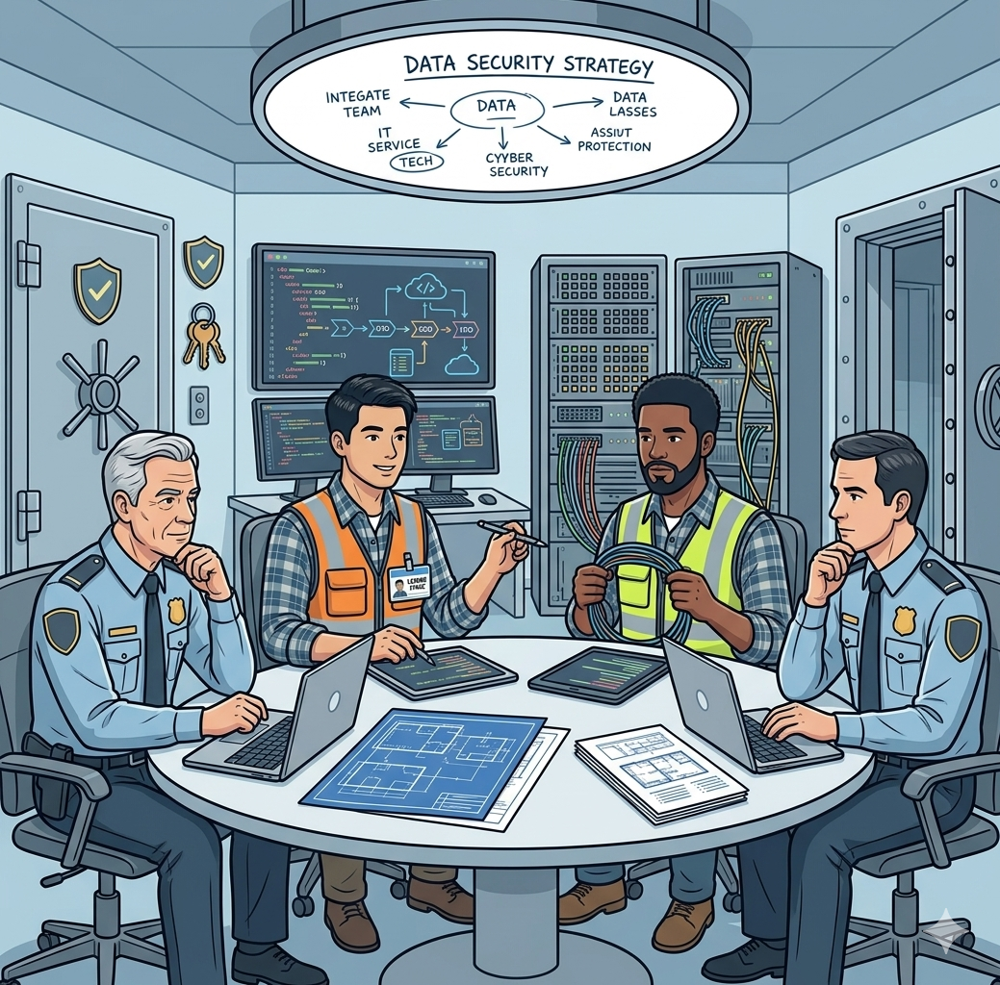

<!-- SPDX-License-Identifier: CC-BY-4.0 -->
<!-- Copyright Contributors to the Egeria project. -->

# Assuring IT System Security

This scenario illustrates how Egeria can be used to support the assurance of IT system security.

When [Simon Burr](/practices/coco-pharmaceuticals/personas/simon-burr) (Si) joins Coco Pharmaceuticals, the [data security strategy](/practices/coco-pharmaceuticals/scenarios/building-a-data-security-strategy/overview) has set out *what* the company is committing to.  Si's job is to make it true in practice: to monitor, test and improve the security of the IT systems, and to be able to show that it is working.  He meets regularly with [Ivor Padlock](/practices/coco-pharmaceuticals/personas/ivor-padlock), [Lemmie Stage](/practices/coco-pharmaceuticals/personas/lemmie-stage) and [Gary Geeke](/practices/coco-pharmaceuticals/personas/gary-geeke) to review progress.

The security team's practice of working each threat through into the concrete risks it gives rise to, and rating each one for likelihood and impact, is the model for the company-wide [risk register](/practices/coco-pharmaceuticals/scenarios/building-the-governance-team/overview#the-risk-register) that the governance leaders go on to build together.  [Ivor Padlock](/practices/coco-pharmaceuticals/personas/ivor-padlock) owns the cyber security and event security entries in that register.

## Starting from the systems inventory

Si cannot protect systems that nobody has told him about.  The ISMS obligation that *information assets must be inventoried and classified* means that his first question is the one Gary has just been working on: what systems does Coco Pharmaceuticals actually run?

Gary's [systems inventory](/practices/coco-pharmaceuticals/scenarios/cataloguing-infrastructure/overview) began as his spreadsheet, was loaded into Egeria so that the strategic information supply chains could be mapped to real systems, and was then extended with the systems from the two recent acquisitions - the small-batch manufacturers in Austin and in Bucharest.  It is this complete inventory that gives Si his starting point, and it brings an uncomfortable discovery.

The original Coco Pharmaceuticals estate has no security governance software at all.  There is a firewall and there are certificates, but nothing that collects security events, looks for unusual behaviour or tests the defences.  The acquisitions are different:

* **Bucharest** runs a Splunk SIEM (security information and event management) platform, fed in real time by the security event logs from Active Directory, the SAP ERP system, the FactoryTalk SCADA system on the shop floor and the VMware infrastructure.  Alongside it, Darktrace provides AI-based threat detection and network anomaly monitoring, pushing its high-confidence alerts into Splunk to be correlated with everything else.
* **Austin** runs its own Splunk Enterprise SIEM, fed by a Palo Alto next-generation firewall, Active Directory, SAP, the manufacturing execution system's audit trail and Microsoft Purview data loss prevention.

Both sites also have established security practices, including regular vulnerability scanning and penetration testing, that the parent company has never had.

## Learning from the acquisitions

Si's original plan had been to choose and install security tooling from scratch.  Instead, he starts by talking to the people who run security at Austin and Bucharest - their names are recorded against their systems in the inventory - about what they monitor, what they test, how often, and what they have learned.  They have years of experience operating these tools in a regulated manufacturing environment, and they become his closest advisors.

Egeria makes their set-up visible in a way that a conversation alone would not.  The system interactions loaded with the acquisitions' inventory show which systems send which security events to the SIEM, over which protocol and how often.  Si uses these as a template.  For each system in the original Coco estate he asks the same questions: where would its security events go, which acquisition system plays the equivalent role, and what would an attacker be able to do there unobserved today?  The gaps become his work list, and he plans to extend the acquisitions' monitoring and testing practices to cover the original Coco systems rather than run a separate approach at headquarters.

He prioritises using the risk register.  The two Critical cyber security risks point him at where to start:

* **Ransomware disruption to manufacturing operations** requires that manufacturing systems are segmented from the corporate network, that offline and tested backups exist for everything critical to production, and that the incident response plan covers manufacturing downtime.  The inventory shows which systems are involved, and the network and host information shows where they sit.
* **Theft of personalised treatment intellectual property** requires the strongest tier of access control on the research systems, logging and regular review of access, and data loss prevention monitoring for bulk export - which is exactly what Austin's Purview set-up already does.

## Modelling the threats

With the systems known, Si begins [threat modelling](/egeria-solutions/threat-modelling/overview).  He does not need to draw the systems from scratch: [Erin Overview](/practices/coco-pharmaceuticals/personas/erin-overview) and [Peter Profile](/practices/coco-pharmaceuticals/personas/peter-profile) have already described the [strategic information supply chains](/practices/coco-pharmaceuticals/scenarios/defining-information-supply-chains/overview) as solution components linked to the systems that run them.  Those models show what the business depends on, how data moves between systems, and which external partners are involved.  Si adds the actors - legitimate and malicious - and works through each component looking for the ways it could be attacked.  The threats and the risks they give rise to are recorded in Egeria, and each risk is linked to the components and systems it applies to with the [*ScopedBy*](/types/1/0120-Assignment-Scopes) relationship.  When a system changes, the risks scoped to it show Si what needs to be looked at again.

## Continuous penetration testing

Part of Si's remit is to set up continuous penetration testing across the company.  Sidney's question in the [strategy meeting](/practices/coco-pharmaceuticals/scenarios/building-a-data-security-strategy/overview) - had the security of the systems ever been tested? - had no good answer, and a test carried out once a year would only show how secure the systems were on the day of the test.  Attackers probe continuously, so the defences need to be tested continuously too.

Si builds the testing up in layers, drawing on the practices already in use at Austin and Bucharest:

* **Automated vulnerability scanning** runs on a regular schedule against every system in the inventory, looking for known weaknesses such as unpatched software, exposed services and insecure configuration.
* **Automated penetration testing** goes further, attempting to exploit what the scans find in order to show which weaknesses an attacker could actually use, and how far they could get.
* **Expert-led penetration tests** are commissioned periodically for the most critical systems, and whenever a major change is made, because some weaknesses can only be found by a skilled person thinking like an attacker.

Egeria tells Si what to test and in what order.  The inventory defines the scope - a system that is not in the inventory will not be tested, which is another reason the inventory must be complete.  The risks scoped to each solution component, and the systems that implement those components, tell him which systems to test first and most often.  The deployments that [Lemmie's pipelines](/practices/coco-pharmaceuticals/scenarios/devops-cataloguing/overview) record show when something new has reached production and should be tested.

The results come back into Egeria.  Each test run is catalogued as a [survey report](/concepts/survey-report) through the [Asset Maker API](/services/omvs/asset-maker/overview), with its category set to *Penetration Test Results* or *Vulnerability Scan Report*, and its findings are added through the [Data Discovery API](/services/omvs/data-discovery/overview).  Each finding is a [security annotation](/types/6/0665-Security-Annotations) linked to the report and to the system it was found in - a *VulnerabilityAnnotation* for a known vulnerability found by a scan, or a *PenetrationTestFindingAnnotation* for a weakness a tester exploited - and tagged with its vulnerability type from the security team's reference data.  A *SecurityPostureAnnotation* summarizes each run.  Findings that need someone to act on them become [incident reports](/concepts/incident-report), and when a fix has been deployed the system is retested to confirm that the weakness has gone.  Because every run is kept, Si can show whether the estate is getting more secure over time - which is exactly the evidence that the ISMS's plan-do-check-act cycle asks for.

## Keeping the picture current

An inventory that is correct on the day it is loaded and wrong a month later gives a false sense of security.  Two changes keep it up to date.

The first is in Gary's [IT infrastructure governance program](https://github.com/odpi/egeria-workspaces/blob/main/coco-workbooks/4.%20keeping-safe/it-governance-program.md).  It requires that every system is recorded in the systems inventory, with an owner, its purpose, the data it holds and its recovery objective, *before* it reaches production, and that every change to a production system follows one recorded path.  A *Systems Inventory Completeness* metric compares what is registered with what is discovered, so that systems arriving outside the process are spotted.

The second is Lemmie's work on [DevOps cataloguing](/practices/coco-pharmaceuticals/scenarios/devops-cataloguing/overview).  As the deployment pipelines run, they record what was deployed, where, and what it was built from: the operating platform and its software package manifest on each host, the storage it uses and the network through which it can be reached.  This turns the catalog into a record of the *software supply chain*.  When a vulnerability is announced in a software package, the question "where are we running it?" can be answered from Egeria in minutes rather than by asking around.  It also lets Gary and Lemmie standardize the operating platforms and plan a rolling update of system software, so that security patches are applied systematically rather than when someone remembers.

## Keeping open metadata safe

As the catalog fills up, Si points out that Egeria has itself become a sensitive resource.  A complete map of the company's systems, how they connect, which are monitored and which risks remain open is exactly what an attacker would want.  If the security team is going to rely on it, open metadata must be both protected and trustworthy.

Egeria's security features are configured accordingly:

* access to the open metadata is controlled through [governance zones](/features/governance-zoning/overview), with security access controls defining who may see and change the elements in each zone.
* the secrets needed by Egeria's connectors to reach other systems are held in [secrets stores](/concepts/secrets-store-connector) rather than in configuration or in the repository.
* the users of Egeria are routinely [audited](/practices/coco-pharmaceuticals/scenarios/auditing-it-system-users/overview), so that clear-text passwords, unexpected accounts and unsecured zones are spotted and fixed.

## What changed

The tooling borrowed from the acquisitions closes the most obvious gaps, but Ivor notices a more subtle effect.  Once the systems, their owners, their software levels, their data and their risks are visible in one place, people start to look.  System owners see the risks recorded against their systems and ask how to reduce them.  The DevOps team sees the patch levels across the estate.  The departments that bought their own systems discover that registering them makes them easier to support, not harder.  Combined with the security awareness training in the [education program](/practices/coco-pharmaceuticals/scenarios/defining-data-enabled-employees/overview), the visibility and traceability that Egeria provides makes the whole company more efficient and more vigilant - security becomes something people can see, and therefore something they can take part in.

!!! education "Further information"
    * The Egeria solutions used in this scenario are described under [Keeping Safe](/egeria-solutions/keeping-safe), in particular [Threat Modelling](/egeria-solutions/threat-modelling/overview), [Proactive Cataloguing](/egeria-solutions/proactive-cataloguing/overview) and [Auditing Users](/egeria-solutions/auditing-users/overview).
    * The [DevOps Pipeline API](/services/omvs/devops-pipeline/overview) is how deployment pipelines record what they deploy.
    * The Dr.Egeria Markdown file that scopes the risks in the risk register to the solution components they threaten is `risk-scopes.md`, and the file for Gary's IT infrastructure governance program is `it-governance-program.md` in 'coco-workbooks/4. keeping-safe' of the [Quickstart](/egeria-workspaces/quick-start/overview) environment.  [Link to the directory on GitHub](https://github.com/odpi/egeria-workspaces/tree/main/coco-workbooks/4.%20keeping-safe).

--8<-- "snippets/abbr.md"
