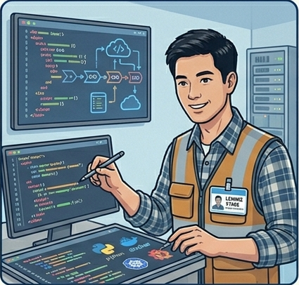
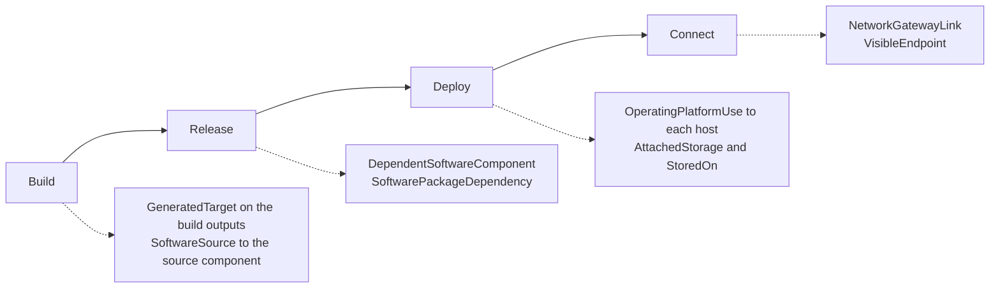
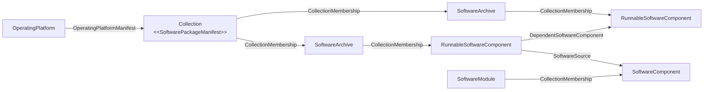

<!-- SPDX-License-Identifier: CC-BY-4.0 -->
<!-- Copyright Contributors to the Egeria project. -->

# DevOps Cataloguing

This scenario shows how the DevOps team uses Egeria to catalog the infrastructure and software it deploys, as it deploys it.  It means the systems inventory stays accurate without anyone having to update it by hand.  It also records the software supply chain behind every deployed system, and supports a rolling update of system software so that security patches are applied across the whole estate.

## Where it starts

[Gary Geeke](/practices/coco-pharmaceuticals/personas/gary-geeke) has [loaded his systems inventory into Egeria](/practices/coco-pharmaceuticals/scenarios/cataloguing-infrastructure/overview) and extended it with the systems from the Austin and Bucharest acquisitions.  It is already being used: Erin and Peter have linked the strategic information supply chains to it, and the security team has taken it up as the asset inventory for the [ISMS](/practices/coco-pharmaceuticals/scenarios/building-a-data-security-strategy/overview).  But Gary knows its weakness from his spreadsheet days.  Keeping it current - particularly the software levels on each machine - was tedious, and he often fell behind.  An inventory that the security team relies on cannot be allowed to drift.

[Lemmie Stage](/practices/coco-pharmaceuticals/personas/lemmie-stage) builds and deploys the containers that run Coco Pharmaceuticals' new systems and services.  Every time one of his pipelines runs, it changes the IT landscape: new software components are released, operating platforms are patched, storage is attached to new hosts, and services move between networks.  The pipeline already knows exactly what it is deploying, where, and what it was built from.  Gary's suggestion is simple: let the pipeline tell Egeria.

Lemmie has his own reason to agree.  The security of the systems he deploys is a constant worry, with new security exposures being discovered all the time.  When the next one is announced, he wants to be able to say where the affected software is running without logging on to every host to find out.

## Agreeing standard operating platforms

Gary's inventory records an operating system and a patch level for each system, and the data from the acquisitions shows how much variation there is.  Before automating anything, Lemmie and Gary agree a small number of standard deployments for the software to run on.  The first is Lemmie's common Linux distribution for Coco Pharmaceuticals' Docker containers, which nearly all of his new services are built on.

Each standard deployment is recorded as an [*OperatingPlatform*](/types/0/0030-Operating-Platforms) entity, with its operating system and patch level.  The list of software packages that make up the stack is held in a [collection](/concepts/collection) with the *SoftwarePackageManifest* classification, and linked to the operating platform with the *OperatingPlatformManifest* relationship.  A new version of a stack - for example, one that includes this month's security patches - is a new operating platform with its own manifest.

These definitions are more than a record.  They are what Lemmie's software updater works from: the operating platform says what a host *should* be running, so the updater can compare it with what the host *is* running and bring the two into line.

This is the change Gary had listed as a benefit of moving his inventory into Egeria: formalising software levels into standard operating platforms reduces the variation in the system stacks and makes a systematic upgrade process possible.

## What the pipeline records

Lemmie adds steps to his deployment pipelines that call the [DevOps Pipeline API](/services/omvs/devops-pipeline/overview) as they run.  Figure 1 shows what is recorded at each stage.

> **Figure 1:** The open metadata recorded by Lemmie's pipelines at each stage of a deployment

???+ info "Build and release"
    When the pipeline builds a component, it adds the *GeneratedTarget* classification to the build outputs, recording the build identifier, the build tool and its version.  Generated targets can be reproduced at will, so they do not need to be backed up.  The *SoftwareSource* relationship connects each built asset to the software component it was built from, and *DependentSoftwareComponent* records which runnable components need one another in order to execute.  *SoftwarePackageDependency* links the asset to the collection of software packages it needs when it is running.

???+ info "Deployment"
    When the component is deployed, the pipeline links the operating platform to each host it was installed on with the *OperatingPlatformUse* relationship.  Its properties record when the software was installed and who - or what - deployed it, so every change can be traced to the pipeline run that made it.  Storage volumes are linked to the hosts they are attached to, and to the data stores that keep their data on them.  This shows which physical storage holds a particular data set, which matters when a volume is decommissioned or when regulations restrict where data may be stored.

???+ info "Network placement"
    The pipeline records which networks each service's [endpoint](/concepts/endpoint) can be reached through, and which [network gateways](/concepts/network) map between networks.  This shows where services are isolated in private networks and which gateways expose them to the outside world.

???+ info "Cloud deployments"
    Where part of the infrastructure is provided by a cloud provider, the pipeline adds the *CloudProvider*, *CloudPlatform*, *CloudTenant* or *CloudService* classification, so that it is clear which parts of the estate are not completely under Coco Pharmaceuticals' control (see [cloud platforms and services](/concepts/cloud-platform)).

The pipeline creates the operating platforms, storage volumes, networks and network gateways itself.  The hosts, servers and other [assets](/concepts/asset) it links to are created through the [Asset Maker API](/services/omvs/asset-maker/overview), using [templates](/concepts/template) so that each new system is catalogued consistently.

!!! summary "Usage"
    Each pipeline run leaves behind a record of what was released, what it was built from, what it depends on, where it was deployed, the storage it uses and the network it can be reached through.  Nobody has to remember to update the inventory, because the update is part of the deployment.

## The software bill of materials

The manifests the pipeline maintains are, in effect, a *software bill of materials* (SBOM) for each deployment.  Figure 2 shows how it is structured.

> **Figure 2:** A software bill of materials in open metadata

* The SBOM itself is a collection with the [*SoftwarePackageManifest*](/types/0/0030-Operating-Platforms) classification.
* Its members are typically [*SoftwareArchive*](/types/0/0030-Operating-Platforms) collections - the packages - whose members are the [*RunnableSoftwareComponent*](/types/2/0282-Released-Software-Components) elements that each package delivers, with their release versions.
* The dependencies between runnable components are recorded with the [*DependentSoftwareComponent*](/types/2/0282-Released-Software-Components) relationship.
* Where the software is built in-house, the [*SoftwareSource*](/types/2/0282-Released-Software-Components) relationship traces a runnable component back to the [*SoftwareComponent*](/types/2/0281-Software-Modules) it was built from.  Software components are organized into [*SoftwareModules*](/types/2/0281-Software-Modules) that describe the hierarchy of [software development assets](/types/2/0280-Software-Development-Assets) found in a git repository - the build instruction files, source code files, scripts and configuration files.

So, for the services that Lemmie's team builds, the chain runs all the way from a host, through the operating platform and the packages it contains, to the source code in the repository.

## Answering the vulnerability question

A few months after the pipelines go live, a serious vulnerability is announced in a widely used software package.  [Simon Burr](/practices/coco-pharmaceuticals/personas/simon-burr) asks the question that used to take days: where are we running it?

The answer can now be found by following the links in Egeria:

1. Find the software archive or runnable software component for the affected package and version, and the software package manifests that it is a member of.
2. Follow *OperatingPlatformManifest* to the operating platforms that use those manifests, and *SoftwarePackageDependency* to the deployed software that needs them directly.
3. Follow *OperatingPlatformUse* to the hosts each operating platform has been installed on.
4. From each host, find the systems it runs, their owners, the data they hold and the information supply chains that depend on them.

This gives the security team a list of affected systems, ranked by what depends on them, within minutes of the announcement.  It is the *software supply chain* information that the security team had not been able to see before.

Si records what he finds.  The types of vulnerability that the security team tracks - for example, remote code execution, privilege escalation, injection, or exposed credentials - are defined as [*ReferenceDataValue*](/types/5/0545-Reference-Data) elements, grouped into a *Vulnerability Types* [*ReferenceDataSet*](/types/5/0545-Reference-Data).  Each finding is recorded as an [incident report](/concepts/incident-report), linked to the resources it affects with the *ImpactedResource* relationship and tagged with its vulnerability type using the [*ReferenceValueAssignment*](/types/5/0545-Reference-Data) relationship.  Since every finding uses the same set of types, it is easy to see which kinds of vulnerability are being found and which resources they affect - and, over time, which kinds keep coming back.

## Rolling out security patches

Fixing the vulnerability uses the same model.  Lemmie builds a new version of each affected stack and records it as a new operating platform with an updated manifest.  The software updater picks up the new definition and redeploys each host onto the new platform, and the *OperatingPlatformUse* relationships move from the old platform to the new one.

At any point during the rollout, the hosts still linked to the old platform are the ones still waiting to be patched.  Gary and Lemmie use this to plan the rollout in an order that respects each service's agreed maintenance windows, and to show Ivor and Si when it is complete.  Once it has worked for one vulnerability, they make it the routine way of keeping system software up to date: a rolling update on a regular cycle, rather than a scramble each time a new exposure is announced.

## Meeting the IT governance obligations

Gary's IT infrastructure governance program includes two obligations that the pipelines now help to meet:

* **Systems Must Be Recorded in the Systems Inventory Before Reaching Production** - a deployment through the pipeline is recorded as it happens, so nothing it deploys arrives in production uncatalogued.
* **Changes Must Be Assessed for Impact and Recorded Before Deployment** - the deployer and install time recorded on each change can be reconciled with the approved changes, so the running configuration can always be explained by what was approved.

Not everything comes through Lemmie's pipelines.  Departments still buy their own systems, and suppliers install equipment.  The *Systems Inventory Completeness* metric compares what is registered with what is discovered, and breaks it down by how each system was found.  A system discovered running but never registered points to a route into production that the pipelines - and the governance - do not yet cover.

## Benefits

* The systems inventory stays current without manual effort, so the security, privacy and data governance programs can rely on it.
* The software supply chain behind each deployed system is recorded as a software bill of materials, traceable back to the source code, so the impact of a newly announced vulnerability can be assessed in minutes.
* Vulnerabilities are classified consistently, so the security team can see which kinds are being found and where.
* Standard operating platforms reduce variation across the estate and make a rolling update of system software possible.
* Every change to the infrastructure can be traced to the pipeline run that made it.
* Network placement and storage are visible, supporting the segmentation and data residency requirements in the risk register.
* Lemmie's work is visible to the rest of the company in a way it was not before - something he had long wanted from [Polly](/practices/coco-pharmaceuticals/personas/polly-tasker) and [Erin](/practices/coco-pharmaceuticals/personas/erin-overview).

??? info "Calling the DevOps Pipeline API"
    The [DevOps Pipeline API](/services/omvs/devops-pipeline/overview) is a REST API under the URL marker `devops-pipeline`.  Sample requests for every operation are in [Egeria-api-devops-pipeline.http](https://github.com/odpi/egeria/blob/main/open-metadata-implementation/view-services/devops-pipeline/Egeria-api-devops-pipeline.http).  The pipeline authenticates with a bearer token, using an account set up for the pipeline with its own user identity, so that the changes it makes are attributed to it rather than to a person.

??? info "Viewing the deployed systems"
    The systems can be viewed through [The Catalog](/user-interfaces/the-catalog/overview) under the **IT Infrastructure** card, and the systems at each location through [Egeria Explorer](/user-interfaces/egeria-explorer/overview) under the **Location** card.

!!! education "Further information"
    * [Proactive Cataloguing](/egeria-solutions/proactive-cataloguing/overview) describes the Egeria solution used in this scenario.
    * [Assuring IT Systems Security](/practices/coco-pharmaceuticals/scenarios/assuring-it-systems-security/overview) shows how the security team uses the information that Lemmie's pipelines record.

--8<-- "snippets/abbr.md"
