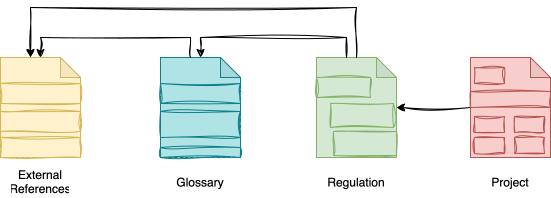

<!-- SPDX-License-Identifier: CC-BY-4.0 -->
<!-- Copyright Contributors to the Egeria project. -->

# Preparing for Martyn's Law

## Overview

It is early 2026 and [Ivor Padlock](/practices/coco-pharmaceuticals/personas/ivor-padlock) is keen to explore the implications of the new UK Terrorism (Protection of Premises) Act 2025 (Martyn's Law) on Coco Pharmaceuticals' annual conference in London. The number of people attending has been growing steadily, and they are now around 700 people.  

The new act kicks in for events of over 200 people with a higher tier at 800 people.  It is expected to be enforced from 2027 and [Ivor Padlock](/practices/coco-pharmaceuticals/personas/ivor-padlock) is keen to understand the impact, firstly with the current attendance and the impact if attendance grows over 800.  He likes to keep ahead of the game since these government initiatives tend to offer useful insights and best-practices.

> **Figure 1:** Coco Pharmaceuticals' annual conference in London

This is a different kind of security from the cyber security work that has occupied much of Ivor's attention recently.  It concerns the physical safety of people, and the measures are largely about premises, procedures and training rather than technology.  However, the way Ivor approaches it is the same: understand the requirements, record them where others can find them, work out the risks, and assign clear responsibility for the response.

## Documenting the Act using Dr.Egeria

At this time, although the Act has been passed into law, it is not yet being enforced.  The UK government has provided guidance on how to prepare for the new law, which can be found [here](https://www.gov.uk/government/publications/terrorism-protection-of-premises-act-2025-factsheets/terrorism-protection-of-premises-act-2025-overarching-factsheet).  There is also the [Protect UK](https://www.protectuk.police.uk/) website, with a lot of useful definitions and guidance.

As Ivor reviews the new law, he uses [Dr.Egeria](/user-interfaces/dr-egeria/overview) markdown format and command processor to capture the key information.  This helps his thinking process by structuring the information in a logical way, and puts the definitions in place in Egeria for when he needs to refer to them.

> **Figure 2:** Capturing Martyn's Law

Ivor begins by building a list of the key documents that he needs to understand the new law.  These are represented using [External References](/concepts/external-reference). He collected them together in a [collection](/concepts/collection).

As Ivor continues his reading, he begins to notice new terms and concepts in the documents.  Again he uses Dr.Egeria markdown commands to create a list of new glossary terms, each with a simple definition cut and pasted from the websites.
He decides to create a glossary to group these terms.

He creates a Regulation governance definition for the Act and links the glossary and the external references to the Regulation governance definition using the [Resource List](/types/0/0019-More-Information) relationship.

!!! education "Further Information"
    The markdown documents that Ivor creates to set up the initial definition of the Act can be found in [Egeria Workspaces](https://github.com/odpi/egeria-workspaces/tree/main/coco-workbooks/4.%20keeping-safe/martyns-law).  `annual-conference.md` adds the conference project and the Responsible Person role, and scopes the role and the two event security risks to the conference.

## Modelling the Impact of the Act

After Ivor has captured the key information, he starts to think about the impact of the new law on Coco Pharmaceuticals' annual conference.

The conference had never been described in open metadata, so Ivor starts by creating a [project](/types/1/0130-Projects) for it, recording its scope and the criteria by which he will judge that it meets the Act's requirements - documented and rehearsed public protection procedures, a fresh venue security assessment for each conference, briefed staff, and attendance monitored against the 800-attendee threshold.

He realizes he needs a new [governance role](/types/4/0445-Governance-Roles) definition for the *Responsible Person* defined by the act.  This responsible person role is linked to the conference project with the [*ScopedBy*](/types/1/0120-Assignment-Scopes) relationship, since the duties apply to the event rather than to Coco Pharmaceuticals as a whole.  The role is defined, but nobody has yet been appointed to it - designating a senior person well ahead of the 2027 enforcement date is one of the things the project has to achieve.

He needs information from the venue about the escape routes and other safety measures they have.  Then he can assess if they need additional safety measures.

Finally, he arranges meetings to take the next steps in preparing for Martyn's Law.

The two risks Ivor identifies through this work - a terrorism-related incident at the annual conference, and failure to discharge the responsible person duties the Act creates - become the event security category of the company's [risk register](/practices/coco-pharmaceuticals/scenarios/building-the-governance-team/overview#the-risk-register).  They also expose a gap in the governance model: the Act had been captured as a regulation but never as a threat, so there was no driver for either risk to answer to until one was defined.  Both risks are scoped to the conference project with the *ScopedBy* relationship, in the same way as the Responsible Person role, so everything that applies to the conference can be found from it.

> **Figure 3:** Modelling Martyn's Law

## The conference

When the conference comes round, Ivor attends in person.  He wants to see the public protection procedures working in practice, and to be on hand if anything does not go to plan.

He also uses the conference to build a relationship with the regulator.  Ahead of the event he contacted the Security Industry Authority (SIA), the regulator for the Act, and invited a representative to come and see how Coco Pharmaceuticals is preparing for the new law.  Seeing the procedures in action at a real event is far more useful to both sides than a description on paper, and it gives Ivor an early opportunity to check that his interpretation of the guidance matches the regulator's.

> **Figure 4:** Ivor welcoming the representative from the regulator to the annual conference

Everything goes well.  The procedures are understood by the staff working at the event, the venue's arrangements hold up, and the conversation with the regulator is constructive.  Ivor decides to make this the standard practice for all Coco Pharmaceuticals conferences, wherever they are held - even in countries where Martyn's Law does not apply, its approach is a sound basis for keeping attendees safe.  Since the conference project, the Responsible Person role and the risks are all recorded in Egeria, they provide a ready-made pattern to copy for each new event.

## Why this matters beyond the conference

Ivor's work on Martyn's Law shows a pattern that the governance leaders go on to reuse.  The Act was captured first as a [regulation](/types/4/0405-Governance-Drivers), with its glossary and external references, by the person who needed to understand it.  It then became a *Terrorism at Public Events* [threat](/types/4/0405-Governance-Drivers), two [risks](/types/4/0415-Governance-Responses) rated for likelihood and impact, a project for the conference, and a *Responsible Person* role scoped to it.  Each step is linked to the one before, so anyone looking at the project can follow it back to the clause of the Act that requires it - and when the guidance is updated ahead of enforcement in 2027, Ivor can see which of his definitions are affected.

It also shows that security is not only a concern of the IT department.  The Responsible Person duties reach into event planning, venue contracts, staff briefings and communications with attendees.  Because the definitions are in Egeria rather than in Ivor's personal notes, the events team, the facilities team and the venue can be brought into the same picture.

???+ info "Further Information"
    * **Egeria's Assessing a New Regulation Solution**. In this scenario, Ivor was using Egeria's [Assessing New Regulation](/egeria-solutions/assessing-new-regulation/overview) solution to build up an inventory and understanding of the new law.
    * **Egeria's Threat Modelling Solution**. After building a definition of Martyn's Law, Ivor used Egeria's [Threat Modelling](/egeria-solutions/threat-modelling/overview) solution to model the impact of the new law on Coco Pharmaceuticals' annual conference.

--8<-- "snippets/abbr.md"