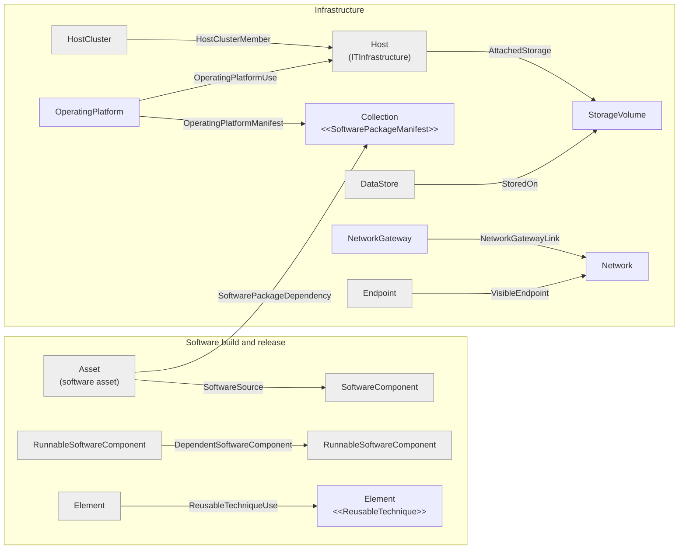

<!-- SPDX-License-Identifier: CC-BY-4.0 -->
<!-- Copyright Contributors to the Egeria project. -->

--8<-- "snippets/content-status/stable.md"

# DevOps Pipeline API

The DevOps Pipeline API is a REST API that enables a devops engineer to maintain the metadata about the changing digital resources being deployed through devops pipelines.

A pipeline that builds software and rolls it out to production changes the IT landscape every time it runs: new software components are released, operating platforms are patched, storage is attached to new hosts and services move between networks.  The DevOps Pipeline API lets the pipeline (or the engineer running it) record those changes as they happen, so that the catalog continues to show where each digital resource is running, what it depends on and what it was built from.  This information is used when assessing the impact of a change, planning backups and recovery, checking that data stays within its permitted locations, and tracing a deployed component back to its source.

The API is located under the URL marker `devops-pipeline`:

```
{{baseURL}}/servers/{{viewServer}}/api/open-metadata/devops-pipeline/...
```

## Key features

The operations fall into six groups.  The first three manage the infrastructure that software is deployed onto; the last three describe the software itself and how it was built.

???+ info "Storage volumes"
    Create, update, delete, retrieve and search for [*StorageVolume*](/types/0/0036-Storage/#storagevolume-entity) elements, which describe persistent storage and its capacity (see [storage volume](/concepts/storage-volume)).  A storage volume is linked to:

    * the IT infrastructure (such as a host) that it is attached to with the [*AttachedStorage*](/types/0/0036-Storage/#attachedstorage-relationship) relationship (*linkAttachedStorage* / *detachAttachedStorage*).
    * the data stores that keep their data on it with the [*StoredOn*](/types/2/0210-Data-Stores) relationship (*linkStoredOn* / *detachStoredOn*).

    Together, these show which physical storage holds a particular data set - important when a volume is to be decommissioned or when regulations restrict where certain data may be stored.

???+ info "Networks and network gateways"
    Create, update, delete, retrieve and search for [*Network*](/types/0/0070-Networks-and-Gateways/#network-entity) and [*NetworkGateway*](/types/0/0070-Networks-and-Gateways/#networkgateway-entity) elements.  They are connected together as follows:

    * *linkNetworkGateway* connects a network gateway to a network with the [*NetworkGatewayLink*](/types/0/0070-Networks-and-Gateways/#networkgatewaylink-relationship) relationship, which records the external and internal network addresses that the gateway maps between.  This is a [multi-link](/concepts/uni-multi-link) relationship, so the same gateway can be linked to the same network more than once.  Each call creates a new relationship and returns its unique identifier, which is then passed to *updateNetworkGatewayLink* and *detachNetworkGateway*.
    * *linkVisibleEndpoint* records that an [endpoint](/concepts/endpoint) is reachable through a network with the [*VisibleEndpoint*](/types/0/0070-Networks-and-Gateways/#visibleendpoint-relationship) relationship.

    This shows where services are isolated in private networks and which gateways expose them to the outside world (see [network](/concepts/network)).

???+ info "Hosts and operating platforms"
    Create, update, delete, retrieve and search for [*OperatingPlatform*](/types/0/0030-Operating-Platforms/#operatingplatform-entity) elements, which describe the operating system and software stack installed on a host.  An operating platform is linked to:

    * the IT infrastructure that it is installed on with the [*OperatingPlatformUse*](/types/0/0030-Operating-Platforms/#operatingplatformuse-relationship) relationship.  Its properties record when the software was installed and who (or what) deployed it.
    * a [collection](/concepts/collection) that lists the software packages that make up the stack with the [*OperatingPlatformManifest*](/types/0/0030-Operating-Platforms/#operatingplatformmanifest-relationship) relationship.

    Since many hosts can share the same operating platform, it can represent a standardized software stack, and its *OperatingPlatformUse* relationships show which hosts that stack has been rolled out to (see [operating platform](/concepts/operating-platform) and [host](/concepts/host)).  The API also maintains the [*HostClusterMember*](/types/0/0035-Complex-Hosts) relationship (*linkHostClusterMember* / *detachHostClusterMember*) that shows which hosts are managed by a host cluster.

???+ info "Software packages"
    * *setSoftwarePackageManifest* adds the [*SoftwarePackageManifest*](/types/0/0030-Operating-Platforms/#softwarepackagemanifest-classification) classification to a collection to show that it lists software packages.
    * *linkSoftwarePackageDependency* connects an asset to the collection of software packages that it needs when it is running with the [*SoftwarePackageDependency*](/types/0/0030-Operating-Platforms/#softwarepackagedependency-relationship) relationship.

    When a vulnerability is reported in a package, these relationships show which operating platforms and deployed resources include it.

???+ info "Cloud deployments"
    Four classifications show that part of the infrastructure is provided by a cloud provider and so is not completely under the organization's control (see [cloud platforms and services](/concepts/cloud-platform)):

    | Operation | Classification | Applied to |
    |---|---|---|
    | *setHostAsCloudProvider* | *CloudProvider* | a host - typically a host cluster - run by a cloud provider (infrastructure as a service) |
    | *setAsCloudPlatform* | *CloudPlatform* | a software server platform running in a cloud service (platform as a service) |
    | *setServerAsCloudTenant* | *CloudTenant* | a software server supporting the organization's tenancy |
    | *setCapabilityAsCloudService* | *CloudService* | a software capability offered as a cloud service (software as a service) |

    Each has a matching *clear...* operation to remove the classification.

???+ info "Software build and release"
    These operations record how the deployed software was produced (see [0280 Software Development Assets](/types/2/0280-Software-Development-Assets) and [0282 Released Software Components](/types/2/0282-Released-Software-Components)):

    * *setElementAsGeneratedTarget* adds the [*GeneratedTarget*](/types/2/0280-Software-Development-Assets/#generatedtarget-classification) classification to an element produced by a build program or script, recording the build identifier, build tool and its version.  A generated target can be reproduced at will, so it does not need backing up.
    * *linkSoftwareSource* connects a software asset to the software component that it is built from with the [*SoftwareSource*](/types/2/0282-Released-Software-Components/#softwaresource-relationship) relationship.
    * *linkDependentSoftwareComponent* records that one [*RunnableSoftwareComponent*](/types/2/0282-Released-Software-Components/#runnablesoftwarecomponent-entity) needs another in order to execute with the [*DependentSoftwareComponent*](/types/2/0282-Released-Software-Components/#dependentsoftwarecomponent-relationship) relationship.
    * *setElementAsReusableTechnique* adds the [*ReusableTechnique*](/types/2/0280-Software-Development-Assets/#reusabletechnique-classification) classification to a process, script or technique that can be reused in multiple contexts, and *linkReusableTechniqueUse* records each place where it is used with the [*ReusableTechniqueUse*](/types/2/0280-Software-Development-Assets/#reusabletechniqueuse-relationship) relationship.

    Each link operation has a matching *detach...* operation, and each classification a matching *clear...* operation.

!!! summary "Usage"
    A typical pipeline run releases a new version of a software component, records its *SoftwareSource* and *DependentSoftwareComponent* relationships, and marks the build outputs as generated targets.  It then records where the component was deployed: the operating platform and package manifest on the target hosts, the storage the host uses, and the network through which its endpoint can be reached.

## How the elements fit together

Figure 1 shows how the elements maintained by the DevOps Pipeline API connect to one another.



> **Figure 1:** The elements and relationships maintained by the DevOps Pipeline API.  Elements shown in grey are created through other APIs and only linked or classified by this one.

The DevOps Pipeline API creates storage volumes, networks, network gateways and operating platforms itself.  The other elements it links together are created elsewhere:

* Hosts, host clusters, software server platforms, software servers, data stores, software components and other [assets](/concepts/asset) are maintained through the [Asset Maker API](/services/omvs/asset-maker/overview), which also manages the deployment relationships between software capabilities and the infrastructure they run on.
* Endpoints are maintained through the [Connection Maker API](/services/omvs/connection-maker/overview).
* Collections, including the package lists used as software package manifests, are maintained through the [Collection Manager API](/services/omvs/collection-manager/overview).

## Common patterns

Each of the four element types that the API creates (storage volumes, networks, network gateways and operating platforms) supports the same seven operations:

| Operation | URL (after `/devops-pipeline`) | Request body |
|---|---|---|
| create | `/storage-volumes` | *NewElementRequestBody* |
| create from [template](/concepts/template) | `/storage-volumes/from-template` | *TemplateRequestBody* |
| update | `/storage-volumes/{storageVolumeGUID}/update` | *UpdateElementRequestBody* |
| delete | `/storage-volumes/{storageVolumeGUID}/delete` | *DeleteElementRequestBody* |
| retrieve by name | `/storage-volumes/by-name` | *FilterRequestBody* |
| search | `/storage-volumes/by-search-string` | *SearchStringRequestBody* |
| retrieve by GUID | `/storage-volumes/{storageVolumeGUID}/retrieve` | *GetRequestBody* |

The other element types use `/networks`, `/network-gateways` and `/operating-platforms` in place of `/storage-volumes`.

Relationships are created with a `.../attach` request and removed with the matching `.../detach` request.  For example, an operating platform is attached to the host it has been installed on with:

```
###
# @name linkOperatingPlatformUse
POST {{baseURL}}/servers/{{viewServer}}/api/open-metadata/devops-pipeline/operating-platforms/{{operatingPlatformGUID}}/operating-platform-use/{{itInfrastructureGUID}}/attach
Authorization: Bearer {{token}}
Content-Type: application/json

{
  "class" : "NewRelationshipRequestBody",
  "properties": {
    "class": "OperatingPlatformUseProperties",
    "installTime": "{{$isoTimestamp}}",
    "deployer": "add deployer name here",
    "deployerTypeName": "add deployer type name here",
    "deployerPropertyName": "add deployer property name here"
  }
}
```

Classifications are added with a POST to the classification's URL (for example `/elements/{elementGUID}/generated-target`) and removed with a POST to the same URL followed by `/remove`.

## Further information

* [Egeria-api-devops-pipeline.http](https://github.com/odpi/egeria/blob/main/open-metadata-implementation/view-services/devops-pipeline/Egeria-api-devops-pipeline.http) contains sample requests for every operation in this API.
* [Digital resources](/concepts/digital-resource) describes the different kinds of resource that can be catalogued.
* [Deployed implementation types](/concepts/deployed-implementation-type) provide the values used in the *deployedImplementationType* property of the *CloudPlatform* classification.

--8<-- "snippets/abbr.md"
