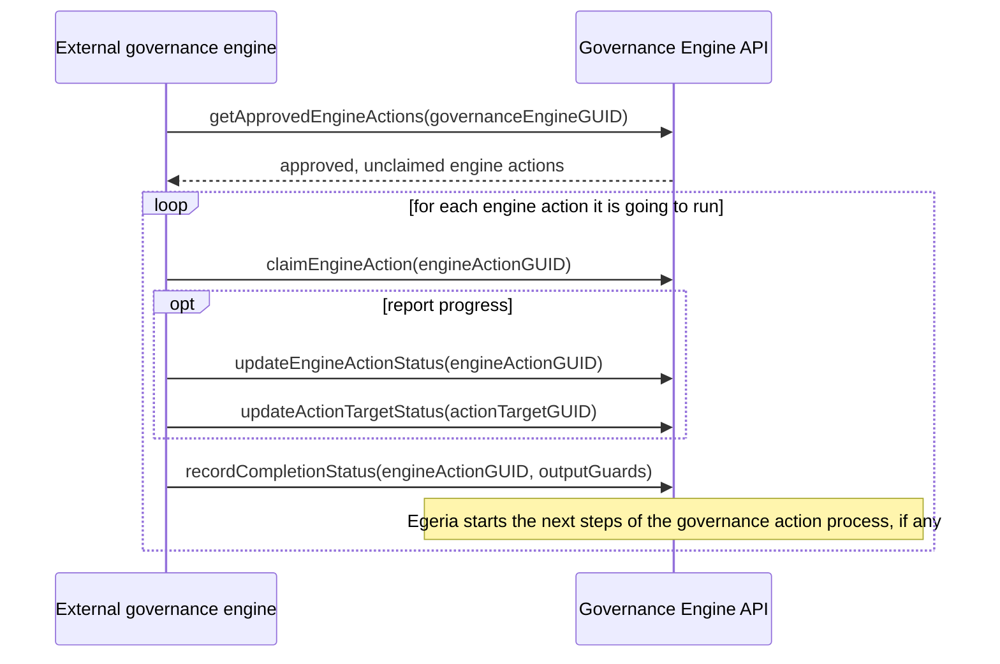

<!-- SPDX-License-Identifier: CC-BY-4.0 -->
<!-- Copyright Contributors to the Egeria project. -->

--8<-- "snippets/content-status/in-development.md"

# Governance Engine API

The Governance Engine API is for [governance engines](/concepts/governance-engine) that run [engine actions](/concepts/engine-action) outside of Egeria.  The governance engine does the work, while Egeria continues to coordinate the engine actions.  For example, when an engine action is a step in a [governance action process](/concepts/governance-action-process), Egeria starts the next steps of the process when the engine action completes.

These are the same calls that Egeria's own [engine hosts](/concepts/engine-host) make when they run a governance engine.  They come from the *GovernanceCompletionInterface* of the [Open Governance Framework (OGF)](/frameworks/ogf/overview), so an external governance engine takes part in a governance action process in exactly the same way as a governance engine running in an engine host.

| Property                | Value               |
|-------------------------|---------------------|
| URL marker              | `governance-engine` |
| View service code       | 243                 |
| Development status      | IN_DEVELOPMENT      |

## Key features

* **Finding the work to do**: Retrieving the engine actions that are approved to run on a governance engine and that no-one has claimed yet.
* **Claiming an engine action**: Taking ownership of an engine action so that no other caller runs it.
* **Reporting progress**: Updating the status of the engine action, and of each of its [action targets](/concepts/action-target).
* **Recording completion**: Declaring that the engine action is finished, with the [guards](/concepts/guard) that select the next steps of a governance action process.
* **Recovering after a restart**: Retrieving the engine actions the caller has claimed but not finished.

## Running an engine action

The sequence of calls made by an external governance engine is shown below.  The `governanceEngineGUID` is the unique identifier of the governance engine's [definition](/concepts/governance-engine-definition) in open metadata, and identifies which engine actions are destined for this engine.



The governance engine authenticates with its own userId.  The claim records that userId against the engine action, and from then on only that userId can update the engine action.  This means two copies of an external governance engine can poll for the same work without both running it: only one claim succeeds.

The examples below use the IntelliJ `.http` style used throughout the Egeria documentation.

### Retrieve the approved engine actions

The `getApprovedEngineActions` operation returns the engine actions that are approved to run on the governance engine and that no engine has claimed yet.  The caller then claims the ones it is going to run.

```
###
# @name getApprovedEngineActions
GET {{baseURL}}/servers/{{viewServer}}/api/open-metadata/governance-engine/governance-engines/{{governanceEngineGUID}}/engine-actions/approved?startFrom=0&pageSize=0
Authorization: Bearer {{token}}
```

### Claim an engine action

The `claimEngineAction` operation requests that execution of an engine action is allocated to the caller.  It is only permitted if no other caller has claimed it.

```
###
# @name claimEngineAction
POST {{baseURL}}/servers/{{viewServer}}/api/open-metadata/governance-engine/engine-actions/{{engineActionGUID}}/claim
Authorization: Bearer {{token}}
```

### Report progress

These two operations are optional.  The `updateEngineActionStatus` operation updates the status of the engine action, providing the caller is the one that claimed it.  The status may be `REQUESTED`, `APPROVED`, `WAITING`, `ACTIVATING`, `IN_PROGRESS`, `PAUSED`, `FOR_INFO`, `COMPLETED`, `INVALID`, `IGNORED`, `FAILED`, `CANCELLED`, `ABANDONED` or `OTHER`.

```
###
# @name updateEngineActionStatus
POST {{baseURL}}/servers/{{viewServer}}/api/open-metadata/governance-engine/engine-actions/{{engineActionGUID}}/status/update
Authorization: Bearer {{token}}
Content-Type: application/json

{
  "class" : "EngineActionStatusRequestBody",
  "status" : "IN_PROGRESS"
}
```

By default, the status of each action target is derived from the status of the engine action.  When the governance engine has many target elements to process, the `updateActionTargetStatus` operation sets the status of each one individually to show its progress.

```
###
# @name updateActionTargetStatus
POST {{baseURL}}/servers/{{viewServer}}/api/open-metadata/governance-engine/engine-actions/action-targets/update
Authorization: Bearer {{token}}
Content-Type: application/json

{
  "class" : "ActionTargetStatusRequestBody",
  "actionTargetGUID" : "{{actionTargetGUID}}",
  "status" : "COMPLETED",
  "startDate" : "{{$isoTimestamp}}",
  "completionDate" : "{{$isoTimestamp}}",
  "completionMessage" : "add completion message here"
}
```

### Record completion

The `recordCompletionStatus` operation declares that all the processing for the engine action is finished, and the status of the work: `ACTIONED`, `INVALID`, `FAILED` or `OTHER`.  If the engine action is part of a governance action process, its output guards determine which steps of the process run next.  The request parameters and new action targets are passed on to those steps.

```
###
# @name recordCompletionStatus
POST {{baseURL}}/servers/{{viewServer}}/api/open-metadata/governance-engine/engine-actions/{{engineActionGUID}}/completion-status
Authorization: Bearer {{token}}
Content-Type: application/json

{
  "class" : "CompletionStatusRequestBody",
  "status" : "ACTIONED",
  "requestParameters" : {
    "propertyName1" : "propertyValue1"
  },
  "outputGuards" : [ "add guard here" ],
  "newActionTargets" : [
    {
      "actionTargetName" : "add action target name here",
      "actionTargetGUID" : "add guid here"
    }
  ],
  "completionMessage" : "add completion message here"
}
```

### Recover after a restart

The `getActiveClaimedEngineActions` operation returns the engine actions that are still in process and that were claimed by the caller's userId.  A governance engine calls it when it restarts, to pick up the work it had started.

```
###
# @name getActiveClaimedEngineActions
GET {{baseURL}}/servers/{{viewServer}}/api/open-metadata/governance-engine/governance-engines/{{governanceEngineGUID}}/engine-actions/active-claimed?startFrom=0&pageSize=0
Authorization: Bearer {{token}}
```

## Moving from the Automated Curation API

!!! warning "Five operations have moved from the Automated Curation API"
    `claimEngineAction`, `getActiveClaimedEngineActions`, `updateEngineActionStatus`, `updateActionTargetStatus` and `recordCompletionStatus` used to be part of the [Automated Curation API](/services/omvs/automated-curation/overview).  Their paths, request bodies and responses are unchanged, so a caller, such as [pyegeria](/guides/developer/python-clients/overview), moves to this API by replacing the `automated-curation` URL marker with `governance-engine`.  For example:

    ```
    /servers/{viewServer}/api/open-metadata/automated-curation/engine-actions/{engineActionGUID}/claim
    ```

    becomes

    ```
    /servers/{viewServer}/api/open-metadata/governance-engine/engine-actions/{engineActionGUID}/claim
    ```

    `getApprovedEngineActions` is new in this API.

Initiating, cancelling and monitoring engine actions and governance action processes remains in the [Automated Curation API](/services/omvs/automated-curation/overview).

## Further information

* [Engine Action Concept](/concepts/engine-action)
* [Governance Engine Concept](/concepts/governance-engine)
* [Governance Action Process Concept](/concepts/governance-action-process)
* [Open Governance Framework (OGF)](/frameworks/ogf/overview)

Sample REST API requests can be found in [Egeria-api-governance-engine.http](https://github.com/odpi/egeria/blob/main/open-metadata-implementation/view-services/governance-engine/Egeria-api-governance-engine.http).

--8<-- "snippets/abbr.md"
