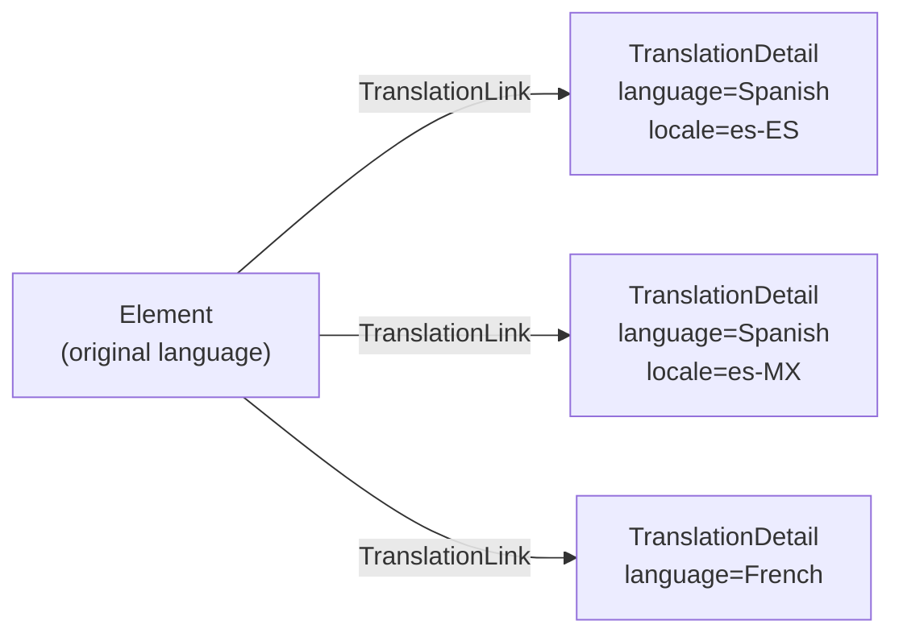

<!-- SPDX-License-Identifier: CC-BY-4.0 -->
<!-- Copyright Contributors to the Egeria project. -->

--8<-- "snippets/content-status/in-development.md"

# Multi Language API

The Multi Language API is a REST API that enables the caller to set up translations for key metadata attributes in one or more languages.

An organization that operates in several countries needs its catalog to be readable by people who work in different languages.  Rather than duplicating each element, open metadata keeps the element in its original language and attaches a separate translation for each additional language.  The original remains the authoritative description, and a user interface can show the translation that matches its user's language, falling back to the original where none exists.

## How translations are stored

Each translation is a [*TranslationDetail*](/types/0/0022-Translations/#translationdetail-entity) element linked to the element it translates with the [*TranslationLink*](/types/0/0022-Translations/#translationlink-relationship) relationship.  An element can have any number of translations - one for each language, or several for one language where the translations differ by locale.



> **Figure 1:** An element with three translations, two of them for the same language in different locales.

A translation has the following properties:

| Property | Holds |
|---|---|
| *language* | The natural language of the translation, such as `Spanish`.  It is required, and it is the value used to find the translation again. |
| *languageCode* | A code for the language, such as `es` from ISO-639. |
| *locale* | The locale of the translation, such as `es-ES`.  It is optional, and distinguishes translations for the same language. |
| *displayName* | The translation of the element's *displayName* (or *name*). |
| *description* | The translation of the element's *description*. |
| *additionalTranslations* | A map of translations for any other string properties of the element, keyed by property name. |

The translation is [anchored](/concepts/anchor) to the element it translates, so it is deleted with that element rather than being left behind.

## Operations

All the operations are called with the unique identifier (GUID) of the element being translated.

| Operation | Request | Purpose |
|---|---|---|
| *setTranslation* | `POST .../elements/{elementGUID}/translations` | Create or update the translation for a language and locale.  The body is a *NewElementRequestBody* whose *properties* are a *TranslationDetailProperties* object. |
| *clearTranslation* | `POST .../elements/{elementGUID}/translations/remove?language=...&locale=...` | Delete the translation for a language and locale. |
| *getTranslation* | `GET .../elements/{elementGUID}/translations/retrieve?language=...&locale=...` | Return the translation for a language and locale, or nothing if there is none. |
| *getTranslations* | `GET .../elements/{elementGUID}/translations?startFrom=0&pageSize=0` | Return all the translations attached to the element, one page at a time. |

## Finding the matching translation

*setTranslation*, *clearTranslation* and *getTranslation* all start by looking for the existing translation that matches the requested language and locale.  The rules are:

* The *language* must match exactly.  The comparison is case-sensitive, so `Spanish` and `spanish` are different languages - choose a convention and use it consistently.  The language is required: a request without it is rejected with an invalid parameter error, even though it is passed as an optional query parameter.
* If a *locale* is supplied, the translation's locale must match it too.
* If no locale is supplied, a translation for the language that has no locale is preferred.  If every translation for the language has a locale, the first one found is used.

This means a single translation per language can be maintained without ever mentioning a locale, while an element that needs regional variants can address each one by its locale.

The operations then act on the match:

* *setTranslation* creates a new translation if there is no match.  Otherwise, it updates the matching translation, **replacing** all of its properties with those in the request - a property that is left out of the request is cleared.
* *clearTranslation* deletes the matching translation.  If there is no match, the request still succeeds, since there is already no translation for that language.
* *getTranslation* returns the matching translation, or an empty response if there is none.

!!! summary "Usage"
    A user interface typically calls *getTranslation* with the user's language and locale when it displays an element, and shows the original properties if nothing is returned.  A translation tool calls *getTranslations* to see which languages are already covered, then *setTranslation* to add or correct each one.

## URL marker

The Multi Language API is one of the [generic view services](/services/omvs/#generic-api-services), whose operations can be called through the URL marker of any view service running in the view server:

```
{{baseURL}}/servers/{{viewServer}}/api/open-metadata/{urlMarker}/elements/{elementGUID}/translations
```

Using `multi-language` as the URL marker routes the request to the metadata access server configured for the Multi Language view service.  Using the URL marker of another view service - for example `glossary-manager` - routes it to the metadata access server configured for that service, so that a user interface built on one specialized API can maintain translations without needing a separate configuration.

## Example

```
###
# @name setTranslation
POST {{baseURL}}/servers/{{viewServer}}/api/open-metadata/multi-language/elements/{{elementGUID}}/translations
Authorization: Bearer {{token}}
Content-Type: application/json

{
  "class" : "NewElementRequestBody",
  "properties": {
    "class": "TranslationDetailProperties",
    "language": "Spanish",
    "languageCode": "es",
    "locale": "es-ES",
    "displayName": "add translated display name here",
    "description": "add translated description here",
    "additionalTranslations": {
      "summary": "add translated summary here"
    }
  }
}

###
# @name getTranslation
GET {{baseURL}}/servers/{{viewServer}}/api/open-metadata/multi-language/elements/{{elementGUID}}/translations/retrieve?language=Spanish&locale=es-ES
Authorization: Bearer {{token}}
```

## Further information

* [0022 Translations](/types/0/0022-Translations) defines the *TranslationDetail* entity and *TranslationLink* relationship.
* [Egeria-api-multi-language.http](https://github.com/odpi/egeria/blob/main/open-metadata-implementation/view-server-generic-services/multi-language/Egeria-api-multi-language.http) contains sample requests for every operation in this API.

--8<-- "snippets/abbr.md"
