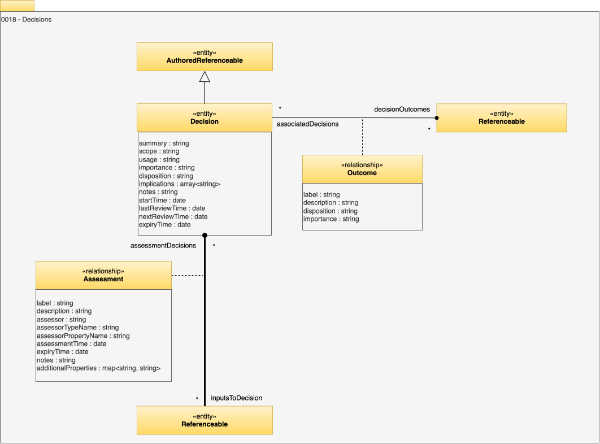

<!-- SPDX-License-Identifier: CC-BY-4.0 -->
<!-- Copyright Contributors to the Egeria project. -->

# 0018 Decisions

There is value in capturing the decisions that have been made, how they have been implemented, and the consequences of those decisions.

## Decision entity

The *Decision* entity is an [AuthoredReferenceable](/types/0/0010-Base-Model) that documents a decision that has been made.

* *summary* - Short description for summary tables.
* *scope* - Breadth of impact or coverage.
* *usage* - Guidance on how the decision should be used.
* *importance* - Relative importance of this decision for the organization.
* *disposition* - the status of the decision.
* *implications* - Impact on the organization, people and services when adopting the recommendation in this decision.
* *notes* - Notes on why the decision was made.
* *startTime* - defines the expected start time of the decision's implementation.
* *lastReviewTime* - defines the last time the decision was reviewed.
* *nextReviewTime* - defines the next time the decision will be reviewed.
* *expiryTime* - defines the time when the decision will be obsolete and should no longer be relied on.

## Assessment relationship

The *Assessment* relationship links a *Decision* entity to a *Referenceable* entity that is the subject of the assessment. It is used to capture the assessment parameters for the decision.  It is a multi-link relationship, so the same element may be assessed many times for the same decision.  Its attributes are:

* *label* - The label of the assessment.
* *description* - The description of the assessment.
* *assessor* - Person or organization that made the assessment.
* *assessorTypeName* - Type of element referenced in the assessor property.
* *assessorPropertyName* - Name of the property from the element used to identify the assessor property.
* *assessmentTime* - defines the time the assessment leading to the decision was made.
* *expiryTime* - defines the time when the assessment will be obsolete and should no longer be relied on.
* *notes* - Notes on the assessment.
* *additionalProperties* - a set of name-value pairs (i.e. a map) where the values are all strings.  It can be used for other properties that are not directly supported by this relationship.

## Outcome relationship

The *Outcome* relationship links one *Decision* entity to another *Referenceable* entity that represents an outcome of the decision.

* *label* - the display name for the relationship.
* *description* - additional description of the relationship.
* *importance* - Relative importance of this outcome for the organization.
* *disposition* - the status of the outcome.

--8<-- "snippets/abbr.md"
