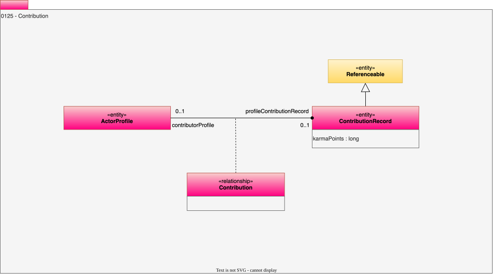

<!-- SPDX-License-Identifier: CC-BY-4.0 -->
<!-- Copyright Contributors to the Egeria project. -->

# 0125 Contribution

A key part of a successful governance program is ensuring that contributors are recognized - the individuals, and optionally the automation that supports them.  The contribution record keeps track of the contribution of each actor in the form of [karma points](/concepts/karma-point).  Karma points are collected based on the user performing the work and then aggregated into the contribution record of the associated actor profile.

## ContributionRecord entity

The *ContributionRecord* accumulates achievements of an individual. Specifically Egeria supports [Karma Points](/concepts/karma-point). These are awarded for participation in open metadata and governance. The number of karma points awarded to the individual is recorded in their *ContributionRecord* entity.

* *karmaPoints* captures the total number of points that the actor has earned from their activity.

The contribution records are maintained by the *Simon Contribution Recorder*, which creates an actor's contribution record the first time they earn a karma point, and adds to its `karmaPoints` on each refresh.  The records it creates have a `qualifiedName` of the actor profile's qualified name followed by `_contributionRecord`, and a `displayName` of "Contribution record for" followed by the profile's display name.  See [how karma points are awarded](/egeria-solutions/organization-insight/overview#how-points-are-awarded).

## Contribution relationship

The *Contribution* relationship links the contribution record to the actor profile for the individual or automation that is making the contribution.

--8<-- "snippets/abbr.md"
