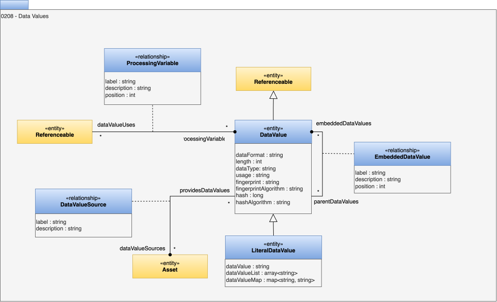

<!-- SPDX-License-Identifier: CC-BY-4.0 -->
<!-- Copyright Contributors to the ODPi Egeria project. -->

# 0208 Data Values

There are occasions where data values are stored, or referenced in metadata.  For example, they can be used to describe the values used to configure a [process instance](/types/2/0215-Software-Components) (such as an [analytic model run](/types/2/0265-Analytics-Assets)).  The data values help to explain variations in the output from different process instances.

 

## DataValue entity

The *DataValue* entity is a [Referenceable](/types/0/0010-Base-Model) used to describe a particular data value.  This may be a primitive value or a complex value such as an array, map, nested structure, multidimensional cube, or graph.  The entity holds enough of the data values to satisfy queries.  For example, the data value may be stored explicitly in the *LiteralDataValue* entity, or it may only have a fingerprint uniquely describing the data value and a *DataValueSource* link to where the data is stored. 

* *dataFormat* - the format of the data value.
* *length* - the length of the data value.
* *dataType* - the type of the data value.
* *usage* - the intended usage of the data value.
* *fingerprint* - A string value that represents the content of the data value.
* *fingerprintAlgorithm* - The algorithm used to generate the fingerprint.
* *hash* - A long value that represents the content of the data value.
* *hashAlgorithm* - The algorithm used to generate the hash.

## LiteralDataValue entity

The *LiteralDataValue* entity is a type of *DataValue* entity used to hold the data for a *DataValue* entity.  Its attributes provide a choice of formats to use:

* *dataValue* - the data expressed as a string - it may be a literal string, or something like a JSON structure.  The format used is specified in the *dataFormat* attribute.
* *dataValueList* - the data expressed as a list of strings - again, it may be a list of literal strings, or something like a JSON structure.
* *dataValueMap* - the data expressed as a map of strings to strings - again, it may be a map of literal strings, or something like a JSON structure.

## DataValueSource relationship

The *DataValueSource* relationship links a *DataValue* entity to an [Asset](/types/0/0010-Base-Model) that describes how to access the associated digital resource where the data is stored.

* *label* - the display name for the relationship.
* *description* - additional description of the relationship.

## ProcessingVariable relationship

The *ProcessingVariable* relationship links a [Referenceable](/types/0/0010-Base-Model) to a *DataValue* that describes values used to configure its processing.

* *label* - the display name for the relationship.
* *description* - additional description of the relationship.
* *position* - position of the data value that is used to pass the data value to the referenceable. Zero means no position set. A positive value identifies the position starting from 1 for the first position.

## EmbeddedDataValue relationship

The *EmbeddedDataValue* relationship allows a *DataValue* entity to be embedded in another *DataValue* entity.

* *label* - display name of the relationship that may also be used by the parent value to refer to the embedded value.
* *description* - additional description of the relationship.
* *position* - position of the embedded value in the collection of *EmbeddedDataValue* relationships. Zero means no position set. A positive value identifies the position starting from 1 for the first position.

    
--8<-- "snippets/abbr.md"
 