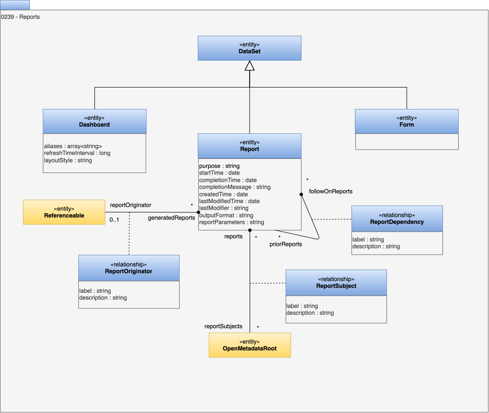

<!-- SPDX-License-Identifier: CC-BY-4.0 -->
<!-- Copyright Contributors to the ODPi Egeria project. -->

# 0239 Reports

Reports described assembled information about a particular topic. It can be linked to the process that created it, the elements it describes, and other related reports.  Reports can be generated from [report specifications](/types/5/0582-Report-Specifications).

## Dashboard entity

A *Dashboard* is a [DataSet](0210-Data-Stores.md) that is a collection of reports.  It provides the layout information so that the display of the embedded reports is logical and easy to follow.

* *aliases* - alternative names for the dashboard that can be used when searching for it.
* *refreshTimeInterval* - how often, in minutes, the dashboard should refresh the data displayed in its reports.
* *layoutStyle* - the style of layout used to arrange the reports on the dashboard, such as a grid, a set of tabs or a single column.

## Report entity

The *Report* entity is a [DataSet](0210-Data-Stores.md) that describes an instance of a populated report.  It has the following attributes:

* *purpose* - purpose of the report.
* *authors* - userIds of the report authors.
* *startTime* - the start of the time period that the report's content represents.
* *completionTime* - the end of the time period that the report's content represents.
* *completionMessage* - any message generated by the process creating the report.
* *createdTime* - the time the report was created.
* *lastModifiedTime* - the time the report content was last modified.
* *lastModifier* - the userId of the last person to modify the report.
* *reportParameters* - parameters used to create the report - typically a JSON String.
* *outputFormat* - the format used for the content of the report.

Egeria supports three specialized reports:

* [Connector activity report](/types/4/0457-Connector-Activity-Reports) - description of the activity of a connector during a certain time period.
* [Incident report](/types/4/0470-Incident-Reporting) - description of a particular incident or situation that is affecting the operation of the organization.
* [Survey report](/types/6/0603-Survey-Reports) - details of a survey of one or more digital resources.

## ReportOriginator relationship

The *ReportOriginator* relationship links a report to the element (typically a process) that created the report.

* *label* - the label to use when displaying this relationship.
* *description* - the description of the relationship between the reports.

## ReportSubject relationship

The *ReportSubject* relationship links a report to an element that the report is about.

* *label* - the label to use when displaying this relationship.
* *description* - the description of the relationship between the reports.

## ReportDependency relationship

The *ReportDependency* relationship links a report to another related report.  There is a sense of time in this relationship.  It has the following attributes:

* *label* - the label to use when displaying this relationship.
* *description* - the description of the relationship between the reports.

## Form entity

The *Form* entity is a [DataSet](0210-Data-Stores.md) that organizes a request for new data.

--8<-- "snippets/abbr.md"