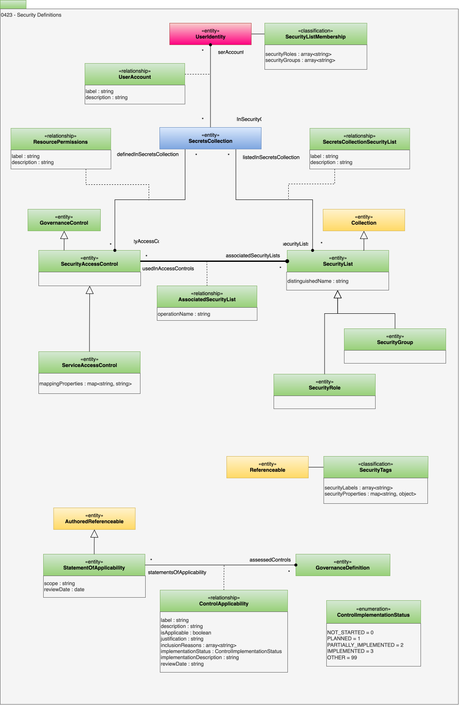

<!-- SPDX-License-Identifier: CC-BY-4.0 -->
<!-- Copyright Contributors to the ODPi Egeria project. -->

# 0423 Security Definitions

Security, particularly access control, is an important form of governance that preserves exclusive access to specific [resources](/concepts/resource) for particular *[actors](/types/1/0110-Actors)*.

## UserAccount relationship

The *UserAccount* relationship links a *UserIdentity* entity that describes a userId with the [SecretsCollection](/types/2/0227-Keystores) where the user's account is defined.

* *label* - Display label to use when displaying this lineage relationship in a lineage graph.
* *description* - Description of the element or associated resource in free-text.

## ResourcePermissions relationship

The *ResourcePermissions* relationship links a *SecurityAccessControl* with the [SecretsCollection](/types/2/0227-Keystores) where the security access control is defined.

* *label* - Display label to use when displaying this lineage relationship in a lineage graph.
* *description* - Description of the element or associated resource in free-text.

## SecurityAccessControl entity

The *SecurityAccessControl* entity is a type of [GovernanceControl](/types/4/0420-Governance-Controls) that defines the access control lists that a user must belong to if he/she/it is to be given permission to execute a specific command.

## ServiceAccessControl entity

The *ServiceAccessControl* entity is a type of *SecurityAccessControl* that describes the permissions associated with a service.  This may cover a server or a service.  The *mappingProperties* are used to define the exact scope that the control refers to.

* *mappingProperties* - Additional properties to aid the mapping to the element in an external resource.

## SecretsCollectionSecurityList relationship

The *SecretsCollectionSecurityList* relationship links a *SecurityList* with the [SecretsCollection](/types/2/0227-Keystores) where the security list is defined.

* *label* - Display label to use when displaying this lineage relationship in a lineage graph.
* *description* - Description of the element or associated resource in free-text.

## SecurityList entity

The *SecurityList* entity defines a list of users and nested lists that are included in a set of permissions associated with a security access control.  It is a specialized type of [Collection](/types/0/0021-Collections) so the lists can be nested using the [CollectionMembership](/types/0/0021-Collections) relationship.

* *distinguishedName* - The LDAP distinguished name (DN) that gives a unique positional name in the LDAP DIT.

## SecurityGroup entity

The *SecurityGroup* entity defines a group of users and groups that are related.

## SecurityRole entity

The *SecurityRole* entity defines a collection of users that requires the same permissions to perform the same work (role).

* *distinguishedName* - The LDAP distinguished name (DN) that gives a unique positional name in the LDAP DIT.

## AssociatedSecurityList relationship

The *AssociatedSecurityList* relationship defines which *SecurityList* to use for each type of operation defined by the *SecurityAccessControl* entity.  The `operationName` attribute defines the name of the operation being mapped.

* *operationName* - Name of the operation to that is controlled by the linked security group.

## SecurityListMembership classification

The *SecurityListMembership* classification summarizes the list of security groups that a user should be granted.  For efficiency, each security group may be identified by its `distinguishedName` property for efficiency.  However, it may be the group's `qualifiedName`.  The *SecurityGroupMembership* classification is attached to one of the user's *[UserIdentity](/types/1/0110-Actors)* entities.

* *securityGroups* - List of security group names.

* *securityRoles* - List of security role names.

## SecurityTags classification

*SecurityTags* identify labels and properties that are used in determining which access control rules should be executed when access to a particular resource is requested.  They can be attached to [assets](/types/0/0010-Base-Model), [schema elements](/types/5/0501-Schema-Elements) and [glossaries](/types/3/0310-Glossary) depending on the scope of resource that the security tags apply to. The [synchronized access control](/features/synchronized-access-control) feature describes how security tags are set up and used.

* *securityLabels* - Labels that apply to the referenceable.
* *securityProperties* - Properties that apply to the referenceable.

## Statements of applicability

A *statement of applicability* records which controls from a security standard - such as the Annex A controls of ISO/IEC 27001, or the controls of NIST SP 800-53 - apply to an organization, why each one is included or excluded, and how far each one has been implemented.  It is one of the main documents reviewed when an information security management system is audited for [certification](/types/4/0482-Certifications).

The statement is linked:

* to each control from the standard with the *ControlApplicability* relationship.  The controls are [governance definitions](/types/4/0401-Governance-Definitions), typically [*GovernanceControl*](/types/4/0420-Governance-Controls) entities.
* to the [*CertificationType*](/types/4/0482-Certifications) it supports with the [*GovernedBy*](/types/4/0401-Governance-Definitions) relationship.
* to the elements that are in scope - the organization, its sites, systems and teams - with the [*ScopedBy*](/types/1/0120-Assignment-Scopes) relationship.

The organization's own controls that implement a control from the standard are linked to it with the [*GovernanceControlLink*](/types/4/0420-Governance-Controls) relationship, and the risks they treat with [*GovernanceMechanism*](/types/4/0420-Governance-Controls), so that each applicable control can be traced to the risks that justify it.

## StatementOfApplicability entity

The *StatementOfApplicability* entity is an [*AuthoredReferenceable*](/types/0/0010-Base-Model), so it records its authors, version and content status - for example, `DRAFT` while it is being prepared and `APPROVED` once it has been signed off for an audit.

* *scope* - The part of the organization that the statement covers, such as the scope of the information security management system.
* *reviewDate* - The date that the statement was last reviewed.

## ControlApplicability relationship

The *ControlApplicability* relationship links a *StatementOfApplicability* entity (end 1) to a [*GovernanceDefinition*](/types/4/0401-Governance-Definitions) entity (end 2) that describes one control from the standard.  There is one relationship for each control assessed by the statement.

* *isApplicable* - Does the control apply within the scope of the statement of applicability?  A control is treated as applicable unless this is set to false.
* *justification* - Justification for including or excluding the control.
* *inclusionReasons* - Reasons that the control is included - for example, risk treatment, a legal or regulatory requirement, a contractual obligation or a business requirement.
* *implementationStatus* - How far the control has been implemented.  The values come from the *ControlImplementationStatus* enumeration.
* *implementationDescription* - Description of how the control is implemented within the scope of the statement.
* *reviewDate* - The date that the applicability of the control was last reviewed.
* *label* - Label for the control, such as its number in the standard.
* *description* - Notes on the control's applicability.

## ControlImplementationStatus enumeration

The *ControlImplementationStatus* enumeration defines how far a control listed in a statement of applicability has been implemented.

* *NOT_STARTED* - No work has started on implementing the control.  This is the default.
* *PLANNED* - The implementation of the control is planned but has not started.
* *PARTIALLY_IMPLEMENTED* - The control is partially implemented.
* *IMPLEMENTED* - The control is fully implemented and its implementation is evidenced.
* *OTHER* - Another implementation status.

!!! education "Further information"
    * Statements of applicability are maintained through the [Security Officer API](/services/omvs/security-officer/overview#statements-of-applicability).
    * The Core Content Pack includes a *CertificationType* for ISO/IEC 27001:2022, with the qualified name `CertificationType::ISO/IEC 27001:2022`.  The text of the standard belongs to ISO, so its Annex A controls are not supplied.
    * The [Security Content Pack](/content-packs/security-content-pack/overview) supplies the NIST CSF 2.0 and NIST SP 800-53 Rev. 5 control catalogs as governance controls that can be linked to a statement of applicability.

--8<-- "snippets/abbr.md"