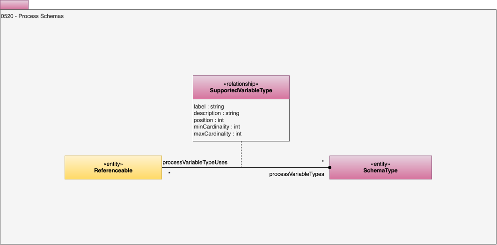

<!-- SPDX-License-Identifier: CC-BY-4.0 -->
<!-- Copyright Contributors to the ODPi Egeria project. -->

# 0520 Process Schemas

Process schemas describe the types of data values that are used to initialize a process when it runs.

## SupportedVariableType relationship

The *SupportedVariableType* relationship is used to describe the types of data values that are used by a process to initialize/configure it.

* *label* - the display name for the relationship.
* *description* - additional description of the relationship.
* *position* - position of the data value that is used to pass to the referenceable. Zero means no position set. A positive value identifies the position starting from 1 for the first position.
* *minCardinality* - minimum number of allowed instances.
* *maxCardinality* - maximum number of allowed instances.

--8<-- "snippets/abbr.md"