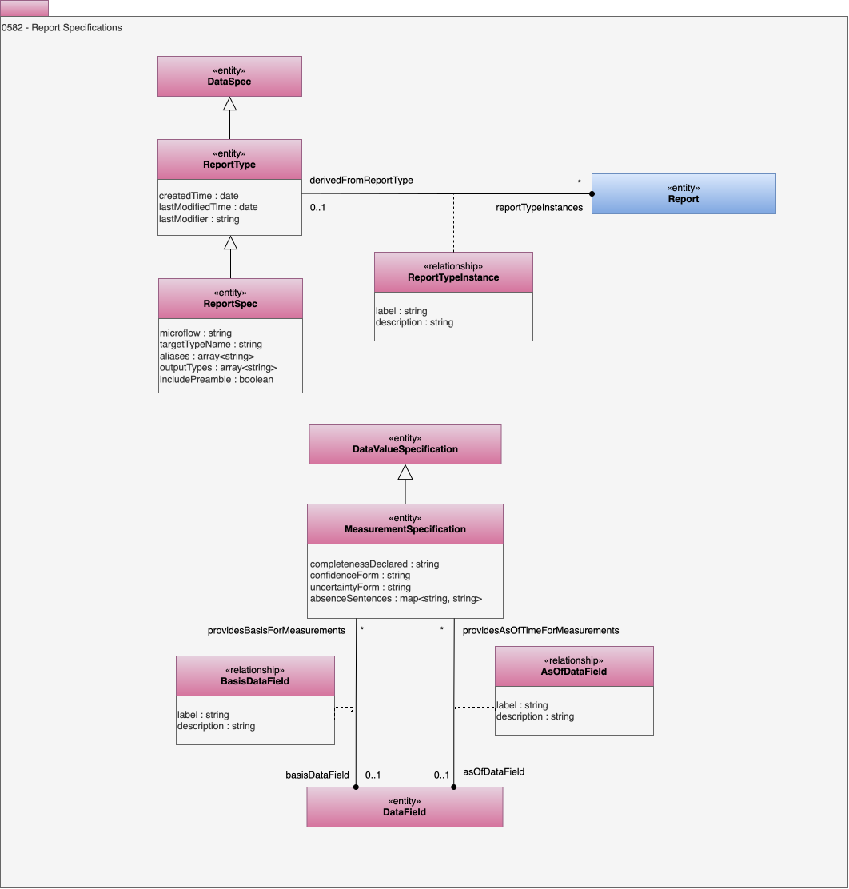

<!-- SPDX-License-Identifier: CC-BY-4.0 -->
<!-- Copyright Contributors to the ODPi Egeria project. -->

# 0582 Report Specifications

Report specification provide the detail needed to request data and format the results into a report.  These reports are typically designed to answer specific [questions](/types/3/0340-Dictionary) and often have a specific [perspective](/types/1/0145-Perspectives) in mind.

## ReportType entity

The *ReportType* entity is a type of [DataSpec](0580-Data-Dictionaries.md) that describes a report design.  It specifies the schema (structure) of the data that will be assembled in a populated report.  It has the following attributes:

* createdTime - the time the report type was created.
* lastModifiedTime - the time the report type content was last modified.
* lastModifier - the userId of the last person to modify the report type.

## ReportTypeInstance relationship

The *ReportTypeInstance* represents an association between a report type and an instance of a report that was generated using this type.

* *label* - the label to use when displaying this relationship.
* *description* - the description of the relationship between the report and its report type.

## ReportSpec entity

The *ReportSpec* is a specialized *ReportType* for reports about open lineage and related data.

* *microflow* - The ordered list of stages to with its parameters (in JSON)
* *targetTypeName* - The type of element that is being reported on
* *aliases* - Alternative names for the report specification.
* *outputTypes* - An array of output types that can be generated from this specification.
* *includePreamble* - Should the preamble be included in the report.

## MeasurementSpecification entity

A type of [DataValueSpecification](0540-Data-Value-Specifications.md) that is the description of a measurement that is part of a report.

* *completenessDeclared* - Whether a measured value should count everything or may undercount, for example because a page limit was hit. Lets a renderer say "at least N" rather than "N". Usually set on the shared general spec. Possible valid metadata values:	complete, lower_bound, unknown.	
* *confidenceForm* - How the value is produced, which is confidence in the method, not in the value itself. A renderer uses it to qualify the figure. Possible valid metadata values: measured, estimated, inferred, judged, generated	
* *uncertaintyForm* - How to read the inherited absoluteUncertainty / relativeUncertainty: as plus/minus a spread, as a low-high range, or as a named band. It describes the spread of the value, which is separate from confidenceForm. Possible valid metadata value: plus_minus, low_high, band	
* *absenceSentences* -	A map from an absence state (nothing_found, not_measured, not_permitted, not_applicable) to the sentence to show in place of a value when there isn't one, so "measured and found nothing" never looks like "never measured".

## BasisDataField relationship

Represents an association between a *MeasurementSpecification* and the data field that describes the basis for the measurement.  For example, the denominator for a percentage or the total a share is taken from.

* *label* - the label to use when displaying this relationship.
* *description* - the description of the relationship between the reports.

## AsOfDataField relationship

Represents an association between a *MeasurementSpecification* and a data field that describes the time of the measurement.

* *label* - the label to use when displaying this relationship.
* *description* - the description of the relationship between the reports.

--8<-- "snippets/abbr.md"