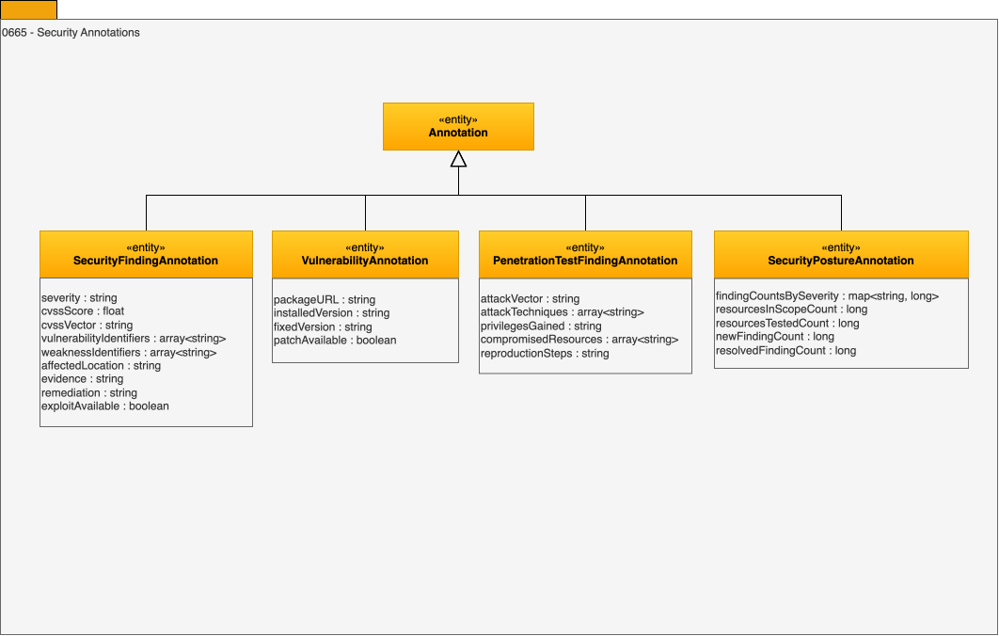

<!-- SPDX-License-Identifier: CC-BY-4.0 -->
<!-- Copyright Contributors to the ODPi Egeria project. -->

# 0665 Security Annotations

These [Annotations](/types/6/0610-Annotations) capture the results of security testing - the weaknesses that a vulnerability scan or a penetration test finds in a resource, and a summary of each test run.

Each run of a security test is catalogued as a [*SurveyReport*](/types/6/0603-Survey-Reports).  Since a survey report is a type of asset, it is created through the [Asset Maker API](/services/omvs/asset-maker/overview), and its annotations are added through the [Data Discovery API](/services/omvs/data-discovery/overview).  The report's *category* says what kind of test it was - for example `Vulnerability Scan Report` or `Penetration Test Results`.  Each finding is an annotation linked to the report with the *ReportedAnnotation* relationship, and to the resource it was found in with the *AssociatedAnnotation* relationship.  When a finding is located in a more specific element that is also catalogued - a software package, an endpoint or a file, for example - the annotation can be linked to that element with *AssociatedAnnotation* too.

These types work with the general annotation mechanisms:

* The scanner's own identifier for a finding is stored in the annotation's *identifier* property, so the same finding can be recognized in later runs.
* The type of vulnerability can be recorded by linking the annotation to a [*ReferenceDataValue*](/types/5/0545-Reference-Data) with the *ReferenceValueAssignment* relationship.  The vulnerability types are typically grouped into a *ReferenceDataSet*.
* Findings that a tester chained together can be linked with the [*AnnotationExtension*](/types/6/0610-Annotations) relationship.
* False positives and accepted risks are recorded with an [*AnnotationReview*](/types/6/0612-Annotation-Reviews).
* A finding that needs someone to act on it can be raised as an [incident report](/types/4/0470-Incident-Reporting).

## SecurityFindingAnnotation entity

The *SecurityFindingAnnotation* entity is a type of [*Annotation*](/types/6/0610-Annotations) that describes a weakness found in a resource by a security test, such as a vulnerability scan or a penetration test.  It is the base type for the more specific findings below, and is used directly for findings that are neither, such as an insecure configuration.

* *severity* - The qualitative severity of the finding.  For security findings, use the CVSS ratings: `None`, `Low`, `Medium`, `High` or `Critical`.
* *cvssScore* - The Common Vulnerability Scoring System (CVSS) base score for the finding, from 0.0 to 10.0.
* *cvssVector* - The CVSS vector string that shows how the score was calculated, for example `CVSS:3.1/AV:N/AC:L/PR:N/UI:N/S:U/C:H/I:N/A:N`.
* *vulnerabilityIdentifiers* - The identifiers of the publicly disclosed vulnerabilities behind the finding, such as CVE identifiers.
* *weaknessIdentifiers* - The identifiers of the types of weakness behind the finding, such as CWE identifiers.
* *affectedLocation* - Where the finding was detected - for example a host and port, a URL, a file path or a software package.  If the element at this location is catalogued, the annotation can also be linked to it with the [*AssociatedAnnotation*](/types/6/0610-Annotations) relationship, so the finding appears with the element it affects.
* *evidence* - Evidence that supports the finding, such as the request and response that demonstrated it.
* *remediation* - The recommended action to remove the weakness or reduce its impact.
* *exploitAvailable* - Is an exploit for the weakness publicly available?

## VulnerabilityAnnotation entity

The *VulnerabilityAnnotation* entity is a type of *SecurityFindingAnnotation* that describes a known vulnerability in the software used by a resource, typically found by a vulnerability scan.

* *packageURL* - The package URL (purl) of the affected software package, for example `pkg:maven/org.apache.logging.log4j/log4j-core@2.14.1`.
* *installedVersion* - The version of the affected software that is installed.
* *fixedVersion* - The version of the software in which the vulnerability is fixed.
* *patchAvailable* - Is a fix for the vulnerability available?

The affected package can be matched to the software packages in the [software package manifests](/types/0/0030-Operating-Platforms) of the deployed systems, to find everywhere else the vulnerability may be present.

## PenetrationTestFindingAnnotation entity

The *PenetrationTestFindingAnnotation* entity is a type of *SecurityFindingAnnotation* that describes a weakness that a penetration test was able to exploit, with how it was exploited and what was gained.

* *attackVector* - How the weakness was reached - for example `Network`, `Adjacent network`, `Local`, `Physical` or `Social engineering`.
* *attackTechniques* - The techniques used to exploit the weakness, such as MITRE ATT&CK technique identifiers.
* *privilegesGained* - The access or privileges that the tester gained by exploiting the weakness.
* *compromisedResources* - The names of the resources that the tester was able to reach or control by exploiting the weakness.  If these resources are catalogued, the annotation can also be linked to each of them with the [*AssociatedAnnotation*](/types/6/0610-Annotations) relationship, so the finding appears with every element it put at risk.
* *reproductionSteps* - The steps to reproduce the finding.

## SecurityPostureAnnotation entity

The *SecurityPostureAnnotation* entity is a type of [*ResourceMeasureAnnotation*](/types/6/0660-Resource-Measures) that summarizes the findings and coverage of one run of a security test.  It is typically linked to the survey report for the run, so that the trend across runs can be followed.

* *findingCountsBySeverity* - The number of open findings for each severity.
* *resourcesInScopeCount* - The number of resources in the scope of the security test.
* *resourcesTestedCount* - The number of resources in scope that were tested.
* *newFindingCount* - The number of findings detected for the first time in this run.
* *resolvedFindingCount* - The number of findings from earlier runs that are no longer detected.

??? education "Further information"
    * [Assuring IT Systems Security](/practices/coco-pharmaceuticals/scenarios/assuring-it-systems-security/overview) shows Coco Pharmaceuticals cataloguing the results of continuous penetration testing.
    * [Survey reports](/concepts/survey-report) describes how survey reports and annotations are organized.

--8<-- "snippets/abbr.md"
