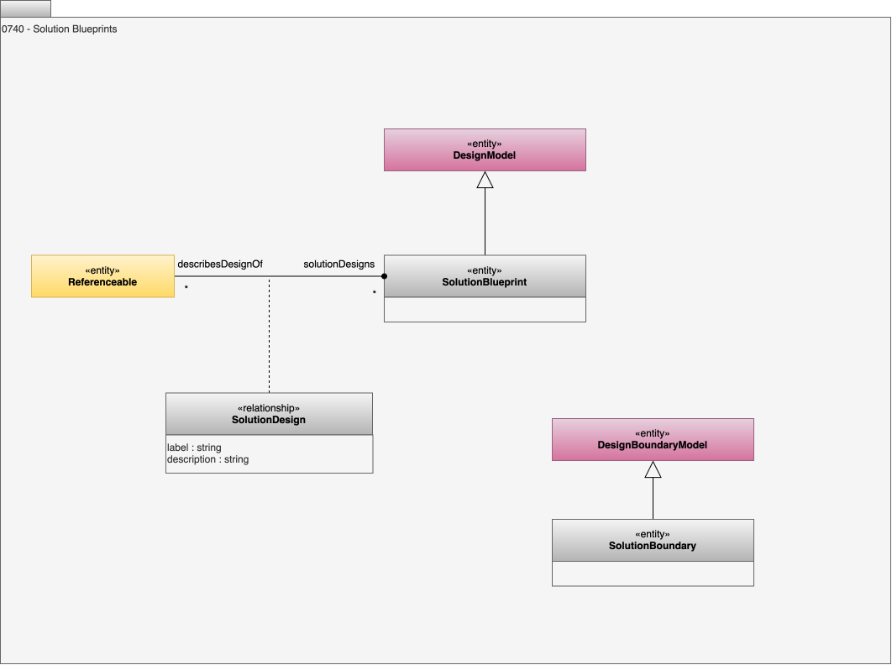

<!-- SPDX-License-Identifier: CC-BY-4.0 -->
<!-- Copyright Contributors to the ODPi Egeria project 2020. -->

# 0740 Solution Blueprints

A [solution blueprint](/concepts/solution-blueprint) is a collection of [solution components](/types/7/0730-Solution-Components) that describe the an aspect of a digital solution, or a new capability.

## SolutionBlueprint entity

The *SolutionBlueprint* entity describes a single version of a solution's components and roles.  It inherits from [DesignModel](/types/5/0565-Design-Models) which is a type of [Collection](/types/0/0021-Collections).
The [*CollectionMembership*](/types/0/0021-Collections) relationship identifies the list of elements (typically solution components and roles) that should appear on the diagram.  The [SolutionLinkingWire](/types/7/0735-Solution-Ports-and-Wires) relationships show how they are linked together, and so the CollectionMembership relationship simply documents the role each element plays in supporting the solution.

## SolutionBoundary entity

The *SolutionBoundary* entity is used to organize solution blueprint's components and roles in a hierarchy to help understanding.  It inherits from [DesignModelBoundary](/types/5/0565-Design-Models) which is a type of [Collection](/types/0/0021-Collections).
The [*CollectionMembership*](/types/0/0021-Collections) relationship identifies the list of elements (typically solution components and roles) that should appear within the boundary on the blueprint's mermaid diagram using the CollectionMembership relationship.

## SolutionDesign relationship

There can be multiple solution blueprints describing a solution.  For example:

* to describe a version of the architecture.
* to define an aspect of the architecture.
* to describe different levels of detail.

The *SolutionDesign* relationship identifies which [element](/types/0/0010-Base-Model) the blueprint describes.  Its attributes identify what aspect of the architecture is covered by the blueprint.

--8<-- "snippets/abbr.md"