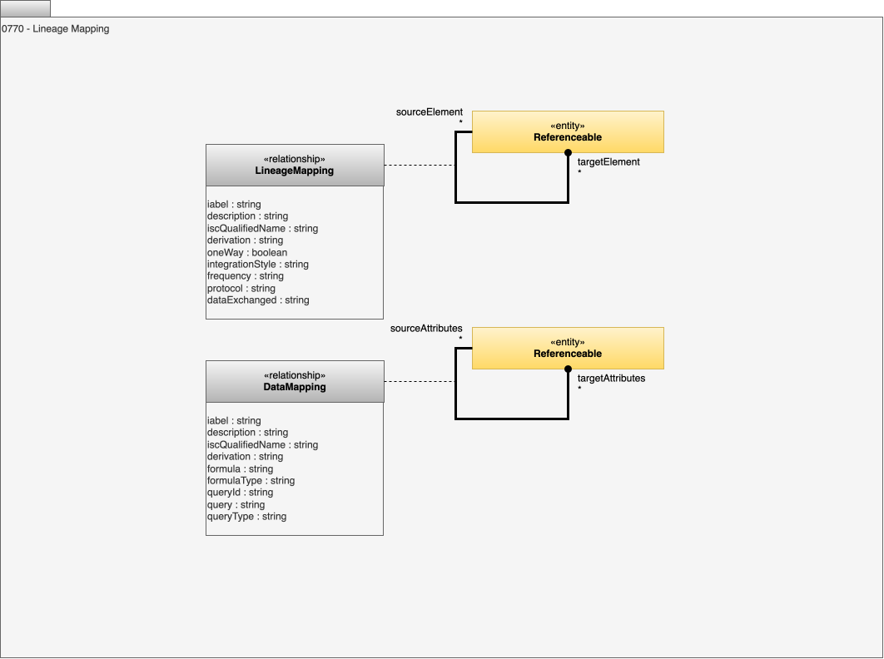

<!-- SPDX-License-Identifier: CC-BY-4.0 -->
<!-- Copyright Contributors to the ODPi Egeria project 2020. -->

# 0770 - Lineage Mapping

Lineage Mapping identifies elements that are [equivalent to each other in the lineage graph](/features/lineage-management/overview/#stitching). It is used to stitch the lineage graph together.

This is contrast with the [Data Passing](/types/7/0750-Data-Passing) relationships that represent implementation relationships between components.

## LineageMapping relationship

The *LineageMapping* relationship identifies two elements that represent the same real-world object.  This occurs when different tools are integrated into the open metadata ecosystem and they either use different names or catalog at different levels of granularity.  The aim of this relationship is to link up disconnected parts of a lineage graph.

* *label* - type of request.
* *description* - description of the request.
* *iscQualifiedName* - qualified name of the associated information supply chain.
* *derivation* - where did the lineage relationship come from?
* *integrationStyle* - Mechanism to flow data and control along the segment.
* *protocol* - Name of the protocol used to connect to the endpoint.
* *frequency* - How frequently is this expected to run? e.g.real-time, hourly, daily, on batch completion?
* *dataExchanged* - A full explanation of what data flows and why.
* *oneWay* - Is the data flowing one-way or bidirectional?

## DataMapping relationship

The *DataMapping* relationship maps, typically, a schema attribute from one asset to the equivalent schema attribute of another asset to indicate that the data is copied from one to another.  The attributes within this relationship describe any transformation/mapping used.  The relationship is shown between two referenceables so that mapping components can be included in this fine-grained lineage.

* *label* - type of request.
* *description* - description of the request.
* *iscQualifiedName* - qualified name of the associated information supply chain.
* *derivation* - where did the lineage relationship come from?
* *formula* - Formula that describes the behaviour of the element. May include placeholders for queryIds.
* *formulaType* - Format of the expression provided in the formula attribute.
* *queryId* - Placeholder for a query.
* *query* - Query used to extract data, can include placeholders.
* *queryType* - Type of query used to extract data.

--8<-- "snippets/abbr.md"
