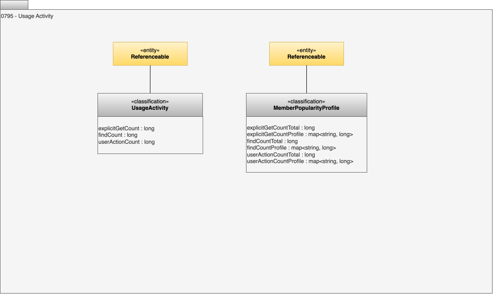

<!-- SPDX-License-Identifier: CC-BY-4.0 -->
<!-- Copyright Contributors to the ODPi Egeria project 2020. -->

# 0795 - Usage Activity

The classifications below are used to gather statistics about usage activity around an element.

## UsageActivity classification

The *UsageActivity* classification is used to describe the usage activity around an anchor element.  It is typically associated with an [Asset](/types/0/0010-Base-Model) or [DigitalProduct](/types/7/0710-Digital-Products).  It captures the following data related to the activity around itself and its anchored elements:

* *explicitGetCount* - the number of times the element, or one of its anchored elements, has been explicitly retrieved from the repository by an identifier or name.  This indicates that it is an element of specific interest to the calling user.
* *findCount* - the number of times the element, or one of its anchored elements, has been retrieved from the repository as part of a search request.  This indicates the element's findability.
* *userActionCount* - the number of times the element, or one of its anchored elements, has been created, linked, unlinked, updated or deleted from the repository.

## MemberPopularityProfile classification

The *MemberPopularityProfile* classification is used to describe the usage activity around a collection of elements.  It is typically attached to a [Collection](/types/0/0010-Base-Model) and summarizes the usage activity around the members of the collection.  It captures the following data related to the activity around its members:

* *explicitGetCountTotal* - the number of times any of the collection's members has been explicitly retrieved from the repository by an identifier or name.
* *explicitGetCountProfile* - a map of member GUID to the number of times that member has been explicitly retrieved from the repository by an identifier or name.
* *findCountTotal* - the number of times any of the collection's members has been retrieved from the repository as part of a search request.
* *findCountProfile* - a map of member GUID to the number of times that member has been retrieved from the repository as part of a search request.
* *userActionCountTotal* - the number of times any of the collection's members has been created, linked, unlinked, updated or deleted from the repository.
* *userActionCountProfile* - a map of member GUID to the number of times that member has been created, linked, unlinked, updated or deleted from the repository.

 
--8<-- "snippets/abbr.md"