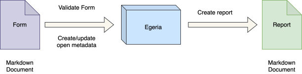
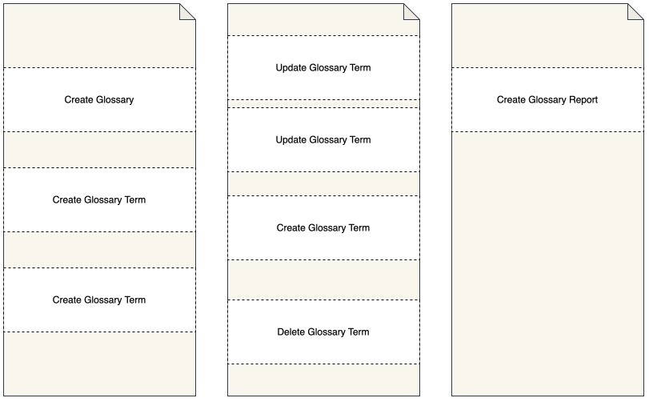
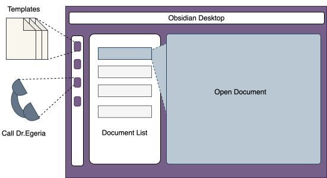

<!-- SPDX-License-Identifier: CC-BY-4.0 -->
<!-- Copyright Contributors to the Egeria project. -->

# Dr.Egeria MD

MD is short for Markdown.  It is a lightweight markup language that can be used to create documents.  Markdown is widely used in software development, documentation, and blogging.  It is also supported in a great many tools.  Markdown documents can be shared through email and chat interfaces.  They are also parsable by AI document processors.  In summary, markdown is an excellent format for gathering information from subject-matter experts and documenting projects, ideas, requirements, specifications, and other proposals. 

Dr.Egeria MD is a markdown document processor that can be used to create and update open metadata as well as build reports.

> **Figure 1:** Dr Egeria in operation

A single markdown document can include explanatory text and diagrams interspersed with commands to the Dr.Egeria command processor.  

> **Figure 2:** Dr Egeria Form Structures

When the document is processed, Dr.Egeria reads the document, extracts the commands and turns them into calls to Egeria's rest API.  The commands may be to maintain open metadata elements or create a report.  

Reports may extract information as text, tables or mermaid diagrams. They are created in a new document from the form requesting that the report is generated.

With Dr.Egeria it is possible to create, maintain and report on:

* Glossaries and glossary terms
* Projects
* Collections
* Digital Products
* Data dictionaries and data specifications
* Solution components, roles and blueprints
* Feedback (comments, tags, likes and ratings) to existing metadata elements
* Governance Definitions such as License Types and Certification Types
* External References, such as Data Source Descriptions

## Using Obsidian

[Obsidian](https://obsidian.md/) is a popular markdown editor that supports [Mermaid Diagrams](/user-interfaces/mermaid/overview) and plug-in markdown processors such as Dr.Egeria.  Obsidian is free to use and available on many platforms.  

Dr.Egeria includes two types of plug-ins for Obsidian.  The first is a collection of command templates that can be browsed and pasted into a markdown document.  Once the command is filled out, the **Call Dr.Egeria** function can be selected to process the markdown document.

> **Figure 3:** The Obsidian Desktop

Obsidian therefore makes a very flexible and easy to use desktop environment for editing, organizing and processing Dr.Egeria forms and reports.

## Writing documents that process cleanly

Dr.Egeria divides a document into blocks at each `#` or `##` heading and at each horizontal rule (`___` or `---`). A block is a command when its first line names a command, such as `## Create Glossary Term`, and each `###` heading inside it is an attribute. A few habits follow from this, and they matter most in long documents that mix commands with explanation:

* **End each command with `___`.** Otherwise a `###` heading in the text that follows is read as one of the command's attributes.
* **Don't begin a `##` heading with a command word** such as Create, Find, Link or Process unless it is a command.
* **Commands inside code fences still run.** Fences are a convenient way to show commands in a tutorial, but an example that should not run needs a placeholder, such as `## <Verb> <Object>`.
* **Write attributes as `###` headings**, not as `Name: value` lines.
* **Validate before processing.** References to elements that are created further up the same document show as "not found" in validate, and resolve when the document is processed.
* **Expect documents to be run more than once.** `Create` commands update an element with the same qualified name, but renaming an element creates a new one.
* **Status filters:** *Limit Result by Status* filters on whether an element is `ACTIVE` or `DELETED`. Lifecycle states such as `DRAFT` have their own filters: Content, Deployment and Activity Status.

The [Dr.Egeria manual](https://github.com/odpi/egeria-python/blob/main/docs/dr_egeria_manual.md#techniques-and-best-practices) explains each of these with examples.

???+ note "Further Information"
    * [Dr.Egeria manual: Techniques and Best Practices](https://github.com/odpi/egeria-python/blob/main/docs/dr_egeria_manual.md#techniques-and-best-practices)
    * [Mermaid Diagrams](/user-interfaces/mermaid/overview)
    * [Dr.Egeria Introduction - Part 1](https://github.com/odpi/egeria-python/blob/main/sample-data/egeria-inbox/dr_egeria_intro_part1.md)
    * [Dr.Egeria Introduction - Part 2](https://github.com/odpi/egeria-python/blob/main/sample-data/egeria-inbox/dr_egeria_intro_part2.md)
    * [Dr.Egeria Introduction - Part 3](https://github.com/odpi/egeria-python/blob/main/sample-data/egeria-inbox/dr_egeria_intro_part3.md)

--8<-- "snippets/abbr.md"