<!-- SPDX-License-Identifier: CC-BY-4.0 -->
<!-- Copyright Contributors to the Egeria project. -->

# Lineage Explorer

**Lineage Explorer** is a user interface for exploring an [asset's](/concepts/asset) lineage at different levels of detail. You can navigate to the lineage explorer from the asset's page in [The Catalog](/user-interfaces/the-catalog/overview) or 
by selecting the **Lineage Explorer** Card in the portal and adding a search string to extract the asset you are interested in.

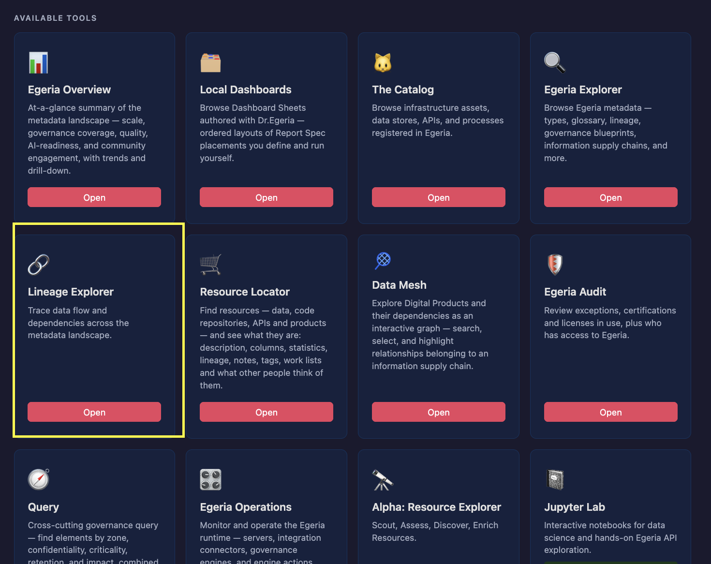

## Walkthrough

When you select **Open in Lineage Explorer** from the asset's page in the [The Catalog](/user-interfaces/the-catalog/overview), the Lineage Explorer is opened with the asset selected.

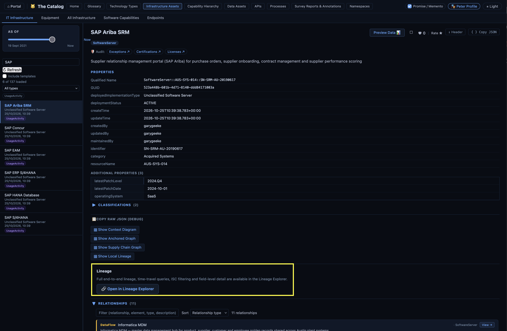

The top of the page gives a brief summary of the asset, along with a timeline slider.  The Timeline slider allows you to see the lineage from different points in time.  Move the slider to the time you are interested in and let go.  The lineage explorer then queries Egeria with the selected time and displays the results.

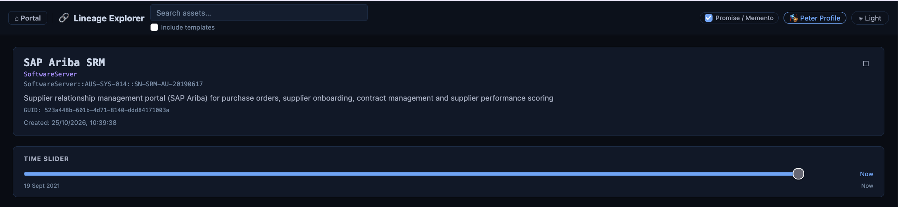

## Local Lineage

Below the timeline is the local lineage.  This shows the assets that are directly connected to the asset you are interested in through lineage.

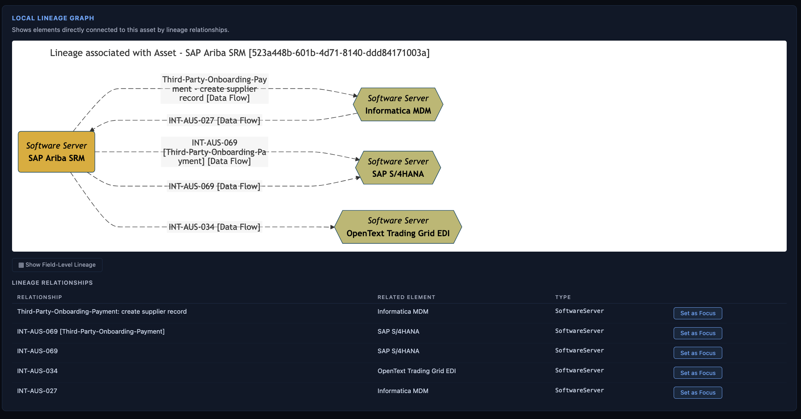

It is possible to select one of these assets, and the lineage explorer switches the focus to that asset.  This is an effective way to step through a lineage graph an asset at a time.

## Information Supply Chains

Next are the information supply chains that this asset participates in.  It displays the name and description of each supply chain and an option to see more details in [Egeria Explorer](/user-interfaces/egeria-explorer/overview).

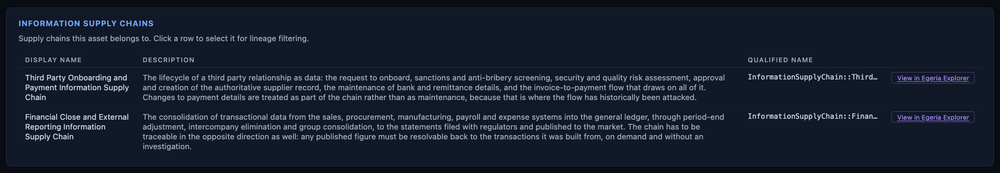

It is possible to select one of these information supply chains to affect how the full lineage (below) is displayed.  In the image below, *Third Party Onboarding and Payment Information Supply Chain* is selected.  Notice that two radio buttons appear below the table:

* **Limit to ISC** - only display the nodes of the full lineage graph that are part of the selected information supply chain.
* **Highlight ISC** - show the entire lineage graph and highlight the relationships of the graph that are part of the selected information supply chain.

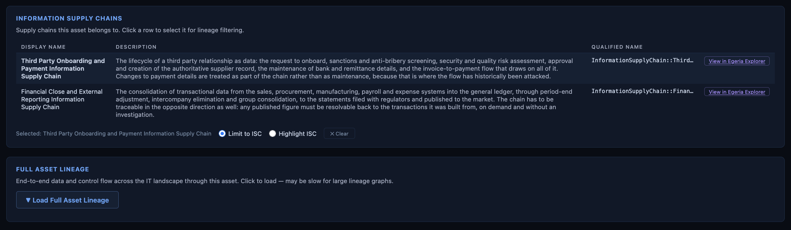

Either click clear, or select the same information supply chain again to remove the selection.

## Full Lineage

Finally, there is the full lineage.  This shows all the assets that are connected to the asset you are interested in through lineage, either directly or indirectly.

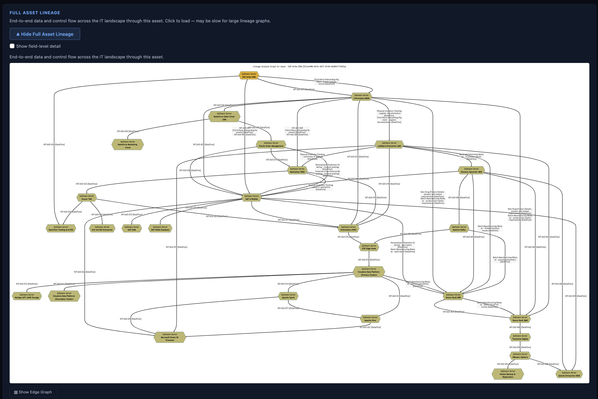

Underneath the diagram is a list of all the assets that are featured in the diagram.

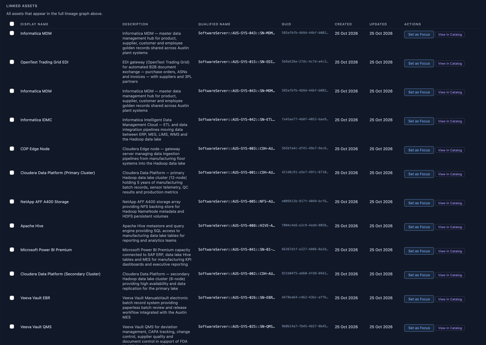

As with the local lineage, the full lineage is also interactive.  You can click on any of the assets in the list to see the lineage of that asset.

As mentioned in the previous section, the full lineage display can be modified to show only the assets that are part of the selected information supply chain. The result is a much smaller graph.

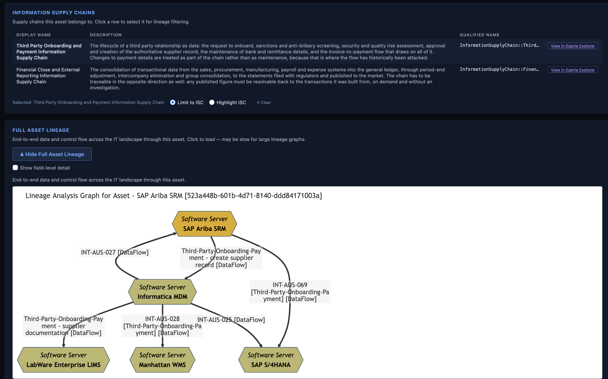

Alternatively, the full lineage can be modified to highlight the relationships of the graph that are part of the selected information supply chain.
This is useful when you want to see the context of an information supply chain.

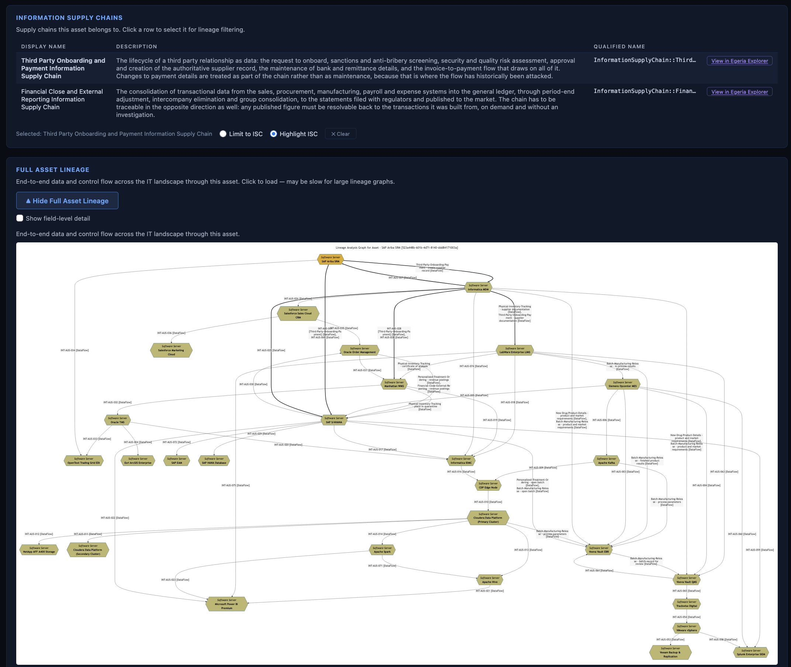

## Edge Lineage Graph

You may have noticed a small check box below the full lineage graph.  This allows you to view the elements at the edge of the graph.

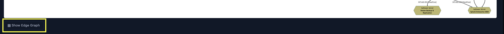

Here is the example of the edge lineage graph for the **SAP Ariba SRM** asset.

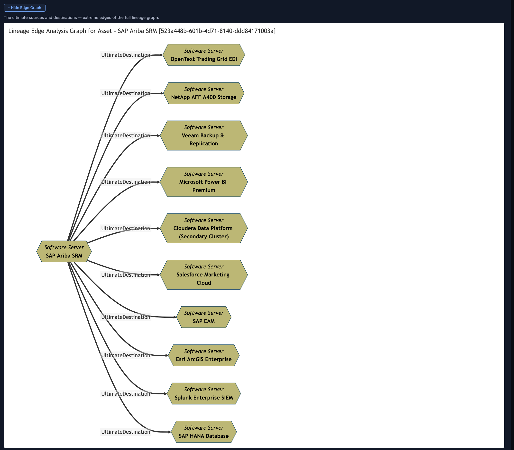

## Field Level Lineage Graph

Similarly, you may have noticed a small check box above the full lineage graph.  This extracts additional lineage information between the data fields of the asset.

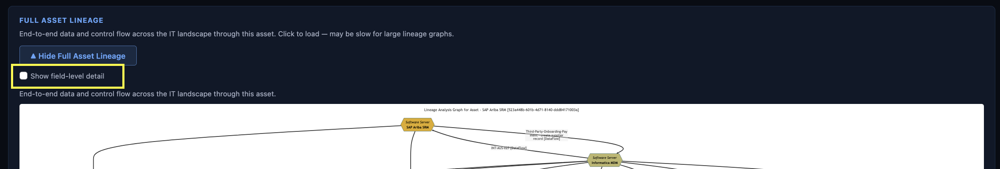

The **SAP Ariba SRM** asset is a server and has no data fields.  However, here is the example of the field level lineage graph for the related **austin_systems.sap_ariba** database schema.

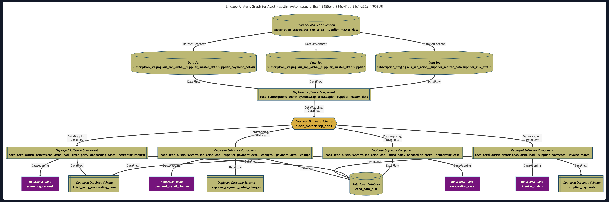

--8<-- "snippets/abbr.md"