<!-- SPDX-License-Identifier: CC-BY-4.0 -->
<!-- Copyright Contributors to the Egeria project. -->

# Graph Visualization

Egeria visualizes collections of related metadata elements as graphs using Mermaid.
[Mermaid](https://mermaid.js.org/) is a markdown extension for representing diagrams using structured text that can then be rendered in a JavaScript environment.  Many [Open Metadata View Services (OMVSs)](/services/omvs) REST API calls return one or more Mermaid markdown strings alongside the elements they retrieve.  Each string is a ready-made picture of some aspect of the returned elements: their context, their structure, their lineage, or a statistical profile.

This page describes each of the Mermaid graphs that Egeria produces, when it is returned, and what it shows.  The examples are live output from the Coco Pharmaceuticals metadata loaded into the [Egeria Quickstart](/egeria-workspaces/quick-start/overview) platform.

## Reading the graphs

The flowchart graphs share a common set of conventions:

* The title names the kind of graph, the display name of the element it is centred on and, in square brackets, that element's unique identifier (GUID).
* Each box is a metadata element.  The text in *italics* is the element's type (with any distinguishing classification in square brackets, such as *Project [Task]*), and the **bold** text is its display name.  The shape and colour of the box are chosen from the element's type, so, for example, databases are drawn as cylinders and processes as subprocess boxes.  Details of the types can be found on the [Open Metadata Types](/types) pages.
* The element that the graph is centred on is highlighted in gold.
* Each line is a relationship.  The arrow-head is at end 2 of the relationship and the label is the relationship type, preceded by the relationship's label property if it has one (for example *governs [Solution Linking Wire]*).  Animated lines are used for lineage.
* Where an element has more relationships of one type than the request's `maxMermaidNodeCount` option allows (the default is 5), the extra elements are summarized in a single box labelled *... plus N Items*.  Setting `maxMermaidNodeCount` to 0 suppresses the Mermaid graphs altogether, which makes large queries faster.
* Some boxes are clickable and link to further documentation, such as the connector types and deployed implementation types described on this site.

## Summary of the graphs

| Graph property | Returned on | What it shows |
|----------------|-------------|---------------|
| [`mermaidGraph`](#context-graph-mermaidgraph) | Every element returned as an *OpenMetadataRootElement*, and on list responses | The element's context: its structural and descriptive relationships. |
| [`actionMermaidGraph`](#action-graph-actionmermaidgraph) | Every element returned as an *OpenMetadataRootElement* | The components that are working on the element. |
| [`activityMermaidGraph`](#activity-graph-activitymermaidgraph) | Every element returned as an *OpenMetadataRootElement* | The activity recorded for the element. |
| [`rootHierarchyMermaidGraph`](#hierarchy-graph-roothierarchymermaidgraph) | Collection and project hierarchy requests | A tree of nested collections or projects. |
| [`specificationMermaidGraph`](#specification-graph-specificationmermaidgraph) | Elements with a specification, such as governance services | The parameters, action targets and guards that the element supports. |
| [`solutionBlueprintMermaidGraph`](#solution-blueprint-graph-solutionblueprintmermaidgraph) | Solution blueprints | The blueprint's solution components and how they are wired together. |
| [`solutionSubcomponentMermaidGraph`](#solution-subcomponent-graph-solutionsubcomponentmermaidgraph) | Solution components with subcomponents | The components nested inside a solution component. |
| [`organizationTreeMermaidGraph`](#organization-tree-graph-organizationtreemermaidgraph) | Teams with subteams | The team structure below a team. |
| [`collectionMermaidMindMap`](#collection-mind-map-collectionmermaidmindmap) | Collections that contain other collections | The nested collections as a mind map. |
| [`zoneProfileMermaidPieChart`](#zone-profile-pie-charts) | Governance zones with a membership profile | The types of the elements that are members of the zone. |
| [`zoneProfileAnchoredMermaidPieChart`](#zone-profile-pie-charts) | Governance zones with a membership profile | The types of the anchored elements that are in the zone through their anchor. |
| [`zoneProfileAllMermaidPieChart`](#zone-profile-pie-charts) | Governance zones with a membership profile | The types of all the elements in the zone. |
| [`userAccountTypeProfileMermaidPieChart`](#user-account-profile-pie-charts) | Secrets collections with a user account profile | The types of user account in the collection. |
| [`userAccountStatusProfileMermaidPieChart`](#user-account-profile-pie-charts) | Secrets collections with a user account profile | The status of the user accounts in the collection. |
| [`anchorMermaidGraph`](#anchor-graph-anchormermaidgraph) | `getAssetGraph` | The asset with all the elements anchored to it. |
| [`informationSupplyChainMermaidGraph`](#information-supply-chain-membership-graph-informationsupplychainmermaidgraph) | `getAssetGraph` | The information supply chains that the asset belongs to. |
| [`localLineageGraph`](#local-lineage-graph-locallineagegraph) | `getAssetGraph` | The lineage relationships attached directly to the asset. |
| [`fieldLevelLineageGraph`](#field-level-lineage-graph-fieldlevellineagegraph) | `getAssetGraph` | The data mappings between the asset's schema elements and other elements. |
| [`fullLineageMermaidGraph`](#full-lineage-graph-fulllineagemermaidgraph) | `getAssetLineageGraph` | All the elements reachable from the asset through lineage relationships. |
| [`edgeMermaidGraph`](#lineage-edge-graph-edgemermaidgraph) | `getAssetLineageGraph` | The ultimate sources and destinations of the asset's lineage. |
| [`iscImplementationMermaidGraph`](#implementation-graph-iscimplementationmermaidgraph) | `getInformationSupplyChainByGUID` and information supply chain searches | The supply chain's context, design and implementation status. |
| [`iscDataMeshMermaidGraph`](#data-mesh-graph-iscdatameshmermaidgraph) | As above | The digital products that implement the supply chain. |
| [`iscSystemFabricMermaidGraph`](#system-fabric-graph-iscsystemfabricmermaidgraph) | As above | The IT infrastructure and software capabilities that the supply chain runs on. |
| [`iscDataFabricMermaidGraph`](#data-fabric-graph-iscdatafabricmermaidgraph) | As above | The data lineage that implements the supply chain. |
| [`iscDataMappingMermaidGraph`](#data-mapping-graph-iscdatamappingmermaidgraph) | As above | The data mappings that implement the supply chain. |
| [`governanceActionProcessMermaidGraph`](#governance-action-process-graphs) | `getGovernanceActionProcessGraph` | The steps of a governance action process, or the engine actions of a running instance of it. |

A graph property is only present when there is something to show: for example, `organizationTreeMermaidGraph` is null for a team with no subteams, and `fieldLevelLineageGraph` is null for an asset with no data mappings.

## Element graphs

Most requests return their elements as an *OpenMetadataRootElement*, which carries the element's properties, its header, the relationships attached to it and the elements at the other end of them.  Each of these comes with three Mermaid graphs that draw the element and its relationships.  The relationships are split between the three graphs by their [relationship purpose](/concepts/relationship-purpose), which is the purpose Egeria's type system declares for the relationship's type.  A relationship type added by an extension archive takes the purpose of its nearest Egeria super type, and is drawn in the context graph if it has none.

Action and activity relationships accumulate as the ecosystem works: every governance action, request for action and recorded action adds more.  Keeping them out of the context graph means that the context graph stays a stable, readable picture of the element's structure however busy the element becomes, while the action and activity graphs show what is happening to it.  Elements that are only reached through action or activity relationships appear only in those graphs.

### Context graph (`mermaidGraph`)

The context graph shows the element with every relationship (and the elements it links to, along with any further nested elements) **except** those whose purpose is *Action* or *Activity*.  It shows what the element is, what it is made of, what is attached to it, and how it is governed and deployed.  The context graph also shows how the element was found (its *relatedBy* relationship, when it was returned from a query that followed a relationship), and the hierarchy for elements returned with one.

This is the context graph of one of the processes that loads Coco Pharmaceuticals' data hub.  It shows the process that it is part of, the data sharing agreement that covers its input, the data flows in and out of it, and a summary box for its four data mappings, which are more than the `maxMermaidNodeCount` of 3 used on this request.

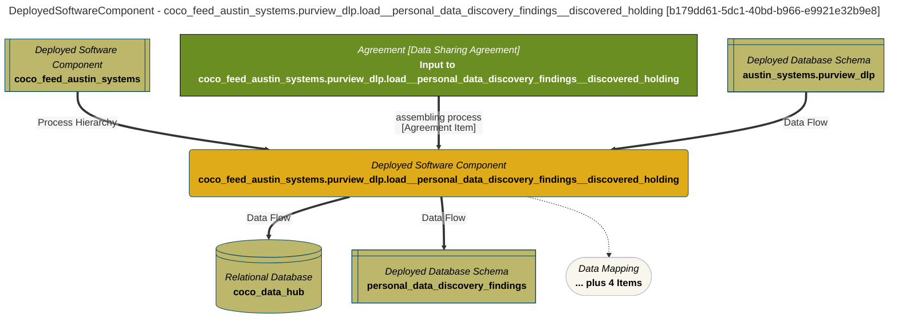

Requests that return a list of elements, such as the `find...` and `get...ByName` requests, also return a `mermaidGraph` on the response itself.  This is a composite graph that draws all the returned elements together, titled with the search string that was used.

### Action graph (`actionMermaidGraph`)

The action graph shows the element with the relationships attached to it whose purpose is *Action*, together with any elements nested below them.  These are the components that are working on the element, such as the targets of a governance action, the governance engine that executes it, or the subscribers to a notification.  Its title includes *Actions*, and it is null if there are no such relationships.

This action graph shows the governance engine that runs a step in the process that creates a subscription to a digital product:

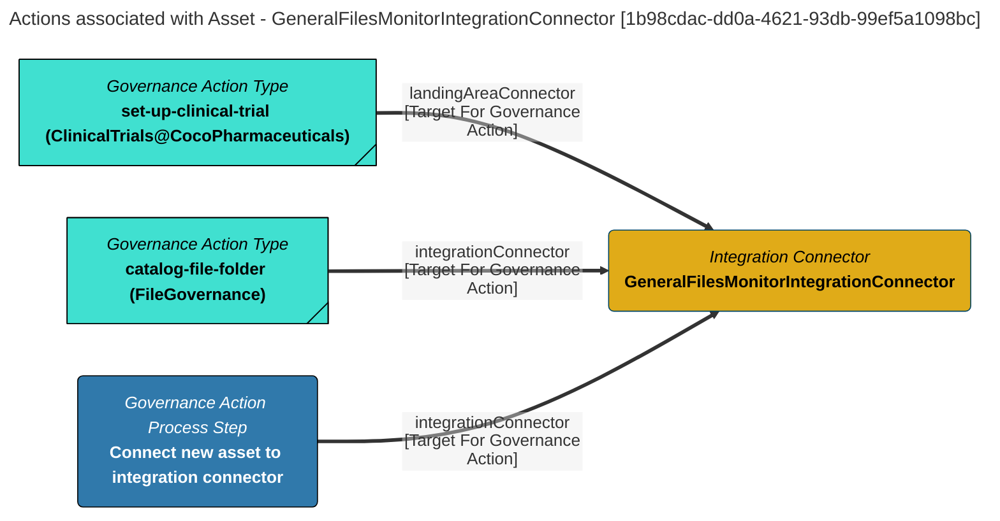

For an asset returned by `getAssetGraph`, the action graph is widened to cover the actions on any of the asset's anchored elements as well as the asset itself; its title is then *Actions associated with Asset*.

### Activity graph (`activityMermaidGraph`)

The activity graph shows the element with the relationships attached to it whose purpose is *Activity*, together with any elements nested below them.  These record what has happened to the element, such as the actions that have been requested of, or taken on, the element, or the template it was created from.  Its title includes *Activity*, and it is null if there are no such relationships.

This activity graph shows that a tabular data set collection was created from a template:

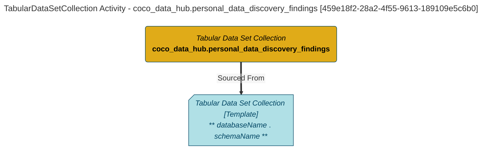

## Structural graphs

Some types of element have a structure that is clearer when drawn on its own, without the rest of the element's context.  These graphs are added to the *OpenMetadataRootElement* alongside the element graphs when the element is of the right type and has the necessary content.

### Hierarchy graph (`rootHierarchyMermaidGraph`)

The hierarchy graph is returned by the requests that walk down a hierarchy of elements:

* *getCollectionHierarchy* (`POST .../collections/{collectionGUID}/hierarchy`) in the [Collection Manager API](/services/omvs/collection-manager/overview) and the other services that manage collections.  The nested collections are drawn in a subgraph called *Collection Hierarchy* (with the query depth added when one was requested), and the number of members of each nested collection is shown in a box linked to it.
* *getProjectHierarchy* (`POST .../projects/{projectGUID}/hierarchy`) in the [Project Manager API](/services/omvs/project-manager/overview), which draws the managed projects in a subgraph called *Managed Projects*, and *getProjectGraph* (`POST .../projects/{projectGUID}/graph`), which draws the dependent projects in a subgraph called *Other Related Projects*.

The starting element's context is drawn at the top, and the hierarchy below it.  This is the project hierarchy of Jules Keeper's ninety day plan to establish a data strategy for Coco Pharmaceuticals.  The plan is split into three phases, each of which has its own tasks:

```mermaid
---
title: Project Hierarchy - My Ninety Day Plan [2fbf6cf2-0038-4a50-9464-2eb4b7a5e3e8]
---
flowchart TD
%%{init: {"flowchart": {"htmlLabels": false}} }%%

1@{ shape: rounded, label: "*Project*
**My Ninety Day Plan**"}
2@{ shape: notch-rect, label: "*Project*
**Next 30 Days (Initiation Phase)**"}
1==>|"Project Hierarchy"|2
3@{ shape: notch-rect, label: "*Project [Task]*
**Define Data-driven System Architecture**"}
2==>|"Project Hierarchy"|3
4@{ shape: notch-rect, label: "*Project [Task]*
**Create Cross-Domain Governance Drivers and Policies**"}
2==>|"Project Hierarchy"|4
5@{ shape: notch-rect, label: "*Project [Task]*
**Document Data Strategy**"}
2==>|"Project Hierarchy"|5
6@{ shape: stadium, label: "*Project Hierarchy*
**... plus 7 Items**"}
2-.->6
7@{ shape: notch-rect, label: "*Project*
**Final 30 Days (Impact Phase)**"}
1==>|"Project Hierarchy"|7
8@{ shape: notch-rect, label: "*Project*
**First 30 Days (Learning Phase)**"}
1==>|"Project Hierarchy"|8
9@{ shape: notch-rect, label: "*Project [Task]*
**Build proposal to present to the board**"}
8==>|"Project Hierarchy"|9
10@{ shape: notch-rect, label: "*Project [Task]*
**Hold meetings with leaders across the business**"}
8==>|"Project Hierarchy"|10
11@{ shape: notch-rect, label: "*Project [Task]*
**Meet my team - Erin Overview and Peter Profile**"}
8==>|"Project Hierarchy"|11
subgraph 12 [Managed Projects]
direction LR
2==>|"Project"|3
2==>|"Project"|4
2==>|"Project"|5
13@{ shape: notch-rect, label: "*Project [Task]*
**Define multi-faceted governance**"}
2==>|"Project"|13
14@{ shape: notch-rect, label: "*Project [Task]*
**Identify Authoritative Sources**"}
2==>|"Project"|14
15@{ shape: notch-rect, label: "*Project [Task]*
**Define continuous analytics**"}
2==>|"Project"|15
16@{ shape: notch-rect, label: "*Project [Task]*
**Identifying key information supply chains**"}
2==>|"Project"|16
17@{ shape: notch-rect, label: "*Project [Task]*
**Organize Governance Leaders Team**"}
2==>|"Project"|17
18@{ shape: notch-rect, label: "*Project [Task]*
**Define Subject Areas**"}
2==>|"Project"|18
19@{ shape: notch-rect, label: "*Project [Task]*
**Plan for data-enabled employees**"}
2==>|"Project"|19
8==>|"Project"|9
8==>|"Project"|10
8==>|"Project"|11
end
1-.->12
style 1 color:#000000, fill:#e0ab18, stroke:#004563
style 2 color:#000000, fill:#FFC0CB, stroke:#000000
style 3 color:#000000, fill:#FFC0CB, stroke:#000000
style 4 color:#000000, fill:#FFC0CB, stroke:#000000
style 5 color:#000000, fill:#FFC0CB, stroke:#000000
style 6 color:#000000, fill:#F9F7ED, stroke:#b7c0c7
style 7 color:#000000, fill:#FFC0CB, stroke:#000000
style 8 color:#000000, fill:#FFC0CB, stroke:#000000
style 9 color:#000000, fill:#FFC0CB, stroke:#000000
style 10 color:#000000, fill:#FFC0CB, stroke:#000000
style 11 color:#000000, fill:#FFC0CB, stroke:#000000
style 12 color:#000000, fill:#F9F7ED, stroke:#b7c0c7
style 13 color:#000000, fill:#FFC0CB, stroke:#000000
style 14 color:#000000, fill:#FFC0CB, stroke:#000000
style 15 color:#000000, fill:#FFC0CB, stroke:#000000
style 16 color:#000000, fill:#FFC0CB, stroke:#000000
style 17 color:#000000, fill:#FFC0CB, stroke:#000000
style 18 color:#000000, fill:#FFC0CB, stroke:#000000
style 19 color:#000000, fill:#FFC0CB, stroke:#000000
```

Notice that the context part of the graph is limited by `maxMermaidNodeCount` (here, three tasks are shown for the initiation phase plus a summary box), whereas the *Managed Projects* subgraph shows every task.

### Specification graph (`specificationMermaidGraph`)

A [specification](/concepts/specification) describes how an element, typically a connector or governance service, can be called: the request types and parameters it supports, the action targets it expects, the guards it produces, the annotation types it creates and so on.  The specification graph draws each kind of specification property as a hexagon linked to the element, with each property below it and its details (description, data type, example value, whether it is required, and so on) in a subgraph.  It is returned whenever the element has specification properties.  The [Automated Curation API](/services/omvs/automated-curation/overview) also returns specification graphs for technology types and governance action types.

This is part of the specification graph of the Lovelace OpenLineage Data Scope governance action service, showing one of its request parameters, one of the guards it produces and the action target it expects:

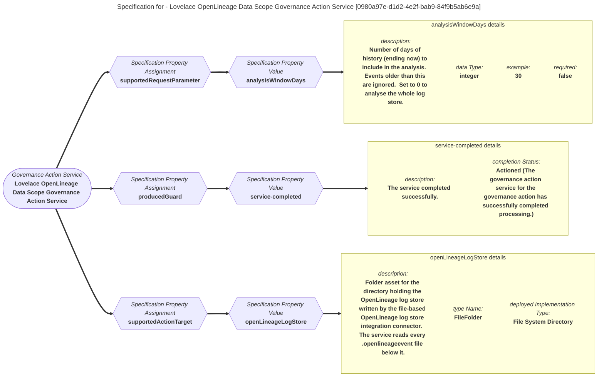

### Solution blueprint graph (`solutionBlueprintMermaidGraph`)

A [solution blueprint](/concepts/solution-blueprint) is a collection of [solution components](/concepts/solution-component) and the actors that use them.  The solution blueprint graph draws just the top-level components of the blueprint inside a *Components and Actors* subgraph, linked together by their solution linking wires.  It is returned for solution blueprints that have members, for example by the [Solution Architect API](/services/omvs/solution-architect/overview).

This is the blueprint of Coco Pharmaceuticals' data strategy:

```mermaid
---
title: Components and Roles for Solution Blueprint - Data Strategy Framework [1dbed139-50b8-42d9-a5dd-e96f0fcf1ac4]
---
flowchart TD
%%{init: {"flowchart": {"htmlLabels": false}} }%%

subgraph 1 [Components and Actors]
2@{ shape: rect, label: "*Solution Component*
**Common Data Definitions**"}
3@{ shape: rect, label: "*Solution Component*
**Data-driven Systems Architecture**"}
4@{ shape: rect, label: "*Solution Component*
**Optimized Information Supply Chains**"}
5@{ shape: rect, label: "*Solution Component*
**Authoritative Sources**"}
6@{ shape: rect, label: "*Solution Component*
**Continuous Analytics and AI**"}
7@{ shape: rect, label: "*Solution Component*
**Data-enabled Employees**"}
8@{ shape: rect, label: "*Solution Component*
**Multi-faceted Governance Model**"}
3==>|"understood through,
[Solution Linking Wire]"|2
8==>|"governs,
[Solution Linking Wire]"|2
4==>|"designed by,
[Solution Linking Wire]"|3
8==>|"governs,
[Solution Linking Wire]"|3
5==>|"maintained by,
[Solution Linking Wire]"|4
8==>|"governs,
[Solution Linking Wire]"|4
6==>|"uses,
[Solution Linking Wire]"|5
8==>|"governs,
[Solution Linking Wire]"|5
7==>|"makes decisions with,
[Solution Linking Wire]"|6
8==>|"governs,
[Solution Linking Wire]"|6
8==>|"governs,
[Solution Linking Wire]"|7
end
style 1 color:#FFFFFF, fill:#3079ab, stroke:#000000
style 2 color:#000000, fill:#DDA0DD, stroke:#000000
style 3 color:#000000, fill:#DDA0DD, stroke:#000000
style 4 color:#000000, fill:#DDA0DD, stroke:#000000
style 5 color:#000000, fill:#DDA0DD, stroke:#000000
style 6 color:#000000, fill:#DDA0DD, stroke:#000000
style 7 color:#000000, fill:#DDA0DD, stroke:#000000
style 8 color:#000000, fill:#DDA0DD, stroke:#000000
```

### Solution subcomponent graph (`solutionSubcomponentMermaidGraph`)

A solution component may be broken down into subcomponents.  The solution subcomponent graph draws the solution component, styled by its *solutionComponentType*, linked to a *Subcomponents* subgraph that holds its nested components and the solution linking wires between them.  It is titled *Solution Component* followed by the component's name, and is returned for solution components that have nested components, for example by the Solution Architect API.

This is the pipeline that moves Coco Pharmaceuticals' weekly measurements files from the landing area into the data lake, catalogs them, and validates their contents.  Once a file has been moved, its origin is determined and its quality is checked, and the quality assessment is reported before the new asset is published.

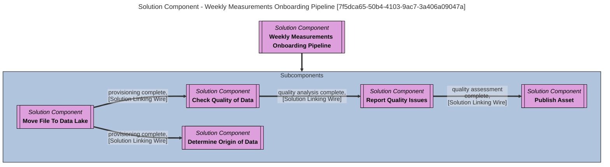

### Organization tree graph (`organizationTreeMermaidGraph`)

The organization tree graph draws a [team](/concepts/team) and the teams below it, following the *TeamStructure* relationships down through every level of the hierarchy.  A solid line means that the parent team has delegation and escalation authority over the subteam; otherwise the line is dotted.  It is titled *Team structure* and is returned for teams that have subteams, for example by the [People Organizer API](/services/omvs/people-organizer/overview).

This is the structure of Coco Pharmaceuticals' Bucharest site:

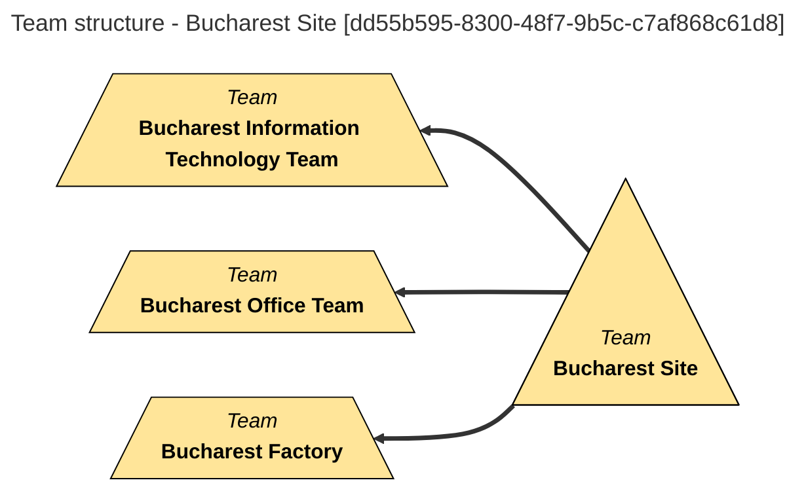

### Collection mind map (`collectionMermaidMindMap`)

The collection mind map uses Mermaid's *mindmap* diagram to draw a collection's nested collections, with each branch showing the collection's type in bold followed by its name.  Only collections are drawn: other members, such as assets or glossary terms, are left out, and the branches stop at digital products and agreements.  It is returned for collections (including digital product catalogs, folders and blueprints) that have at least one nested collection.

This is the top level of Coco Pharmaceuticals' strategic digital product catalog, which is organized into folders by business area:

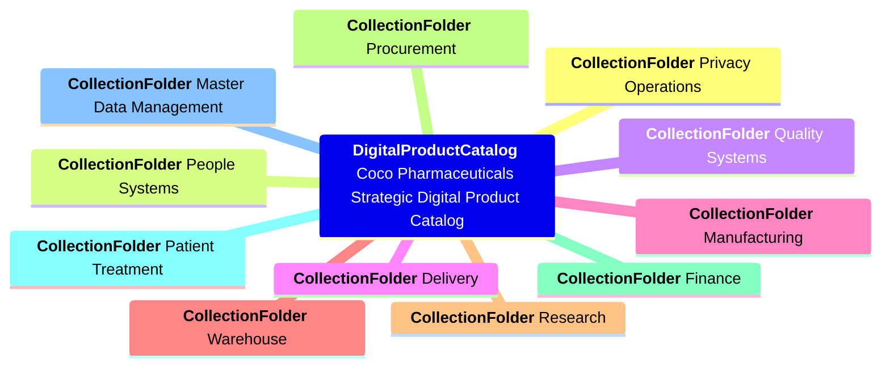

## Profile pie charts

Some elements carry a classification that holds statistics about the elements they group together.  These statistics are maintained by Egeria's governance services, and are returned as Mermaid *pie* charts.  Each chart shows the largest values as separate segments, labelled with their count, and adds the remaining values together in an *Others* segment.

### Zone profile pie charts

A [governance zone](/concepts/governance-zone) with a *ZoneMembershipProfile* classification has three pie charts, each counting the elements in the zone by type:

* `zoneProfileMermaidPieChart` (*Membership of ...*) counts the elements that list the zone in their own zone membership.
* `zoneProfileAnchoredMermaidPieChart` (*Anchored Elements of ...*) counts the elements that are in the zone because their [anchor](/concepts/anchor) is in the zone.
* `zoneProfileAllMermaidPieChart` (*All Elements of ...*) counts both together.

These are the charts for Coco Pharmaceuticals' security zone.  The direct members are mostly user identities, security roles and security groups, whereas the anchored elements are the parts of the digital products that publish them.

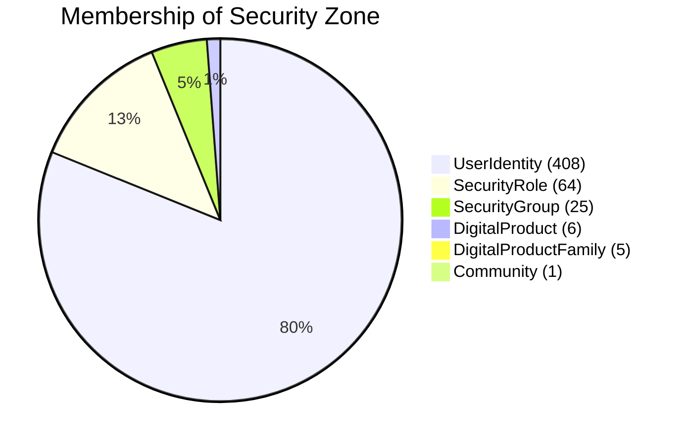

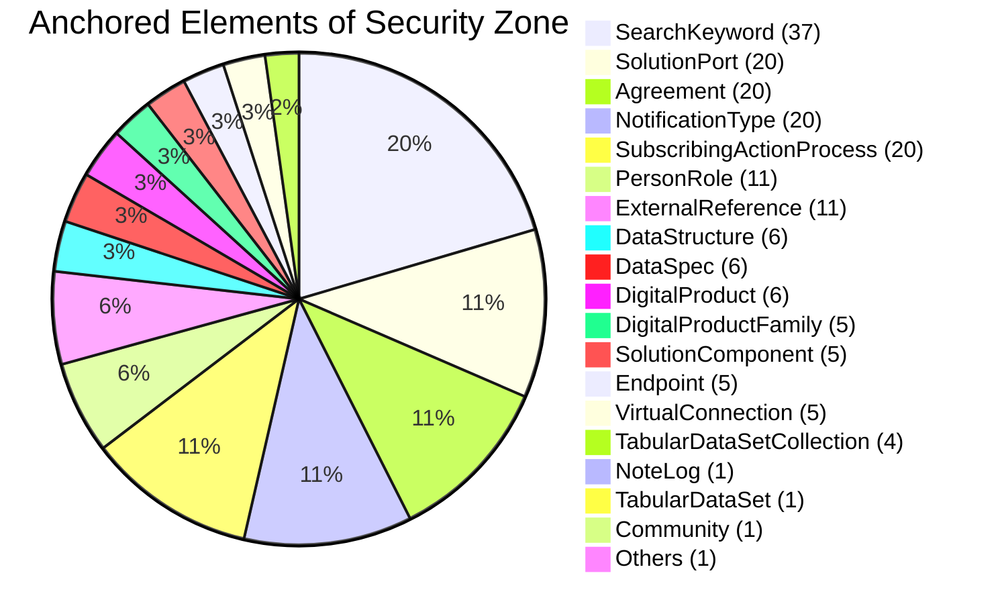

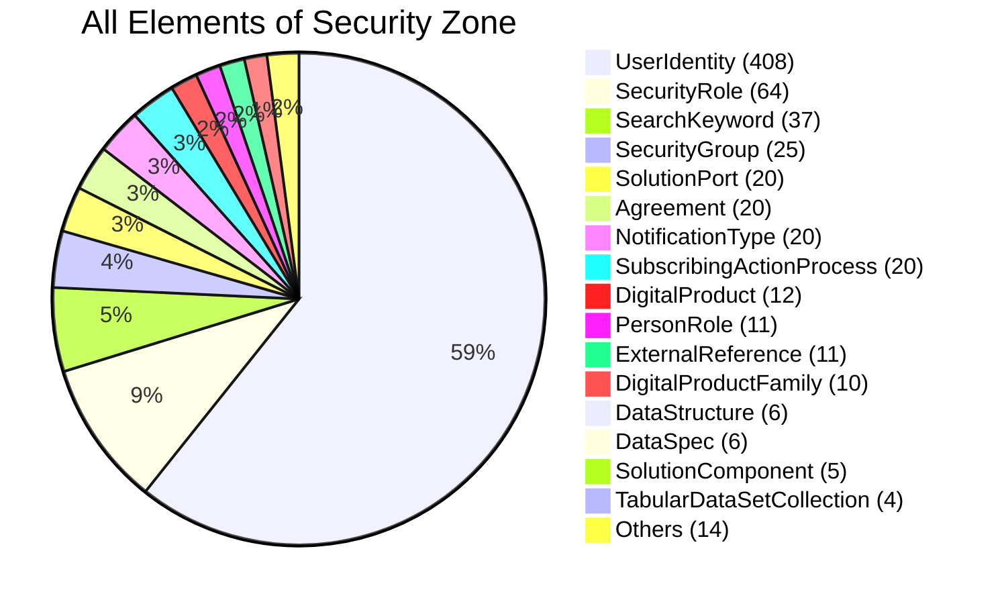

### User account profile pie charts

A secrets collection, such as a user directory, with a *UserAccountProfile* classification has two pie charts describing the [user accounts](/concepts/user-identity) it holds.  They are only returned if the collection holds at least one account.

* `userAccountTypeProfileMermaidPieChart` (*Account Types in ...*) counts the accounts by their account type.
* `userAccountStatusProfileMermaidPieChart` (*Account Statuses in ...*) counts the accounts by their status.

These are the charts for Coco Pharmaceuticals' user directory:

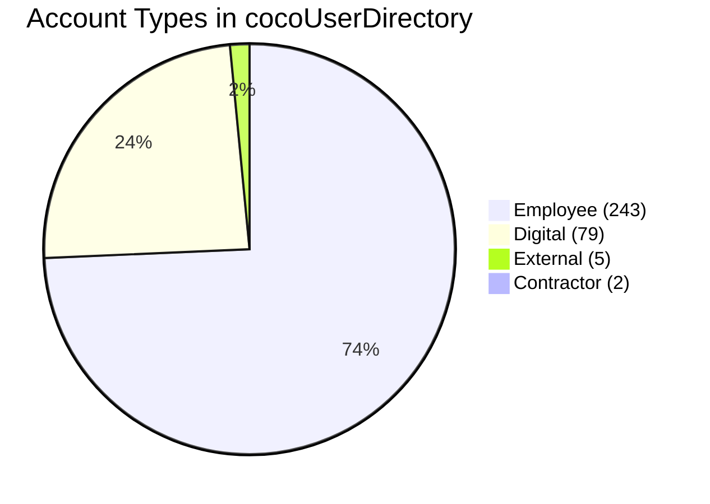

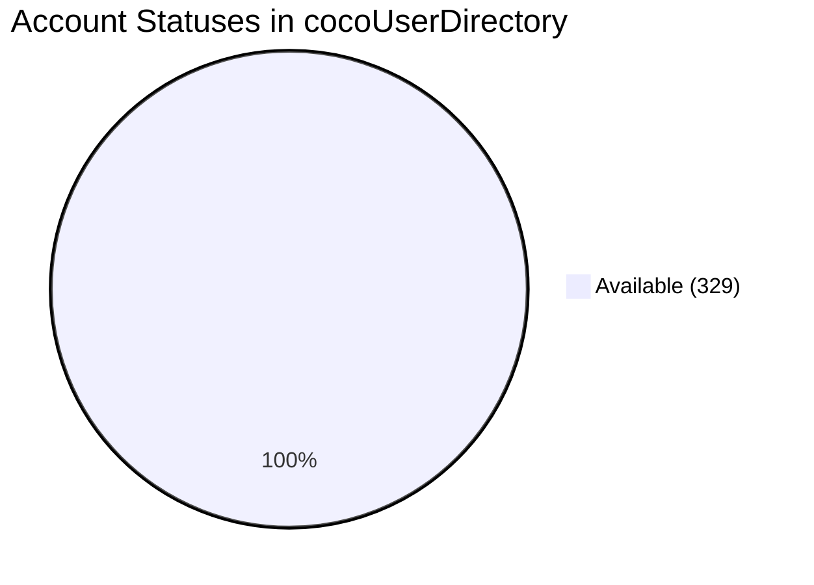

## Asset graphs

The [Asset Catalog API](/services/omvs/asset-catalog/overview) supports a REST API called *getAssetGraph* (`POST /servers/{serverName}/api/open-metadata/asset-catalog/assets/{assetGUID}/as-graph`) which returns the requested asset, all the elements anchored to it, and all the relationships that are attached to the asset and its anchored elements.  This can be a lot of information, so the response breaks it down into several graphs, each showing a different aspect of the asset.  The asset is drawn in gold in each of them.

### Anchor graph (`anchorMermaidGraph`)

The anchor graph draws the asset with all its anchored elements and the relationships attached to them, apart from the lineage and action relationships that have graphs of their own.  The anchored elements have rounded corners; elements that are just linked to one of the anchored elements have square corners.  The asset's classifications are listed in a subgraph.  *DataSetContent* and *DerivedSchemaTypeQueryTarget* relationships are drawn in both this graph and the lineage graphs, because they describe the structure of the asset as well as where its data comes from.

This is the anchor graph of the tabular data set collection that represents one of the schemas in Coco Pharmaceuticals' data hub.  It shows the connection that is used to access the data, the digital product that the collection belongs to, the template it was created from and the database schema whose content it describes.

```mermaid
---
title: Asset - coco_data_hub.personal_data_discovery_findings [459e18f2-28a2-4f55-9613-189109e5c6b0]
---
flowchart LR
%%{init: {"flowchart": {"htmlLabels": false}} }%%

subgraph 1 [Classifications]
direction TB
2@{ shape: rounded, label: "*Anchors*
"}
end
3@{ shape: rounded, label: "*Tabular Data Set Collection*
**coco_data_hub.personal_data_discovery_findings**"}
4@{ shape: rounded, label: "*Endpoint*
**coco_data_hub.personal_data_discovery_findings endpoint**"}
5@{ shape: rounded, label: "*Endpoint*
**coco_data_hub.personal_data_discovery_findings secret store endpoint**"}
6@{ shape: rounded, label: "*Connection*
**coco_data_hub.personal_data_discovery_findings secrets store connection**"}
7@{ shape: rounded, label: "*Virtual Connection*
**coco_data_hub.personal_data_discovery_findings connection**"}
8@{ shape: rounded, label: "*Virtual Connection*
**coco_data_hub.personal_data_discovery_findings data set connection**"}
3==>|"Resource Connection"|8
7==>|"Connect To Endpoint"|4
9@{ shape: rounded, label: "*Connector Type*
**YAML File Secrets Store Connector**"}
6==>|"Connection Connector Type"|9
8==>|"Connect to technology [Embedded Connection]"|7
10@{ shape: card, label: "*Tabular Data Set Collection [Template]*
** *databaseName* . *schemaName* **"}
3==>|"Sourced From"|10
11@{ shape: rounded, label: "*Connector Type*
**Relational Database JDBC Connector**"}
7==>|"Connection Connector Type"|11
12@{ shape: rect, label: "*Digital Product*
**Personal Data Discovery Findings**"}
12==>|"Collection Membership"|3
6==>|"Connect To Endpoint"|5
13@{ shape: rounded, label: "*Connector Type*
**PostgreSQL Tabular Data Set Collection Connector**"}
8==>|"Connection Connector Type"|13
14@{ shape: win-pane, label: "*Deployed Database Schema*
**personal_data_discovery_findings**"}
3==>|"Data Set Content"|14
7==>|"basicAuthentication [Embedded Connection]"|6
style 1 color:#000000, fill:#F9F7ED, stroke:#b7c0c7
style 3 color:#000000, fill:#e0ab18, stroke:#004563
style 4 color:#000000, fill:#ffffe0, stroke:#004563
style 5 color:#000000, fill:#ffffe0, stroke:#004563
style 6 color:#000000, fill:#ffffe0, stroke:#004563
style 7 color:#000000, fill:#ffffe0, stroke:#004563
style 8 color:#000000, fill:#ffffe0, stroke:#004563
style 9 color:#000000, fill:#39add1, stroke:#004563
style 10 color:#004563, fill:#b0e0e6, stroke:#004563
style 11 color:#000000, fill:#39add1, stroke:#004563
style 12 color:#000000, fill:#838cc7, stroke:#3079ab
style 13 color:#000000, fill:#39add1, stroke:#004563
style 14 color:#000000, fill:#BDB76B, stroke:#004563
click 9 "https://github.com/odpi/egeria/tree/main/open-metadata-implementation/adapters/open-connectors/secrets-store-connectors/yaml-secrets-store-connector" "Click for more documentation" _blank
click 11 "https://github.com/odpi/egeria/tree/main/open-metadata-implementation/adapters/open-connectors/data-store-connectors/jdbc-resource-connector" "Click for more documentation" _blank
click 13 "https://github.com/odpi/egeria/tree/main/open-metadata-implementation/adapters/open-connectors/data-manager-connectors/postgres-server-connectors" "Click for more documentation" _blank
```

### Information supply chain membership graph (`informationSupplyChainMermaidGraph`)

The information supply chain membership graph shows the [information supply chains](/concepts/information-supply-chain) that the asset is part of, that is, the supply chains named in the *iscQualifiedName* property of the lineage relationships attached to the asset.  It is titled *Information Supply Chain Analysis Graph for Asset* and is null if the asset is not part of any information supply chain.

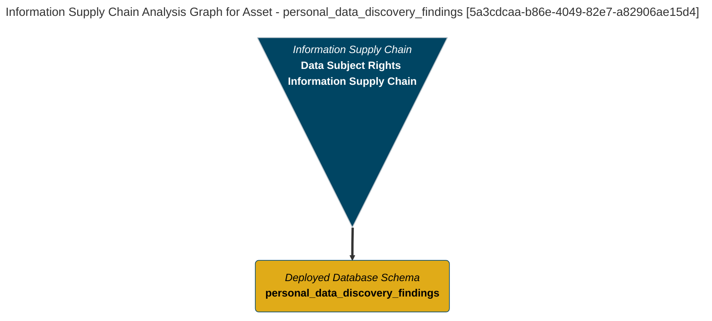

Use the [information supply chain graphs](#information-supply-chain-graphs) to see the whole supply chain.

### Local lineage graph (`localLineageGraph`)

The local lineage graph draws the *DataFlow*, *ControlFlow*, *ProcessCall*, *LineageMapping* and *DataSetContent* relationships that are attached directly to the asset or to one of its anchored elements (such as a column), as animated lines.  It is titled *Lineage associated with Asset*.  It shows the asset's immediate neighbours in its lineage; use [*getAssetLineageGraph*](#lineage-graphs) to follow the lineage further.

This database schema is fed by two processes and its content is described by a tabular data set collection:

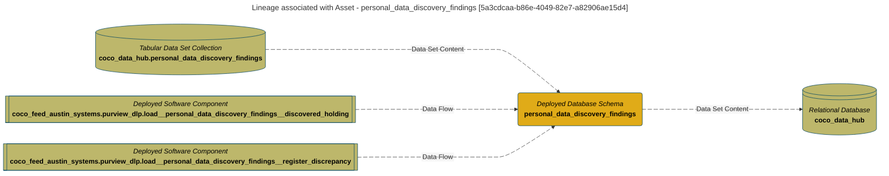

### Field-level lineage graph (`fieldLevelLineageGraph`)

The field-level lineage graph draws the *DataMapping* relationships that link the asset's schema elements to schema elements of other assets, or to processes.  Each mapped schema element is linked to its own anchor with a dotted *Anchor for* line, so it is possible to see which asset each field belongs to.  It is titled *Field-Level Lineage Analysis Graph for Asset* and is null if the asset has no data mappings.

This process reads three tables from Coco Pharmaceuticals' data loss prevention system and writes to a table in the data hub:

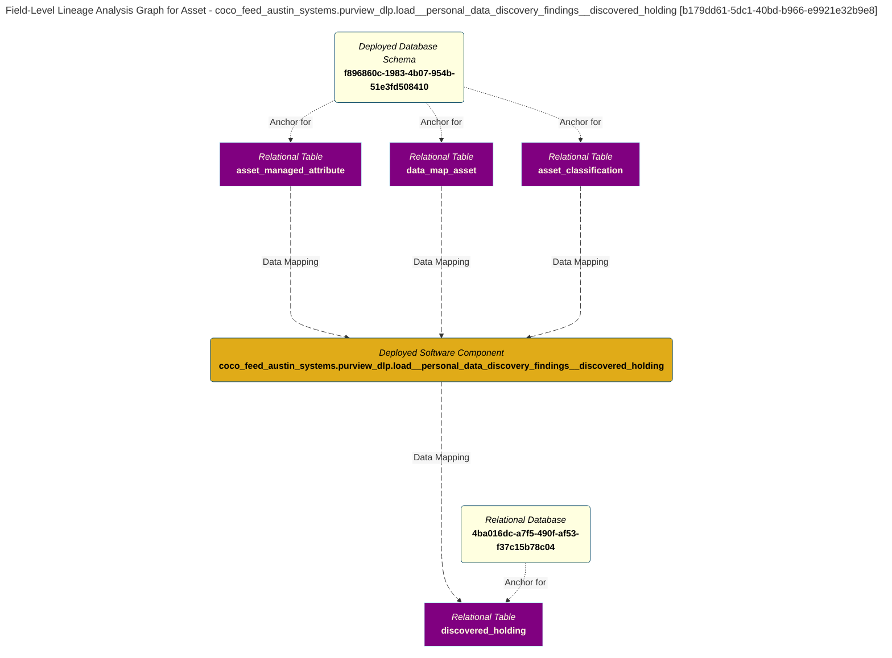

## Lineage graphs

The [Asset Catalog API](/services/omvs/asset-catalog/overview) also supports a REST API called *getAssetLineageGraph* (`POST /servers/{serverName}/api/open-metadata/asset-catalog/assets/{assetGUID}/as-lineage-graph`), which follows the [lineage](/concepts/lineage) relationships out from the requested asset, in both directions, and returns the assets it finds and the relationships between them.  The relationships that are followed are:

* [DataFlow](/types/7/0750-Data-Passing) - how is data flowing
* [ProcessCall](/types/7/0750-Data-Passing) - which system is calling another
* [ControlFlow](/types/7/0750-Data-Passing) - how is control passed between processes that are under the control of a workflow manager
* [LineageMapping](/types/7/0770-Lineage-Mapping) - how do elements catalogued from different lineage systems relate to one another
* [DataMapping](/types/7/0770-Lineage-Mapping) - how do individual data fields map to one another
* [DataSetContent](/types/2/0210-Data-Stores) - how are data sources combined to create a data set
* [DerivedSchemaTypeQueryTarget](/types/5/0512-Derived-Schema-Elements) - what are the queries used to create derived data fields and views
* *ActionRequester* - which actions have been requested by elements in the lineage

You can specify any number of these relationship types on the request in `includeOnlyRelationships`.  If you specify none, all of them are followed.  The *AssetLineageGraphRequestBody* also supports:

* `maxHops` - how far to follow the lineage from the requested asset.
* `allAnchors` - whether to follow the lineage of all the elements anchored to the assets it finds, rather than just the assets themselves.
* `limitToISCQualifiedName` - only follow relationships that are part of the named information supply chain.
* `highlightISCQualifiedName` - draw the relationships that are part of the named information supply chain with thick lines, and the others with thin lines.

### Full lineage graph (`fullLineageMermaidGraph`)

The full lineage graph draws every asset that was found, and every lineage relationship between them.  Where several relationships link the same two assets, they are drawn as a single line labelled with all their types.  Requests for action and to do elements that were found through *ActionRequester* relationships are styled differently from the rest of the lineage.  It is titled *Lineage Analysis Graph for Asset*.

This is the lineage of the schema in Coco Pharmaceuticals' operational database that holds the output of its data loss prevention system.  Two processes write to it, two processes copy its data into the data hub, and the data hub is in turn read by the processes that survey and catalog it.

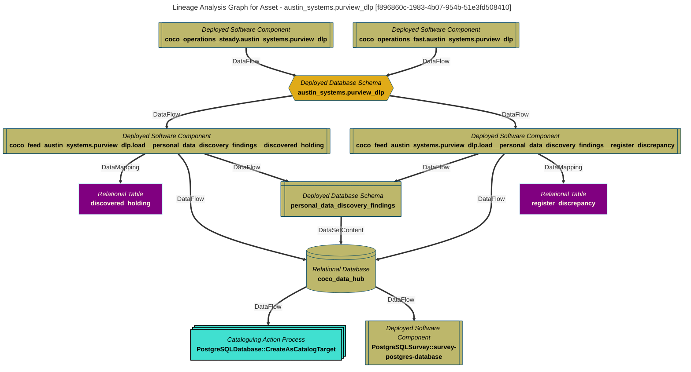

### Lineage edge graph (`edgeMermaidGraph`)

Lineage graphs quickly become too large to read.  The lineage edge graph answers the two questions most often asked of them: where does this asset's data ultimately come from, and where does it ultimately go?  It draws the requested asset linked to the *ultimate sources* of its lineage (the assets in the full lineage graph that have no lineage flowing into them) and its *ultimate destinations* (the assets that have no lineage flowing out of them).  An asset where the search stopped because it reached `maxHops` is not counted as a source or destination, because the lineage carries on beyond it.  It is titled *Lineage Edge Analysis Graph for Asset*, and is null if no sources or destinations were found.

This is the edge graph for the same schema:

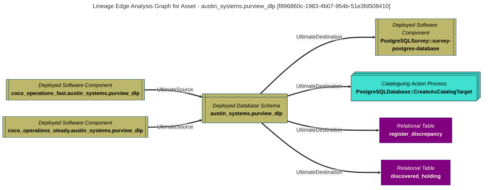

## Information supply chain graphs

An [information supply chain](/concepts/information-supply-chain) describes the flow of a particular type of data across systems and organizations.  It is designed with [solution components](/concepts/solution-component) and implemented by the relationships, such as data flows and digital product dependencies, that name the supply chain in their *iscQualifiedName* property.

The [Solution Architect API](/services/omvs/solution-architect/overview) returns information supply chains as an *InformationSupplyChainElement*, from *getInformationSupplyChainByGUID* (`POST /servers/{serverName}/api/open-metadata/solution-architect/information-supply-chains/{informationSupplyChainGUID}/retrieve`) and the information supply chain search requests.  As well as the element graphs, it carries five graphs of its own: one for the design, and one for each layer of the implementation.  The implementation is split into layers because together they are often too big for Mermaid to display.

In each of the layer graphs, the layer's elements are drawn inside a subgraph named after the layer.  The solution components and digital products that are linked to them are drawn outside the subgraph with their links into it, showing which part of the design each element implements.  So are the anchors of the layer's elements, linked by a line labelled *Anchor for*.  The elements in the layer graphs are labelled with their qualified names.

### Implementation graph (`iscImplementationMermaidGraph`)

The implementation graph shows the supply chain's design.  It has up to three areas:

* *Context* - the information supply chain (drawn as an inverted triangle) with the supply chains that it is part of, the segments it is made of, and the supply chains that it supplies data to or receives data from.
* *Design* - the solution components that are members of the supply chain, with the solution linking wires between them that belong to this supply chain.
* *Status* - the same solution components, styled to show how far their implementation has progressed.  It only appears if at least one component is not yet active, or has a *Promise* or *Memento* classification.

This is the implementation graph of Coco Pharmaceuticals' data subject rights supply chain, which receives personal data from the new employee onboarding and clinical trials supply chains.  All of its components are active, so there is no status area.

```mermaid
---
title: Information Supply Chain - Data Subject Rights Information Supply Chain [7dc5ee50-99a6-401f-8d05-fc8ec16b1f97]
---
flowchart TD
%%{init: {"flowchart": {"htmlLabels": false}} }%%

subgraph 1 [Context]
direction LR
2@{ shape: flip-tri, label: "*Information Supply Chain*
**Data Subject Rights Information Supply Chain**"}
3@{ shape: rect, label: "*Information Supply Chain*
**New Employee Onboarding Information Supply Chain**"}
3==>|"employee personal data [Information Supply Chain Link]"|2
4@{ shape: rect, label: "*Information Supply Chain*
**Clinical Trials Information Supply Chain**"}
4==>|"trial participant data [Information Supply Chain Link]"|2
5@{ shape: rect, label: "*Information Supply Chain*
**Workforce Competency and Qualification Information Supply Chain**"}
5==>|"site staff training [Information Supply Chain Link]"|4
3==>|"new joiner record [Information Supply Chain Link]"|5
end
subgraph 6 [Design]
direction LR
7@{ shape: rect, label: "*Solution Component*
**Personal Data Discovery**"}
8@{ shape: rect, label: "*Solution Component*
**Worker Master Register**"}
9@{ shape: rect, label: "*Solution Component*
**Egeria Open Metadata and Governance**"}
9-. "catalogued holdings [Solution Linking Wire]" .->7
end
1~~~6
style 1 color:#FFFFFF, fill:#FFFFFF, stroke:#FFFFFF
style 2 color:#FFFFFF, fill:#004563, stroke:#e0ab18
style 3 color:#000000, fill:#f5fffa, stroke:#000000
style 4 color:#000000, fill:#f5fffa, stroke:#000000
style 5 color:#000000, fill:#f5fffa, stroke:#000000
style 6 color:#000000, fill:#b0c4de, stroke:#000000
style 7 color:#000000, fill:#DDA0DD, stroke:#000000
style 8 color:#000000, fill:#DDA0DD, stroke:#000000
style 9 color:#000000, fill:#DDA0DD, stroke:#000000
```

### Data mesh graph (`iscDataMeshMermaidGraph`)

The data mesh graph shows the [digital products](/concepts/digital-product) that implement the supply chain, linked by their digital product dependencies, in a *Data Mesh* subgraph, along with the solution components linked to them.  It describes the [data mesh](/concepts/data-mesh) view of the supply chain: who is publishing what data for whom.

```mermaid
---
title: Information Supply Chain Data Mesh - Data Subject Rights Information Supply Chain [7dc5ee50-99a6-401f-8d05-fc8ec16b1f97]
---
flowchart TD
%%{init: {"flowchart": {"htmlLabels": false}} }%%

subgraph 1 [Data Mesh]
direction BT
2@{ shape: rect, label: "*Digital Product*
**DigitalProduct::Coco::Personal Data Discovery Findings**"}
3@{ shape: rect, label: "*Digital Product*
**DigitalProduct::Coco::Open Metadata Catalogue Holdings**"}
end
2==>|"catalogued holdings [Digital Product Dependency]"|3
style 1 color:#000000, fill:#5f9ea0, stroke:#3079ab
style 2 color:#000000, fill:#838cc7, stroke:#3079ab
style 3 color:#000000, fill:#838cc7, stroke:#3079ab
```

### System fabric graph (`iscSystemFabricMermaidGraph`)

The system fabric graph shows the IT infrastructure and software capabilities that the supply chain runs on, in a *System Fabric* subgraph, along with the solution components that are linked to them or anchor them.  It is null if none of the implementation relationships link to infrastructure or software capabilities.

This is the system fabric of Coco Pharmaceuticals' sustainability reporting supply chain.  The *coco-sus* server at its centre gathers data from the ledgers, expenses, inventory and hazardous materials systems, sends it to the calculators, and serves the results to the dashboards.

```mermaid
---
title: Information Supply Chain System Fabric - Sustainability Reporting Information Supply Chain [dd15b286-a38d-4f03-8625-aaded8596048]
---
flowchart TD
%%{init: {"flowchart": {"htmlLabels": false}} }%%

subgraph 1 [System Fabric]
2@{ shape: hex, label: "*Software Server*
**System::coco-ledgers**"}
3@{ shape: hex, label: "*Software Server*
**System::coco-sus**"}
4@{ shape: hex, label: "*Software Server*
**System::coco-sus-calculators**"}
5@{ shape: hex, label: "*Software Server*
**System::austin-haz-mat**"}
6@{ shape: hex, label: "*Software Server*
**System::coco-inventory**"}
7@{ shape: hex, label: "*Software Server*
**System::coco-sus-dashboards**"}
8@{ shape: hex, label: "*Software Server*
**System::coco-expenses**"}
9@{ shape: hex, label: "*Software Server*
**System::aus-inventory**"}
10@{ shape: hex, label: "*Software Server*
**System::coco-haz-mat**"}
end
2==>|"spending types [Data Flow]"|3
4==>|"results publishing [Data Flow]"|3
5==>|"publish hazmat levels [Data Flow]"|3
3==>|"raw data request [Data Flow]"|4
6==>|"goods movement [Data Flow]"|3
3==>|"report request [Data Flow]"|7
8==>|"travel inventory [Data Flow]"|3
9==>|"goods movement [Data Flow]"|3
10==>|"publish hazmat levels [Data Flow]"|3
style 1 color:#004563, fill:#b7c0c7, stroke:#004563
style 2 color:#000000, fill:#BDB76B, stroke:#004563
style 3 color:#000000, fill:#BDB76B, stroke:#004563
style 4 color:#000000, fill:#BDB76B, stroke:#004563
style 5 color:#000000, fill:#BDB76B, stroke:#004563
style 6 color:#000000, fill:#BDB76B, stroke:#004563
style 7 color:#000000, fill:#BDB76B, stroke:#004563
style 8 color:#000000, fill:#BDB76B, stroke:#004563
style 9 color:#000000, fill:#BDB76B, stroke:#004563
style 10 color:#000000, fill:#BDB76B, stroke:#004563
```

### Data fabric graph (`iscDataFabricMermaidGraph`)

The data fabric graph shows the [data fabric](/concepts/data-fabric) view of the supply chain: the data stores, processes and actions that are linked by data lineage, control flow and action requester relationships, in a *Data Fabric* subgraph, along with the solution components and digital products linked to them.  Data mappings are left out, because they have a layer of their own.

```mermaid
---
title: Information Supply Chain Data Fabric - Data Subject Rights Information Supply Chain [7dc5ee50-99a6-401f-8d05-fc8ec16b1f97]
---
flowchart TD
%%{init: {"flowchart": {"htmlLabels": false}} }%%

subgraph 1 [Data Fabric]
2@{ shape: subproc, label: "*Deployed Software Component*
**DeployedSoftwareComponent::egeria-workspace::coco_feed_bucharest_systems.opentext_ecm.load__retention_period_assignments__retention_period_assignment**"}
3@{ shape: lin-cyl, label: "*Relational Database*
**PostgreSQL Relational Database::Coco PostgreSQL Server 1::coco_data_hub**"}
4@{ shape: win-pane, label: "*Deployed Database Schema*
**PostgreSQL Relational Database::Coco PostgreSQL Server 1::coco_data_hub::retention_period_assignments**"}
5@{ shape: win-pane, label: "*Deployed Database Schema*
**PostgreSQL Relational Database Schema::Coco PostgreSQL Server 1::bucharest_systems.opentext_ecm**"}
6@{ shape: subproc, label: "*Deployed Software Component*
**DeployedSoftwareComponent::egeria-workspace::coco_feed_austin_systems.purview_dlp.load__personal_data_discovery_findings__discovered_holding**"}
7@{ shape: subproc, label: "*Deployed Software Component*
**DeployedSoftwareComponent::egeria-workspace::coco_feed_austin_systems.purview_dlp.load__personal_data_discovery_findings__register_discrepancy**"}
8@{ shape: win-pane, label: "*Deployed Database Schema*
**PostgreSQL Relational Database::Coco PostgreSQL Server 1::coco_data_hub::personal_data_discovery_findings**"}
9@{ shape: win-pane, label: "*Deployed Database Schema*
**PostgreSQL Relational Database Schema::Coco PostgreSQL Server 1::austin_systems.purview_dlp**"}
end
2==>|"Data Flow"|3
2==>|"Data Flow"|4
5==>|"Data Flow"|2
6==>|"Data Flow"|3
7==>|"Data Flow"|3
7==>|"Data Flow"|8
9==>|"Data Flow"|7
6==>|"Data Flow"|8
9==>|"Data Flow"|6
3-. "Anchor for" .->8
3-. "Anchor for" .->4
style 1 color:#004563, fill:#b7c0c7, stroke:#004563
style 2 color:#000000, fill:#BDB76B, stroke:#004563
style 3 color:#000000, fill:#BDB76B, stroke:#004563
style 4 color:#000000, fill:#BDB76B, stroke:#004563
style 5 color:#000000, fill:#BDB76B, stroke:#004563
style 6 color:#000000, fill:#BDB76B, stroke:#004563
style 7 color:#000000, fill:#BDB76B, stroke:#004563
style 8 color:#000000, fill:#BDB76B, stroke:#004563
style 9 color:#000000, fill:#BDB76B, stroke:#004563
```

### Data mapping graph (`iscDataMappingMermaidGraph`)

The data mapping graph shows the field-level view of the supply chain: the schema elements and processes linked by *DataMapping* relationships, in a *Data Mapping* subgraph, with every one of their anchors drawn outside it.  This makes it possible to see which tables in which systems feed each process.

This is the data mapping graph of Coco Pharmaceuticals' occupational health surveillance supply chain, which loads worker assignments into the data hub from the human resources systems at two sites:

```mermaid
---
title: Information Supply Chain Data Mapping - Occupational Health Surveillance Information Supply Chain [8f263964-dc30-4ff9-836a-4077ebf4ffda]
---
flowchart TD
%%{init: {"flowchart": {"htmlLabels": false}} }%%

1@{ shape: lin-cyl, label: "*Relational Database*
**PostgreSQL Relational Database::Coco PostgreSQL Server 1::coco_data_hub**"}
2@{ shape: win-pane, label: "*Deployed Database Schema*
**PostgreSQL Relational Database Schema::Coco PostgreSQL Server 1::austin_systems.workday_hcm**"}
3@{ shape: win-pane, label: "*Deployed Database Schema*
**PostgreSQL Relational Database Schema::Coco PostgreSQL Server 1::bucharest_systems.workday_hcm**"}
subgraph 4 [Data Mapping]
5@{ shape: subproc, label: "*Deployed Software Component*
**DeployedSoftwareComponent::egeria-workspace::coco_feed_austin_systems.workday_hcm.load__worker_master_data__worker_assignment**"}
6@{ shape: rect, label: "*Relational Table*
**PostgreSQL Relational Database::Coco PostgreSQL Server 1::coco_data_hub::worker_master_data::worker_assignment**"}
7@{ shape: rect, label: "*Relational Table*
**PostgreSQL Relational Database Schema::Coco PostgreSQL Server 1::austin_systems.workday_hcm::worker_position**"}
8@{ shape: rect, label: "*Relational Table*
**PostgreSQL Relational Database Schema::Coco PostgreSQL Server 1::austin_systems.workday_hcm::job_profile**"}
9@{ shape: subproc, label: "*Deployed Software Component*
**DeployedSoftwareComponent::egeria-workspace::coco_feed_bucharest_systems.workday_hcm.load__worker_master_data__worker_assignment**"}
10@{ shape: rect, label: "*Relational Table*
**PostgreSQL Relational Database Schema::Coco PostgreSQL Server 1::bucharest_systems.workday_hcm::worker_position**"}
11@{ shape: rect, label: "*Relational Table*
**PostgreSQL Relational Database Schema::Coco PostgreSQL Server 1::bucharest_systems.workday_hcm::job_profile**"}
end
5==>|"Data Mapping"|6
7==>|"Data Mapping"|5
8==>|"Data Mapping"|5
9==>|"Data Mapping"|6
10==>|"Data Mapping"|9
11==>|"Data Mapping"|9
1-->|"Anchor for"|6
2-->|"Anchor for"|7
2-->|"Anchor for"|8
3-->|"Anchor for"|10
3-->|"Anchor for"|11
style 1 color:#000000, fill:#BDB76B, stroke:#004563
style 2 color:#000000, fill:#BDB76B, stroke:#004563
style 3 color:#000000, fill:#BDB76B, stroke:#004563
style 4 color:#004563, fill:#b7c0c7, stroke:#004563
style 5 color:#000000, fill:#BDB76B, stroke:#004563
style 6 color:#ffffe0, fill:#800080, stroke:#CCFFFF
style 7 color:#ffffe0, fill:#800080, stroke:#CCFFFF
style 8 color:#ffffe0, fill:#800080, stroke:#CCFFFF
style 9 color:#000000, fill:#BDB76B, stroke:#004563
style 10 color:#ffffe0, fill:#800080, stroke:#CCFFFF
style 11 color:#ffffe0, fill:#800080, stroke:#CCFFFF
```

## Governance action process graphs

[Governance action processes](/concepts/governance-action-process) describe a linked series of steps that run in an [engine host](/concepts/engine-host).  Their definition is maintained in the open metadata repositories.  In addition, when a governance action process runs, a [*GovernanceActionProcessInstance*](/types/4/0462-Governance-Action-Processes) element is created and linked to the [engine actions](/concepts/engine-action) that control the execution of the process.

The [Governance Officer API](/services/omvs/governance-officer/overview) has a REST API called *getGovernanceActionProcessGraph* that returns the process with its steps, and a Mermaid graph of them in `governanceActionProcessMermaidGraph`.  It can be passed the unique identifier of either a governance action process, to get the design of the process, or a governance action process instance, to see what happened when the process ran.

```
POST {{baseURL}}/servers/{{viewServer}}/api/open-metadata/governance-officer/governance-action-processes/{{processGUID}}/graph
```

### Process design graph

When it is passed a governance action process, the graph shows the process linked to its first step, and every step that may run after it.  Each line between the steps is labelled with the [guard](/concepts/guard) that the previous step must produce for the next step to run.

This is the sample *Daily Governance Action Process* from Egeria's core content pack.  Its first step works out the day of the week and produces a guard naming the day, which selects the step that outputs that day's task.

```mermaid
---
title: Process - Daily Governance Action Process [8b6f86da-d35b-4935-ba8f-fc5ca6535372]
---
flowchart LR
%%{init: {"flowchart": {"htmlLabels": false}} }%%

1@{ shape: processes, label: "*Governance Action Process*
**Daily Governance Action Process**"}
2@{ shape: rounded, label: "*Governance Action Process Step*
**Get the day of the Week**"}
1==>|"Governance Action Process Flow"|2
3@{ shape: rounded, label: "*Governance Action Process Step*
**Output Tuesday's task**"}
4@{ shape: rounded, label: "*Governance Action Process Step*
**Output Saturday's task**"}
5@{ shape: rounded, label: "*Governance Action Process Step*
**Output Thursday's task**"}
6@{ shape: rounded, label: "*Governance Action Process Step*
**Output Wednesday's task**"}
7@{ shape: rounded, label: "*Governance Action Process Step*
**Output Monday's task**"}
8@{ shape: rounded, label: "*Governance Action Process Step*
**Output Friday's task**"}
9@{ shape: rounded, label: "*Governance Action Process Step*
**Output Sunday's task**"}
2==>|"tuesday"|3
2==>|"saturday"|4
2==>|"thursday"|5
2==>|"wednesday"|6
2==>|"monday"|7
2==>|"friday"|8
2==>|"sunday"|9
style 1 color:#000000, fill:#40E0D0, stroke:#000000
style 2 color:#FFFFFF, fill:#3079ab, stroke:#000000
style 3 color:#FFFFFF, fill:#3079ab, stroke:#000000
style 4 color:#FFFFFF, fill:#3079ab, stroke:#000000
style 5 color:#FFFFFF, fill:#3079ab, stroke:#000000
style 6 color:#FFFFFF, fill:#3079ab, stroke:#000000
style 7 color:#FFFFFF, fill:#3079ab, stroke:#000000
style 8 color:#FFFFFF, fill:#3079ab, stroke:#000000
style 9 color:#FFFFFF, fill:#3079ab, stroke:#000000
```

### Process instance graph

A process is run with the *initiateGovernanceActionProcess* request (`POST .../governance-action-processes/initiate`), passing the process's qualified name.  The request returns the unique identifier of the new governance action process instance, which can be passed to the same *getGovernanceActionProcessGraph* request:

```
POST {{baseURL}}/servers/{{viewServer}}/api/open-metadata/governance-officer/governance-action-processes/{{instanceGUID}}/graph
```

The graph now shows the engine actions that have been created for the steps so far.  Each one includes its activity status and, once it has finished, the guards it produced and its completion message.  A step that failed is drawn in a different colour.  The graph grows as the process runs, so calling the request again shows its progress.

This is the instance graph from a run of the daily process on a Monday.  Only one of the seven day-specific steps ran, so the shape is much simpler than the design.

```mermaid
---
title: Process - Daily Governance Action Process@Mon Nov 09 20:48:11 GMT 2026 [dad491d1-2e17-4a35-8657-f104ca468031]
---
flowchart LR
%%{init: {"flowchart": {"htmlLabels": false}} }%%

1@{ shape: subproc, label: "*Governance Action Process Instance*
**Daily Governance Action Process@Mon Nov 09 20:48:11 GMT 2026**"}
2@{ shape: rounded, label: "*Engine Action*
**Get the day of the Week**
completionGuards: [monday]
activityStatus: COMPLETED
completionMessage: GOVERNANCE-ACTION-CONNECTORS-0036 The get-day-of-week-governance-action-service governance action service has determined that today is Monday"}
1==>|"Governance Action Process Flow"|2
3@{ shape: rounded, label: "*Engine Action*
**Output Monday's task**
completionGuards: [message-written]
activityStatus: COMPLETED
completionMessage: GOVERNANCE-ACTION-CONNECTORS-0024 Action For Monday is - Wash"}
2==>|"monday"|3
style 1 color:#000000, fill:#BDB76B, stroke:#004563
style 2 color:#FFFFFF, fill:#3079ab, stroke:#000000
style 3 color:#FFFFFF, fill:#3079ab, stroke:#000000
```

## Rendering mermaid diagrams

Mermaid is a mature standard that has widespread support.  Below are some examples of where it can be used.

### Jupyter Notebooks

If you are using *Jupyter Notebooks* with [pyegeria](/user-interfaces/hey-egeria/overview/#installation) installed, such as with the [egeria-workspaces](https://github.com/odpi/egeria-workspaces), it is possible to render Mermaid strings using the `render_mermaid(mermaid_string)` function call.

### Draw.io

The *draw.io* diagramming tool used extensively in this site can render Mermaid diagrams.  It is described in the [draw.io help](https://www.drawio.com/blog/mermaid-diagrams).

### Mermaid live editor

The Mermaid community provide a web page where you can paste a mermaid string, and it will render it dynamically.  The live editor can be found at [https://mermaid.live/edit](https://mermaid.live/edit)

--8<-- "snippets/abbr.md"
