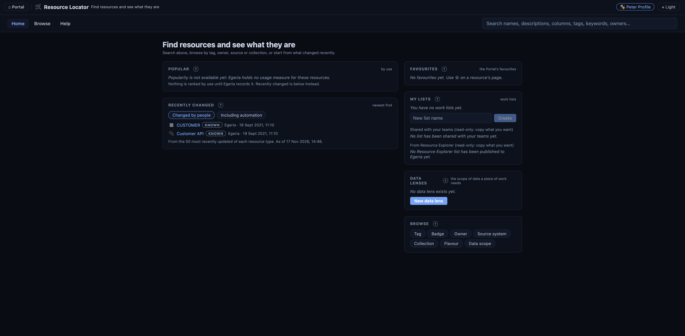
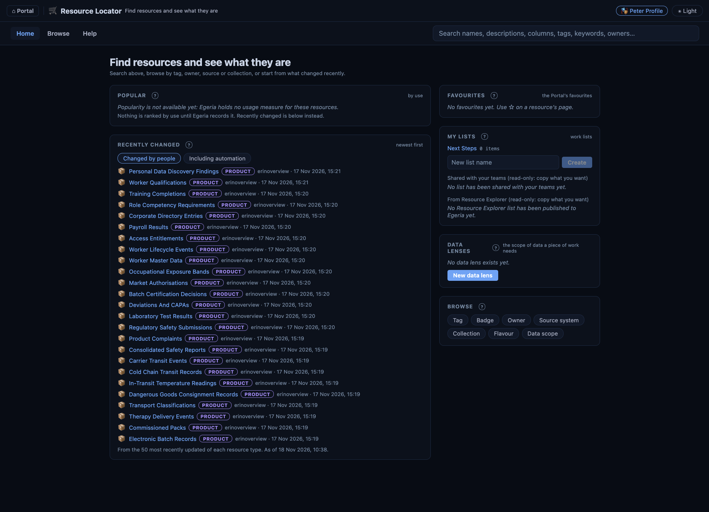
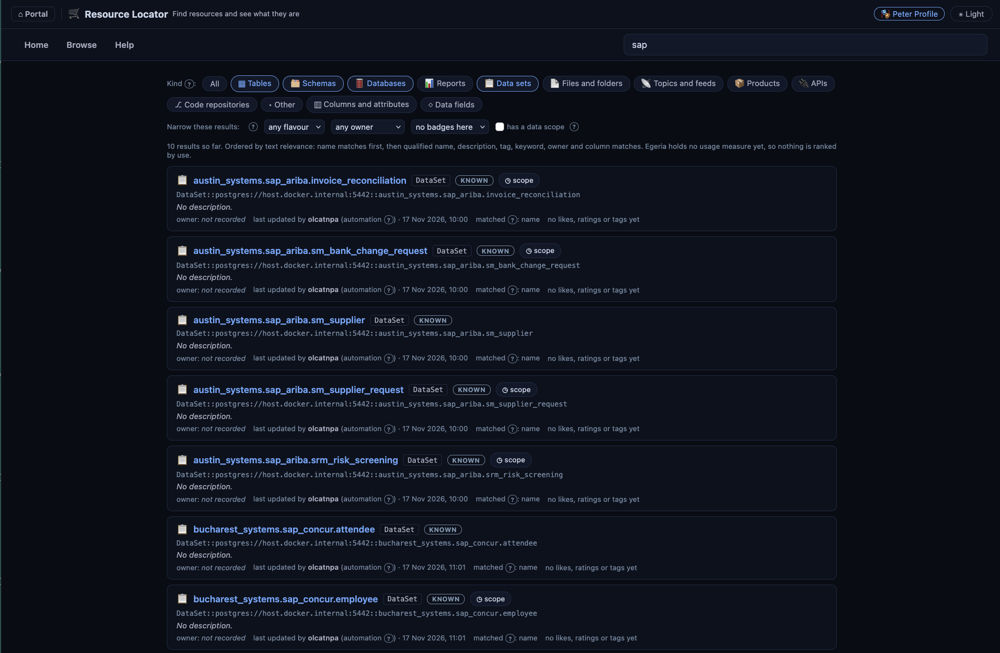
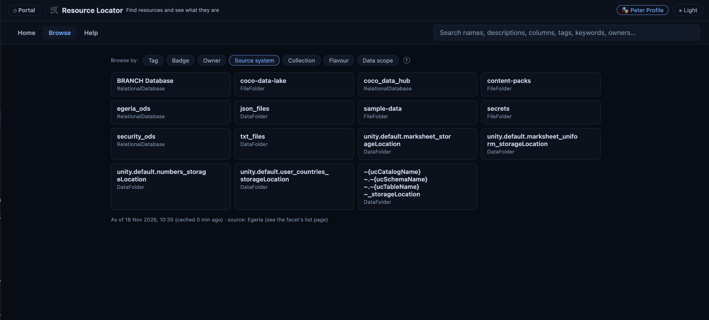
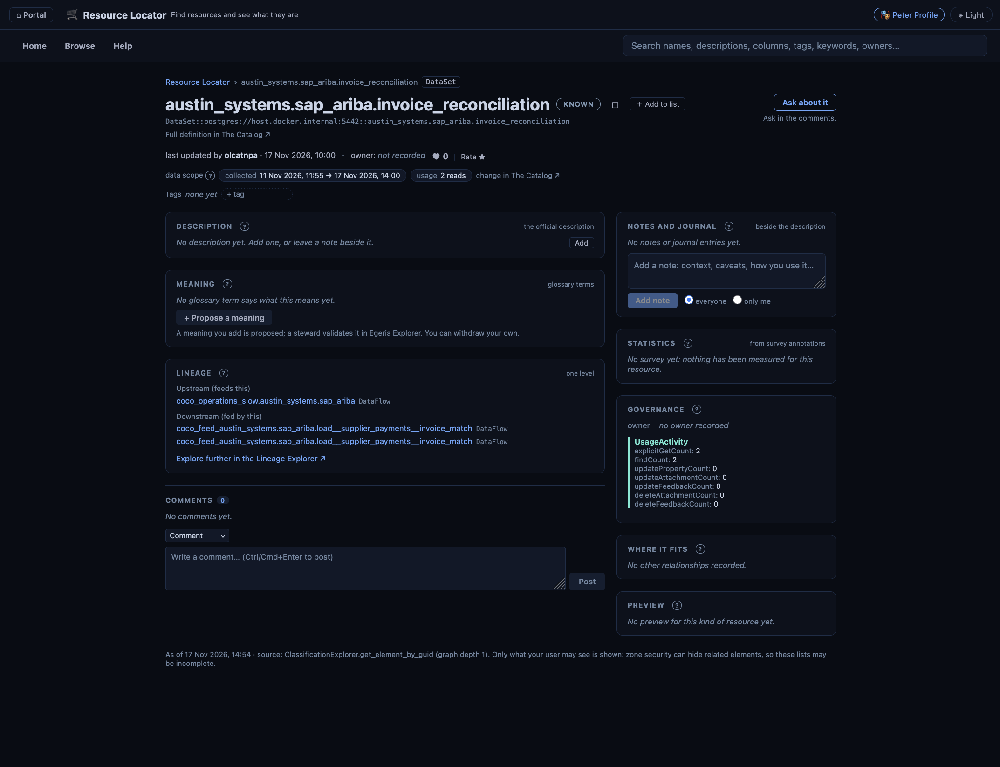

<!-- SPDX-License-Identifier: CC-BY-4.0 -->
<!-- Copyright Contributors to the Egeria project. -->

# Resource Locator

**Resource Locator** is a web-based user interface for finding, assessing and selecting the [resources](/concepts/digital-resource) that your organization has - its tables, files, reports, APIs, data products and code repositories - and creating a list (collection) for your project.  This may be a personal project, or one for your team.  It is designed for the people who *use* resources rather than the people who curate them: an analyst looking for the right data set, a developer looking for an API, or a new member of a team trying to find out what exists.  This is sometimes referred to as **Shopping for data**.

Where [The Catalog](/user-interfaces/the-catalog/overview) and [Egeria Explorer](/user-interfaces/egeria-explorer/overview) show the full detail of the open metadata knowledge graph, Resource Locator gathers what a consumer needs to know about one resource onto a single page: its description, its columns, what it contains, what it means, who owns it, where it came from and what other people have said about it.  It reads this from open metadata, and the only things it writes back are those that a consumer can reasonably contribute: better descriptions, [informal tags](/concepts/informal-tag), search keywords, glossary term suggestions, notes, feedback and lists of the resources they are working with.

Resource Locator is part of the web portal in the [Egeria Workspaces](/egeria-workspaces) [Quickstart](/egeria-workspaces/quick-start/overview) environment, where it is opened from the **Resource Locator** tile, or directly at `/resource-locator`.  It is not *yet* available in Freshstart.

## The home page

The home page is the place to start when you do not yet know what you are looking for.

* **Recently changed** lists the resources that changed most recently, newest first.  Surveys and connectors update resources all the time, so there are two views: **Changed by people** hides the changes made by automation, and **Including automation** shows everything.
* **Popular** is reserved for the resources that are used the most.  Resource Locator does not yet rank resources by use, and says so, rather than presenting a ranking based on a guess.
* **Favourites** shows the resources that you have saved as favourites.
* **My lists** shows your [work lists](#work-lists).
* **Browse** offers the facets described [below](#browsing).

Favourites and work lists belong to you, so they are only shown once you have chosen a persona, or signed in, using the **Choose persona** button at the top of the page.

## Searching

Type into the search box at the top of any page.  A search matches the names, qualified names and descriptions of resources, and also:

* **column names** - a match on a column is reported against its table, so that you find the table rather than a list of columns;
* **informal tags** and search keywords;
* **owners**.

The results are grouped by the kind of resource.  The buttons above the results show one kind at a time: **Tables**, **Schemas**, **Databases**, **Reports**, **Data sets**, **Files and folders**, **Topics and feeds**, **Products**, **APIs**, **Code repositories** and **Other**, or **All**.

Each result shows why it matched, its tags, a summary of its likes and ratings and, if you have already saved it, how many of your lists it is in.  The results are ordered by how well the text matches.

## Browsing

**Browse** finds resources without typing.  Choose one of the following facets to list its values, and then choose a value to see the resources that have it:

* **Tag** - the [informal tags](/concepts/informal-tag) that people have attached.
* **Badge** - the governance classifications, such as confidentiality and criticality.
* **Owner** - who is responsible for the resource.
* **Source system** - the system that the resource belongs to.
* **Collection** - the [collections](/concepts/collection) that resources have been organized into.
* **Flavour** - whether the resource is data, a [digital product](/concepts/digital-product), or a member of a [data sharing hub](/concepts/data-sharing-hub).
* **Data scope** - the scope of the data in the resource, taken from its [*DataScope*](/types/2/0210-Data-Stores) classification.

## The resource page

Selecting a resource opens its own page.  The heading shows its name, type and qualified name, who last updated it and when, its owner, its likes and ratings, its data scope and its tags.  A link opens its full definition in [Egeria Explorer](/user-interfaces/egeria-explorer/overview).

The rest of the page is made up of cards:

| Card | What it shows |
|---|---|
| **Description** | The description of the resource.  You can improve it; your change is attributed to you, with the time. |
| **Columns** | The schema of the resource, with the type and description of each column.  Column descriptions can be improved too. |
| **Meaning** | The [glossary terms](/concepts/glossary-term) assigned to the resource and to its columns.  You can propose a term, and withdraw one that you proposed.  A term that you add is a proposal, which a steward validates in Egeria Explorer. |
| **What it contains** | The parts one level down - the schemas in a database, the tables in a schema, the files in a folder, the data sets of a product - with a count of each.  **Part of** shows what the resource is contained in. |
| **Lineage** | The resources one step upstream and downstream, where lineage has been recorded, with a link to the [Lineage Explorer](/user-interfaces/lineage-explorer/overview) for the rest. |
| **Statistics** | The latest measurements from the [surveys](/concepts/survey-report) of the resource, such as row counts and column profiles, each with its date. |
| **Preview** | A preview of the content of a file, where one is available. |
| **Governance** | The owner, and the classifications attached to the resource, such as its confidentiality, its criticality and how often it has been used. |
| **Where it fits** | The collections and products that the resource belongs to, its connections, the governance definitions that apply to it, its external references and the other elements related to it. |
| **Comments** | The [comments](/concepts/comment) that people have made about the resource. |
| **Notes and journal** | The notes on the resource, the notes left on its parts, and your own [private notes](#notes-and-private-notes). |

The names of the parts of a resource, and of the resources related to it, are links.  A name opens that resource in Resource Locator, and the arrow beside it opens its full definition in The Catalog or Egeria Explorer.

Resource Locator says what is missing rather than showing an empty table: "no survey yet", "no lineage recorded" or "no owner recorded".  These gaps are useful to know about before relying on a resource, and each is an invitation to the people who curate the catalog.  Similarly, a resource that you cannot open is reported as possibly hidden from you by its [governance zones](/features/governance-zoning/overview), not as missing.

## Adding what you know

The people who use a resource often know things about it that the catalog does not.  From the resource page you can:

* improve the **description** of the resource, or of one of its columns;
* add an **informal tag**;
* propose the **glossary term** that says what the resource, or a column, means;
* **like**, **rate** or **comment on** the resource, using Egeria's [feedback](/features/user-feedback/overview) support;
* add a **note**;
* save the resource as a **favourite**, or add it to a work list.

Every change is made as you, the signed-in user, using your own security token, so it is attributed to you and is subject to the same access controls as any other change you make.  If you have not chosen a persona or signed in, the change is refused; nothing is written under a shared account.

## Notes and private notes

When you add a note you choose who can read it.

* **Everyone** adds the note to the resource's own [note log](/concepts/note-log).  Anyone who can see the resource can read it.
* **Only me** keeps the note in the journal of your own profile, linked to the resource so that it appears both on the resource page and, with what it is about, in your journal in [My Egeria](/user-interfaces/my-egeria/overview).  The note is placed in governance zones that only you can read, so other people cannot open it and it is left out of their searches.

Private notes cannot be deleted yet, and the page says so.

## Work lists

A work list is a [collection](/concepts/collection) of the resources that you are working with, each with the reason you added it.  It is a way to keep hold of what you have found - the candidate data sets for a project, for example - and to hand it on.

* **Create** a list, rename it, add resources to it with a reason, and remove them.
* **Copy** members of any list that you can see into a list of your own.
* **Share** a list with a [team](/concepts/team) or [community](/concepts/community) that you belong to, and stop sharing it.

Because a work list is an ordinary collection in open metadata, it can be seen in the other user interfaces too.  The lists published from Resource Explorer, part of [Trellis](/concepts/trellis), are shown alongside your own for the same reason; these are read-only, so copy what you want from them into a list of your own.

<!-- SCREENSHOT NEEDED: a work list with its members and reasons, e.g. resource-locator-work-list.png -->

## Where the resources come from

Resource Locator displays the resources that are described in open metadata, so it shows whatever has been catalogued: the [assets](/concepts/asset) created by Egeria's integration connectors as they catalog databases, file systems, event brokers and APIs; the [digital products](/concepts/digital-product) defined by product managers; the measurements recorded by [surveys](/concepts/survey-report); and the lineage captured from running pipelines.  The more of this that is in place, the more each resource page has to say.

Resource Locator and Resource Explorer are two sides of the same activity.  Resource Explorer is for the curator: it surveys resources that are not yet in the catalog and publishes what is worth keeping.  Resource Locator is for the consumer who then needs to find and understand those resources.

!!! info "Further information"
    * [The Catalog](/user-interfaces/the-catalog/overview) - the technical view of the same assets.
    * [Egeria Explorer](/user-interfaces/egeria-explorer/overview) - the full open metadata definition of any element.
    * [Lineage Explorer](/user-interfaces/lineage-explorer/overview) - the complete lineage of a resource.
    * [Data Mesh](/user-interfaces/data-mesh/overview) - the digital products and the dependencies between them.
    * [User feedback](/features/user-feedback/overview) - likes, ratings, comments, informal tags and notes.

--8<-- "snippets/abbr.md"
