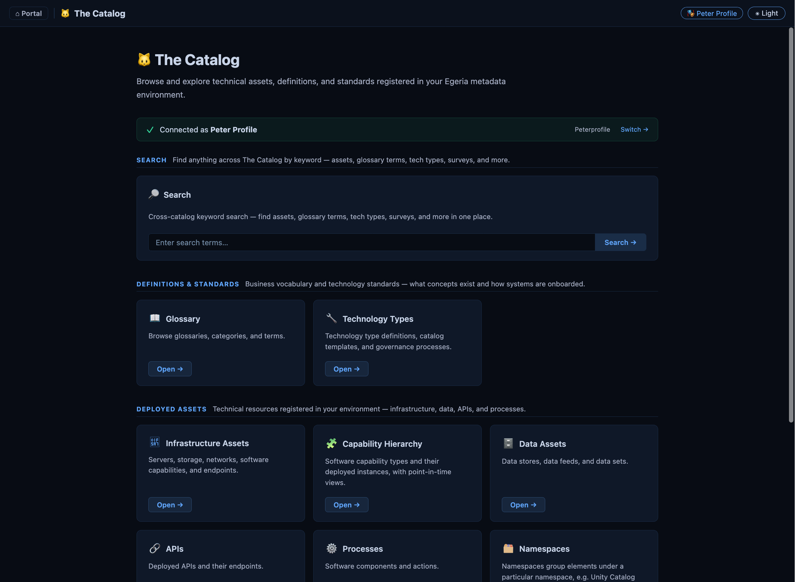
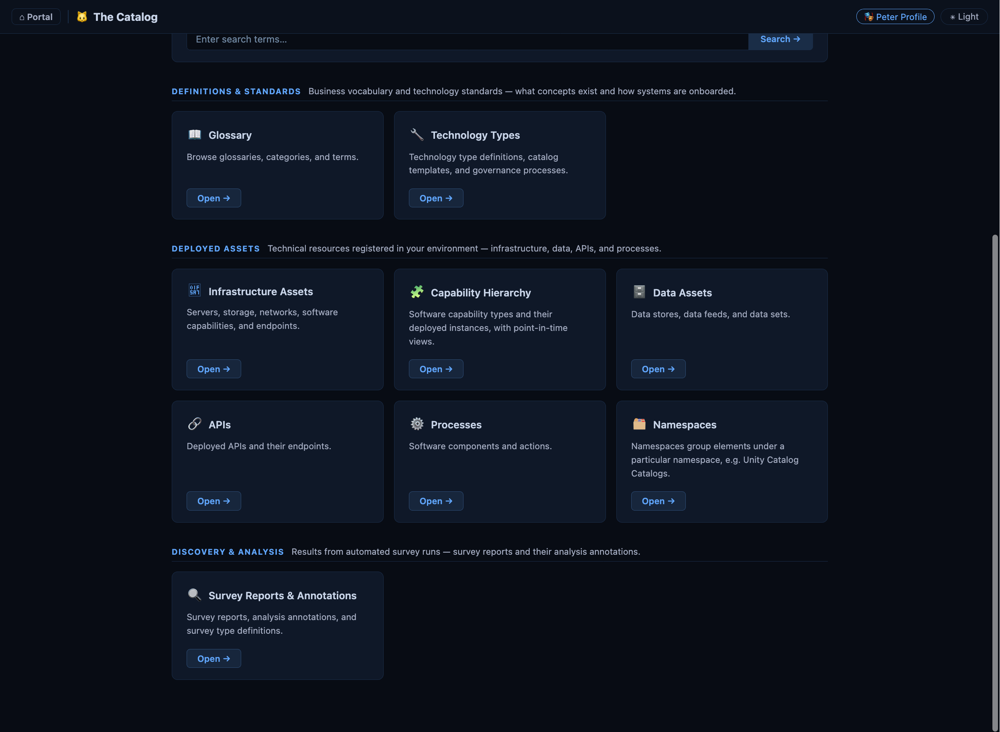
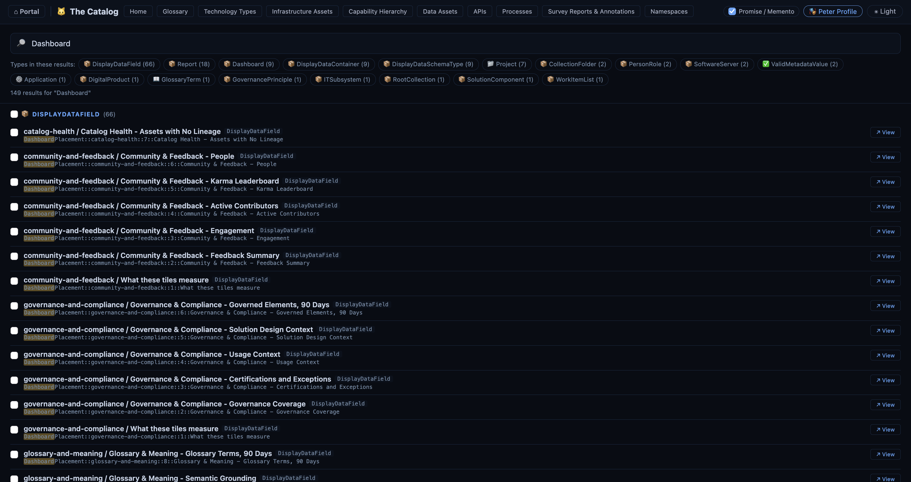
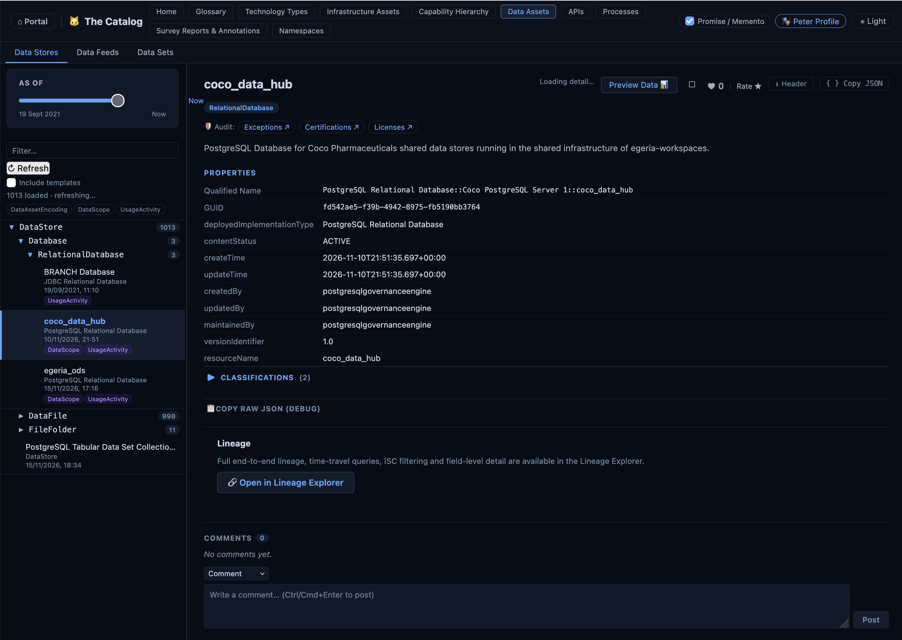
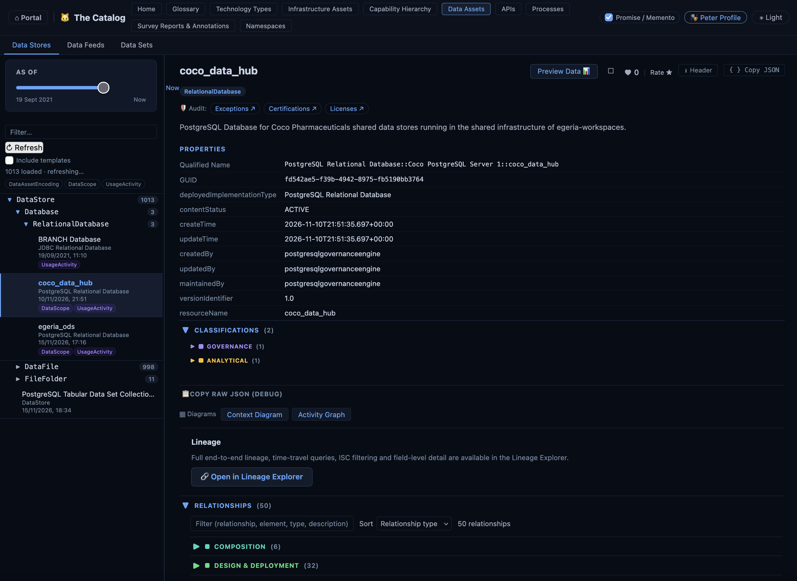
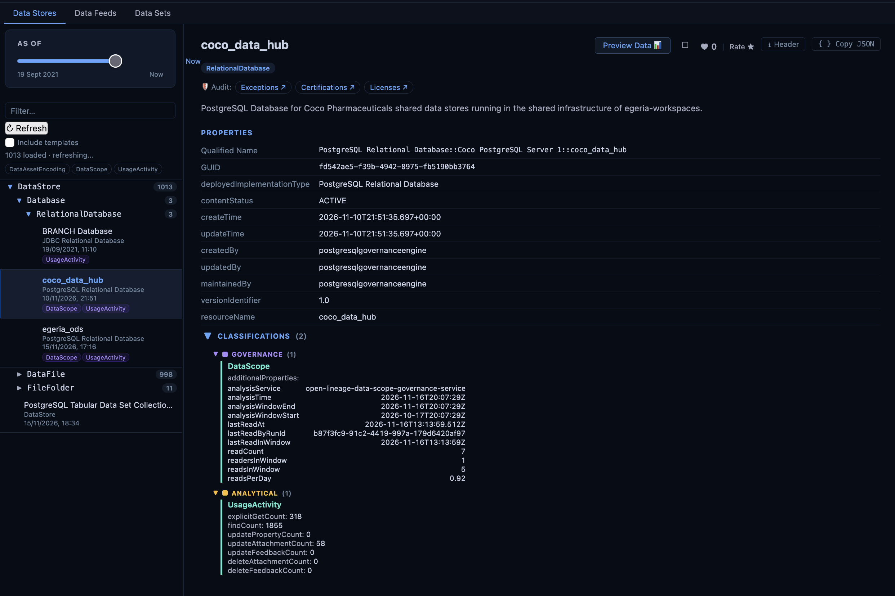
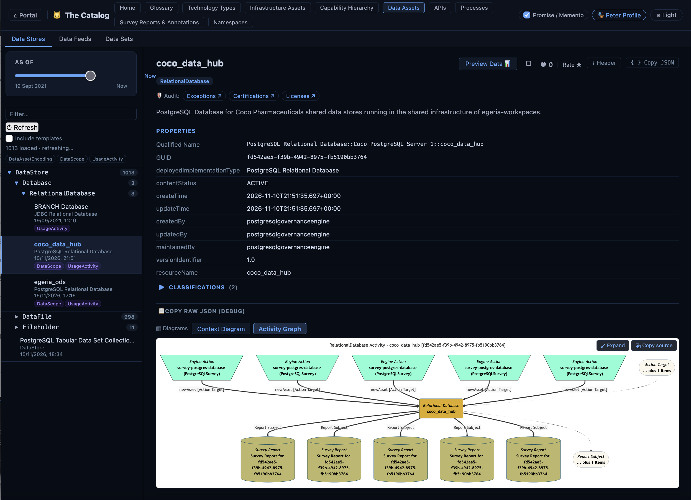
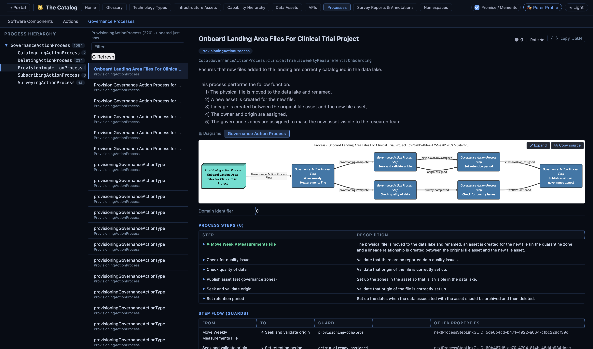

<!-- SPDX-License-Identifier: CC-BY-4.0 -->
<!-- Copyright Contributors to the Egeria project. -->

# The Catalog

**The Catalog** is a web-based user interface for exploring the technical [assets](/concepts/asset) that are described in open metadata: the infrastructure, data stores, data sets, APIs and software processes that make up your organization's IT estate, together with the glossary terms that explain them, the technology types that classify them and the survey reports that have analysed them.

It is designed for the people who build and run this estate, such as architects, data engineers, integration developers and infrastructure teams.  Each kind of asset has its own section with a list that can be browsed by type, and selecting an asset shows its properties, classifications, schema, diagrams, lineage and relationships on one page.  A person who simply wants to find a resource to use is better served by [Resource Locator](/user-interfaces/resource-locator/overview), which shows the same assets with less of the technical detail.

The Catalog is part of the web portal in the [Egeria Workspaces](/egeria-workspaces) [Quickstart](/egeria-workspaces/quick-start/overview) and [Freshstart](/egeria-workspaces/fresh-start/overview) environments, where it is opened from its tile, or directly at `/tech-catalog`.

> The home page of The Catalog, connected as Peter Profile.  The search box is at the top, with the tiles for the sections beneath it.

## The home page

The home page has a search box, followed by a tile for each section, arranged in three groups.

| Group | Section | What it shows |
|---|---|---|
| **Definitions & Standards** | **Glossary** | The glossaries, their folders and their [terms](/concepts/glossary-term). |
| | **Technology Types** | The technology types that Egeria knows about, such as *PostgreSQL Server* or *Apache Kafka Topic*, with the [templates](/concepts/template) used to catalog each one and the governance processes that work with it. |
| **Deployed Assets** | **Infrastructure Assets** | Servers, hosts, storage and networks, with tabs for [software capabilities](/concepts/software-capability) and [endpoints](/concepts/endpoint). |
| | **Capability Hierarchy** | The types of software capability, as a tree, with the deployed instances of each type. |
| | **Data Assets** | Data stores, data feeds and data sets, each in its own tab. |
| | **APIs** | The deployed APIs. |
| | **Processes** | Software components, actions and [governance action processes](/concepts/governance-action-process). |
| | **Namespaces** | The namespaces that group elements together, such as the catalogs of a Unity Catalog server. |
| **Discovery & Analysis** | **Survey Reports & Annotations** | The [survey reports](/concepts/survey-report) from automated surveys, the annotations they produced and the types of survey available. |

> The tiles for the sections of The Catalog, in their three groups.

Once a section is open, the sections are listed as buttons across the top of the page, so you can move between them without returning to the home page.

The Catalog retrieves metadata as the persona chosen in the portal, and the banner at the top of the home page shows who you are connected as, with a **Switch** link to choose a different persona.  What you see is therefore subject to that user's access to [governance zones](/concepts/governance-zone).  If no persona has been chosen, the home page shows connection settings instead, which can be used to point The Catalog at a particular platform, view server and user.

## Searching

There are two kinds of search.

* The **search box on the home page** is a keyword search across every type of element at once.  The results are grouped under the type of each element found.  Each result shows where the search text matched, and has a **View** button to open it.  A row of type buttons shows which types were found, with a count for each, and choosing one repeats the search for just that type.  Results can be selected, individually or a whole group at a time, and then added to a [collection](/concepts/collection) or a governance zone or, where it makes sense for the elements selected, given a classification.
* The **filter box in each section** narrows the list that the section has already loaded, matching on display name, qualified name and description.

> The results of a search for "Dashboard": 149 elements of eighteen different types.  The buttons under the search box show each type with the number found, and the results are listed under their type, with the matching text highlighted and a **View** button to open each one.

## Browsing a section

A section has a list on the left and the detail of the selected element on the right.  Most sections have tabs across the top for the different kinds of element that they cover.  The tabs in **Infrastructure Assets** are worked out from the open metadata types, so a new type of infrastructure gets a tab of its own.

The list is organized as a tree of types, with the number of elements of each type beside it.  Opening a type shows its subtypes and the elements themselves.  Above the tree:

* the **filter** box narrows the list;
* the classification buttons, such as *DataScope* or *UsageActivity*, show only the elements that have that classification;
* **Include templates** adds the [templates](/concepts/template) to the list, which are otherwise left out because they are not real assets;
* **Refresh** reloads the list.  The first load of a large list can take a few seconds, after which it is kept for up to fifteen minutes.

> The **Data Stores** tab of the Data Assets section.  The type tree has been opened as far as *RelationalDatabase*, and the *coco_data_hub* database is selected, so its details are shown on the right.

### Looking back in time

The **As of** slider above the list sets the time that The Catalog is showing.  It normally sits at *Now*.  Moving it back shows the elements, their properties, their diagrams and their relationships as they were at that time, which is useful for answering questions such as "what did this server connect to before the migration?".

### Promises and mementos

Egeria normally hides elements that are classified as a [promise](/concepts/promise), which is a placeholder for something that has not yet been catalogued, or a [memento](/concepts/memento), which is the record of something that has been removed but is kept because lineage depends on it.  The **Promise / Memento** switch at the top of the page controls whether these are included.  It is on by default, so that lineage is shown complete, and it is remembered for each browser tab.

## The detail of an element

Selecting an element shows what is known about it.

| Part | What it shows |
|---|---|
| **Heading** | The name and type of the element, with buttons to like and rate it, to show its header (its identifiers, versions and origin) and to copy its full description as JSON, for use in a notebook or a problem report. |
| **Preview Data** | For a data asset whose content can be read, a preview of the data. |
| **Audit** | Links to [Egeria Audit](/user-interfaces/egeria-audit/overview) for the exceptions, certifications and licenses that relate to the element. |
| **Properties** | The properties of the element, including who created it and when it last changed. |
| **Classifications** | The classifications attached to the element, in groups such as *Governance* and *Analytical*, with the properties of each one. |
| **Schema** | For a data asset, its columns or attributes.  A column that has been assigned a glossary term is marked, with a link to the term. |
| **Diagrams** | A button for each diagram that Egeria supplies for the element, such as its context diagram, activity graph, anchored graph and local lineage. |
| **Lineage** | The immediate lineage of the element, with a button to open it in [Lineage Explorer](/user-interfaces/lineage-explorer/overview) for the complete graph. |
| **Relationships** | The related elements, folded into groups by [relationship purpose](/concepts/relationship-purpose), such as *Composition* and *Design & Deployment*, so that the relationships that describe how an asset is built are not mixed up with those that describe how it is governed. |
| **Comments** | The comments made about the element, and a box to add one as a comment, question, answer, suggestion, usage note or requirement. |

> The detail of the *coco_data_hub* database, showing its properties, the buttons for its diagrams, and its 50 relationships grouped by purpose.

Opening **Classifications** shows each classification with its properties.  In this example, the *DataScope* classification records how the database has been read by the pipelines that Egeria has observed, and *UsageActivity* counts how often its description has been retrieved and updated.

> The classifications attached to *coco_data_hub*, grouped into governance and analytical classifications.

Choosing one of the diagram buttons draws that diagram beneath them.  It can be expanded to fill the window, and its source can be copied.

> The **Activity Graph** for *coco_data_hub*, showing the surveys that have been run against the database and the survey reports that they produced.

### Following relationships

Each related element has a **View** button.  It moves to that element in the section it belongs to, even when that is a different section: following a relationship from a data store to the server that hosts it, for example, opens the server in Infrastructure Assets.

Some elements, such as a schema type or an individual column, do not belong to any section.  **View** opens these in a pop-up over the page, showing the same detail.  You can carry on following relationships inside the pop-up, with a trail showing where you have been and a **Back** button, and close it to return to where you started.

The other user interfaces in the portal, such as Lineage Explorer and Egeria Explorer, have a **View in Catalog** link on the assets they show, which opens The Catalog at the right section with that asset selected.

## Sections with their own displays

Some sections show more than the standard detail.

* **Glossary** - the detail of a term includes where it is used: every schema column and data field that the term has been assigned to.
* **Capability Hierarchy** - shows the types of software capability as a tree, with a count of the deployed instances of each type.
* **Processes** - the **Governance Processes** tab lists the [governance action processes](/concepts/governance-action-process) by type, such as provisioning, surveying and cataloguing processes, and shows each one as a flow diagram of its steps.  Beneath it are the steps themselves, the guards that lead from one step to the next, and the specification of the process: its request parameters, the guards it produces and its action targets.
* **Survey Reports & Annotations** - survey reports and annotations show when they were created, and can be filtered by a range of dates.  Annotations can also be filtered by type, such as *Schema Analysis*, *Resource Measure*, *Quality* or *Request for Action*, and by the survey report that they belong to.

> The **Governance Processes** tab showing the *Onboard Landing Area Files For Clinical Trial Project* process: its flow diagram, its six steps and the guards that link them.

## Where the assets come from

The Catalog shows whatever has been catalogued in open metadata.  In the Quickstart environment this includes the Coco Pharmaceuticals systems loaded from Egeria's [content packs](/content-packs), the assets catalogued by [integration connectors](/concepts/integration-connector) as they scan databases, file systems and event brokers, and the results of the [surveys](/concepts/survey-report) run against them.  The technology types and their templates are what those connectors use to decide how to catalog each new resource.  In the Freshstart environment, The Catalog shows the assets that you have catalogued yourself.

!!! info "Further information"
    * [Resource Locator](/user-interfaces/resource-locator/overview) - the same assets, presented for people looking for a resource to use.
    * [Lineage Explorer](/user-interfaces/lineage-explorer/overview) - the complete lineage of an asset.
    * [Egeria Explorer](/user-interfaces/egeria-explorer/overview) - the open metadata types, governance definitions, digital products and information supply chains.
    * [Egeria Audit](/user-interfaces/egeria-audit/overview) - the exceptions, certifications and licenses for an asset.

--8<-- "snippets/abbr.md"
