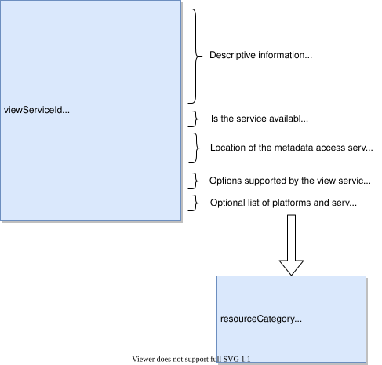

<!-- SPDX-License-Identifier: CC-BY-4.0 -->
<!-- Copyright Contributors to the Egeria project. -->

## Configure the view services

[Open Metadata View Services (OMVSs)](/services/omvs) provide task-oriented, domain-specific REST API services for user interfaces, and other non-Java programming environments, such as python, that integrate with the open metadata ecosystem.  The view services call a [metadata access server](/concepts/metadata-access-server) to send and retrieve metadata.

To get a description of each of the view services that are supported by an [OMAG Server Platform](/concepts/omag-server-platform), list the registered view services.

???+ info "List registered view services"
    The registered view services for an [OMAG Server Platform](/concepts/omag-server-platform) are the view services whose implementation is included in the platform's classpath:
    
    !!! get "GET - list registered view services"
        ```
        {{platformURLRoot}}/open-metadata/platform-services/server-platform/registered-services/view-services
        ```
        
        ??? success "Response from listing registered view services"
            The response from the quickstart platform lists 40 view services.  Four are shown here.

            ```json
            {
                "class": "RegisteredOMAGServicesResponse",
                "relatedHTTPCode": 200,
                "services": [
                    {
                        "serviceId": 207,
                        "serviceName": "My Profile API",
                        "serviceDevelopmentStatus": "STABLE",
                        "serviceURLMarker": "my-profile",
                        "serviceDescription": "Manage information about the logged on user as well as their preferences.",
                        "serviceWiki": "https://egeria-project.org/services/omvs/my-profile/overview/",
                        "serverType": "View Server",
                        "partnerServiceName": "Open Metadata Store Services",
                        "partnerServerType": "Metadata Access Server"
                    },
                    {
                        "serviceId": 208,
                        "serviceName": "Asset Catalog API",
                        "serviceDevelopmentStatus": "STABLE",
                        "serviceURLMarker": "asset-catalog",
                        "serviceDescription": "Search and understand your assets.",
                        "serviceWiki": "https://egeria-project.org/services/omvs/asset-catalog/overview/",
                        "serverType": "View Server",
                        "partnerServiceName": "Open Metadata Store Services",
                        "partnerServerType": "Metadata Access Server"
                    },
                    {
                        "serviceId": 209,
                        "serviceName": "Collection Manager API",
                        "serviceDevelopmentStatus": "STABLE",
                        "serviceURLMarker": "collection-manager",
                        "serviceDescription": "Build collections of asset and other metadata.",
                        "serviceWiki": "https://egeria-project.org/services/omvs/collection-manager/overview/",
                        "serverType": "View Server",
                        "partnerServiceName": "Open Metadata Store Services",
                        "partnerServerType": "Metadata Access Server"
                    },
                    {
                        "serviceId": 221,
                        "serviceName": "Privacy Officer API",
                        "serviceDevelopmentStatus": "STABLE",
                        "serviceURLMarker": "privacy-officer",
                        "serviceDescription": "Manage the governance of privacy.",
                        "serviceWiki": "https://egeria-project.org/services/omvs/privacy-officer/overview/",
                        "serverType": "View Server",
                        "partnerServiceName": "Open Metadata Store Services",
                        "partnerServerType": "Metadata Access Server"
                    }
                ]
            }
            ```
The values returned for each registered view service are:

| Property                       | Use                                                                                                       |
|--------------------------------|-----------------------------------------------------------------------------------------------------------|
| `serviceId`                    | Unique identifier of the service.                                                                         |
| `serviceName`                  | Name of the service, used in messages and documentation.                                                  |
| `serviceDevelopmentStatus`     | Describes the relative maturity of the view service.                                                      |
| `serviceURLMarker`             | Returns the unique name for the view service used in REST API URLs to identify a particular view service. |
| `serviceDescription`           | Returns a short description of the view service to help you choose which ones you want.                   |
| `serviceWiki`                  | Link to the documentation for the view service.                                                           |
| `serverType`                   | The type of OMAG Server that runs the view service - always a view server.                                |
| `partnerServiceName`           | The access service that the view service calls in the metadata access server.                             |
| `partnerServerType`            | The type of server that hosts the partner service.                                                        |

To activate a specific view service in a view server, add an entry for the view service to the view server's configuration document.
View services can be configured into a view server either altogether or individually.

=== "Configure a single view service"

    A specific view service can be individually configured with the following command.  Listing the registered view services is a good way to discover the `serviceURLMarker` values used when configuring individual view services.

    !!! post "POST - configure a specific view service"
        ```
        {{platformURLRoot}}/open-metadata/admin-services/servers/{{serverName}}/view-services/{{serviceURLMarker}}
        ```

        The request body must contain a `ViewServiceRequestBody` object, while the `serviceURLMarker` can
        be found by listing the registered view services.

=== "configure all view services"

    It is also possible to configure a set of view services at the same time, using the following command:

    !!! post "POST - configure multiple view services"
        ```
        {{platformURLRoot}}/open-metadata/admin-services/servers/{{serverName}}/view-services
        ```

        Again the request body must contain a `ViewServiceRequestBody` object.  This object is used to configure each of the registered view services.

The `ViewServiceRequestBody` used on either of these requests contains:

* `omagServerName` - the name of the metadata access server that is to provide the metadata services to the view service.
* `omagServerPlatformRootURL` - platform URL root where the metadata access server is running.
* `secretsStoreProvider`, `secretsStoreLocation` and `secretsStoreCollection` - the connector provider class name, location and collection name of the [secrets store](/concepts/secrets-store-connector) that holds the credentials the view service uses to obtain a bearer token from the metadata access server.
* `viewServiceOptions` - optional map of specific options used to configure the behaviour of the view service.

??? example "Example ViewServiceRequestBody"

    This is the request body used to configure the view services of the default `view-server` configuration.  The values between `~{` and `}~` are placeholders that are replaced when the configuration is built.

    ```json
    {
        "class": "ViewServiceRequestBody",
        "omagserverName": "active-metadata-store",
        "omagserverPlatformRootURL": "~{egeriaEndpoint}~",
        "secretsStoreProvider" : "~{secretsStoreProvider}~",
        "secretsStoreLocation"  : "~{egeriaServersSecretsStore}~",
        "secretsStoreCollection" : "~{egeriaServersSecretsCollection}~"
    }
    ```

When all view services are configured with a single call, each registered view service that is not deprecated is added to the configuration document.

It is possible to list the configured view services for a view Server using the following command:

!!! get "GET - list configured view services"
    ```
    {{platformURLRoot}}/open-metadata/admin-services/servers/{{serverName}}/view-services
    ```

??? success "Response from listing configured view services"
    The response will be a `RegisteredOMAGServicesResponse` which contains a list of `RegisteredOMAGService` objects - one for each configured view service.  It will look something like the following:

    ```json
    {
        "class": "RegisteredOMAGServicesResponse",
        "relatedHTTPCode": 200,
        "services": [
            {
                "serviceId": 207,
                "serviceName": "My Profile API",
                "serviceDevelopmentStatus": "STABLE",
                "serviceURLMarker": "my-profile",
                "serviceDescription": "Manage information about the logged on user as well as their preferences.",
                "serviceWiki": "https://egeria-project.org/services/omvs/my-profile/overview/",
                "serverType": "View Server",
                "partnerServiceName": "Open Metadata Store Services",
                "partnerServerType": "Metadata Access Server"
            },
            {
                "serviceId": 208,
                "serviceName": "Asset Catalog API",
                "serviceDevelopmentStatus": "STABLE",
                "serviceURLMarker": "asset-catalog",
                "serviceDescription": "Search and understand your assets.",
                "serviceWiki": "https://egeria-project.org/services/omvs/asset-catalog/overview/",
                "serverType": "View Server",
                "partnerServiceName": "Open Metadata Store Services",
                "partnerServerType": "Metadata Access Server"
            }
        ]
    }
    ```

It is also possible to retrieve the full configuration for the view services.  This contains the additional information provided by the platform.

=== "Retrieving a specific view service's configuration"

    !!! get "GET - retrieve a specific view service's configuration"
        ```
        {{platformURLRoot}}/open-metadata/admin-services/servers/{{serverName}}/view-services/{{serviceURLMarker}}
        ```
    
        The response will be a `ViewServiceConfigResponse` containing a `ViewServiceConfig` object.

=== "Retrieving all configured view services' configuration"

    !!! get "GET - retrieve current configuration for all configured view services"
        ```
        {{platformURLRoot}}/open-metadata/admin-services/servers/{{serverName}}/view-services/configuration
        ```

    This will return a `ViewServicesResponse` which will contain a list of `ViewServiceConfig` objects.

The structure of the `ViewServiceConfig` object is illustrated below:



Finally, view service configuration can easily be removed from a server configuration document.

=== "Removing configuration for a single view service"

    A specific view service can be individually cleared with the following command. This will remove the view service's
    configuration from the server.

    !!! delete "DELETE - remove configuration for a specific view service"
        ```
        {{platformURLRoot}}/open-metadata/admin-services/servers/{{serverName}}/view-services/{{serviceURLMarker}}
        ```

        The `serviceURLMarker` can be found by listing the registered view services.

=== "Removing configuration for all view services"

    All the view services configured on a server can be cleared with the following command:

    !!! delete "DELETE - remove configured view services"
        ```
        {{platformURLRoot}}/open-metadata/admin-services/servers/{{serverName}}/view-services
        ```
